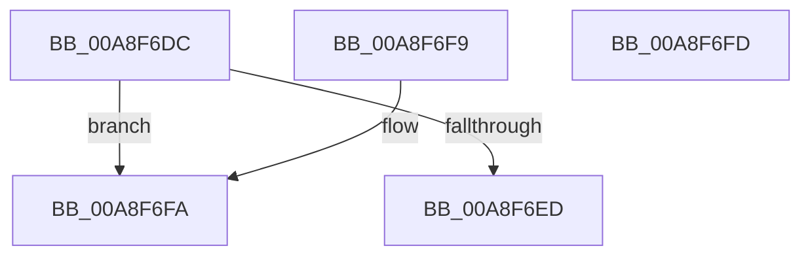

# MiIsProcessCfgExportSuppressionEnabled

- RVA: `0x00A8F6DC`–`0x00A8F6FE` (길이 `34` bytes)
- VA: `0x0000000140A8F6DC`
- 실행 섹션: `PAGE`
- PDB 이름 있음: `예`; PDB Function 태그: `아니요`
- unwind 정보 RVA: `0x000DB714`
- 디코드: `11`개 명령, `34/34` bytes 표시
- 미해석 바이트: `0` (있으면 어셈블리에 `.byte`로 보존)

> 이 문서는 커널 이미지의 기계어와 PDB 기호를 분석해 생성했습니다. 4번과 5번은 함수 원형과 자료형을 바이너리 사용 방식에서 추정한 C 해석이며 원본 소스 복구 결과는 아닙니다.

## 1. Dependencies

- 직접 호출 지점: **0**; 고유 호출 대상: **0**
- 직접 호출자로 확인된 함수: **2**
- RIP 상대 이미지 참조: **0**

### Outgoing calls
- 직접 디코드된 call 명령이 없습니다.

### Direct callers
- [MiCfgMarkValidEntries](../9F/MiCfgMarkValidEntries_function_009F4FE8.md) at `0x009F51E7`
- [MiCfgMarkValidEntries](../9F/MiCfgMarkValidEntries_function_009F4FE8.md) at `0x009F521D`
- [MiValidateUserCallTarget](../AC/MiValidateUserCallTarget_function_00AC09A0.md) at `0x00AC09F7`

### Static image references
- 디코드된 RIP-relative 메모리 참조가 없습니다.

## 2. Other-region calls and transfers

- 다른 실행 섹션으로 향하는 call: **0**
- 별도 외부 분기/꼬리 이동을 확인하지 못했습니다.

## 3. Assembly (complete function range)

```asm
00A8F6DC  48 8B 81 10 04 00 00            mov rax, qword ptr [rcx + 0x410]
00A8F6E3  48 83 B8 A8 04 00 00 00         cmp qword ptr [rax + 0x4a8], 0
00A8F6EB  74 0D                           je 0x140a8f6fa
00A8F6ED  8B 81 50 07 00 00               mov eax, dword ptr [rcx + 0x750]
00A8F6F3  D1 E8                           shr eax, 1
00A8F6F5  83 E0 01                        and eax, 1
00A8F6F8  C3                              ret
00A8F6F9  CC                              int3
00A8F6FA  33 C0                           xor eax, eax
00A8F6FC  C3                              ret
00A8F6FD  CC                              int3
```

## 4. C-style interpretation (structured pseudocode)

```c
__int64 __fastcall MiIsProcessCfgExportSuppressionEnabled(__int64 a1)
{
    __int64 result;

    if ((*(unsigned __int64 *)(*(unsigned __int64 *)(a1 + 1040) + 1192)) == 0) goto loc_00A8F6FA;
    result = (unsigned int)(((unsigned int)(*(unsigned int *)(a1 + 1872))) >> (1));
    result = (unsigned int)((result) & (1));
    return result;
loc_00A8F6FA:
    result = 0;
    return result;
}
```

## 5. (Beta) C Style

```c
int64_t MiIsProcessCfgExportSuppressionEnabled(void *Arg1)
{
    uint8_t *arg1 = (uint8_t *)Arg1;

    int64_t result;

    if ((*(uint64_t *)(*(uint64_t *)(arg1 + 0x410) + 0x4A8)) == 0) goto loc_00A8F6FA;
    result = (uint32_t)(((uint32_t)(*(uint32_t *)(arg1 + 0x750))) >> (1));
    result = (uint32_t)((result) & (1));
    return result;
loc_00A8F6FA:
    result = 0;
    return result;
}
```

### 관측된 메모리 오프셋

구조체 형식이 확인되지 않은 접근은 인자 기준의 오프셋으로만 기록했습니다.

| 기준 인자 | 오프셋 표현 | 폭 (bit) | 접근 |
|---|---:|---:|---|
| `Arg1` | `+ 0x410` | `64` | `R` |
| `Arg1` | `+ 0x750` | `32` | `R` |

## 6. Execution-region graph

[열기: 2D/3D 그래프와 함수 탐색 컨트롤 패널](../../../control-panel.html?section=page&rva=0x00A8F6DC&view=graph)

- 2D 그래프는 위에서 아래로 흐르고, 3D 그래프는 빈 공간을 드래그해 회전합니다. Shift+드래그는 이동, 휠은 확대·축소, 함수 노드 선택은 대상 보고서 이동입니다.

### Static fallback


