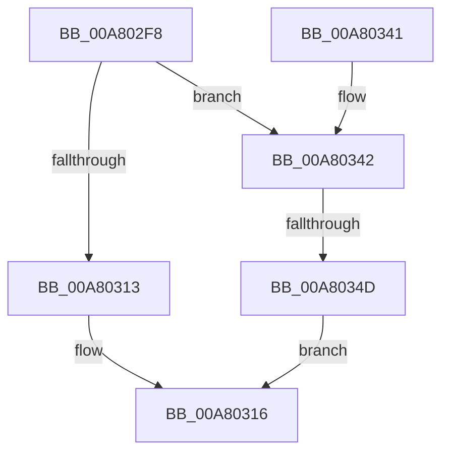

# MiLogMemResetInfo

- RVA: `0x00A802F8`–`0x00A80355` (길이 `93` bytes)
- VA: `0x0000000140A802F8`
- 실행 섹션: `PAGE`
- PDB 이름 있음: `예`; PDB Function 태그: `예`
- unwind 정보 RVA: `0x000B6FD4`
- 디코드: `23`개 명령, `93/93` bytes 표시
- 미해석 바이트: `0` (있으면 어셈블리에 `.byte`로 보존)

> 이 문서는 커널 이미지의 기계어와 PDB 기호를 분석해 생성했습니다. 4번과 5번은 함수 원형과 자료형을 바이너리 사용 방식에서 추정한 C 해석이며 원본 소스 복구 결과는 아닙니다.

## 1. Dependencies

- 직접 호출 지점: **1**; 고유 호출 대상: **1**
- 직접 호출자로 확인된 함수: **1**
- RIP 상대 이미지 참조: **0**

### Outgoing calls
- `0x00A80337` → [MiLogPerfMemoryEvent](../../text/23/MiLogPerfMemoryEvent_function_002369C8.md) (function, `0x002369C8`)

### Direct callers
- [MiAllocateVirtualMemory](../88/MiAllocateVirtualMemory_function_00883B40.md) at `0x008841BC`
- [MiAllocateVirtualMemory](../88/MiAllocateVirtualMemory_function_00883B40.md) at `0x008843C0`

### Static image references
- 디코드된 RIP-relative 메모리 참조가 없습니다.

## 2. Other-region calls and transfers

- 다른 실행 섹션으로 향하는 call: **1**
  - `0x00A80337` → [MiLogPerfMemoryEvent](../../text/23/MiLogPerfMemoryEvent_function_002369C8.md) (`PAGE` → `.text`)
- call이 아닌 외부 분기/꼬리 이동: **1**
  - `0x00A80347` → [sub_00B42D4A](../B4/Unknown_function_00B42D4A.md) (`tail-transfer`)

## 3. Assembly (complete function range)

```asm
00A802F8  48 83 EC 58                     sub rsp, 0x58
00A802FC  33 C0                           xor eax, eax
00A802FE  48 89 4C 24 30                  mov qword ptr [rsp + 0x30], rcx
00A80303  89 44 24 44                     mov dword ptr [rsp + 0x44], eax
00A80307  48 89 54 24 38                  mov qword ptr [rsp + 0x38], rdx
00A8030C  41 0F BA E0 13                  bt r8d, 0x13
00A80311  73 2F                           jae 0x140a80342
00A80313  83 E0 FC                        and eax, 0xfffffffc
00A80316  B9 86 02 00 00                  mov ecx, 0x286
00A8031B  89 44 24 40                     mov dword ptr [rsp + 0x40], eax
00A8031F  41 B9 14 00 00 00               mov r9d, 0x14
00A80325  C7 44 24 20 02 19 50 00         mov dword ptr [rsp + 0x20], 0x501902
00A8032D  4C 8D 44 24 30                  lea r8, [rsp + 0x30]
00A80332  BA 00 80 00 20                  mov edx, 0x20008000
00A80337  E8 8C 66 7B FF                  call 0x1402369c8
00A8033C  48 83 C4 58                     add rsp, 0x58
00A80340  C3                              ret
00A80341  CC                              int3
00A80342  41 0F BA E0 18                  bt r8d, 0x18
00A80347  0F 83 FD 29 0C 00               jae 0x140b42d4a
00A8034D  83 E0 FD                        and eax, 0xfffffffd
00A80350  83 C8 01                        or eax, 1
00A80353  EB C1                           jmp 0x140a80316
```

## 4. C-style interpretation (structured pseudocode)

```c
__int64 __fastcall MiLogMemResetInfo(__int64 a1, __int64 a2, int a3)
{
    __int64 result;
    __int64 v_rsp;
    unsigned int v_stack_m14;
    unsigned int v_stack_m18;
    unsigned __int64 v_stack_m20;
    unsigned __int64 v_stack_m28;
    unsigned int v_stack_m38;

    v_rsp = (v_rsp) - (88);
    result = 0;
    v_stack_m28 = a1;
    v_stack_m14 = 0;
    v_stack_m20 = a2;
    if (condition_is_above_or_equal) goto loc_00A80342;
    result = (unsigned int)((result) & (0xFFFFFFFCULL));
loc_00A80316:
    v_stack_m18 = (unsigned int)(result);
    v_stack_m38 = 0x501902ULL;
    result = MiLogPerfMemoryEvent(646, (unsigned int)(0x20008000ULL), v_stack_m28, 20);
    v_rsp = (v_rsp) + (88);
    return result;
loc_00A80342:
    result = (unsigned int)((result) & (0xFFFFFFFDULL));
    result = (unsigned int)((result) | (1));
    goto loc_00A80316;
}
```

## 5. (Beta) C Style

```c
int64_t MiLogMemResetInfo(int64_t Arg1, int64_t Arg2, int32_t Arg3)
{
    int64_t result;
    int64_t local_rsp;
    uint32_t v_stack_m14;
    uint32_t v_stack_m18;
    uint64_t v_stack_m20;
    uint64_t v_stack_m28;
    uint32_t v_stack_m38;

    local_rsp = (local_rsp) - (88);
    result = 0;
    v_stack_m28 = Arg1;
    v_stack_m14 = 0;
    v_stack_m20 = Arg2;
    if (condition_is_above_or_equal) goto loc_00A80342;
    result = (uint32_t)((result) & (0xFFFFFFFCULL));
loc_00A80316:
    v_stack_m18 = (uint32_t)(result);
    v_stack_m38 = 0x501902ULL;
    result = MiLogPerfMemoryEvent(646, (uint32_t)(0x20008000ULL), v_stack_m28, 20);
    local_rsp = (local_rsp) + (88);
    return result;
loc_00A80342:
    result = (uint32_t)((result) & (0xFFFFFFFDULL));
    result = (uint32_t)((result) | (1));
    goto loc_00A80316;
}
```

## 6. Execution-region graph

[열기: 2D/3D 그래프와 함수 탐색 컨트롤 패널](../../../control-panel.html?section=page&rva=0x00A802F8&view=graph)

- 2D 그래프는 위에서 아래로 흐르고, 3D 그래프는 빈 공간을 드래그해 회전합니다. Shift+드래그는 이동, 휠은 확대·축소, 함수 노드 선택은 대상 보고서 이동입니다.

### Static fallback


