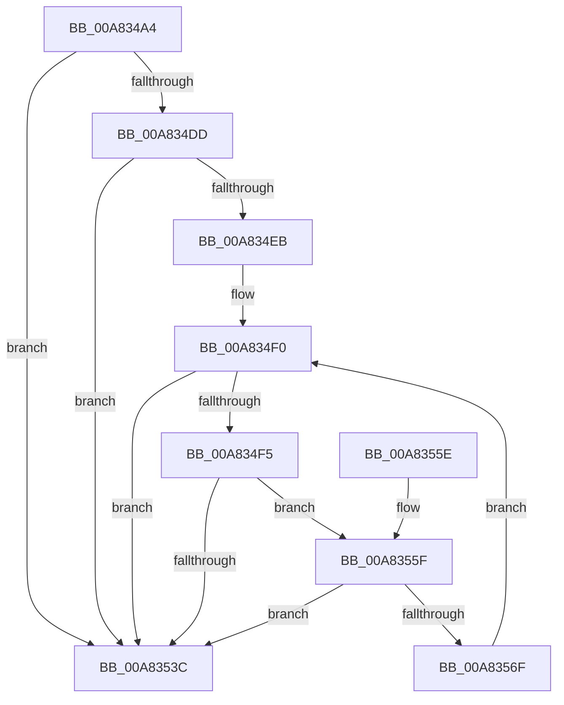

# MiReserveWorkingSetSwapSpaceRuns

- RVA: `0x00A834A4`–`0x00A83574` (길이 `208` bytes)
- VA: `0x0000000140A834A4`
- 실행 섹션: `PAGE`
- PDB 이름 있음: `예`; PDB Function 태그: `아니요`
- unwind 정보 RVA: `0x000B7474`
- 디코드: `61`개 명령, `208/208` bytes 표시
- 미해석 바이트: `0` (있으면 어셈블리에 `.byte`로 보존)

> 이 문서는 커널 이미지의 기계어와 PDB 기호를 분석해 생성했습니다. 4번과 5번은 함수 원형과 자료형을 바이너리 사용 방식에서 추정한 C 해석이며 원본 소스 복구 결과는 아닙니다.

## 1. Dependencies

- 직접 호출 지점: **2**; 고유 호출 대상: **2**
- 직접 호출자로 확인된 함수: **1**
- RIP 상대 이미지 참조: **0**

### Outgoing calls
- `0x00A834FF` → [MiMakePageFilePte](../../text/38/MiMakePageFilePte_function_003823C8.md) (function, `0x003823C8`)
- `0x00A83522` → [MiFindFreePageFileSpace](../../text/3E/MiFindFreePageFileSpace_function_003E2CAC.md) (function, `0x003E2CAC`)

### Direct callers
- [MiReserveWorkingSetSwapSpace](MiReserveWorkingSetSwapSpace_function_00A833E4.md) at `0x00A8343B`

### Static image references
- 디코드된 RIP-relative 메모리 참조가 없습니다.

## 2. Other-region calls and transfers

- 다른 실행 섹션으로 향하는 call: **2**
  - `0x00A834FF` → [MiMakePageFilePte](../../text/38/MiMakePageFilePte_function_003823C8.md) (`PAGE` → `.text`)
  - `0x00A83522` → [MiFindFreePageFileSpace](../../text/3E/MiFindFreePageFileSpace_function_003E2CAC.md) (`PAGE` → `.text`)
- 별도 외부 분기/꼬리 이동을 확인하지 못했습니다.

## 3. Assembly (complete function range)

```asm
00A834A4  48 8B C4                        mov rax, rsp
00A834A7  48 89 58 08                     mov qword ptr [rax + 8], rbx
00A834AB  48 89 68 10                     mov qword ptr [rax + 0x10], rbp
00A834AF  48 89 70 18                     mov qword ptr [rax + 0x18], rsi
00A834B3  48 89 78 20                     mov qword ptr [rax + 0x20], rdi
00A834B7  41 54                           push r12
00A834B9  41 56                           push r14
00A834BB  41 57                           push r15
00A834BD  48 83 EC 20                     sub rsp, 0x20
00A834C1  45 8B F8                        mov r15d, r8d
00A834C4  48 8B DA                        mov rbx, rdx
00A834C7  45 8B E1                        mov r12d, r9d
00A834CA  4C 8B F1                        mov r14, rcx
00A834CD  4A 8B 84 F9 60 48 00 00         mov rax, qword ptr [rcx + r15*8 + 0x4860]
00A834D5  8B 40 14                        mov eax, dword ptr [rax + 0x14]
00A834D8  48 3B C2                        cmp rax, rdx
00A834DB  72 5F                           jb 0x140a8353c
00A834DD  48 8B 7C 24 60                  mov rdi, qword ptr [rsp + 0x60]
00A834E2  48 8D 6F 50                     lea rbp, [rdi + 0x50]
00A834E6  48 3B FD                        cmp rdi, rbp
00A834E9  73 51                           jae 0x140a8353c
00A834EB  BE 50 00 00 00                  mov esi, 0x50
00A834F0  48 85 DB                        test rbx, rbx
00A834F3  74 47                           je 0x140a8353c
00A834F5  49 8B D7                        mov rdx, r15
00A834F8  49 8B CC                        mov rcx, r12
00A834FB  48 C1 E2 0C                     shl rdx, 0xc
00A834FF  E8 C4 EE 8F FF                  call 0x1403823c8
00A83504  48 33 C2                        xor rax, rdx
00A83507  41 B9 29 00 00 00               mov r9d, 0x29
00A8350D  48 25 FF 0F FF FF               and rax, 0xffffffffffff0fff
00A83513  4C 8B C3                        mov r8, rbx
00A83516  48 33 C2                        xor rax, rdx
00A83519  49 8B CE                        mov rcx, r14
00A8351C  48 8B D7                        mov rdx, rdi
00A8351F  48 89 07                        mov qword ptr [rdi], rax
00A83522  E8 85 F7 95 FF                  call 0x1403e2cac
00A83527  8B C0                           mov eax, eax
00A83529  48 8B CE                        mov rcx, rsi
00A8352C  48 C1 F9 04                     sar rcx, 4
00A83530  48 0F AF C8                     imul rcx, rax
00A83534  89 47 08                        mov dword ptr [rdi + 8], eax
00A83537  48 3B CB                        cmp rcx, rbx
00A8353A  73 23                           jae 0x140a8355f
00A8353C  48 8B 6C 24 48                  mov rbp, qword ptr [rsp + 0x48]
00A83541  48 8B C3                        mov rax, rbx
00A83544  48 8B 5C 24 40                  mov rbx, qword ptr [rsp + 0x40]
00A83549  48 8B 74 24 50                  mov rsi, qword ptr [rsp + 0x50]
00A8354E  48 8B 7C 24 58                  mov rdi, qword ptr [rsp + 0x58]
00A83553  48 83 C4 20                     add rsp, 0x20
00A83557  41 5F                           pop r15
00A83559  41 5E                           pop r14
00A8355B  41 5C                           pop r12
00A8355D  C3                              ret
00A8355E  CC                              int3
00A8355F  48 2B D8                        sub rbx, rax
00A83562  48 83 C7 10                     add rdi, 0x10
00A83566  48 83 EE 10                     sub rsi, 0x10
00A8356A  48 3B FD                        cmp rdi, rbp
00A8356D  73 CD                           jae 0x140a8353c
00A8356F  E9 7C FF FF FF                  jmp 0x140a834f0
```

## 4. C-style interpretation (structured pseudocode)

```c
__int64 __fastcall MiReserveWorkingSetSwapSpaceRuns(__int64 a1, __int64 a2, int a3, int a4, __int64 a5)
{
    __int64 result;
    __int64 v_rbx;
    __int64 v_rdi;
    __int64 v_rsi;
    __int64 v_rsp;
    unsigned __int64 v_stack_p10;
    unsigned __int64 v_stack_p18;
    unsigned __int64 v_stack_p20;
    unsigned __int64 v_stack_p8;

    *(unsigned __int64 *)(v_rsp + 8) = v_rbx;
    *(unsigned __int64 *)(v_rsp + 16) = v_rbp;
    *(unsigned __int64 *)(v_rsp + 24) = v_rsi;
    *(unsigned __int64 *)(v_rsp + 32) = v_rdi;
    v_rsp = (v_rsp) - (32);
    if (((unsigned int)(*(unsigned int *)(*(unsigned __int64 *)(a1 + (unsigned int)(a3) * 8 + 18528) + 20))) < a2) goto loc_00A8353C;
    if (a5 >= (a5 + 80)) goto loc_00A8353C;
loc_00A834F0:
    if (a2 == 0) goto loc_00A8353C;
    a2 = ((unsigned int)(a3)) << (12);
    result = MiMakePageFilePte((unsigned int)(a4), a2, a3, a4);
    result = (result) ^ (a2);
    result = (result) & (0xFFFFFFFFFFFF0FFFULL);
    result = (result) ^ (a2);
    *(unsigned __int64 *)(a5) = result;
    result = MiFindFreePageFileSpace(a1, a5, a2, 41);
    a1 = (80) >> (4);
    a1 = (a1) * ((unsigned int)((unsigned int)(result)));
    *(unsigned int *)(a5 + 8) = (unsigned int)((unsigned int)((unsigned int)(result)));
    if (a1 >= a2) goto loc_00A8355F;
loc_00A8353C:
    v_rsp = (v_rsp) + (32);
    return a2;
loc_00A8355F:
    v_rbx = (v_stack_p8) - (a2);
    v_rdi = (v_stack_p20) + (16);
    v_rsi = (v_stack_p18) - (16);
    if (v_rdi >= v_stack_p10) goto loc_00A8353C;
    goto loc_00A834F0;
}
```

## 5. (Beta) C Style

```c
int64_t MiReserveWorkingSetSwapSpaceRuns(void *Arg1, int64_t Arg2, int32_t Arg3, int32_t Arg4, void *Arg5)
{
    uint8_t *arg1 = (uint8_t *)Arg1;
    uint8_t *arg5 = (uint8_t *)Arg5;

    int64_t result;
    int64_t local_rbx;
    int64_t local_rdi;
    int64_t local_rsi;
    int64_t local_rsp;
    uint64_t v_stack_p10;
    uint64_t v_stack_p18;
    uint64_t v_stack_p20;
    uint64_t v_stack_p8;

    *(uint64_t *)(local_rsp + 0x8) = local_rbx;
    *(uint64_t *)(local_rsp + 0x10) = local_rbp;
    *(uint64_t *)(local_rsp + 0x18) = local_rsi;
    *(uint64_t *)(local_rsp + 0x20) = local_rdi;
    local_rsp = (local_rsp) - (32);
    if (((uint32_t)(*(uint32_t *)(*(uint64_t *)(arg1 + (uint32_t)(Arg3) * 8 + 0x4860) + 0x14))) < Arg2) goto loc_00A8353C;
    if (Arg5 >= (Arg5 + 80)) goto loc_00A8353C;
loc_00A834F0:
    if (Arg2 == 0) goto loc_00A8353C;
    Arg2 = ((uint32_t)(Arg3)) << (12);
    result = MiMakePageFilePte((uint32_t)(Arg4), Arg2, Arg3, Arg4);
    result = (result) ^ (Arg2);
    result = (result) & (0xFFFFFFFFFFFF0FFFULL);
    result = (result) ^ (Arg2);
    *(uint64_t *)(arg5) = result;
    result = MiFindFreePageFileSpace(Arg1, Arg5, Arg2, 41);
    Arg1 = (80) >> (4);
    Arg1 = (Arg1) * ((uint32_t)((uint32_t)(result)));
    *(uint32_t *)(arg5 + 0x8) = (uint32_t)((uint32_t)((uint32_t)(result)));
    if (Arg1 >= Arg2) goto loc_00A8355F;
loc_00A8353C:
    local_rsp = (local_rsp) + (32);
    return Arg2;
loc_00A8355F:
    local_rbx = (v_stack_p8) - (Arg2);
    local_rdi = (v_stack_p20) + (16);
    local_rsi = (v_stack_p18) - (16);
    if (local_rdi >= v_stack_p10) goto loc_00A8353C;
    goto loc_00A834F0;
}
```

### 관측된 메모리 오프셋

구조체 형식이 확인되지 않은 접근은 인자 기준의 오프셋으로만 기록했습니다.

| 기준 인자 | 오프셋 표현 | 폭 (bit) | 접근 |
|---|---:|---:|---|
| `Arg1` | `+ 0x4860 + r15*8` | `64` | `R` |
| `Arg5` | `+ 0x50` | `64` | `R` |

## 6. Execution-region graph

[열기: 2D/3D 그래프와 함수 탐색 컨트롤 패널](../../../control-panel.html?section=page&rva=0x00A834A4&view=graph)

- 2D 그래프는 위에서 아래로 흐르고, 3D 그래프는 빈 공간을 드래그해 회전합니다. Shift+드래그는 이동, 휠은 확대·축소, 함수 노드 선택은 대상 보고서 이동입니다.

### Static fallback


