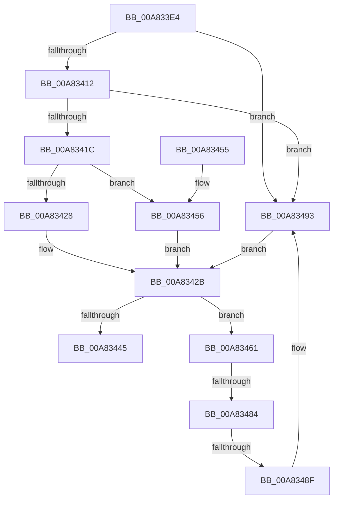

# MiReserveWorkingSetSwapSpace

- RVA: `0x00A833E4`–`0x00A8349B` (길이 `183` bytes)
- VA: `0x0000000140A833E4`
- 실행 섹션: `PAGE`
- PDB 이름 있음: `예`; PDB Function 태그: `예`
- unwind 정보 RVA: `0x000B7450`
- 디코드: `49`개 명령, `183/183` bytes 표시
- 미해석 바이트: `0` (있으면 어셈블리에 `.byte`로 보존)

> 이 문서는 커널 이미지의 기계어와 PDB 기호를 분석해 생성했습니다. 4번과 5번은 함수 원형과 자료형을 바이너리 사용 방식에서 추정한 C 해석이며 원본 소스 복구 결과는 아닙니다.

## 1. Dependencies

- 직접 호출 지점: **3**; 고유 호출 대상: **3**
- 직접 호출자로 확인된 함수: **2**
- RIP 상대 이미지 참조: **0**

### Outgoing calls
- `0x00A8343B` → [MiReserveWorkingSetSwapSpaceRuns](MiReserveWorkingSetSwapSpaceRuns_function_00A834A4.md) (function, `0x00A834A4`)
- `0x00A83467` → [MiFreeReservationRuns](../A4/MiFreeReservationRuns_function_00A4AB28.md) (function, `0x00A4AB28`)
- `0x00A83475` → [memset](../../text/6C/memset_function_006C6C40.md) (function, `0x006C6C40`)

### Direct callers
- [MmOutSwapWorkingSet](../../text/2A/MmOutSwapWorkingSet_function_002A6BC8.md) at `0x002A6FBA`
- [MmOutSwapVirtualAddresses](../../text/2A/MmOutSwapVirtualAddresses_function_002A8C30.md) at `0x002A8D23`

### Static image references
- 디코드된 RIP-relative 메모리 참조가 없습니다.

## 2. Other-region calls and transfers

- 다른 실행 섹션으로 향하는 call: **1**
  - `0x00A83475` → [memset](../../text/6C/memset_function_006C6C40.md) (`PAGE` → `.text`)
- call이 아닌 외부 분기/꼬리 이동: **2**
  - `0x00A8347E` → [sub_00B43DD8](../B4/Unknown_function_00B43DD8.md) (`tail-transfer`)
  - `0x00A83489` → [sub_00B43DD8](../B4/Unknown_function_00B43DD8.md) (`tail-transfer`)

## 3. Assembly (complete function range)

```asm
00A833E4  48 89 5C 24 08                  mov qword ptr [rsp + 8], rbx
00A833E9  48 89 6C 24 10                  mov qword ptr [rsp + 0x10], rbp
00A833EE  56                              push rsi
00A833EF  48 83 EC 30                     sub rsp, 0x30
00A833F3  45 8B D1                        mov r10d, r9d
00A833F6  48 8B F2                        mov rsi, rdx
00A833F9  48 8B E9                        mov rbp, rcx
00A833FC  4A 8B 84 D1 60 48 00 00         mov rax, qword ptr [rcx + r10*8 + 0x4860]
00A83404  41 8B D9                        mov ebx, r9d
00A83407  44 3B 4C 24 60                  cmp r9d, dword ptr [rsp + 0x60]
00A8340C  0F 84 81 00 00 00               je 0x140a83493
00A83412  83 7C 24 60 10                  cmp dword ptr [rsp + 0x60], 0x10
00A83417  41 8B DA                        mov ebx, r10d
00A8341A  74 77                           je 0x140a83493
00A8341C  44 8B 08                        mov r9d, dword ptr [rax]
00A8341F  F6 80 AC 00 00 00 20            test byte ptr [rax + 0xac], 0x20
00A83426  74 2E                           je 0x140a83456
00A83428  41 D1 E9                        shr r9d, 1
00A8342B  48 8B 54 24 68                  mov rdx, qword ptr [rsp + 0x68]
00A83430  44 8B C3                        mov r8d, ebx
00A83433  48 8B CD                        mov rcx, rbp
00A83436  48 89 74 24 20                  mov qword ptr [rsp + 0x20], rsi
00A8343B  E8 64 00 00 00                  call 0x140a834a4
00A83440  48 85 C0                        test rax, rax
00A83443  75 1C                           jne 0x140a83461
00A83445  48 8B 5C 24 40                  mov rbx, qword ptr [rsp + 0x40]
00A8344A  48 8B 6C 24 48                  mov rbp, qword ptr [rsp + 0x48]
00A8344F  48 83 C4 30                     add rsp, 0x30
00A83453  5E                              pop rsi
00A83454  C3                              ret
00A83455  CC                              int3
00A83456  41 8B C1                        mov eax, r9d
00A83459  C1 E8 06                        shr eax, 6
00A8345C  44 2B C8                        sub r9d, eax
00A8345F  EB CA                           jmp 0x140a8342b
00A83461  48 8B D6                        mov rdx, rsi
00A83464  48 8B CD                        mov rcx, rbp
00A83467  E8 BC 76 FC FF                  call 0x140a4ab28
00A8346C  33 D2                           xor edx, edx
00A8346E  48 8B CE                        mov rcx, rsi
00A83471  44 8D 42 50                     lea r8d, [rdx + 0x50]
00A83475  E8 C6 37 C4 FF                  call 0x1406c6c40
00A8347A  3B 5C 24 60                     cmp ebx, dword ptr [rsp + 0x60]
00A8347E  0F 84 54 09 0C 00               je 0x140b43dd8
00A83484  83 7C 24 60 10                  cmp dword ptr [rsp + 0x60], 0x10
00A83489  0F 83 49 09 0C 00               jae 0x140b43dd8
00A8348F  8B 5C 24 60                     mov ebx, dword ptr [rsp + 0x60]
00A83493  41 B9 01 00 00 00               mov r9d, 1
00A83499  EB 90                           jmp 0x140a8342b
```

## 4. C-style interpretation (structured pseudocode)

```c
__int64 __fastcall MiReserveWorkingSetSwapSpace(__int64 a1, __int64 a2, __int64 a3, int a4, unsigned int a5, __int64 a6)
{
    __int64 result;
    __int64 v_rsp;
    unsigned __int64 v_stack_m18;
    unsigned __int64 v_stack_p10;
    unsigned __int64 v_stack_p8;

    v_stack_p8 = v_rbx;
    v_stack_p10 = v_rbp;
    v_rsp = (v_rsp) - (48);
    if (a4 == a5) goto loc_00A83493;
    if (a5 == 16) goto loc_00A83493;
    if (((*(unsigned __int8 *)(*(unsigned __int64 *)(a1 + (unsigned int)(a4) * 8 + 18528) + 172)) & (32)) == 0) goto loc_00A83456;
    a4 = (unsigned int)(((unsigned int)(*(unsigned int *)(*(unsigned __int64 *)(a1 + (unsigned int)(a4) * 8 + 18528)))) >> (1));
loc_00A8342B:
    v_stack_m18 = a2;
    result = MiReserveWorkingSetSwapSpaceRuns(a1, a6, (unsigned int)((unsigned int)((unsigned int)((unsigned int)((unsigned int)(a4))))), a4);
    if (result != 0) goto loc_00A83461;
    v_rsp = (v_rsp) + (48);
    return result;
loc_00A83456:
    result = (unsigned int)(((unsigned int)(a4)) >> (6));
    a4 = (unsigned int)((a4) - ((unsigned int)(result)));
    goto loc_00A8342B;
loc_00A83461:
    result = MiFreeReservationRuns(v_stack_p10, a2, (unsigned int)((unsigned int)((unsigned int)((unsigned int)((unsigned int)(a4))))), a4);
    a2 = 0;
    result = memset(0, a2, a2 + 80, a4);
loc_00A83493:
    goto loc_00A8342B;
}
```

## 5. (Beta) C Style

```c
int64_t MiReserveWorkingSetSwapSpace(void *Arg1, int64_t Arg2, int64_t Arg3, int32_t Arg4, uint32_t Arg5, int64_t Arg6)
{
    uint8_t *arg1 = (uint8_t *)Arg1;

    int64_t result;
    int64_t local_rsp;
    uint64_t v_stack_m18;
    uint64_t v_stack_p10;
    uint64_t v_stack_p8;

    v_stack_p8 = local_rbx;
    v_stack_p10 = local_rbp;
    local_rsp = (local_rsp) - (48);
    if (Arg4 == Arg5) goto loc_00A83493;
    if (Arg5 == 16) goto loc_00A83493;
    if (((*(uint8_t *)(*(uint64_t *)(arg1 + (uint32_t)(Arg4) * 8 + 0x4860) + 0xAC)) & (32)) == 0) goto loc_00A83456;
    Arg4 = (uint32_t)(((uint32_t)(*(uint32_t *)(*(uint64_t *)(arg1 + (uint32_t)(Arg4) * 8 + 0x4860)))) >> (1));
loc_00A8342B:
    v_stack_m18 = Arg2;
    result = MiReserveWorkingSetSwapSpaceRuns(Arg1, Arg6, (uint32_t)((uint32_t)((uint32_t)((uint32_t)((uint32_t)(Arg4))))), Arg4);
    if (result != 0) goto loc_00A83461;
    local_rsp = (local_rsp) + (48);
    return result;
loc_00A83456:
    result = (uint32_t)(((uint32_t)(Arg4)) >> (6));
    Arg4 = (uint32_t)((Arg4) - ((uint32_t)(result)));
    goto loc_00A8342B;
loc_00A83461:
    result = MiFreeReservationRuns(v_stack_p10, Arg2, (uint32_t)((uint32_t)((uint32_t)((uint32_t)((uint32_t)(Arg4))))), Arg4);
    Arg2 = 0;
    result = memset(0, Arg2, Arg2 + 80, Arg4);
loc_00A83493:
    goto loc_00A8342B;
}
```

### 관측된 메모리 오프셋

구조체 형식이 확인되지 않은 접근은 인자 기준의 오프셋으로만 기록했습니다.

| 기준 인자 | 오프셋 표현 | 폭 (bit) | 접근 |
|---|---:|---:|---|
| `Arg1` | `+ 0x4860 + r10*8` | `64` | `R` |

## 6. Execution-region graph

[열기: 2D/3D 그래프와 함수 탐색 컨트롤 패널](../../../control-panel.html?section=page&rva=0x00A833E4&view=graph)

- 2D 그래프는 위에서 아래로 흐르고, 3D 그래프는 빈 공간을 드래그해 회전합니다. Shift+드래그는 이동, 휠은 확대·축소, 함수 노드 선택은 대상 보고서 이동입니다.

### Static fallback


