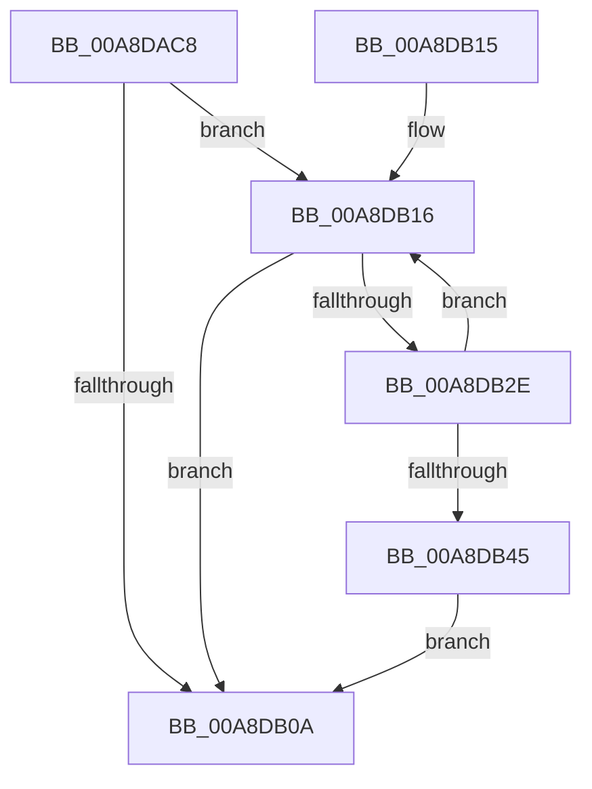

# MiUpdateVadBits

- RVA: `0x00A8DAC8`–`0x00A8DB47` (길이 `127` bytes)
- VA: `0x0000000140A8DAC8`
- 실행 섹션: `PAGE`
- PDB 이름 있음: `예`; PDB Function 태그: `아니요`
- unwind 정보 RVA: `0x00070B28`
- 디코드: `35`개 명령, `127/127` bytes 표시
- 미해석 바이트: `0` (있으면 어셈블리에 `.byte`로 보존)

> 이 문서는 커널 이미지의 기계어와 PDB 기호를 분석해 생성했습니다. 4번과 5번은 함수 원형과 자료형을 바이너리 사용 방식에서 추정한 C 해석이며 원본 소스 복구 결과는 아닙니다.

## 1. Dependencies

- 직접 호출 지점: **3**; 고유 호출 대상: **3**
- 직접 호출자로 확인된 함수: **2**
- RIP 상대 이미지 참조: **0**

### Outgoing calls
- `0x00A8DAFD` → [MiLocateLowestConflictingVad](../../text/44/MiLocateLowestConflictingVad_function_0044BD14.md) (function, `0x0044BD14`)
- `0x00A8DB19` → [MiSetVadBits](../88/MiSetVadBits_function_008870D8.md) (function, `0x008870D8`)
- `0x00A8DB21` → [MiGetNextVad](../../text/29/MiGetNextVad_function_00297224.md) (function, `0x00297224`)

### Direct callers
- [MiExpandVadBitMap](../88/MiExpandVadBitMap_function_00886574.md) at `0x008866CB`
- [sub_00B47882](../B4/Unknown_function_00B47882.md) at `0x00B478A8`

### Static image references
- 디코드된 RIP-relative 메모리 참조가 없습니다.

## 2. Other-region calls and transfers

- 다른 실행 섹션으로 향하는 call: **2**
  - `0x00A8DAFD` → [MiLocateLowestConflictingVad](../../text/44/MiLocateLowestConflictingVad_function_0044BD14.md) (`PAGE` → `.text`)
  - `0x00A8DB21` → [MiGetNextVad](../../text/29/MiGetNextVad_function_00297224.md) (`PAGE` → `.text`)
- 별도 외부 분기/꼬리 이동을 확인하지 못했습니다.

## 3. Assembly (complete function range)

```asm
00A8DAC8  48 89 5C 24 08                  mov qword ptr [rsp + 8], rbx
00A8DACD  57                              push rdi
00A8DACE  48 83 EC 20                     sub rsp, 0x20
00A8DAD2  48 3B D1                        cmp rdx, rcx
00A8DAD5  48 8B C1                        mov rax, rcx
00A8DAD8  65 48 8B 0C 25 88 01 00 00      mov rcx, qword ptr gs:[0x188]
00A8DAE1  48 BF FF FF FE FF FF 7F 00 00   movabs rdi, 0x7ffffffeffff
00A8DAEB  48 0F 43 FA                     cmovae rdi, rdx
00A8DAEF  48 8B D0                        mov rdx, rax
00A8DAF2  48 8B 89 B8 00 00 00            mov rcx, qword ptr [rcx + 0xb8]
00A8DAF9  4C 8D 47 FF                     lea r8, [rdi - 1]
00A8DAFD  E8 12 E2 9B FF                  call 0x14044bd14
00A8DB02  48 8B D8                        mov rbx, rax
00A8DB05  48 85 C0                        test rax, rax
00A8DB08  75 0C                           jne 0x140a8db16
00A8DB0A  48 8B 5C 24 30                  mov rbx, qword ptr [rsp + 0x30]
00A8DB0F  48 83 C4 20                     add rsp, 0x20
00A8DB13  5F                              pop rdi
00A8DB14  C3                              ret
00A8DB15  CC                              int3
00A8DB16  48 8B CB                        mov rcx, rbx
00A8DB19  E8 BA 95 DF FF                  call 0x1408870d8
00A8DB1E  48 8B CB                        mov rcx, rbx
00A8DB21  E8 FE 96 80 FF                  call 0x140297224
00A8DB26  48 8B D8                        mov rbx, rax
00A8DB29  48 85 C0                        test rax, rax
00A8DB2C  74 DC                           je 0x140a8db0a
00A8DB2E  0F B6 48 20                     movzx ecx, byte ptr [rax + 0x20]
00A8DB32  8B 40 18                        mov eax, dword ptr [rax + 0x18]
00A8DB35  48 C1 E1 20                     shl rcx, 0x20
00A8DB39  48 0B C8                        or rcx, rax
00A8DB3C  48 C1 E1 0C                     shl rcx, 0xc
00A8DB40  48 3B CF                        cmp rcx, rdi
00A8DB43  72 D1                           jb 0x140a8db16
00A8DB45  EB C3                           jmp 0x140a8db0a
```

## 4. C-style interpretation (structured pseudocode)

```c
__int64 __fastcall MiUpdateVadBits(__int64 a1, __int64 a2)
{
    __int64 result;
    __int64 v_rdi;
    __int64 v_rsp;
    unsigned __int64 v_stack_p8;

    v_stack_p8 = v_rbx;
    v_rsp = (v_rsp) - (32);
    if (a2 >= a1) { v_rdi = a2; }
    result = MiLocateLowestConflictingVad(*(unsigned __int64 *)(*(unsigned __int64 *)(gs_base + (0 + 392)) + 184), a1, v_rdi - 1, a4);
    if (result != 0) goto loc_00A8DB16;
loc_00A8DB0A:
    v_rsp = (v_rsp) + (32);
    return result;
loc_00A8DB16:
    result = MiSetVadBits(v_stack_p8, a1, v_rdi - 1, a4);
    result = MiGetNextVad(v_stack_p8, a1, v_rdi - 1, a4);
    if (result == 0) goto loc_00A8DB0A;
    a1 = (*(unsigned __int8 *)(result + 32)) << (32);
    a1 = (a1) | ((unsigned int)(*(unsigned int *)(result + 24)));
    a1 = (a1) << (12);
    if (a1 < v_rdi) goto loc_00A8DB16;
    goto loc_00A8DB0A;
}
```

## 5. (Beta) C Style

```c
int64_t MiUpdateVadBits(int64_t Arg1, int64_t Arg2)
{
    int64_t result;
    int64_t local_rdi;
    int64_t local_rsp;
    uint64_t v_stack_p8;

    v_stack_p8 = local_rbx;
    local_rsp = (local_rsp) - (32);
    if (Arg2 >= Arg1) { local_rdi = Arg2; }
    result = MiLocateLowestConflictingVad(*(uint64_t *)(*(uint64_t *)(gs_base + (0 + 0x188)) + 0xB8), Arg1, local_rdi - 1, a4);
    if (result != 0) goto loc_00A8DB16;
loc_00A8DB0A:
    local_rsp = (local_rsp) + (32);
    return result;
loc_00A8DB16:
    result = MiSetVadBits(v_stack_p8, Arg1, local_rdi - 1, a4);
    result = MiGetNextVad(v_stack_p8, Arg1, local_rdi - 1, a4);
    if (result == 0) goto loc_00A8DB0A;
    Arg1 = (*(uint8_t *)(result + 0x20)) << (32);
    Arg1 = (Arg1) | ((uint32_t)(*(uint32_t *)(result + 0x18)));
    Arg1 = (Arg1) << (12);
    if (Arg1 < local_rdi) goto loc_00A8DB16;
    goto loc_00A8DB0A;
}
```

## 6. Execution-region graph

[열기: 2D/3D 그래프와 함수 탐색 컨트롤 패널](../../../control-panel.html?section=page&rva=0x00A8DAC8&view=graph)

- 2D 그래프는 위에서 아래로 흐르고, 3D 그래프는 빈 공간을 드래그해 회전합니다. Shift+드래그는 이동, 휠은 확대·축소, 함수 노드 선택은 대상 보고서 이동입니다.

### Static fallback


