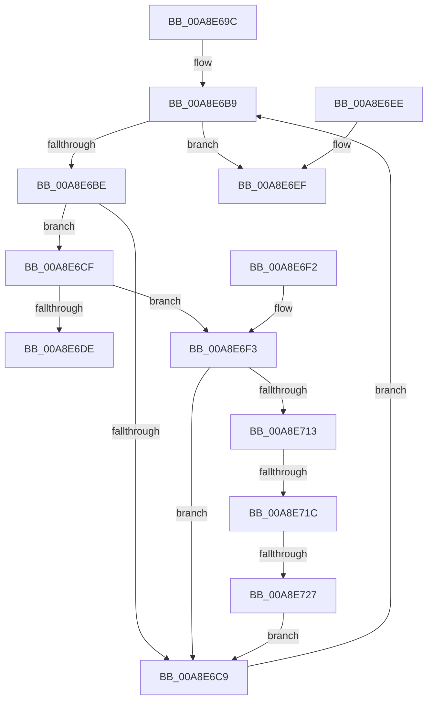

# MiValidateStrongCodeDriverImage

- RVA: `0x00A8E69C`–`0x00A8E729` (길이 `141` bytes)
- VA: `0x0000000140A8E69C`
- 실행 섹션: `PAGE`
- PDB 이름 있음: `예`; PDB Function 태그: `예`
- unwind 정보 RVA: `0x000DB714`
- 디코드: `38`개 명령, `141/141` bytes 표시
- 미해석 바이트: `0` (있으면 어셈블리에 `.byte`로 보존)

> 이 문서는 커널 이미지의 기계어와 PDB 기호를 분석해 생성했습니다. 4번과 5번은 함수 원형과 자료형을 바이너리 사용 방식에서 추정한 C 해석이며 원본 소스 복구 결과는 아닙니다.

## 1. Dependencies

- 직접 호출 지점: **0**; 고유 호출 대상: **0**
- 직접 호출자로 확인된 함수: **1**
- RIP 상대 이미지 참조: **1**

### Outgoing calls
- 직접 디코드된 call 명령이 없습니다.

### Direct callers
- [MmLoadSystemImageEx](../99/MmLoadSystemImageEx_function_00999B8C.md) at `0x00999E97`

### Static image references
- `0x00A8E6DE` → RVA `0x00E2D7F8` (`.data`; write)

## 2. Other-region calls and transfers

- 다른 실행 섹션으로 향하는 call: **0**
- call이 아닌 외부 분기/꼬리 이동: **2**
  - `0x00A8E716` → `0x00B465D2` (`tail-transfer`)
  - `0x00A8E721` → `0x00B465D2` (`tail-transfer`)

## 3. Assembly (complete function range)

```asm
00A8E69C  0F B7 51 14                     movzx edx, word ptr [rcx + 0x14]
00A8E6A0  41 BB FF 0F 00 00               mov r11d, 0xfff
00A8E6A6  0F B7 41 06                     movzx eax, word ptr [rcx + 6]
00A8E6AA  48 83 C2 18                     add rdx, 0x18
00A8E6AE  48 03 D1                        add rdx, rcx
00A8E6B1  48 8D 0C 80                     lea rcx, [rax + rax*4]
00A8E6B5  4C 8D 14 CA                     lea r10, [rdx + rcx*8]
00A8E6B9  49 3B D2                        cmp rdx, r10
00A8E6BC  73 31                           jae 0x140a8e6ef
00A8E6BE  44 8B 42 24                     mov r8d, dword ptr [rdx + 0x24]
00A8E6C2  41 0F BA E0 1D                  bt r8d, 0x1d
00A8E6C7  72 06                           jb 0x140a8e6cf
00A8E6C9  48 83 C2 28                     add rdx, 0x28
00A8E6CD  EB EA                           jmp 0x140a8e6b9
00A8E6CF  41 8B C0                        mov eax, r8d
00A8E6D2  25 00 00 00 82                  and eax, 0x82000000
00A8E6D7  3D 00 00 00 80                  cmp eax, 0x80000000
00A8E6DC  75 15                           jne 0x140a8e6f3
00A8E6DE  C7 05 10 F1 39 00 C2 00 00 00   mov dword ptr [rip + 0x39f110], 0xc2
00A8E6E8  B8 7B 00 00 C0                  mov eax, 0xc000007b
00A8E6ED  C3                              ret
00A8E6EE  CC                              int3
00A8E6EF  33 C0                           xor eax, eax
00A8E6F1  C3                              ret
00A8E6F2  CC                              int3
00A8E6F3  44 8B 4A 10                     mov r9d, dword ptr [rdx + 0x10]
00A8E6F7  8B 4A 08                        mov ecx, dword ptr [rdx + 8]
00A8E6FA  49 03 CB                        add rcx, r11
00A8E6FD  48 81 E1 00 F0 FF FF            and rcx, 0xfffffffffffff000
00A8E704  4B 8D 04 0B                     lea rax, [r11 + r9]
00A8E708  48 25 00 F0 FF FF               and rax, 0xfffffffffffff000
00A8E70E  48 3B C1                        cmp rax, rcx
00A8E711  73 B6                           jae 0x140a8e6c9
00A8E713  45 85 C9                        test r9d, r9d
00A8E716  0F 85 B6 7E 0B 00               jne 0x140b465d2
00A8E71C  41 0F BA E0 19                  bt r8d, 0x19
00A8E721  0F 83 AB 7E 0B 00               jae 0x140b465d2
00A8E727  EB A0                           jmp 0x140a8e6c9
```

## 4. C-style interpretation (structured pseudocode)

```c
__int64 __fastcall MiValidateStrongCodeDriverImage(__int64 a1)
{
    __int64 result;

    a2 = (*(unsigned __int16 *)(a1 + 20)) + (24);
    a2 = (a2) + (a1);
loc_00A8E6B9:
    if (a2 >= (a2 + *(unsigned __int16 *)(a1 + 6) + *(unsigned __int16 *)(a1 + 6) * 4 * 8)) goto loc_00A8E6EF;
    if (a2 < (a2 + *(unsigned __int16 *)(a1 + 6) + *(unsigned __int16 *)(a1 + 6) * 4 * 8)) goto loc_00A8E6CF;
loc_00A8E6C9:
    a2 = (a2) + (40);
    goto loc_00A8E6B9;
loc_00A8E6CF:
    result = (unsigned int)(((unsigned int)((unsigned int)((unsigned int)(*(unsigned int *)(a2 + 36))))) & (0x82000000ULL));
    if (((unsigned int)(result)) != 0x80000000ULL) goto loc_00A8E6F3;
    *(unsigned int *)(v_rip + 3797264) = 194;
    return (unsigned int)(0xC000007BULL);
loc_00A8E6EF:
    result = 0;
    return result;
loc_00A8E6F3:
    a1 = ((unsigned int)(*(unsigned int *)(a2 + 8))) + ((unsigned int)(0xFFFULL));
    a1 = (a1) & (0xFFFFFFFFFFFFF000ULL);
    result = ((unsigned int)(0xFFFULL) + (unsigned int)(*(unsigned int *)(a2 + 16)) * 1) & (0xFFFFFFFFFFFFF000ULL);
    if (result >= a1) goto loc_00A8E6C9;
    goto loc_00A8E6C9;
}
```

## 5. (Beta) C Style

```c
int64_t MiValidateStrongCodeDriverImage(void *Arg1)
{
    uint8_t *arg1 = (uint8_t *)Arg1;

    int64_t result;

    a2 = (*(uint16_t *)(arg1 + 0x14)) + (24);
    a2 = (a2) + (Arg1);
loc_00A8E6B9:
    if (a2 >= (a2 + *(uint16_t *)(arg1 + 0x6) + *(uint16_t *)(arg1 + 0x6) * 4 * 8)) goto loc_00A8E6EF;
    if (a2 < (a2 + *(uint16_t *)(arg1 + 0x6) + *(uint16_t *)(arg1 + 0x6) * 4 * 8)) goto loc_00A8E6CF;
loc_00A8E6C9:
    a2 = (a2) + (40);
    goto loc_00A8E6B9;
loc_00A8E6CF:
    result = (uint32_t)(((uint32_t)((uint32_t)((uint32_t)(*(uint32_t *)(a2 + 0x24))))) & (0x82000000ULL));
    if (((uint32_t)(result)) != 0x80000000ULL) goto loc_00A8E6F3;
    *(uint32_t *)(v_rip + 0x39F110) = 194;
    return (uint32_t)(0xC000007BULL);
loc_00A8E6EF:
    result = 0;
    return result;
loc_00A8E6F3:
    Arg1 = ((uint32_t)(*(uint32_t *)(a2 + 0x8))) + ((uint32_t)(0xFFFULL));
    Arg1 = (Arg1) & (0xFFFFFFFFFFFFF000ULL);
    result = ((uint32_t)(0xFFFULL) + (uint32_t)(*(uint32_t *)(a2 + 0x10)) * 1) & (0xFFFFFFFFFFFFF000ULL);
    if (result >= Arg1) goto loc_00A8E6C9;
    goto loc_00A8E6C9;
}
```

### 관측된 메모리 오프셋

구조체 형식이 확인되지 않은 접근은 인자 기준의 오프셋으로만 기록했습니다.

| 기준 인자 | 오프셋 표현 | 폭 (bit) | 접근 |
|---|---:|---:|---|
| `Arg1` | `+ 0x6` | `16` | `R` |
| `Arg1` | `+ 0x14` | `16` | `R` |

## 6. Execution-region graph

[열기: 2D/3D 그래프와 함수 탐색 컨트롤 패널](../../../control-panel.html?section=page&rva=0x00A8E69C&view=graph)

- 2D 그래프는 위에서 아래로 흐르고, 3D 그래프는 빈 공간을 드래그해 회전합니다. Shift+드래그는 이동, 휠은 확대·축소, 함수 노드 선택은 대상 보고서 이동입니다.

### Static fallback


