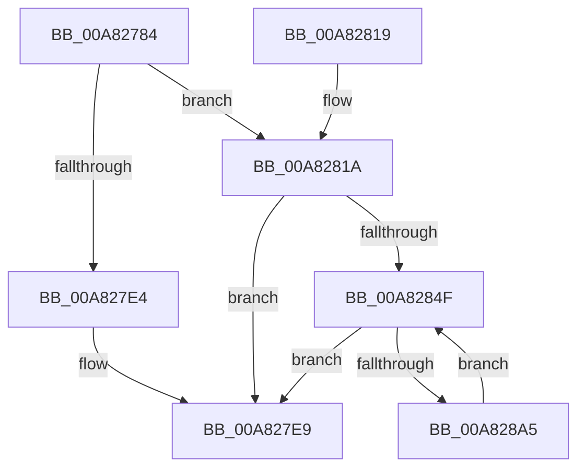

# MmGetNodeChannelRanges

- RVA: `0x00A82784`–`0x00A828A7` (길이 `291` bytes)
- VA: `0x0000000140A82784`
- 실행 섹션: `PAGE`
- PDB 이름 있음: `예`; PDB Function 태그: `아니요`
- unwind 정보 RVA: `0x0006E484`
- 디코드: `79`개 명령, `291/291` bytes 표시
- 미해석 바이트: `0` (있으면 어셈블리에 `.byte`로 보존)

> 이 문서는 커널 이미지의 기계어와 PDB 기호를 분석해 생성했습니다. 4번과 5번은 함수 원형과 자료형을 바이너리 사용 방식에서 추정한 C 해석이며 원본 소스 복구 결과는 아닙니다.

## 1. Dependencies

- 직접 호출 지점: **3**; 고유 호출 대상: **3**
- 직접 호출자로 확인된 함수: **1**
- RIP 상대 이미지 참조: **4**

### Outgoing calls
- `0x00A827B3` → [MiReferencePageRuns](../../text/37/MiReferencePageRuns_function_00379540.md) (function, `0x00379540`)
- `0x00A827D5` → [MiAllocatePool](../../text/35/MiAllocatePool_function_0035B540.md) (function, `0x0035B540`)
- `0x00A827EC` → [MiDereferencePageRuns](../../text/3B/MiDereferencePageRuns_function_003BD388.md) (function, `0x003BD388`)

### Direct callers
- [ExpQueryMemoryTopologyInformation](ExpQueryMemoryTopologyInformation_function_00A826E0.md) at `0x00A8270F`

### Static image references
- `0x00A827AC` → RVA `0x00E38D00` (`.data`; read)
- `0x00A82827` → RVA `0x00FC5000` (`ALMOSTRO`; read)
- `0x00A82834` → RVA `0x00FC5002` (`ALMOSTRO`; read)
- `0x00A82883` → RVA `0x00E38D10` (`.data`; read)

## 2. Other-region calls and transfers

- 다른 실행 섹션으로 향하는 call: **3**
  - `0x00A827B3` → [MiReferencePageRuns](../../text/37/MiReferencePageRuns_function_00379540.md) (`PAGE` → `.text`)
  - `0x00A827D5` → [MiAllocatePool](../../text/35/MiAllocatePool_function_0035B540.md) (`PAGE` → `.text`)
  - `0x00A827EC` → [MiDereferencePageRuns](../../text/3B/MiDereferencePageRuns_function_003BD388.md) (`PAGE` → `.text`)
- 별도 외부 분기/꼬리 이동을 확인하지 못했습니다.

## 3. Assembly (complete function range)

```asm
00A82784  48 8B C4                        mov rax, rsp
00A82787  48 89 58 08                     mov qword ptr [rax + 8], rbx
00A8278B  48 89 68 10                     mov qword ptr [rax + 0x10], rbp
00A8278F  48 89 70 18                     mov qword ptr [rax + 0x18], rsi
00A82793  48 89 78 20                     mov qword ptr [rax + 0x20], rdi
00A82797  41 54                           push r12
00A82799  41 56                           push r14
00A8279B  41 57                           push r15
00A8279D  48 83 EC 20                     sub rsp, 0x20
00A827A1  4C 8B FA                        mov r15, rdx
00A827A4  4C 8B E1                        mov r12, rcx
00A827A7  BA 01 00 00 00                  mov edx, 1
00A827AC  48 8D 0D 4D 65 3B 00            lea rcx, [rip + 0x3b654d]
00A827B3  E8 88 6D 8F FF                  call 0x140379540
00A827B8  41 B8 4D 6D 50 68               mov r8d, 0x68506d4d
00A827BE  B9 40 00 00 00                  mov ecx, 0x40
00A827C3  48 8B F8                        mov rdi, rax
00A827C6  8B 28                           mov ebp, dword ptr [rax]
00A827C8  FF CD                           dec ebp
00A827CA  48 C1 E5 05                     shl rbp, 5
00A827CE  48 83 C5 30                     add rbp, 0x30
00A827D2  48 8B D5                        mov rdx, rbp
00A827D5  E8 66 8D 8D FF                  call 0x14035b540
00A827DA  33 DB                           xor ebx, ebx
00A827DC  48 8B F0                        mov rsi, rax
00A827DF  48 85 C0                        test rax, rax
00A827E2  75 36                           jne 0x140a8281a
00A827E4  BB 9A 00 00 C0                  mov ebx, 0xc000009a
00A827E9  48 8B CF                        mov rcx, rdi
00A827EC  E8 97 AB 93 FF                  call 0x1403bd388
00A827F1  48 8B 7C 24 58                  mov rdi, qword ptr [rsp + 0x58]
00A827F6  8B C3                           mov eax, ebx
00A827F8  48 8B 5C 24 40                  mov rbx, qword ptr [rsp + 0x40]
00A827FD  49 89 34 24                     mov qword ptr [r12], rsi
00A82801  48 8B 74 24 50                  mov rsi, qword ptr [rsp + 0x50]
00A82806  49 89 2F                        mov qword ptr [r15], rbp
00A82809  48 8B 6C 24 48                  mov rbp, qword ptr [rsp + 0x48]
00A8280E  48 83 C4 20                     add rsp, 0x20
00A82812  41 5F                           pop r15
00A82814  41 5E                           pop r14
00A82816  41 5C                           pop r12
00A82818  C3                              ret
00A82819  CC                              int3
00A8281A  8B 0F                           mov ecx, dword ptr [rdi]
00A8281C  4C 8D 5F 10                     lea r11, [rdi + 0x10]
00A82820  48 89 08                        mov qword ptr [rax], rcx
00A82823  4C 8D 50 10                     lea r10, [rax + 0x10]
00A82827  0F B7 0D D2 27 54 00            movzx ecx, word ptr [rip + 0x5427d2]
00A8282E  44 8B F3                        mov r14d, ebx
00A82831  89 48 08                        mov dword ptr [rax + 8], ecx
00A82834  0F B6 0D C7 27 54 00            movzx ecx, byte ptr [rip + 0x5427c7]
00A8283B  89 48 0C                        mov dword ptr [rax + 0xc], ecx
00A8283E  8B 0F                           mov ecx, dword ptr [rdi]
00A82840  4C 8D 49 01                     lea r9, [rcx + 1]
00A82844  49 C1 E1 04                     shl r9, 4
00A82848  4C 03 CF                        add r9, rdi
00A8284B  85 C9                           test ecx, ecx
00A8284D  74 9A                           je 0x140a827e9
00A8284F  49 8B 03                        mov rax, qword ptr [r11]
00A82852  4D 8D 5B 10                     lea r11, [r11 + 0x10]
00A82856  49 89 42 08                     mov qword ptr [r10 + 8], rax
00A8285A  49 8B 43 F8                     mov rax, qword ptr [r11 - 8]
00A8285E  49 89 42 10                     mov qword ptr [r10 + 0x10], rax
00A82862  41 8B 01                        mov eax, dword ptr [r9]
00A82865  4D 8D 49 08                     lea r9, [r9 + 8]
00A82869  41 89 02                        mov dword ptr [r10], eax
00A8286C  4D 8D 52 20                     lea r10, [r10 + 0x20]
00A82870  41 0F B6 51 FC                  movzx edx, byte ptr [r9 - 4]
00A82875  48 69 C8 80 DF 00 00            imul rcx, rax, 0xdf80
00A8287C  41 89 52 E4                     mov dword ptr [r10 - 0x1c], edx
00A82880  48 8B C3                        mov rax, rbx
00A82883  48 03 0D 86 64 3B 00            add rcx, qword ptr [rip + 0x3b6486]
00A8288A  80 BC 0A 85 3B 00 00 01         cmp byte ptr [rdx + rcx + 0x3b85], 1
00A82892  0F 94 C0                        sete al
00A82895  41 FF C6                        inc r14d
00A82898  49 89 42 F8                     mov qword ptr [r10 - 8], rax
00A8289C  44 3B 37                        cmp r14d, dword ptr [rdi]
00A8289F  0F 83 44 FF FF FF               jae 0x140a827e9
00A828A5  EB A8                           jmp 0x140a8284f
```

## 4. C-style interpretation (structured pseudocode)

```c
__int64 __fastcall MmGetNodeChannelRanges(__int64 a1, __int64 a2)
{
    __int64 result;
    __int64 v_r14;
    __int64 v_rbp;
    __int64 v_rbx;
    __int64 v_rsp;
    unsigned __int64 v_stack_p10;
    unsigned __int64 v_stack_p18;
    unsigned __int64 v_stack_p20;
    unsigned __int64 v_stack_p8;

    *(unsigned __int64 *)(v_rsp + 8) = v_rbx;
    *(unsigned __int64 *)(v_rsp + 16) = v_rbp;
    *(unsigned __int64 *)(v_rsp + 24) = v_rsi;
    *(unsigned __int64 *)(v_rsp + 32) = v_rdi;
    v_rsp = (v_rsp) - (32);
    result = MiReferencePageRuns(v_rip + 3892557, 1, a3, a4);
    v_rbp = (unsigned int)(((unsigned int)(*(unsigned int *)(result))) - 1);
    v_rbp = (v_rbp) << (5);
    v_rbp = (v_rbp) + (48);
    result = MiAllocatePool(64, v_rbp, (unsigned int)(0x68506D4DULL), a4);
    v_rbx = 0;
    if (result != 0) goto loc_00A8281A;
loc_00A827E9:
    result = MiDereferencePageRuns(result, v_rbp, (unsigned int)(0x68506D4DULL), a4);
    *(unsigned __int64 *)(a1) = result;
    *(unsigned __int64 *)(a2) = v_rbp;
    v_rsp = (v_rsp) + (32);
    return (unsigned int)((unsigned int)((unsigned int)(0xC000009AULL)));
loc_00A8281A:
    *(unsigned __int64 *)((unsigned int)((unsigned int)((unsigned int)(0xC000009AULL)))) = (unsigned int)(*(unsigned int *)(v_stack_p20));
    *(unsigned int *)((unsigned int)((unsigned int)((unsigned int)(0xC000009AULL))) + 8) = (unsigned int)(*(unsigned __int16 *)(v_rip + 5515218));
    *(unsigned int *)((unsigned int)((unsigned int)((unsigned int)(0xC000009AULL))) + 12) = (unsigned int)(*(unsigned __int8 *)(v_rip + 5515207));
    a4 = ((unsigned int)(*(unsigned int *)(v_stack_p20)) + 1) << (4);
    a4 = (a4) + (v_stack_p20);
    if ((unsigned int)((unsigned int)(*(unsigned int *)(v_stack_p20))) == 0) goto loc_00A827E9;
loc_00A8284F:
    *(unsigned __int64 *)((unsigned int)((unsigned int)((unsigned int)(0xC000009AULL))) + 16 + 8) = *(unsigned __int64 *)(v_stack_p20 + 16);
    *(unsigned __int64 *)((unsigned int)((unsigned int)((unsigned int)(0xC000009AULL))) + 16 + 16) = *(unsigned __int64 *)(v_stack_p20 + 16 + 16 - 8);
    *(unsigned int *)((unsigned int)((unsigned int)((unsigned int)(0xC000009AULL))) + 16) = (unsigned int)((unsigned int)(*(unsigned int *)(a4)));
    a1 = ((unsigned int)(*(unsigned int *)(v_stack_p20))) * ((unsigned int)(*(unsigned int *)(a4)));
    *(unsigned int *)((unsigned int)((unsigned int)((unsigned int)(0xC000009AULL))) + 16 + 32 - 28) = (unsigned int)(*(unsigned __int8 *)(a4 + 8 - 4));
    a1 = (a1) + (*(unsigned __int64 *)(v_rip + 3892358));
    result = ((*(unsigned __int8 *)(*(unsigned __int8 *)(a4 + 8 - 4) + a1 * 1 + 15237)) == 1) ? 1 : 0;
    v_r14 = (unsigned int)(((unsigned int)((unsigned int)(v_stack_p8))) + 1);
    *(unsigned __int64 *)((unsigned int)((unsigned int)((unsigned int)(0xC000009AULL))) + 16 + 32 - 8) = result;
    if (((unsigned int)(v_r14)) >= (*(unsigned int *)(v_stack_p20))) goto loc_00A827E9;
    goto loc_00A8284F;
}
```

## 5. (Beta) C Style

```c
int64_t MmGetNodeChannelRanges(void *Arg1, void *Arg2)
{
    uint8_t *arg1 = (uint8_t *)Arg1;
    uint8_t *arg2 = (uint8_t *)Arg2;

    int64_t result;
    int64_t local_r14;
    int64_t local_rbp;
    int64_t local_rbx;
    int64_t local_rsp;
    uint64_t v_stack_p10;
    uint64_t v_stack_p18;
    uint64_t v_stack_p20;
    uint64_t v_stack_p8;

    *(uint64_t *)(local_rsp + 0x8) = local_rbx;
    *(uint64_t *)(local_rsp + 0x10) = local_rbp;
    *(uint64_t *)(local_rsp + 0x18) = local_rsi;
    *(uint64_t *)(local_rsp + 0x20) = local_rdi;
    local_rsp = (local_rsp) - (32);
    result = MiReferencePageRuns(v_rip + 3892557, 1, a3, a4);
    local_rbp = (uint32_t)(((uint32_t)(*(uint32_t *)(result))) - 1);
    local_rbp = (local_rbp) << (5);
    local_rbp = (local_rbp) + (48);
    result = MiAllocatePool(64, local_rbp, (uint32_t)(0x68506D4DULL), a4);
    local_rbx = 0;
    if (result != 0) goto loc_00A8281A;
loc_00A827E9:
    result = MiDereferencePageRuns(result, local_rbp, (uint32_t)(0x68506D4DULL), a4);
    *(uint64_t *)(arg1) = result;
    *(uint64_t *)(arg2) = local_rbp;
    local_rsp = (local_rsp) + (32);
    return (uint32_t)((uint32_t)((uint32_t)(0xC000009AULL)));
loc_00A8281A:
    *(uint64_t *)((uint32_t)((uint32_t)((uint32_t)(0xC000009AULL)))) = (uint32_t)(*(uint32_t *)(v_stack_p20));
    *(uint32_t *)((uint32_t)((uint32_t)((uint32_t)(0xC000009AULL))) + 0x8) = (uint32_t)(*(uint16_t *)(v_rip + 0x5427D2));
    *(uint32_t *)((uint32_t)((uint32_t)((uint32_t)(0xC000009AULL))) + 0xC) = (uint32_t)(*(uint8_t *)(v_rip + 0x5427C7));
    a4 = ((uint32_t)(*(uint32_t *)(v_stack_p20)) + 1) << (4);
    a4 = (a4) + (v_stack_p20);
    if ((uint32_t)((uint32_t)(*(uint32_t *)(v_stack_p20))) == 0) goto loc_00A827E9;
loc_00A8284F:
    *(uint64_t *)((uint32_t)((uint32_t)((uint32_t)(0xC000009AULL))) + 0x10 + 0x8) = *(uint64_t *)(v_stack_p20 + 0x10);
    *(uint64_t *)((uint32_t)((uint32_t)((uint32_t)(0xC000009AULL))) + 0x10 + 0x10) = *(uint64_t *)(v_stack_p20 + 0x10 + 0x10 - 0x8);
    *(uint32_t *)((uint32_t)((uint32_t)((uint32_t)(0xC000009AULL))) + 0x10) = (uint32_t)((uint32_t)(*(uint32_t *)(a4)));
    Arg1 = ((uint32_t)(*(uint32_t *)(v_stack_p20))) * ((uint32_t)(*(uint32_t *)(a4)));
    *(uint32_t *)((uint32_t)((uint32_t)((uint32_t)(0xC000009AULL))) + 0x10 + 0x20 - 0x1C) = (uint32_t)(*(uint8_t *)(a4 + 0x8 - 0x4));
    Arg1 = (Arg1) + (*(uint64_t *)(v_rip + 0x3B6486));
    result = ((*(uint8_t *)(*(uint8_t *)(a4 + 0x8 - 0x4) + arg1 * 1 + 0x3B85)) == 1) ? 1 : 0;
    local_r14 = (uint32_t)(((uint32_t)((uint32_t)(v_stack_p8))) + 1);
    *(uint64_t *)((uint32_t)((uint32_t)((uint32_t)(0xC000009AULL))) + 0x10 + 0x20 - 0x8) = result;
    if (((uint32_t)(local_r14)) >= (*(uint32_t *)(v_stack_p20))) goto loc_00A827E9;
    goto loc_00A8284F;
}
```

### 관측된 메모리 오프셋

구조체 형식이 확인되지 않은 접근은 인자 기준의 오프셋으로만 기록했습니다.

| 기준 인자 | 오프셋 표현 | 폭 (bit) | 접근 |
|---|---:|---:|---|
| `Arg1` | `+ 0x0` | `64` | `W` |
| `Arg2` | `+ 0x0` | `64` | `W` |

## 6. Execution-region graph

[열기: 2D/3D 그래프와 함수 탐색 컨트롤 패널](../../../control-panel.html?section=page&rva=0x00A82784&view=graph)

- 2D 그래프는 위에서 아래로 흐르고, 3D 그래프는 빈 공간을 드래그해 회전합니다. Shift+드래그는 이동, 휠은 확대·축소, 함수 노드 선택은 대상 보고서 이동입니다.

### Static fallback


