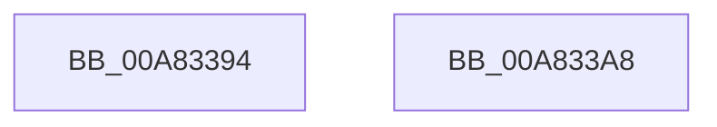

# MmGetScpCfgFunctionOffset

- RVA: `0x00A83394`–`0x00A833A9` (길이 `21` bytes)
- VA: `0x0000000140A83394`
- 실행 섹션: `PAGE`
- PDB 이름 있음: `예`; PDB Function 태그: `아니요`
- unwind 정보 RVA: `0x000DB714`
- 디코드: `6`개 명령, `21/21` bytes 표시
- 미해석 바이트: `0` (있으면 어셈블리에 `.byte`로 보존)

> 이 문서는 커널 이미지의 기계어와 PDB 기호를 분석해 생성했습니다. 4번과 5번은 함수 원형과 자료형을 바이너리 사용 방식에서 추정한 C 해석이며 원본 소스 복구 결과는 아닙니다.

## 1. Dependencies

- 직접 호출 지점: **0**; 고유 호출 대상: **0**
- 직접 호출자로 확인된 함수: **1**
- RIP 상대 이미지 참조: **1**

### Outgoing calls
- 직접 디코드된 call 명령이 없습니다.

### Direct callers
- [PspLocateNtdllAddressesForScpCfg](../../init/C4/PspLocateNtdllAddressesForScpCfg_function_00C46CB0.md) at `0x00C46E64`
- [PspLocateNtdllAddressesForScpCfg](../../init/C4/PspLocateNtdllAddressesForScpCfg_function_00C46CB0.md) at `0x00C46E7B`
- [PspLocateNtdllAddressesForScpCfg](../../init/C4/PspLocateNtdllAddressesForScpCfg_function_00C46CB0.md) at `0x00C46E92`
- [PspLocateNtdllAddressesForScpCfg](../../init/C4/PspLocateNtdllAddressesForScpCfg_function_00C46CB0.md) at `0x00C46EA8`

### Static image references
- `0x00A8339F` → RVA `0x00E2D8A0` (`.data`; read)

## 2. Other-region calls and transfers

- 다른 실행 섹션으로 향하는 call: **0**
- 별도 외부 분기/꼬리 이동을 확인하지 못했습니다.

## 3. Assembly (complete function range)

```asm
00A83394  8D 82 FF 0F 00 00               lea eax, [rdx + 0xfff]
00A8339A  25 00 F0 FF FF                  and eax, 0xfffff000
00A8339F  03 05 FB A4 3A 00               add eax, dword ptr [rip + 0x3aa4fb]
00A833A5  03 C1                           add eax, ecx
00A833A7  C3                              ret
00A833A8  CC                              int3
```

## 4. C-style interpretation (structured pseudocode)

```c
__int64 __fastcall MmGetScpCfgFunctionOffset(int a1, __int64 a2)
{
    __int64 result;

    result = (unsigned int)((a2 + 4095) & (0xFFFFF000ULL));
    result = (unsigned int)((result) + (*(unsigned int *)(v_rip + 3843323)));
    result = (unsigned int)((result) + (a1));
    return result;
}
```

## 5. (Beta) C Style

```c
int64_t MmGetScpCfgFunctionOffset(int32_t Arg1, void *Arg2)
{
    uint8_t *arg2 = (uint8_t *)Arg2;

    int64_t result;

    result = (uint32_t)((Arg2 + 4095) & (0xFFFFF000ULL));
    result = (uint32_t)((result) + (*(uint32_t *)(v_rip + 0x3AA4FB)));
    result = (uint32_t)((result) + (Arg1));
    return result;
}
```

### 관측된 메모리 오프셋

구조체 형식이 확인되지 않은 접근은 인자 기준의 오프셋으로만 기록했습니다.

| 기준 인자 | 오프셋 표현 | 폭 (bit) | 접근 |
|---|---:|---:|---|
| `Arg2` | `+ 0xFFF` | `32` | `R` |

## 6. Execution-region graph

[열기: 2D/3D 그래프와 함수 탐색 컨트롤 패널](../../../control-panel.html?section=page&rva=0x00A83394&view=graph)

- 2D 그래프는 위에서 아래로 흐르고, 3D 그래프는 빈 공간을 드래그해 회전합니다. Shift+드래그는 이동, 휠은 확대·축소, 함수 노드 선택은 대상 보고서 이동입니다.

### Static fallback


