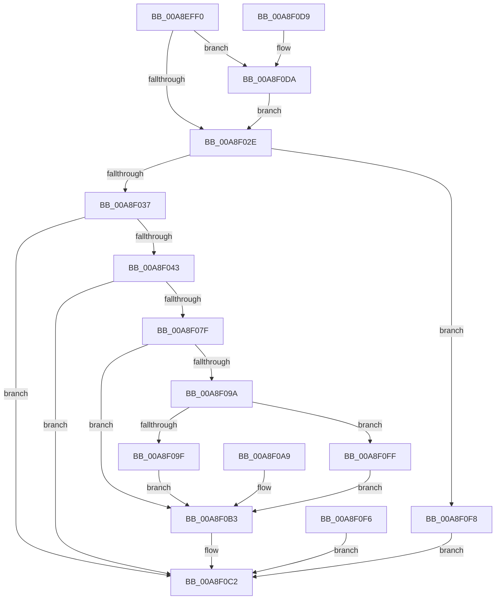

# NtAcquireProcessActivityReference

- RVA: `0x00A8EFF0`–`0x00A8F109` (길이 `281` bytes)
- VA: `0x0000000140A8EFF0`
- 실행 섹션: `PAGE`
- PDB 이름 있음: `예`; PDB Function 태그: `아니요`
- unwind 정보 RVA: `0x000B8B88`
- 디코드: `70`개 명령, `281/281` bytes 표시
- 미해석 바이트: `0` (있으면 어셈블리에 `.byte`로 보존)

> 이 문서는 커널 이미지의 기계어와 PDB 기호를 분석해 생성했습니다. 4번과 5번은 함수 원형과 자료형을 바이너리 사용 방식에서 추정한 C 해석이며 원본 소스 복구 결과는 아닙니다.

## 1. Dependencies

- 직접 호출 지점: **4**; 고유 호출 대상: **4**
- 직접 호출자로 확인된 함수: **0**
- RIP 상대 이미지 참조: **1**

### Outgoing calls
- `0x00A8F03A` → [ExCpuSetResourceManagerAccessCheck](../../text/3A/ExCpuSetResourceManagerAccessCheck_function_003A5444.md) (function, `0x003A5444`)
- `0x00A8F076` → [ObpReferenceObjectByHandleWithTag](../86/ObpReferenceObjectByHandleWithTag_function_00869650.md) (function, `0x00869650`)
- `0x00A8F08F` → [PspCreateActivityReference](PspCreateActivityReference_function_00A8F110.md) (function, `0x00A8F110`)
- `0x00A8F0BB` → [ObfDereferenceObjectWithTag](../../text/2F/ObfDereferenceObjectWithTag_function_002F78E0.md) (function, `0x002F78E0`)

### Direct callers
- 이 함수 시작 RVA로 연결되는 직접 call은 확인되지 않았습니다. 간접 호출은 완전히 역산할 수 없습니다.

### Static image references
- `0x00A8F043` → RVA `0x00FC6A98` (`ALMOSTRO`; read)

## 2. Other-region calls and transfers

- 다른 실행 섹션으로 향하는 call: **2**
  - `0x00A8F03A` → [ExCpuSetResourceManagerAccessCheck](../../text/3A/ExCpuSetResourceManagerAccessCheck_function_003A5444.md) (`PAGE` → `.text`)
  - `0x00A8F0BB` → [ObfDereferenceObjectWithTag](../../text/2F/ObfDereferenceObjectWithTag_function_002F78E0.md) (`PAGE` → `.text`)
- 별도 외부 분기/꼬리 이동을 확인하지 못했습니다.

## 3. Assembly (complete function range)

```asm
00A8EFF0  48 8B C4                        mov rax, rsp
00A8EFF3  48 89 58 08                     mov qword ptr [rax + 8], rbx
00A8EFF7  48 89 70 10                     mov qword ptr [rax + 0x10], rsi
00A8EFFB  48 89 78 18                     mov qword ptr [rax + 0x18], rdi
00A8EFFF  41 56                           push r14
00A8F001  48 83 EC 60                     sub rsp, 0x60
00A8F005  48 8B DA                        mov rbx, rdx
00A8F008  4C 8B F1                        mov r14, rcx
00A8F00B  48 83 60 E0 00                  and qword ptr [rax - 0x20], 0
00A8F010  48 83 60 20 00                  and qword ptr [rax + 0x20], 0
00A8F015  65 48 8B 04 25 88 01 00 00      mov rax, qword ptr gs:[0x188]
00A8F01E  40 8A B0 32 02 00 00            mov sil, byte ptr [rax + 0x232]
00A8F025  40 84 F6                        test sil, sil
00A8F028  0F 85 AC 00 00 00               jne 0x140a8f0da
00A8F02E  45 85 C0                        test r8d, r8d
00A8F031  0F 85 C1 00 00 00               jne 0x140a8f0f8
00A8F037  40 8A CE                        mov cl, sil
00A8F03A  E8 05 64 91 FF                  call 0x1403a5444
00A8F03F  85 C0                           test eax, eax
00A8F041  78 7F                           js 0x140a8f0c2
00A8F043  4C 8B 05 4E 7A 53 00            mov r8, qword ptr [rip + 0x537a4e]
00A8F04A  48 83 64 24 38 00               and qword ptr [rsp + 0x38], 0
00A8F050  48 83 64 24 30 00               and qword ptr [rsp + 0x30], 0
00A8F056  48 8D 84 24 88 00 00 00         lea rax, [rsp + 0x88]
00A8F05E  48 89 44 24 28                  mov qword ptr [rsp + 0x28], rax
00A8F063  C7 44 24 20 50 73 41 63         mov dword ptr [rsp + 0x20], 0x63417350
00A8F06B  44 8A CE                        mov r9b, sil
00A8F06E  BA 00 10 00 00                  mov edx, 0x1000
00A8F073  48 8B CB                        mov rcx, rbx
00A8F076  E8 D5 A5 DD FF                  call 0x140869650
00A8F07B  85 C0                           test eax, eax
00A8F07D  78 43                           js 0x140a8f0c2
00A8F07F  48 8D 54 24 48                  lea rdx, [rsp + 0x48]
00A8F084  48 8B 9C 24 88 00 00 00         mov rbx, qword ptr [rsp + 0x88]
00A8F08C  48 8B CB                        mov rcx, rbx
00A8F08F  E8 7C 00 00 00                  call 0x140a8f110
00A8F094  8B F8                           mov edi, eax
00A8F096  85 C0                           test eax, eax
00A8F098  78 19                           js 0x140a8f0b3
00A8F09A  40 84 F6                        test sil, sil
00A8F09D  74 60                           je 0x140a8f0ff
00A8F09F  48 8B 4C 24 48                  mov rcx, qword ptr [rsp + 0x48]
00A8F0A4  49 89 0E                        mov qword ptr [r14], rcx
00A8F0A7  EB 0A                           jmp 0x140a8f0b3
00A8F0A9  8B F8                           mov edi, eax
00A8F0AB  48 8B 9C 24 88 00 00 00         mov rbx, qword ptr [rsp + 0x88]
00A8F0B3  BA 50 73 41 63                  mov edx, 0x63417350
00A8F0B8  48 8B CB                        mov rcx, rbx
00A8F0BB  E8 20 88 86 FF                  call 0x1402f78e0
00A8F0C0  8B C7                           mov eax, edi
00A8F0C2  4C 8D 5C 24 60                  lea r11, [rsp + 0x60]
00A8F0C7  49 8B 5B 10                     mov rbx, qword ptr [r11 + 0x10]
00A8F0CB  49 8B 73 18                     mov rsi, qword ptr [r11 + 0x18]
00A8F0CF  49 8B 7B 20                     mov rdi, qword ptr [r11 + 0x20]
00A8F0D3  49 8B E3                        mov rsp, r11
00A8F0D6  41 5E                           pop r14
00A8F0D8  C3                              ret
00A8F0D9  CC                              int3
00A8F0DA  48 B9 00 00 FF FF FF 7F 00 00   movabs rcx, 0x7fffffff0000
00A8F0E4  4C 3B F1                        cmp r14, rcx
00A8F0E7  49 0F 42 CE                     cmovb rcx, r14
00A8F0EB  48 8B 01                        mov rax, qword ptr [rcx]
00A8F0EE  48 89 01                        mov qword ptr [rcx], rax
00A8F0F1  E9 38 FF FF FF                  jmp 0x140a8f02e
00A8F0F6  EB CA                           jmp 0x140a8f0c2
00A8F0F8  B8 F1 00 00 C0                  mov eax, 0xc00000f1
00A8F0FD  EB C3                           jmp 0x140a8f0c2
00A8F0FF  48 8B 44 24 48                  mov rax, qword ptr [rsp + 0x48]
00A8F104  49 89 06                        mov qword ptr [r14], rax
00A8F107  EB AA                           jmp 0x140a8f0b3
```

## 4. C-style interpretation (structured pseudocode)

```c
__int64 __fastcall NtAcquireProcessActivityReference(__int64 a1, __int64 a2, int a3)
{
    __int64 result;
    __int64 v_rsp;
    unsigned __int64 v_stack_m18;
    unsigned __int64 v_stack_m20;
    unsigned __int64 v_stack_m30;
    unsigned __int64 v_stack_m38;
    unsigned __int64 v_stack_m40;
    unsigned int v_stack_m48;
    unsigned __int64 v_stack_m8;
    unsigned __int64 v_stack_p20;

    *(unsigned __int64 *)(v_rsp + 8) = v_rbx;
    *(unsigned __int64 *)(v_rsp + 16) = v_rsi;
    *(unsigned __int64 *)(v_rsp + 24) = v_rdi;
    v_rsp = (v_rsp) - (96);
    if ((unsigned __int8)(*(unsigned __int8 *)(*(unsigned __int64 *)(gs_base + (0 + 392)) + 562)) != 0) goto loc_00A8F0DA;
loc_00A8F02E:
    if (a3 != 0) goto loc_00A8F0F8;
    result = ExCpuSetResourceManagerAccessCheck((unsigned __int8)(*(unsigned __int8 *)(*(unsigned __int64 *)(gs_base + (0 + 392)) + 562)), a2, a3, a4);
    if (sign_flag) goto loc_00A8F0C2;
    v_stack_m40 = v_stack_p20;
    v_stack_m48 = 0x63417350ULL;
    result = ObpReferenceObjectByHandleWithTag(a2, (unsigned int)(0x1000ULL), *(unsigned __int64 *)(v_rip + 5470798), (unsigned __int8)(*(unsigned __int8 *)(*(unsigned __int64 *)(gs_base + (0 + 392)) + 562)));
    if (sign_flag) goto loc_00A8F0C2;
    result = PspCreateActivityReference(v_stack_p20, v_stack_m20, *(unsigned __int64 *)(v_rip + 5470798), (unsigned __int8)(*(unsigned __int8 *)(*(unsigned __int64 *)(gs_base + (0 + 392)) + 562)));
    if (sign_flag) goto loc_00A8F0B3;
    if ((unsigned __int8)(*(unsigned __int8 *)(*(unsigned __int64 *)(gs_base + (0 + 392)) + 562)) == 0) goto loc_00A8F0FF;
    *(unsigned __int64 *)(a1) = v_stack_m20;
    goto loc_00A8F0B3;
loc_00A8F0B3:
    result = ObfDereferenceObjectWithTag(v_stack_p20, (unsigned int)(0x63417350ULL), *(unsigned __int64 *)(v_rip + 5470798), (unsigned __int8)(*(unsigned __int8 *)(*(unsigned __int64 *)(gs_base + (0 + 392)) + 562)));
loc_00A8F0C2:
    return (unsigned int)((unsigned int)((unsigned int)((unsigned int)(result))));
loc_00A8F0DA:
    a1 = v_stack_p20;
    if (a1 < v_stack_p20) { a1 = a1; }
    *(unsigned __int64 *)(a1) = *(unsigned __int64 *)(a1);
    goto loc_00A8F02E;
loc_00A8F0F8:
    goto loc_00A8F0C2;
loc_00A8F0FF:
    *(unsigned __int64 *)(a1) = v_stack_m18;
    goto loc_00A8F0B3;
}
```

## 5. (Beta) C Style

```c
int64_t NtAcquireProcessActivityReference(int64_t Arg1, int64_t Arg2, int32_t Arg3)
{
    int64_t result;
    int64_t local_rsp;
    uint64_t v_stack_m18;
    uint64_t v_stack_m20;
    uint64_t v_stack_m30;
    uint64_t v_stack_m38;
    uint64_t v_stack_m40;
    uint32_t v_stack_m48;
    uint64_t v_stack_m8;
    uint64_t v_stack_p20;

    *(uint64_t *)(local_rsp + 0x8) = local_rbx;
    *(uint64_t *)(local_rsp + 0x10) = local_rsi;
    *(uint64_t *)(local_rsp + 0x18) = local_rdi;
    local_rsp = (local_rsp) - (96);
    if ((uint8_t)(*(uint8_t *)(*(uint64_t *)(gs_base + (0 + 0x188)) + 0x232)) != 0) goto loc_00A8F0DA;
loc_00A8F02E:
    if (Arg3 != 0) goto loc_00A8F0F8;
    result = ExCpuSetResourceManagerAccessCheck((uint8_t)(*(uint8_t *)(*(uint64_t *)(gs_base + (0 + 0x188)) + 0x232)), Arg2, Arg3, a4);
    if (sign_flag) goto loc_00A8F0C2;
    v_stack_m40 = v_stack_p20;
    v_stack_m48 = 0x63417350ULL;
    result = ObpReferenceObjectByHandleWithTag(Arg2, (uint32_t)(0x1000ULL), *(uint64_t *)(v_rip + 0x537A4E), (uint8_t)(*(uint8_t *)(*(uint64_t *)(gs_base + (0 + 0x188)) + 0x232)));
    if (sign_flag) goto loc_00A8F0C2;
    result = PspCreateActivityReference(v_stack_p20, v_stack_m20, *(uint64_t *)(v_rip + 0x537A4E), (uint8_t)(*(uint8_t *)(*(uint64_t *)(gs_base + (0 + 0x188)) + 0x232)));
    if (sign_flag) goto loc_00A8F0B3;
    if ((uint8_t)(*(uint8_t *)(*(uint64_t *)(gs_base + (0 + 0x188)) + 0x232)) == 0) goto loc_00A8F0FF;
    *(uint64_t *)(Arg1) = v_stack_m20;
    goto loc_00A8F0B3;
loc_00A8F0B3:
    result = ObfDereferenceObjectWithTag(v_stack_p20, (uint32_t)(0x63417350ULL), *(uint64_t *)(v_rip + 0x537A4E), (uint8_t)(*(uint8_t *)(*(uint64_t *)(gs_base + (0 + 0x188)) + 0x232)));
loc_00A8F0C2:
    return (uint32_t)((uint32_t)((uint32_t)((uint32_t)(result))));
loc_00A8F0DA:
    Arg1 = v_stack_p20;
    if (Arg1 < v_stack_p20) { Arg1 = Arg1; }
    *(uint64_t *)(Arg1) = *(uint64_t *)(Arg1);
    goto loc_00A8F02E;
loc_00A8F0F8:
    goto loc_00A8F0C2;
loc_00A8F0FF:
    *(uint64_t *)(Arg1) = v_stack_m18;
    goto loc_00A8F0B3;
}
```

## 6. Execution-region graph

[열기: 2D/3D 그래프와 함수 탐색 컨트롤 패널](../../../control-panel.html?section=page&rva=0x00A8EFF0&view=graph)

- 2D 그래프는 위에서 아래로 흐르고, 3D 그래프는 빈 공간을 드래그해 회전합니다. Shift+드래그는 이동, 휠은 확대·축소, 함수 노드 선택은 대상 보고서 이동입니다.

### Static fallback


