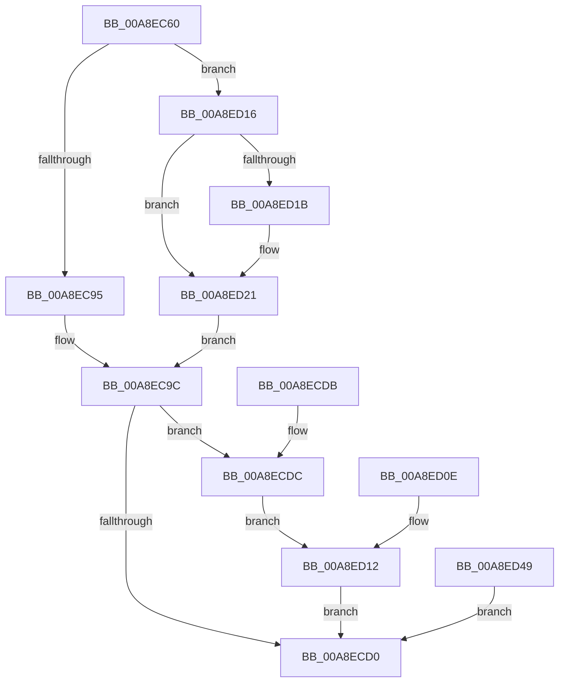

# NtExtendSection

- RVA: `0x00A8EC60`–`0x00A8ED4B` (길이 `235` bytes)
- VA: `0x0000000140A8EC60`
- 실행 섹션: `PAGE`
- PDB 이름 있음: `예`; PDB Function 태그: `아니요`
- unwind 정보 RVA: `0x000B8AEC`
- 디코드: `62`개 명령, `235/235` bytes 표시
- 미해석 바이트: `0` (있으면 어셈블리에 `.byte`로 보존)

> 이 문서는 커널 이미지의 기계어와 PDB 기호를 분석해 생성했습니다. 4번과 5번은 함수 원형과 자료형을 바이너리 사용 방식에서 추정한 C 해석이며 원본 소스 복구 결과는 아닙니다.

## 1. Dependencies

- 직접 호출 지점: **4**; 고유 호출 대상: **4**
- 직접 호출자로 확인된 함수: **0**
- RIP 상대 이미지 참조: **1**

### Outgoing calls
- `0x00A8ECC7` → [ObpReferenceObjectByHandleWithTag](../86/ObpReferenceObjectByHandleWithTag_function_00869650.md) (function, `0x00869650`)
- `0x00A8ECE9` → [MmExtendSection](../98/MmExtendSection_function_00982C38.md) (function, `0x00982C38`)
- `0x00A8ECFE` → [ObfDereferenceObjectWithTag](../../text/2F/ObfDereferenceObjectWithTag_function_002F78E0.md) (function, `0x002F78E0`)
- `0x00A8ED1B` → [ExRaiseDatatypeMisalignment](../89/ExRaiseDatatypeMisalignment_function_00899FD0.md) (function, `0x00899FD0`)

### Direct callers
- 이 함수 시작 RVA로 연결되는 직접 call은 확인되지 않았습니다. 간접 호출은 완전히 역산할 수 없습니다.

### Static image references
- `0x00A8EC9C` → RVA `0x00FC6BD8` (`ALMOSTRO`; read)

## 2. Other-region calls and transfers

- 다른 실행 섹션으로 향하는 call: **1**
  - `0x00A8ECFE` → [ObfDereferenceObjectWithTag](../../text/2F/ObfDereferenceObjectWithTag_function_002F78E0.md) (`PAGE` → `.text`)
- 별도 외부 분기/꼬리 이동을 확인하지 못했습니다.

## 3. Assembly (complete function range)

```asm
00A8EC60  4C 8B DC                        mov r11, rsp
00A8EC63  49 89 5B 08                     mov qword ptr [r11 + 8], rbx
00A8EC67  57                              push rdi
00A8EC68  48 83 EC 50                     sub rsp, 0x50
00A8EC6C  48 8B DA                        mov rbx, rdx
00A8EC6F  4C 8B D1                        mov r10, rcx
00A8EC72  33 FF                           xor edi, edi
00A8EC74  49 89 7B E8                     mov qword ptr [r11 - 0x18], rdi
00A8EC78  49 89 7B 20                     mov qword ptr [r11 + 0x20], rdi
00A8EC7C  65 48 8B 04 25 88 01 00 00      mov rax, qword ptr gs:[0x188]
00A8EC85  44 8A 88 32 02 00 00            mov r9b, byte ptr [rax + 0x232]
00A8EC8C  45 84 C9                        test r9b, r9b
00A8EC8F  0F 85 81 00 00 00               jne 0x140a8ed16
00A8EC95  48 8B 02                        mov rax, qword ptr [rdx]
00A8EC98  49 89 43 20                     mov qword ptr [r11 + 0x20], rax
00A8EC9C  4C 8B 05 35 7F 53 00            mov r8, qword ptr [rip + 0x537f35]
00A8ECA3  48 89 7C 24 38                  mov qword ptr [rsp + 0x38], rdi
00A8ECA8  48 89 7C 24 30                  mov qword ptr [rsp + 0x30], rdi
00A8ECAD  48 8D 44 24 40                  lea rax, [rsp + 0x40]
00A8ECB2  48 89 44 24 28                  mov qword ptr [rsp + 0x28], rax
00A8ECB7  C7 44 24 20 4D 6D 53 63         mov dword ptr [rsp + 0x20], 0x63536d4d
00A8ECBF  BA 10 00 00 00                  mov edx, 0x10
00A8ECC4  49 8B CA                        mov rcx, r10
00A8ECC7  E8 84 A9 DD FF                  call 0x140869650
00A8ECCC  85 C0                           test eax, eax
00A8ECCE  79 0C                           jns 0x140a8ecdc
00A8ECD0  48 8B 5C 24 60                  mov rbx, qword ptr [rsp + 0x60]
00A8ECD5  48 83 C4 50                     add rsp, 0x50
00A8ECD9  5F                              pop rdi
00A8ECDA  C3                              ret
00A8ECDB  CC                              int3
00A8ECDC  45 33 C0                        xor r8d, r8d
00A8ECDF  48 8D 54 24 78                  lea rdx, [rsp + 0x78]
00A8ECE4  48 8B 4C 24 40                  mov rcx, qword ptr [rsp + 0x40]
00A8ECE9  E8 4A 3F EF FF                  call 0x140982c38
00A8ECEE  8B F8                           mov edi, eax
00A8ECF0  89 44 24 70                     mov dword ptr [rsp + 0x70], eax
00A8ECF4  BA 4D 6D 53 63                  mov edx, 0x63536d4d
00A8ECF9  48 8B 4C 24 40                  mov rcx, qword ptr [rsp + 0x40]
00A8ECFE  E8 DD 8B 86 FF                  call 0x1402f78e0
00A8ED03  90                              nop
00A8ED04  48 8B 4C 24 78                  mov rcx, qword ptr [rsp + 0x78]
00A8ED09  48 89 0B                        mov qword ptr [rbx], rcx
00A8ED0C  EB 04                           jmp 0x140a8ed12
00A8ED0E  8B 7C 24 70                     mov edi, dword ptr [rsp + 0x70]
00A8ED12  8B C7                           mov eax, edi
00A8ED14  EB BA                           jmp 0x140a8ecd0
00A8ED16  F6 C3 03                        test bl, 3
00A8ED19  74 06                           je 0x140a8ed21
00A8ED1B  E8 B0 B2 E0 FF                  call 0x140899fd0
00A8ED20  CC                              int3
00A8ED21  48 B9 00 00 FF FF FF 7F 00 00   movabs rcx, 0x7fffffff0000
00A8ED2B  48 3B D9                        cmp rbx, rcx
00A8ED2E  48 0F 42 CB                     cmovb rcx, rbx
00A8ED32  8A 01                           mov al, byte ptr [rcx]
00A8ED34  88 01                           mov byte ptr [rcx], al
00A8ED36  8A 41 07                        mov al, byte ptr [rcx + 7]
00A8ED39  88 41 07                        mov byte ptr [rcx + 7], al
00A8ED3C  48 8B 02                        mov rax, qword ptr [rdx]
00A8ED3F  48 89 44 24 78                  mov qword ptr [rsp + 0x78], rax
00A8ED44  E9 53 FF FF FF                  jmp 0x140a8ec9c
00A8ED49  EB 85                           jmp 0x140a8ecd0
```

## 4. C-style interpretation (structured pseudocode)

```c
__int64 __fastcall NtExtendSection(__int64 a1, __int64 a2)
{
    __int64 result;
    __int64 v_rdi;
    __int64 v_rsp;
    unsigned __int64 v_stack_m18;
    unsigned __int64 v_stack_m20;
    unsigned __int64 v_stack_m28;
    unsigned __int64 v_stack_m30;
    unsigned int v_stack_m38;
    unsigned __int64 v_stack_p40;
    unsigned int v_stack_p70;
    unsigned __int64 v_stack_p78;
    unsigned __int64 v_stack_p8;

    *(unsigned __int64 *)(v_rsp + 8) = v_rbx;
    v_rsp = (v_rsp) - (80);
    v_rdi = 0;
    *(unsigned __int64 *)(v_rsp - 24) = 0;
    *(unsigned __int64 *)(v_rsp + 32) = 0;
    if ((unsigned __int8)(*(unsigned __int8 *)(*(unsigned __int64 *)(gs_base + (0 + 392)) + 562)) != 0) goto loc_00A8ED16;
    *(unsigned __int64 *)(v_rsp + 32) = *(unsigned __int64 *)(a2);
loc_00A8EC9C:
    v_stack_m20 = 0;
    v_stack_m28 = 0;
    v_stack_m30 = v_stack_m18;
    v_stack_m38 = 0x63536D4DULL;
    result = ObpReferenceObjectByHandleWithTag(a1, 16, *(unsigned __int64 *)(v_rip + 5472053), *(unsigned __int8 *)(*(unsigned __int64 *)(gs_base + (0 + 392)) + 562));
    if (!sign_flag) goto loc_00A8ECDC;
loc_00A8ECD0:
    v_rsp = (v_rsp) + (80);
    return result;
loc_00A8ECDC:
    a3 = 0;
    result = MmExtendSection(v_stack_p40, v_stack_p78, a3, *(unsigned __int8 *)(*(unsigned __int64 *)(gs_base + (0 + 392)) + 562));
    v_stack_p70 = (unsigned int)(result);
    result = ObfDereferenceObjectWithTag(v_stack_p40, (unsigned int)(0x63536D4DULL), a3, *(unsigned __int8 *)(*(unsigned __int64 *)(gs_base + (0 + 392)) + 562));
    *(unsigned __int64 *)(v_stack_p8) = v_stack_p78;
    goto loc_00A8ED12;
loc_00A8ED12:
    goto loc_00A8ECD0;
loc_00A8ED16:
    result = (unsigned int)((unsigned int)((unsigned int)((unsigned int)(result))));
    if ((((unsigned __int8)(v_stack_p8)) & (3)) != 0) {
        result = ExRaiseDatatypeMisalignment(v_stack_p78, (unsigned int)(0x63536D4DULL), a3, *(unsigned __int8 *)(*(unsigned __int64 *)(gs_base + (0 + 392)) + 562));
    }
    a1 = v_stack_p78;
    if (v_stack_p8 < v_stack_p78) { a1 = v_stack_p8; }
    *(unsigned __int8 *)(a1) = (unsigned __int8)(*(unsigned __int8 *)(a1));
    *(unsigned __int8 *)(a1 + 7) = (unsigned __int8)(*(unsigned __int8 *)(a1 + 7));
    v_stack_p78 = *(unsigned __int64 *)((unsigned int)(0x63536D4DULL));
    goto loc_00A8EC9C;
}
```

## 5. (Beta) C Style

```c
int64_t NtExtendSection(int64_t Arg1, void *Arg2)
{
    uint8_t *arg2 = (uint8_t *)Arg2;

    int64_t result;
    int64_t local_rdi;
    int64_t local_rsp;
    uint64_t v_stack_m18;
    uint64_t v_stack_m20;
    uint64_t v_stack_m28;
    uint64_t v_stack_m30;
    uint32_t v_stack_m38;
    uint64_t v_stack_p40;
    uint32_t v_stack_p70;
    uint64_t v_stack_p78;
    uint64_t v_stack_p8;

    *(uint64_t *)(local_rsp + 0x8) = local_rbx;
    local_rsp = (local_rsp) - (80);
    local_rdi = 0;
    *(uint64_t *)(local_rsp - 0x18) = 0;
    *(uint64_t *)(local_rsp + 0x20) = 0;
    if ((uint8_t)(*(uint8_t *)(*(uint64_t *)(gs_base + (0 + 0x188)) + 0x232)) != 0) goto loc_00A8ED16;
    *(uint64_t *)(local_rsp + 0x20) = *(uint64_t *)(arg2);
loc_00A8EC9C:
    v_stack_m20 = 0;
    v_stack_m28 = 0;
    v_stack_m30 = v_stack_m18;
    v_stack_m38 = 0x63536D4DULL;
    result = ObpReferenceObjectByHandleWithTag(Arg1, 16, *(uint64_t *)(v_rip + 0x537F35), *(uint8_t *)(*(uint64_t *)(gs_base + (0 + 0x188)) + 0x232));
    if (!sign_flag) goto loc_00A8ECDC;
loc_00A8ECD0:
    local_rsp = (local_rsp) + (80);
    return result;
loc_00A8ECDC:
    a3 = 0;
    result = MmExtendSection(v_stack_p40, v_stack_p78, a3, *(uint8_t *)(*(uint64_t *)(gs_base + (0 + 0x188)) + 0x232));
    v_stack_p70 = (uint32_t)(result);
    result = ObfDereferenceObjectWithTag(v_stack_p40, (uint32_t)(0x63536D4DULL), a3, *(uint8_t *)(*(uint64_t *)(gs_base + (0 + 0x188)) + 0x232));
    *(uint64_t *)(v_stack_p8) = v_stack_p78;
    goto loc_00A8ED12;
loc_00A8ED12:
    goto loc_00A8ECD0;
loc_00A8ED16:
    result = (uint32_t)((uint32_t)((uint32_t)((uint32_t)(result))));
    if ((((uint8_t)(v_stack_p8)) & (3)) != 0) {
        result = ExRaiseDatatypeMisalignment(v_stack_p78, (uint32_t)(0x63536D4DULL), a3, *(uint8_t *)(*(uint64_t *)(gs_base + (0 + 0x188)) + 0x232));
    }
    Arg1 = v_stack_p78;
    if (v_stack_p8 < v_stack_p78) { Arg1 = v_stack_p8; }
    *(uint8_t *)(Arg1) = (uint8_t)(*(uint8_t *)(Arg1));
    *(uint8_t *)(Arg1 + 0x7) = (uint8_t)(*(uint8_t *)(Arg1 + 0x7));
    v_stack_p78 = *(uint64_t *)((uint32_t)(0x63536D4DULL));
    goto loc_00A8EC9C;
}
```

### 관측된 메모리 오프셋

구조체 형식이 확인되지 않은 접근은 인자 기준의 오프셋으로만 기록했습니다.

| 기준 인자 | 오프셋 표현 | 폭 (bit) | 접근 |
|---|---:|---:|---|
| `Arg2` | `+ 0x0` | `64` | `R` |

## 6. Execution-region graph

[열기: 2D/3D 그래프와 함수 탐색 컨트롤 패널](../../../control-panel.html?section=page&rva=0x00A8EC60&view=graph)

- 2D 그래프는 위에서 아래로 흐르고, 3D 그래프는 빈 공간을 드래그해 회전합니다. Shift+드래그는 이동, 휠은 확대·축소, 함수 노드 선택은 대상 보고서 이동입니다.

### Static fallback


