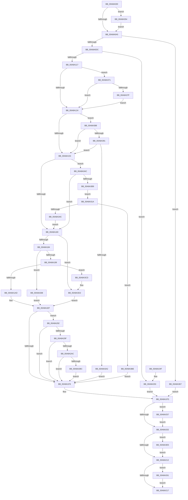

# NtFlushKey

- RVA: `0x00A8A030`–`0x00A8A406` (길이 `982` bytes)
- VA: `0x0000000140A8A030`
- 실행 섹션: `PAGE`
- PDB 이름 있음: `예`; PDB Function 태그: `아니요`
- unwind 정보 RVA: `0x000B851C`
- 디코드: `234`개 명령, `982/982` bytes 표시
- 미해석 바이트: `0` (있으면 어셈블리에 `.byte`로 보존)

> 이 문서는 커널 이미지의 기계어와 PDB 기호를 분석해 생성했습니다. 4번과 5번은 함수 원형과 자료형을 바이너리 사용 방식에서 추정한 C 해석이며 원본 소스 복구 결과는 아닙니다.

## 1. Dependencies

- 직접 호출 지점: **31**; 고유 호출 대상: **23**
- 직접 호출자로 확인된 함수: **1**
- RIP 상대 이미지 참조: **4**

### Outgoing calls
- `0x00A8A0C7` → [CmpInitializeThreadInfo](../../text/3F/CmpInitializeThreadInfo_function_003FBE70.md) (function, `0x003FBE70`)
- `0x00A8A0CC` → [CmpAcquireShutdownRundown](../../pagecmrc/BC/CmpAcquireShutdownRundown_function_00BC9400.md) (function, `0x00BC9400`)
- `0x00A8A108` → [CmObReferenceObjectByHandle](../../pagecmrc/BC/CmObReferenceObjectByHandle_function_00BC9350.md) (function, `0x00BC9350`)
- `0x00A8A162` → [CmpLockRegistryFreezeAware](../9B/CmpLockRegistryFreezeAware_function_009B4AE4.md) (function, `0x009B4AE4`)
- `0x00A8A16B` → [CmpLockKcbShared](../../pagecmrc/BC/CmpLockKcbShared_function_00BC9A1C.md) (function, `0x00BC9A1C`)
- `0x00A8A175` → [CmpPerformKeyBodyDeletionCheck](../../pagecmrc/BC/CmpPerformKeyBodyDeletionCheck_function_00BC97D0.md) (function, `0x00BC97D0`)
- `0x00A8A1A0` → [ExAcquireRundownProtection](../../text/21/ExAcquireRundownProtection_function_00216620.md) (function, `0x00216620`)
- `0x00A8A1B1` → [CmpUnlockKcb](../../pagecmrc/BC/CmpUnlockKcb_function_00BC92C0.md) (function, `0x00BC92C0`)
- `0x00A8A1B6` → [CmpUnlockRegistry](../../pagecmrc/BC/CmpUnlockRegistry_function_00BC9A84.md) (function, `0x00BC9A84`)
- `0x00A8A1BF` → [CmpAttachToRegistryProcess](../../pagecmrc/BC/CmpAttachToRegistryProcess_function_00BC98E0.md) (function, `0x00BC98E0`)
- `0x00A8A1C9` → [CmpFlushHive](../9B/CmpFlushHive_function_009B3DC0.md) (function, `0x009B3DC0`)
- `0x00A8A1DE` → [CmpDetachFromRegistryProcess](../../pagecmrc/BC/CmpDetachFromRegistryProcess_function_00BC9920.md) (function, `0x00BC9920`)
- `0x00A8A1EA` → [ExReleaseRundownProtection](../../text/34/ExReleaseRundownProtection_function_00349E80.md) (function, `0x00349E80`)
- `0x00A8A1F8` → [KeLeaveCriticalRegion](../../text/25/KeLeaveCriticalRegion_function_0025D8B0.md) (function, `0x0025D8B0`)
- `0x00A8A21B` → [CmCleanupThreadInfo](../../text/41/CmCleanupThreadInfo_function_0041FD50.md) (function, `0x0041FD50`)
- `0x00A8A229` → [_security_check_cookie](../../text/6A/_security_check_cookie_function_006AC640.md) (function, `0x006AC640`)
- `0x00A8A25A` → [ObfDereferenceObject](../../text/2F/ObfDereferenceObject_function_002F9350.md) (function, `0x002F9350`)
- `0x00A8A261` → [CmpReleaseShutdownRundown](../../pagecmrc/BC/CmpReleaseShutdownRundown_function_00BC9880.md) (function, `0x00BC9880`)
- `0x00A8A268` → [CmpUnlockKcb](../../pagecmrc/BC/CmpUnlockKcb_function_00BC92C0.md) (function, `0x00BC92C0`)
- `0x00A8A26D` → [CmpUnlockRegistry](../../pagecmrc/BC/CmpUnlockRegistry_function_00BC9A84.md) (function, `0x00BC9A84`)
- `0x00A8A276` → [CmpAttachToRegistryProcess](../../pagecmrc/BC/CmpAttachToRegistryProcess_function_00BC98E0.md) (function, `0x00BC98E0`)
- `0x00A8A27D` → [CmpDoFlushAll](../../text/34/CmpDoFlushAll_function_00349A9C.md) (function, `0x00349A9C`)
- `0x00A8A286` → [CmpDetachFromRegistryProcess](../../pagecmrc/BC/CmpDetachFromRegistryProcess_function_00BC9920.md) (function, `0x00BC9920`)
- `0x00A8A29F` → [CmpIsRegistryLockAcquired](../../text/45/CmpIsRegistryLockAcquired_function_00456A7C.md) (function, `0x00456A7C`)
- `0x00A8A30C` → [CmpCallCallBacksEx](../86/CmpCallCallBacksEx_function_00865F40.md) (function, `0x00865F40`)
- `0x00A8A343` → [CmpCallCallBacksEx](../86/CmpCallCallBacksEx_function_00865F40.md) (function, `0x00865F40`)
- `0x00A8A35D` → [EtwGetKernelTraceTimestamp](../../text/39/EtwGetKernelTraceTimestamp_function_0039FC50.md) (function, `0x0039FC50`)
- `0x00A8A3AC` → [CmpIsRegistryLockAcquired](../../text/45/CmpIsRegistryLockAcquired_function_00456A7C.md) (function, `0x00456A7C`)
- `0x00A8A3D6` → [CmpUnlockKcb](../../pagecmrc/BC/CmpUnlockKcb_function_00BC92C0.md) (function, `0x00BC92C0`)
- `0x00A8A3DB` → [CmpUnlockRegistry](../../pagecmrc/BC/CmpUnlockRegistry_function_00BC9A84.md) (function, `0x00BC9A84`)
- `0x00A8A3FC` → [guard_dispatch_icall](../../text/6B/guard_dispatch_icall_function_006BAAD0.md) (function, `0x006BAAD0`)

### Direct callers
- [ExpWatchProductTypeWork](../6F/ExpWatchProductTypeWork_function_006FFCA0.md) at `0x00700378`

### Static image references
- `0x00A8A053` → RVA `0x00E0A740` (`.data`; read)
- `0x00A8A075` → RVA `0x00FD8008` (`PAGEDATA`; read)
- `0x00A8A153` → RVA `0x00EEFB88` (`.data`; read)
- `0x00A8A18C` → RVA `0x00FD9A90` (`PAGEDATA`; read)

## 2. Other-region calls and transfers

- 다른 실행 섹션으로 향하는 call: **27**
  - `0x00A8A0C7` → [CmpInitializeThreadInfo](../../text/3F/CmpInitializeThreadInfo_function_003FBE70.md) (`PAGE` → `.text`)
  - `0x00A8A0CC` → [CmpAcquireShutdownRundown](../../pagecmrc/BC/CmpAcquireShutdownRundown_function_00BC9400.md) (`PAGE` → `PAGECMRC`)
  - `0x00A8A108` → [CmObReferenceObjectByHandle](../../pagecmrc/BC/CmObReferenceObjectByHandle_function_00BC9350.md) (`PAGE` → `PAGECMRC`)
  - `0x00A8A16B` → [CmpLockKcbShared](../../pagecmrc/BC/CmpLockKcbShared_function_00BC9A1C.md) (`PAGE` → `PAGECMRC`)
  - `0x00A8A175` → [CmpPerformKeyBodyDeletionCheck](../../pagecmrc/BC/CmpPerformKeyBodyDeletionCheck_function_00BC97D0.md) (`PAGE` → `PAGECMRC`)
  - `0x00A8A1A0` → [ExAcquireRundownProtection](../../text/21/ExAcquireRundownProtection_function_00216620.md) (`PAGE` → `.text`)
  - `0x00A8A1B1` → [CmpUnlockKcb](../../pagecmrc/BC/CmpUnlockKcb_function_00BC92C0.md) (`PAGE` → `PAGECMRC`)
  - `0x00A8A1B6` → [CmpUnlockRegistry](../../pagecmrc/BC/CmpUnlockRegistry_function_00BC9A84.md) (`PAGE` → `PAGECMRC`)
  - `0x00A8A1BF` → [CmpAttachToRegistryProcess](../../pagecmrc/BC/CmpAttachToRegistryProcess_function_00BC98E0.md) (`PAGE` → `PAGECMRC`)
  - `0x00A8A1DE` → [CmpDetachFromRegistryProcess](../../pagecmrc/BC/CmpDetachFromRegistryProcess_function_00BC9920.md) (`PAGE` → `PAGECMRC`)
  - `0x00A8A1EA` → [ExReleaseRundownProtection](../../text/34/ExReleaseRundownProtection_function_00349E80.md) (`PAGE` → `.text`)
  - `0x00A8A1F8` → [KeLeaveCriticalRegion](../../text/25/KeLeaveCriticalRegion_function_0025D8B0.md) (`PAGE` → `.text`)
  - `0x00A8A21B` → [CmCleanupThreadInfo](../../text/41/CmCleanupThreadInfo_function_0041FD50.md) (`PAGE` → `.text`)
  - `0x00A8A229` → [_security_check_cookie](../../text/6A/_security_check_cookie_function_006AC640.md) (`PAGE` → `.text`)
  - `0x00A8A25A` → [ObfDereferenceObject](../../text/2F/ObfDereferenceObject_function_002F9350.md) (`PAGE` → `.text`)
  - `0x00A8A261` → [CmpReleaseShutdownRundown](../../pagecmrc/BC/CmpReleaseShutdownRundown_function_00BC9880.md) (`PAGE` → `PAGECMRC`)
  - `0x00A8A268` → [CmpUnlockKcb](../../pagecmrc/BC/CmpUnlockKcb_function_00BC92C0.md) (`PAGE` → `PAGECMRC`)
  - `0x00A8A26D` → [CmpUnlockRegistry](../../pagecmrc/BC/CmpUnlockRegistry_function_00BC9A84.md) (`PAGE` → `PAGECMRC`)
  - `0x00A8A276` → [CmpAttachToRegistryProcess](../../pagecmrc/BC/CmpAttachToRegistryProcess_function_00BC98E0.md) (`PAGE` → `PAGECMRC`)
  - `0x00A8A27D` → [CmpDoFlushAll](../../text/34/CmpDoFlushAll_function_00349A9C.md) (`PAGE` → `.text`)
  - `0x00A8A286` → [CmpDetachFromRegistryProcess](../../pagecmrc/BC/CmpDetachFromRegistryProcess_function_00BC9920.md) (`PAGE` → `PAGECMRC`)
  - `0x00A8A29F` → [CmpIsRegistryLockAcquired](../../text/45/CmpIsRegistryLockAcquired_function_00456A7C.md) (`PAGE` → `.text`)
  - `0x00A8A35D` → [EtwGetKernelTraceTimestamp](../../text/39/EtwGetKernelTraceTimestamp_function_0039FC50.md) (`PAGE` → `.text`)
  - `0x00A8A3AC` → [CmpIsRegistryLockAcquired](../../text/45/CmpIsRegistryLockAcquired_function_00456A7C.md) (`PAGE` → `.text`)
  - `0x00A8A3D6` → [CmpUnlockKcb](../../pagecmrc/BC/CmpUnlockKcb_function_00BC92C0.md) (`PAGE` → `PAGECMRC`)
  - `0x00A8A3DB` → [CmpUnlockRegistry](../../pagecmrc/BC/CmpUnlockRegistry_function_00BC9A84.md) (`PAGE` → `PAGECMRC`)
  - `0x00A8A3FC` → [guard_dispatch_icall](../../text/6B/guard_dispatch_icall_function_006BAAD0.md) (`PAGE` → `.text`)
- 별도 외부 분기/꼬리 이동을 확인하지 못했습니다.

## 3. Assembly (complete function range)

```asm
00A8A030  48 8B C4                        mov rax, rsp
00A8A033  48 89 58 10                     mov qword ptr [rax + 0x10], rbx
00A8A037  48 89 70 18                     mov qword ptr [rax + 0x18], rsi
00A8A03B  48 89 78 20                     mov qword ptr [rax + 0x20], rdi
00A8A03F  55                              push rbp
00A8A040  41 54                           push r12
00A8A042  41 55                           push r13
00A8A044  41 56                           push r14
00A8A046  41 57                           push r15
00A8A048  48 8D 68 A8                     lea rbp, [rax - 0x58]
00A8A04C  48 81 EC 30 01 00 00            sub rsp, 0x130
00A8A053  48 8B 05 E6 06 38 00            mov rax, qword ptr [rip + 0x3806e6]
00A8A05A  48 33 C4                        xor rax, rsp
00A8A05D  48 89 45 20                     mov qword ptr [rbp + 0x20], rax
00A8A061  0F 57 C0                        xorps xmm0, xmm0
00A8A064  33 C0                           xor eax, eax
00A8A066  48 21 44 24 58                  and qword ptr [rsp + 0x58], rax
00A8A06B  0F 57 C9                        xorps xmm1, xmm1
00A8A06E  45 33 E4                        xor r12d, r12d
00A8A071  48 89 45 A8                     mov qword ptr [rbp - 0x58], rax
00A8A075  48 39 05 8C DF 54 00            cmp qword ptr [rip + 0x54df8c], rax
00A8A07C  48 8B D9                        mov rbx, rcx
00A8A07F  0F 11 45 98                     movups xmmword ptr [rbp - 0x68], xmm0
00A8A083  0F 11 4D B0                     movups xmmword ptr [rbp - 0x50], xmm1
00A8A087  0F 11 4D C0                     movups xmmword ptr [rbp - 0x40], xmm1
00A8A08B  0F 11 45 D0                     movups xmmword ptr [rbp - 0x30], xmm0
00A8A08F  0F 11 45 E0                     movups xmmword ptr [rbp - 0x20], xmm0
00A8A093  0F 11 45 F0                     movups xmmword ptr [rbp - 0x10], xmm0
00A8A097  0F 11 45 00                     movups xmmword ptr [rbp], xmm0
00A8A09B  0F 11 45 10                     movups xmmword ptr [rbp + 0x10], xmm0
00A8A09F  0F 85 AF 02 00 00               jne 0x140a8a354
00A8A0A5  48 8D 44 24 48                  lea rax, [rsp + 0x48]
00A8A0AA  33 FF                           xor edi, edi
00A8A0AC  48 89 44 24 50                  mov qword ptr [rsp + 0x50], rax
00A8A0B1  48 8D 4D 98                     lea rcx, [rbp - 0x68]
00A8A0B5  48 8D 44 24 48                  lea rax, [rsp + 0x48]
00A8A0BA  48 89 7C 24 40                  mov qword ptr [rsp + 0x40], rdi
00A8A0BF  48 89 44 24 48                  mov qword ptr [rsp + 0x48], rax
00A8A0C4  45 32 FF                        xor r15b, r15b
00A8A0C7  E8 A4 1D 97 FF                  call 0x1403fbe70
00A8A0CC  E8 2F F3 13 00                  call 0x140bc9400
00A8A0D1  44 8A E8                        mov r13b, al
00A8A0D4  84 C0                           test al, al
00A8A0D6  0F 84 8B 02 00 00               je 0x140a8a367
00A8A0DC  65 48 8B 04 25 88 01 00 00      mov rax, qword ptr gs:[0x188]
00A8A0E5  33 D2                           xor edx, edx
00A8A0E7  48 8B CB                        mov rcx, rbx
00A8A0EA  40 8A B0 32 02 00 00            mov sil, byte ptr [rax + 0x232]
00A8A0F1  48 8D 44 24 58                  lea rax, [rsp + 0x58]
00A8A0F6  48 89 44 24 28                  mov qword ptr [rsp + 0x28], rax
00A8A0FB  44 8A CE                        mov r9b, sil
00A8A0FE  48 8D 44 24 40                  lea rax, [rsp + 0x40]
00A8A103  48 89 44 24 20                  mov qword ptr [rsp + 0x20], rax
00A8A108  E8 43 F2 13 00                  call 0x140bc9350
00A8A10D  8B D8                           mov ebx, eax
00A8A10F  85 C0                           test eax, eax
00A8A111  0F 88 39 01 00 00               js 0x140a8a250
00A8A117  48 39 3D EA DE 54 00            cmp qword ptr [rip + 0x54deea], rdi
00A8A11E  0F 85 4D 02 00 00               jne 0x140a8a371
00A8A124  65 48 8B 04 25 88 01 00 00      mov rax, qword ptr gs:[0x188]
00A8A12D  41 B6 01                        mov r14b, 1
00A8A130  48 8B 7C 24 40                  mov rdi, qword ptr [rsp + 0x40]
00A8A135  66 FF 88 E4 01 00 00            dec word ptr [rax + 0x1e4]
00A8A13C  90                              nop
00A8A13D  48 8B 47 08                     mov rax, qword ptr [rdi + 8]
00A8A141  48 8B 48 20                     mov rcx, qword ptr [rax + 0x20]
00A8A145  8B 81 A0 00 00 00               mov eax, dword ptr [rcx + 0xa0]
00A8A14B  A8 02                           test al, 2
00A8A14D  0F 85 35 02 00 00               jne 0x140a8a388
00A8A153  83 3D 2E 5A 46 00 00            cmp dword ptr [rip + 0x465a2e], 0
00A8A15A  0F 85 4C 02 00 00               jne 0x140a8a3ac
00A8A160  33 C9                           xor ecx, ecx
00A8A162  E8 7D A9 F2 FF                  call 0x1409b4ae4
00A8A167  48 8B 4F 08                     mov rcx, qword ptr [rdi + 8]
00A8A16B  E8 AC F8 13 00                  call 0x140bc9a1c
00A8A170  33 D2                           xor edx, edx
00A8A172  48 8B CF                        mov rcx, rdi
00A8A175  E8 56 F6 13 00                  call 0x140bc97d0
00A8A17A  8B D8                           mov ebx, eax
00A8A17C  85 C0                           test eax, eax
00A8A17E  0F 88 4E 02 00 00               js 0x140a8a3d2
00A8A184  48 8B 4F 08                     mov rcx, qword ptr [rdi + 8]
00A8A188  48 8B 71 20                     mov rsi, qword ptr [rcx + 0x20]
00A8A18C  48 3B 35 FD F8 54 00            cmp rsi, qword ptr [rip + 0x54f8fd]
00A8A193  0F 84 CF 00 00 00               je 0x140a8a268
00A8A199  48 8D 8E 68 06 00 00            lea rcx, [rsi + 0x668]
00A8A1A0  E8 7B C4 78 FF                  call 0x140216620
00A8A1A5  84 C0                           test al, al
00A8A1A7  0F 84 20 02 00 00               je 0x140a8a3cd
00A8A1AD  48 8B 4F 08                     mov rcx, qword ptr [rdi + 8]
00A8A1B1  E8 0A F1 13 00                  call 0x140bc92c0
00A8A1B6  E8 C9 F8 13 00                  call 0x140bc9a84
00A8A1BB  48 8D 4D D0                     lea rcx, [rbp - 0x30]
00A8A1BF  E8 1C F7 13 00                  call 0x140bc98e0
00A8A1C4  33 D2                           xor edx, edx
00A8A1C6  48 8B CE                        mov rcx, rsi
00A8A1C9  E8 F2 9B F2 FF                  call 0x1409b3dc0
00A8A1CE  8B D8                           mov ebx, eax
00A8A1D0  48 8D 4D D0                     lea rcx, [rbp - 0x30]
00A8A1D4  B8 4D 01 00 C0                  mov eax, 0xc000014d
00A8A1D9  85 DB                           test ebx, ebx
00A8A1DB  0F 48 D8                        cmovs ebx, eax
00A8A1DE  E8 3D F7 13 00                  call 0x140bc9920
00A8A1E3  48 8D 8E 68 06 00 00            lea rcx, [rsi + 0x668]
00A8A1EA  E8 91 FC 8B FF                  call 0x140349e80
00A8A1EF  45 84 FF                        test r15b, r15b
00A8A1F2  0F 85 9A 00 00 00               jne 0x140a8a292
00A8A1F8  E8 B3 36 7D FF                  call 0x14025d8b0
00A8A1FD  48 85 FF                        test rdi, rdi
00A8A200  75 55                           jne 0x140a8a257
00A8A202  48 8B 05 FF DD 54 00            mov rax, qword ptr [rip + 0x54ddff]
00A8A209  48 85 C0                        test rax, rax
00A8A20C  0F 85 D3 01 00 00               jne 0x140a8a3e5
00A8A212  45 84 ED                        test r13b, r13b
00A8A215  75 4A                           jne 0x140a8a261
00A8A217  48 8D 4D 98                     lea rcx, [rbp - 0x68]
00A8A21B  E8 30 5B 99 FF                  call 0x14041fd50
00A8A220  8B C3                           mov eax, ebx
00A8A222  48 8B 4D 20                     mov rcx, qword ptr [rbp + 0x20]
00A8A226  48 33 CC                        xor rcx, rsp
00A8A229  E8 12 24 C2 FF                  call 0x1406ac640
00A8A22E  4C 8D 9C 24 30 01 00 00         lea r11, [rsp + 0x130]
00A8A236  49 8B 5B 38                     mov rbx, qword ptr [r11 + 0x38]
00A8A23A  49 8B 73 40                     mov rsi, qword ptr [r11 + 0x40]
00A8A23E  49 8B 7B 48                     mov rdi, qword ptr [r11 + 0x48]
00A8A242  49 8B E3                        mov rsp, r11
00A8A245  41 5F                           pop r15
00A8A247  41 5E                           pop r14
00A8A249  41 5D                           pop r13
00A8A24B  41 5C                           pop r12
00A8A24D  5D                              pop rbp
00A8A24E  C3                              ret
00A8A24F  CC                              int3
00A8A250  48 8B 7C 24 40                  mov rdi, qword ptr [rsp + 0x40]
00A8A255  EB A6                           jmp 0x140a8a1fd
00A8A257  48 8B CF                        mov rcx, rdi
00A8A25A  E8 F1 F0 86 FF                  call 0x1402f9350
00A8A25F  EB A1                           jmp 0x140a8a202
00A8A261  E8 1A F6 13 00                  call 0x140bc9880
00A8A266  EB AF                           jmp 0x140a8a217
00A8A268  E8 53 F0 13 00                  call 0x140bc92c0
00A8A26D  E8 12 F8 13 00                  call 0x140bc9a84
00A8A272  48 8D 4D D0                     lea rcx, [rbp - 0x30]
00A8A276  E8 65 F6 13 00                  call 0x140bc98e0
00A8A27B  33 C9                           xor ecx, ecx
00A8A27D  E8 1A F8 8B FF                  call 0x140349a9c
00A8A282  48 8D 4D D0                     lea rcx, [rbp - 0x30]
00A8A286  E8 95 F6 13 00                  call 0x140bc9920
00A8A28B  33 DB                           xor ebx, ebx
00A8A28D  E9 5D FF FF FF                  jmp 0x140a8a1ef
00A8A292  83 3D EF 58 46 00 00            cmp dword ptr [rip + 0x4658ef], 0
00A8A299  0F 84 59 FF FF FF               je 0x140a8a1f8
00A8A29F  E8 D8 C7 9C FF                  call 0x140456a7c
00A8A2A4  85 C0                           test eax, eax
00A8A2A6  0F 85 4C FF FF FF               jne 0x140a8a1f8
00A8A2AC  48 8D 44 24 48                  lea rax, [rsp + 0x48]
00A8A2B1  48 39 44 24 48                  cmp qword ptr [rsp + 0x48], rax
00A8A2B6  0F 84 3C FF FF FF               je 0x140a8a1f8
00A8A2BC  33 C0                           xor eax, eax
00A8A2BE  48 8D 54 24 60                  lea rdx, [rsp + 0x60]
00A8A2C3  0F 57 C0                        xorps xmm0, xmm0
00A8A2C6  48 89 45 90                     mov qword ptr [rbp - 0x70], rax
00A8A2CA  0F 11 44 24 70                  movups xmmword ptr [rsp + 0x70], xmm0
00A8A2CF  48 8D 45 B0                     lea rax, [rbp - 0x50]
00A8A2D3  B9 1F 00 00 00                  mov ecx, 0x1f
00A8A2D8  0F 11 44 24 60                  movups xmmword ptr [rsp + 0x60], xmm0
00A8A2DD  48 89 44 24 70                  mov qword ptr [rsp + 0x70], rax
00A8A2E2  45 33 C9                        xor r9d, r9d
00A8A2E5  48 8D 44 24 48                  lea rax, [rsp + 0x48]
00A8A2EA  48 89 7C 24 60                  mov qword ptr [rsp + 0x60], rdi
00A8A2EF  48 89 44 24 30                  mov qword ptr [rsp + 0x30], rax
00A8A2F4  45 33 C0                        xor r8d, r8d
00A8A2F7  48 89 7C 24 28                  mov qword ptr [rsp + 0x28], rdi
00A8A2FC  89 4C 24 20                     mov dword ptr [rsp + 0x20], ecx
00A8A300  0F 11 45 80                     movups xmmword ptr [rbp - 0x80], xmm0
00A8A304  89 5C 24 68                     mov dword ptr [rsp + 0x68], ebx
00A8A308  89 5C 24 78                     mov dword ptr [rsp + 0x78], ebx
00A8A30C  E8 2F BC DD FF                  call 0x140865f40
00A8A311  8B 5C 24 78                     mov ebx, dword ptr [rsp + 0x78]
00A8A315  E9 DE FE FF FF                  jmp 0x140a8a1f8
00A8A31A  45 33 C0                        xor r8d, r8d
00A8A31D  48 89 7D B0                     mov qword ptr [rbp - 0x50], rdi
00A8A321  48 8D 44 24 48                  lea rax, [rsp + 0x48]
00A8A326  45 8A CE                        mov r9b, r14b
00A8A329  48 89 44 24 30                  mov qword ptr [rsp + 0x30], rax
00A8A32E  48 8D 55 B0                     lea rdx, [rbp - 0x50]
00A8A332  48 89 7C 24 28                  mov qword ptr [rsp + 0x28], rdi
00A8A337  41 8D 48 1E                     lea ecx, [r8 + 0x1e]
00A8A33B  C7 44 24 20 1F 00 00 00         mov dword ptr [rsp + 0x20], 0x1f
00A8A343  E8 F8 BB DD FF                  call 0x140865f40
00A8A348  85 C0                           test eax, eax
00A8A34A  78 72                           js 0x140a8a3be
00A8A34C  45 8A FE                        mov r15b, r14b
00A8A34F  E9 0C FE FF FF                  jmp 0x140a8a160
00A8A354  BA 00 00 02 00                  mov edx, 0x20000
00A8A359  48 8D 4D 00                     lea rcx, [rbp]
00A8A35D  E8 EE 58 91 FF                  call 0x14039fc50
00A8A362  E9 3E FD FF FF                  jmp 0x140a8a0a5
00A8A367  BB 89 01 00 C0                  mov ebx, 0xc0000189
00A8A36C  E9 8C FE FF FF                  jmp 0x140a8a1fd
00A8A371  48 8B 44 24 40                  mov rax, qword ptr [rsp + 0x40]
00A8A376  48 85 C0                        test rax, rax
00A8A379  0F 84 A5 FD FF FF               je 0x140a8a124
00A8A37F  4C 8B 60 08                     mov r12, qword ptr [rax + 8]
00A8A383  E9 9C FD FF FF                  jmp 0x140a8a124
00A8A388  40 84 F6                        test sil, sil
00A8A38B  0F 84 C2 FD FF FF               je 0x140a8a153
00A8A391  8B 44 24 5C                     mov eax, dword ptr [rsp + 0x5c]
00A8A395  F7 D0                           not eax
00A8A397  A9 06 00 02 00                  test eax, 0x20006
00A8A39C  0F 84 B1 FD FF FF               je 0x140a8a153
00A8A3A2  BB 22 00 00 C0                  mov ebx, 0xc0000022
00A8A3A7  E9 4C FE FF FF                  jmp 0x140a8a1f8
00A8A3AC  E8 CB C6 9C FF                  call 0x140456a7c
00A8A3B1  85 C0                           test eax, eax
00A8A3B3  0F 85 A7 FD FF FF               jne 0x140a8a160
00A8A3B9  E9 5C FF FF FF                  jmp 0x140a8a31a
00A8A3BE  33 DB                           xor ebx, ebx
00A8A3C0  3D 03 05 00 C0                  cmp eax, 0xc0000503
00A8A3C5  0F 45 D8                        cmovne ebx, eax
00A8A3C8  E9 2B FE FF FF                  jmp 0x140a8a1f8
00A8A3CD  BB 25 04 00 C0                  mov ebx, 0xc0000425
00A8A3D2  48 8B 4F 08                     mov rcx, qword ptr [rdi + 8]
00A8A3D6  E8 E5 EE 13 00                  call 0x140bc92c0
00A8A3DB  E8 A4 F6 13 00                  call 0x140bc9a84
00A8A3E0  E9 0A FE FF FF                  jmp 0x140a8a1ef
00A8A3E5  48 83 64 24 28 00               and qword ptr [rsp + 0x28], 0
00A8A3EB  48 8D 55 00                     lea rdx, [rbp]
00A8A3EF  45 33 C9                        xor r9d, r9d
00A8A3F2  4C 89 64 24 20                  mov qword ptr [rsp + 0x20], r12
00A8A3F7  44 8B C3                        mov r8d, ebx
00A8A3FA  B1 15                           mov cl, 0x15
00A8A3FC  E8 CF 06 C3 FF                  call 0x1406baad0
00A8A401  E9 0C FE FF FF                  jmp 0x140a8a212
```

## 4. C-style interpretation (structured pseudocode)

```c
__int64 __fastcall NtFlushKey(__int64 a1, int a2, int a3)
{
    __int64 result;
    __int64 v_r12;
    __int64 v_r15;
    __int64 v_rbx;
    __int64 v_rdi;
    __int64 v_rsp;
    unsigned __int64 v_stack_m100;
    unsigned __int64 v_stack_m108;
    unsigned __int64 v_stack_m110;
    unsigned __int64 v_stack_m118;
    unsigned __int64 v_stack_m130;
    unsigned __int64 v_stack_m138;
    unsigned __int64 v_stack_m28;
    unsigned int v_stack_mB8;
    unsigned __int64 v_stack_mC0;
    unsigned int v_stack_mC8;
    unsigned __int64 v_stack_mD0;
    unsigned int v_stack_mD4;
    unsigned __int64 v_stack_mE8;
    unsigned __int64 v_stack_mF0;

    *(unsigned __int64 *)(v_rsp + 16) = v_rbx;
    *(unsigned __int64 *)(v_rsp + 24) = v_rsi;
    *(unsigned __int64 *)(v_rsp + 32) = v_rdi;
    v_rsp = (v_rsp) - (304);
    result = (*(unsigned __int64 *)(v_rip + 3671782)) ^ (v_rsp);
    *(unsigned __int64 *)(v_rsp - 88 + 32) = result;
    result = 0;
    v_r12 = 0;
    *(unsigned __int64 *)(v_rsp - 88 - 88) = 0;
    *(unsigned __int64 *)(v_rsp - 88 - 104) = v_xmm0;
    *(unsigned __int64 *)(v_rsp - 88 - 80) = v_xmm1;
    *(unsigned __int64 *)(v_rsp - 88 - 64) = v_xmm1;
    *(unsigned __int64 *)(v_rsp - 88 - 48) = v_xmm0;
    *(unsigned __int64 *)(v_rsp - 88 - 32) = v_xmm0;
    *(unsigned __int64 *)(v_rsp - 88 - 16) = v_xmm0;
    *(unsigned __int64 *)(v_rsp - 88) = v_xmm0;
    *(unsigned __int64 *)(v_rsp - 88 + 16) = v_xmm0;
    if ((*(unsigned __int64 *)(v_rip + 5562252)) != 0) goto loc_00A8A354;
loc_00A8A0A5:
    v_rdi = 0;
    v_stack_m108 = v_stack_m110;
    v_stack_m118 = 0;
    v_stack_m110 = v_stack_m110;
    v_r15 = 0;
    result = CmpInitializeThreadInfo(v_rsp - 88 - 104, a2, a3, a4);
    result = CmpAcquireShutdownRundown(v_rsp - 88 - 104, a2, a3, a4);
    if ((unsigned __int8)(result) == 0) goto loc_00A8A367;
    a2 = 0;
    v_stack_m130 = v_stack_m100;
    v_stack_m138 = v_stack_m118;
    result = CmObReferenceObjectByHandle(a1, a2, a3, (unsigned __int8)(*(unsigned __int8 *)(*(unsigned __int64 *)(gs_base + (0 + 392)) + 562)));
    if (sign_flag) goto loc_00A8A250;
    if ((*(unsigned __int64 *)(v_rip + 5562090)) != 0) goto loc_00A8A371;
loc_00A8A124:
    if ((((unsigned __int8)((unsigned int)(*(unsigned int *)(*(unsigned __int64 *)(*(unsigned __int64 *)(v_stack_m118 + 8) + 32) + 160)))) & (2)) != 0) goto loc_00A8A388;
loc_00A8A153:
    if ((*(unsigned int *)(v_rip + 4610606)) != 0) goto loc_00A8A3AC;
loc_00A8A160:
    a1 = 0;
    result = CmpLockRegistryFreezeAware(a1, a2, a3, (unsigned __int8)(*(unsigned __int8 *)(*(unsigned __int64 *)(gs_base + (0 + 392)) + 562)));
    result = CmpLockKcbShared(*(unsigned __int64 *)(v_stack_m118 + 8), a2, a3, (unsigned __int8)(*(unsigned __int8 *)(*(unsigned __int64 *)(gs_base + (0 + 392)) + 562)));
    a2 = 0;
    result = CmpPerformKeyBodyDeletionCheck(v_stack_m118, a2, a3, (unsigned __int8)(*(unsigned __int8 *)(*(unsigned __int64 *)(gs_base + (0 + 392)) + 562)));
    if (sign_flag) goto loc_00A8A3D2;
    if ((*(unsigned __int64 *)(*(unsigned __int64 *)(v_stack_m118 + 8) + 32)) == (*(unsigned __int64 *)(v_rip + 5568765))) goto loc_00A8A268;
    result = ExAcquireRundownProtection(*(unsigned __int64 *)(*(unsigned __int64 *)(v_stack_m118 + 8) + 32) + 1640, a2, a3, (unsigned __int8)(*(unsigned __int8 *)(*(unsigned __int64 *)(gs_base + (0 + 392)) + 562)));
    if ((unsigned __int8)(result) == 0) goto loc_00A8A3CD;
    result = CmpUnlockKcb(*(unsigned __int64 *)(v_stack_m118 + 8), a2, a3, (unsigned __int8)(*(unsigned __int8 *)(*(unsigned __int64 *)(gs_base + (0 + 392)) + 562)));
    result = CmpUnlockRegistry(*(unsigned __int64 *)(v_stack_m118 + 8), a2, a3, (unsigned __int8)(*(unsigned __int8 *)(*(unsigned __int64 *)(gs_base + (0 + 392)) + 562)));
    result = CmpAttachToRegistryProcess(v_rsp - 88 - 48, a2, a3, (unsigned __int8)(*(unsigned __int8 *)(*(unsigned __int64 *)(gs_base + (0 + 392)) + 562)));
    a2 = 0;
    result = CmpFlushHive(*(unsigned __int64 *)(*(unsigned __int64 *)(v_stack_m118 + 8) + 32), a2, a3, (unsigned __int8)(*(unsigned __int8 *)(*(unsigned __int64 *)(gs_base + (0 + 392)) + 562)));
    v_rbx = (unsigned int)((unsigned int)(result));
    if (sign_flag) { v_rbx = (unsigned int)((unsigned int)(0xC000014DULL)); }
    result = CmpDetachFromRegistryProcess(v_rsp - 88 - 48, a2, a3, (unsigned __int8)(*(unsigned __int8 *)(*(unsigned __int64 *)(gs_base + (0 + 392)) + 562)));
    result = ExReleaseRundownProtection(*(unsigned __int64 *)(*(unsigned __int64 *)(v_stack_m118 + 8) + 32) + 1640, a2, a3, (unsigned __int8)(*(unsigned __int8 *)(*(unsigned __int64 *)(gs_base + (0 + 392)) + 562)));
loc_00A8A1EF:
    if (0 != 0) goto loc_00A8A292;
loc_00A8A1F8:
    result = KeLeaveCriticalRegion(*(unsigned __int64 *)(*(unsigned __int64 *)(v_stack_m118 + 8) + 32) + 1640, a2, a3, (unsigned __int8)(*(unsigned __int8 *)(*(unsigned __int64 *)(gs_base + (0 + 392)) + 562)));
loc_00A8A1FD:
    if (v_stack_m118 != 0) goto loc_00A8A257;
loc_00A8A202:
    if (*(unsigned __int64 *)(v_rip + 5561855) != 0) goto loc_00A8A3E5;
loc_00A8A212:
    if ((unsigned __int8)((unsigned __int8)(result)) != 0) goto loc_00A8A261;
loc_00A8A217:
    result = CmCleanupThreadInfo(v_rsp - 88 - 104, a2, a3, (unsigned __int8)(*(unsigned __int8 *)(*(unsigned __int64 *)(gs_base + (0 + 392)) + 562)));
    a1 = (*(unsigned __int64 *)(v_rsp - 88 + 32)) ^ (v_rsp);
    result = _security_check_cookie(a1, a2, a3, (unsigned __int8)(*(unsigned __int8 *)(*(unsigned __int64 *)(gs_base + (0 + 392)) + 562)));
    return result;
loc_00A8A250:
    goto loc_00A8A1FD;
loc_00A8A257:
    result = ObfDereferenceObject(v_stack_mF0, a2, a3, (unsigned __int8)(*(unsigned __int8 *)(*(unsigned __int64 *)(gs_base + (0 + 392)) + 562)));
    goto loc_00A8A202;
loc_00A8A261:
    result = CmpReleaseShutdownRundown(v_stack_mF0, a2, a3, (unsigned __int8)(*(unsigned __int8 *)(*(unsigned __int64 *)(gs_base + (0 + 392)) + 562)));
    goto loc_00A8A217;
loc_00A8A268:
    result = CmpUnlockKcb(v_stack_mF0, a2, a3, (unsigned __int8)(*(unsigned __int8 *)(*(unsigned __int64 *)(gs_base + (0 + 392)) + 562)));
    result = CmpUnlockRegistry(v_stack_mF0, a2, a3, (unsigned __int8)(*(unsigned __int8 *)(*(unsigned __int64 *)(gs_base + (0 + 392)) + 562)));
    result = CmpAttachToRegistryProcess(v_rsp - 88 - 48, a2, a3, (unsigned __int8)(*(unsigned __int8 *)(*(unsigned __int64 *)(gs_base + (0 + 392)) + 562)));
    a1 = 0;
    result = CmpDoFlushAll(a1, a2, a3, (unsigned __int8)(*(unsigned __int8 *)(*(unsigned __int64 *)(gs_base + (0 + 392)) + 562)));
    result = CmpDetachFromRegistryProcess(v_rsp - 88 - 48, a2, a3, (unsigned __int8)(*(unsigned __int8 *)(*(unsigned __int64 *)(gs_base + (0 + 392)) + 562)));
    v_rbx = 0;
    goto loc_00A8A1EF;
loc_00A8A292:
    if ((*(unsigned int *)(v_rip + 4610287)) == 0) goto loc_00A8A1F8;
    result = CmpIsRegistryLockAcquired(v_rsp - 88 - 48, a2, a3, (unsigned __int8)(*(unsigned __int8 *)(*(unsigned __int64 *)(gs_base + (0 + 392)) + 562)));
    if ((unsigned int)(result) != 0) goto loc_00A8A1F8;
    if (v_stack_mE8 == v_stack_mE8) goto loc_00A8A1F8;
    result = 0;
    *(unsigned __int64 *)(v_rsp - 88 - 112) = 0;
    v_stack_mC0 = v_xmm0;
    v_stack_mD0 = v_xmm0;
    v_stack_mC0 = v_rsp - 88 - 80;
    a4 = 0;
    v_stack_mD0 = v_stack_mF0;
    v_stack_m100 = v_stack_mE8;
    a3 = 0;
    v_stack_m108 = v_stack_mF0;
    v_stack_m110 = 31;
    *(unsigned __int64 *)(v_rsp - 88 - 128) = v_xmm0;
    v_stack_mC8 = 0;
    v_stack_mB8 = 0;
    result = CmpCallCallBacksEx(31, v_stack_mD0, a3, a4);
    goto loc_00A8A1F8;
loc_00A8A31A:
    a3 = 0;
    *(unsigned __int64 *)(v_rsp - 88 - 80) = v_stack_mF0;
    v_stack_m100 = v_stack_mE8;
    v_stack_m108 = v_stack_mF0;
    v_stack_m110 = 31;
    result = CmpCallCallBacksEx(a3 + 30, v_rsp - 88 - 80, a3, 1);
    if (sign_flag) goto loc_00A8A3BE;
    goto loc_00A8A160;
loc_00A8A354:
    result = EtwGetKernelTraceTimestamp(v_rsp - 88, (unsigned int)(0x20000ULL), a3, 1);
    goto loc_00A8A0A5;
loc_00A8A367:
    goto loc_00A8A1FD;
loc_00A8A371:
    if (v_stack_mF0 == 0) goto loc_00A8A124;
    goto loc_00A8A124;
loc_00A8A388:
    if ((unsigned __int8)(*(unsigned __int64 *)(v_stack_m28 + 64)) == 0) goto loc_00A8A153;
    result = (unsigned int)(~((unsigned int)(v_stack_mD4)));
    if ((((unsigned int)(result)) & (0x20006ULL)) == 0) goto loc_00A8A153;
    goto loc_00A8A1F8;
loc_00A8A3AC:
    result = CmpIsRegistryLockAcquired(v_rsp - 88, (unsigned int)(0x20000ULL), a3, 1);
    if ((unsigned int)(result) != 0) goto loc_00A8A160;
    goto loc_00A8A31A;
loc_00A8A3BE:
    v_rbx = 0;
    if (((unsigned int)(result)) != 0xC0000503ULL) { v_rbx = (unsigned int)(result); }
    goto loc_00A8A1F8;
loc_00A8A3CD:
loc_00A8A3D2:
    result = CmpUnlockKcb(*(unsigned __int64 *)(v_stack_mF0 + 8), (unsigned int)(0x20000ULL), a3, 1);
    result = CmpUnlockRegistry(*(unsigned __int64 *)(v_stack_mF0 + 8), (unsigned int)(0x20000ULL), a3, 1);
    goto loc_00A8A1EF;
loc_00A8A3E5:
    a4 = 0;
    v_stack_m110 = *(unsigned __int64 *)(v_stack_mF0 + 8);
    result = guard_dispatch_icall(21, v_rsp - 88, (unsigned int)((unsigned int)((unsigned int)(0xC0000425ULL))), a4);
    goto loc_00A8A212;
}
```

## 5. (Beta) C Style

```c
int64_t NtFlushKey(int64_t Arg1, int32_t Arg2, int32_t Arg3)
{
    int64_t result;
    int64_t local_r12;
    int64_t local_r15;
    int64_t local_rbx;
    int64_t local_rdi;
    int64_t local_rsp;
    uint64_t v_stack_m100;
    uint64_t v_stack_m108;
    uint64_t v_stack_m110;
    uint64_t v_stack_m118;
    uint64_t v_stack_m130;
    uint64_t v_stack_m138;
    uint64_t v_stack_m28;
    uint32_t v_stack_mB8;
    uint64_t v_stack_mC0;
    uint32_t v_stack_mC8;
    uint64_t v_stack_mD0;
    uint32_t v_stack_mD4;
    uint64_t v_stack_mE8;
    uint64_t v_stack_mF0;

    *(uint64_t *)(local_rsp + 0x10) = local_rbx;
    *(uint64_t *)(local_rsp + 0x18) = local_rsi;
    *(uint64_t *)(local_rsp + 0x20) = local_rdi;
    local_rsp = (local_rsp) - (304);
    result = (*(uint64_t *)(v_rip + 0x3806E6)) ^ (local_rsp);
    *(uint64_t *)(local_rsp - 0x58 + 0x20) = result;
    result = 0;
    local_r12 = 0;
    *(uint64_t *)(local_rsp - 0x58 - 0x58) = 0;
    *(uint64_t *)(local_rsp - 0x58 - 0x68) = v_xmm0;
    *(uint64_t *)(local_rsp - 0x58 - 0x50) = v_xmm1;
    *(uint64_t *)(local_rsp - 0x58 - 0x40) = v_xmm1;
    *(uint64_t *)(local_rsp - 0x58 - 0x30) = v_xmm0;
    *(uint64_t *)(local_rsp - 0x58 - 0x20) = v_xmm0;
    *(uint64_t *)(local_rsp - 0x58 - 0x10) = v_xmm0;
    *(uint64_t *)(local_rsp - 0x58) = v_xmm0;
    *(uint64_t *)(local_rsp - 0x58 + 0x10) = v_xmm0;
    if ((*(uint64_t *)(v_rip + 0x54DF8C)) != 0) goto loc_00A8A354;
loc_00A8A0A5:
    local_rdi = 0;
    v_stack_m108 = v_stack_m110;
    v_stack_m118 = 0;
    v_stack_m110 = v_stack_m110;
    local_r15 = 0;
    result = CmpInitializeThreadInfo(local_rsp - 88 - 104, Arg2, Arg3, a4);
    result = CmpAcquireShutdownRundown(local_rsp - 88 - 104, Arg2, Arg3, a4);
    if ((uint8_t)(result) == 0) goto loc_00A8A367;
    Arg2 = 0;
    v_stack_m130 = v_stack_m100;
    v_stack_m138 = v_stack_m118;
    result = CmObReferenceObjectByHandle(Arg1, Arg2, Arg3, (uint8_t)(*(uint8_t *)(*(uint64_t *)(gs_base + (0 + 0x188)) + 0x232)));
    if (sign_flag) goto loc_00A8A250;
    if ((*(uint64_t *)(v_rip + 0x54DEEA)) != 0) goto loc_00A8A371;
loc_00A8A124:
    if ((((uint8_t)((uint32_t)(*(uint32_t *)(*(uint64_t *)(*(uint64_t *)(v_stack_m118 + 0x8) + 0x20) + 0xA0)))) & (2)) != 0) goto loc_00A8A388;
loc_00A8A153:
    if ((*(uint32_t *)(v_rip + 0x465A2E)) != 0) goto loc_00A8A3AC;
loc_00A8A160:
    Arg1 = 0;
    result = CmpLockRegistryFreezeAware(Arg1, Arg2, Arg3, (uint8_t)(*(uint8_t *)(*(uint64_t *)(gs_base + (0 + 0x188)) + 0x232)));
    result = CmpLockKcbShared(*(uint64_t *)(v_stack_m118 + 0x8), Arg2, Arg3, (uint8_t)(*(uint8_t *)(*(uint64_t *)(gs_base + (0 + 0x188)) + 0x232)));
    Arg2 = 0;
    result = CmpPerformKeyBodyDeletionCheck(v_stack_m118, Arg2, Arg3, (uint8_t)(*(uint8_t *)(*(uint64_t *)(gs_base + (0 + 0x188)) + 0x232)));
    if (sign_flag) goto loc_00A8A3D2;
    if ((*(uint64_t *)(*(uint64_t *)(v_stack_m118 + 0x8) + 0x20)) == (*(uint64_t *)(v_rip + 0x54F8FD))) goto loc_00A8A268;
    result = ExAcquireRundownProtection(*(uint64_t *)(*(uint64_t *)(v_stack_m118 + 0x8) + 0x20) + 1640, Arg2, Arg3, (uint8_t)(*(uint8_t *)(*(uint64_t *)(gs_base + (0 + 0x188)) + 0x232)));
    if ((uint8_t)(result) == 0) goto loc_00A8A3CD;
    result = CmpUnlockKcb(*(uint64_t *)(v_stack_m118 + 0x8), Arg2, Arg3, (uint8_t)(*(uint8_t *)(*(uint64_t *)(gs_base + (0 + 0x188)) + 0x232)));
    result = CmpUnlockRegistry(*(uint64_t *)(v_stack_m118 + 0x8), Arg2, Arg3, (uint8_t)(*(uint8_t *)(*(uint64_t *)(gs_base + (0 + 0x188)) + 0x232)));
    result = CmpAttachToRegistryProcess(local_rsp - 88 - 48, Arg2, Arg3, (uint8_t)(*(uint8_t *)(*(uint64_t *)(gs_base + (0 + 0x188)) + 0x232)));
    Arg2 = 0;
    result = CmpFlushHive(*(uint64_t *)(*(uint64_t *)(v_stack_m118 + 0x8) + 0x20), Arg2, Arg3, (uint8_t)(*(uint8_t *)(*(uint64_t *)(gs_base + (0 + 0x188)) + 0x232)));
    local_rbx = (uint32_t)((uint32_t)(result));
    if (sign_flag) { local_rbx = (uint32_t)((uint32_t)(0xC000014DULL)); }
    result = CmpDetachFromRegistryProcess(local_rsp - 88 - 48, Arg2, Arg3, (uint8_t)(*(uint8_t *)(*(uint64_t *)(gs_base + (0 + 0x188)) + 0x232)));
    result = ExReleaseRundownProtection(*(uint64_t *)(*(uint64_t *)(v_stack_m118 + 0x8) + 0x20) + 1640, Arg2, Arg3, (uint8_t)(*(uint8_t *)(*(uint64_t *)(gs_base + (0 + 0x188)) + 0x232)));
loc_00A8A1EF:
    if (0 != 0) goto loc_00A8A292;
loc_00A8A1F8:
    result = KeLeaveCriticalRegion(*(uint64_t *)(*(uint64_t *)(v_stack_m118 + 0x8) + 0x20) + 1640, Arg2, Arg3, (uint8_t)(*(uint8_t *)(*(uint64_t *)(gs_base + (0 + 0x188)) + 0x232)));
loc_00A8A1FD:
    if (v_stack_m118 != 0) goto loc_00A8A257;
loc_00A8A202:
    if (*(uint64_t *)(v_rip + 0x54DDFF) != 0) goto loc_00A8A3E5;
loc_00A8A212:
    if ((uint8_t)((uint8_t)(result)) != 0) goto loc_00A8A261;
loc_00A8A217:
    result = CmCleanupThreadInfo(local_rsp - 88 - 104, Arg2, Arg3, (uint8_t)(*(uint8_t *)(*(uint64_t *)(gs_base + (0 + 0x188)) + 0x232)));
    Arg1 = (*(uint64_t *)(local_rsp - 0x58 + 0x20)) ^ (local_rsp);
    result = _security_check_cookie(Arg1, Arg2, Arg3, (uint8_t)(*(uint8_t *)(*(uint64_t *)(gs_base + (0 + 0x188)) + 0x232)));
    return result;
loc_00A8A250:
    goto loc_00A8A1FD;
loc_00A8A257:
    result = ObfDereferenceObject(v_stack_mF0, Arg2, Arg3, (uint8_t)(*(uint8_t *)(*(uint64_t *)(gs_base + (0 + 0x188)) + 0x232)));
    goto loc_00A8A202;
loc_00A8A261:
    result = CmpReleaseShutdownRundown(v_stack_mF0, Arg2, Arg3, (uint8_t)(*(uint8_t *)(*(uint64_t *)(gs_base + (0 + 0x188)) + 0x232)));
    goto loc_00A8A217;
loc_00A8A268:
    result = CmpUnlockKcb(v_stack_mF0, Arg2, Arg3, (uint8_t)(*(uint8_t *)(*(uint64_t *)(gs_base + (0 + 0x188)) + 0x232)));
    result = CmpUnlockRegistry(v_stack_mF0, Arg2, Arg3, (uint8_t)(*(uint8_t *)(*(uint64_t *)(gs_base + (0 + 0x188)) + 0x232)));
    result = CmpAttachToRegistryProcess(local_rsp - 88 - 48, Arg2, Arg3, (uint8_t)(*(uint8_t *)(*(uint64_t *)(gs_base + (0 + 0x188)) + 0x232)));
    Arg1 = 0;
    result = CmpDoFlushAll(Arg1, Arg2, Arg3, (uint8_t)(*(uint8_t *)(*(uint64_t *)(gs_base + (0 + 0x188)) + 0x232)));
    result = CmpDetachFromRegistryProcess(local_rsp - 88 - 48, Arg2, Arg3, (uint8_t)(*(uint8_t *)(*(uint64_t *)(gs_base + (0 + 0x188)) + 0x232)));
    local_rbx = 0;
    goto loc_00A8A1EF;
loc_00A8A292:
    if ((*(uint32_t *)(v_rip + 0x4658EF)) == 0) goto loc_00A8A1F8;
    result = CmpIsRegistryLockAcquired(local_rsp - 88 - 48, Arg2, Arg3, (uint8_t)(*(uint8_t *)(*(uint64_t *)(gs_base + (0 + 0x188)) + 0x232)));
    if ((uint32_t)(result) != 0) goto loc_00A8A1F8;
    if (v_stack_mE8 == v_stack_mE8) goto loc_00A8A1F8;
    result = 0;
    *(uint64_t *)(local_rsp - 0x58 - 0x70) = 0;
    v_stack_mC0 = v_xmm0;
    v_stack_mD0 = v_xmm0;
    v_stack_mC0 = local_rsp - 88 - 80;
    a4 = 0;
    v_stack_mD0 = v_stack_mF0;
    v_stack_m100 = v_stack_mE8;
    Arg3 = 0;
    v_stack_m108 = v_stack_mF0;
    v_stack_m110 = 31;
    *(uint64_t *)(local_rsp - 0x58 - 0x80) = v_xmm0;
    v_stack_mC8 = 0;
    v_stack_mB8 = 0;
    result = CmpCallCallBacksEx(31, v_stack_mD0, Arg3, a4);
    goto loc_00A8A1F8;
loc_00A8A31A:
    Arg3 = 0;
    *(uint64_t *)(local_rsp - 0x58 - 0x50) = v_stack_mF0;
    v_stack_m100 = v_stack_mE8;
    v_stack_m108 = v_stack_mF0;
    v_stack_m110 = 31;
    result = CmpCallCallBacksEx(Arg3 + 30, local_rsp - 88 - 80, Arg3, 1);
    if (sign_flag) goto loc_00A8A3BE;
    goto loc_00A8A160;
loc_00A8A354:
    result = EtwGetKernelTraceTimestamp(local_rsp - 88, (uint32_t)(0x20000ULL), Arg3, 1);
    goto loc_00A8A0A5;
loc_00A8A367:
    goto loc_00A8A1FD;
loc_00A8A371:
    if (v_stack_mF0 == 0) goto loc_00A8A124;
    goto loc_00A8A124;
loc_00A8A388:
    if ((uint8_t)(*(uint64_t *)(v_stack_m28 + 0x40)) == 0) goto loc_00A8A153;
    result = (uint32_t)(~((uint32_t)(v_stack_mD4)));
    if ((((uint32_t)(result)) & (0x20006ULL)) == 0) goto loc_00A8A153;
    goto loc_00A8A1F8;
loc_00A8A3AC:
    result = CmpIsRegistryLockAcquired(local_rsp - 88, (uint32_t)(0x20000ULL), Arg3, 1);
    if ((uint32_t)(result) != 0) goto loc_00A8A160;
    goto loc_00A8A31A;
loc_00A8A3BE:
    local_rbx = 0;
    if (((uint32_t)(result)) != 0xC0000503ULL) { local_rbx = (uint32_t)(result); }
    goto loc_00A8A1F8;
loc_00A8A3CD:
loc_00A8A3D2:
    result = CmpUnlockKcb(*(uint64_t *)(v_stack_mF0 + 0x8), (uint32_t)(0x20000ULL), Arg3, 1);
    result = CmpUnlockRegistry(*(uint64_t *)(v_stack_mF0 + 0x8), (uint32_t)(0x20000ULL), Arg3, 1);
    goto loc_00A8A1EF;
loc_00A8A3E5:
    a4 = 0;
    v_stack_m110 = *(uint64_t *)(v_stack_mF0 + 0x8);
    result = guard_dispatch_icall(21, local_rsp - 88, (uint32_t)((uint32_t)((uint32_t)(0xC0000425ULL))), a4);
    goto loc_00A8A212;
}
```

## 6. Execution-region graph

[열기: 2D/3D 그래프와 함수 탐색 컨트롤 패널](../../../control-panel.html?section=page&rva=0x00A8A030&view=graph)

- 2D 그래프는 위에서 아래로 흐르고, 3D 그래프는 빈 공간을 드래그해 회전합니다. Shift+드래그는 이동, 휠은 확대·축소, 함수 노드 선택은 대상 보고서 이동입니다.

### Static fallback


