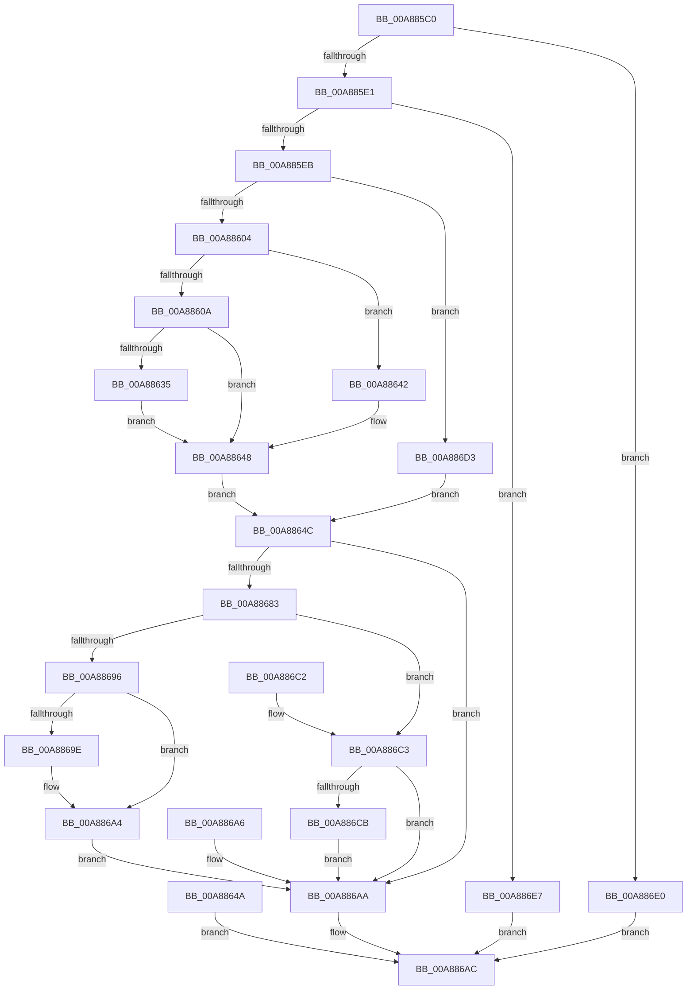

# NtQueryIoCompletion

- RVA: `0x00A885C0`–`0x00A886EE` (길이 `302` bytes)
- VA: `0x0000000140A885C0`
- 실행 섹션: `PAGE`
- PDB 이름 있음: `예`; PDB Function 태그: `아니요`
- unwind 정보 RVA: `0x000B807C`
- 디코드: `83`개 명령, `302/302` bytes 표시
- 미해석 바이트: `0` (있으면 어셈블리에 `.byte`로 보존)

> 이 문서는 커널 이미지의 기계어와 PDB 기호를 분석해 생성했습니다. 4번과 5번은 함수 원형과 자료형을 바이너리 사용 방식에서 추정한 C 해석이며 원본 소스 복구 결과는 아닙니다.

## 1. Dependencies

- 직접 호출 지점: **3**; 고유 호출 대상: **3**
- 직접 호출자로 확인된 함수: **0**
- RIP 상대 이미지 참조: **1**

### Outgoing calls
- `0x00A88642` → [ExRaiseDatatypeMisalignment](../89/ExRaiseDatatypeMisalignment_function_00899FD0.md) (function, `0x00899FD0`)
- `0x00A88674` → [ObReferenceObjectByHandle](../86/ObReferenceObjectByHandle_function_00868DB0.md) (function, `0x00868DB0`)
- `0x00A8868C` → [ObfDereferenceObject](../../text/2F/ObfDereferenceObject_function_002F9350.md) (function, `0x002F9350`)

### Direct callers
- 이 함수 시작 RVA로 연결되는 직접 call은 확인되지 않았습니다. 간접 호출은 완전히 역산할 수 없습니다.

### Static image references
- `0x00A8864C` → RVA `0x00FC6CC0` (`ALMOSTRO`; read)

## 2. Other-region calls and transfers

- 다른 실행 섹션으로 향하는 call: **1**
  - `0x00A8868C` → [ObfDereferenceObject](../../text/2F/ObfDereferenceObject_function_002F9350.md) (`PAGE` → `.text`)
- 별도 외부 분기/꼬리 이동을 확인하지 못했습니다.

## 3. Assembly (complete function range)

```asm
00A885C0  48 89 5C 24 08                  mov qword ptr [rsp + 8], rbx
00A885C5  48 89 74 24 18                  mov qword ptr [rsp + 0x18], rsi
00A885CA  57                              push rdi
00A885CB  41 56                           push r14
00A885CD  41 57                           push r15
00A885CF  48 83 EC 50                     sub rsp, 0x50
00A885D3  49 8B F8                        mov rdi, r8
00A885D6  4C 8B D1                        mov r10, rcx
00A885D9  85 D2                           test edx, edx
00A885DB  0F 85 FF 00 00 00               jne 0x140a886e0
00A885E1  41 83 F9 04                     cmp r9d, 4
00A885E5  0F 85 FC 00 00 00               jne 0x140a886e7
00A885EB  65 48 8B 04 25 88 01 00 00      mov rax, qword ptr gs:[0x188]
00A885F4  44 8A B8 32 02 00 00            mov r15b, byte ptr [rax + 0x232]
00A885FB  45 84 FF                        test r15b, r15b
00A885FE  0F 84 CF 00 00 00               je 0x140a886d3
00A88604  40 F6 C7 03                     test dil, 3
00A88608  75 38                           jne 0x140a88642
00A8860A  48 BA 00 00 FF FF FF 7F 00 00   movabs rdx, 0x7fffffff0000
00A88614  48 8B CA                        mov rcx, rdx
00A88617  4C 3B C2                        cmp r8, rdx
00A8861A  49 0F 42 C8                     cmovb rcx, r8
00A8861E  8A 01                           mov al, byte ptr [rcx]
00A88620  88 01                           mov byte ptr [rcx], al
00A88622  8A 41 03                        mov al, byte ptr [rcx + 3]
00A88625  88 41 03                        mov byte ptr [rcx + 3], al
00A88628  48 8B 9C 24 90 00 00 00         mov rbx, qword ptr [rsp + 0x90]
00A88630  48 85 DB                        test rbx, rbx
00A88633  74 13                           je 0x140a88648
00A88635  48 3B DA                        cmp rbx, rdx
00A88638  48 0F 42 D3                     cmovb rdx, rbx
00A8863C  8B 02                           mov eax, dword ptr [rdx]
00A8863E  89 02                           mov dword ptr [rdx], eax
00A88640  EB 06                           jmp 0x140a88648
00A88642  E8 89 19 E1 FF                  call 0x140899fd0
00A88647  CC                              int3
00A88648  EB 02                           jmp 0x140a8864c
00A8864A  EB 60                           jmp 0x140a886ac
00A8864C  4C 8B 05 6D E6 53 00            mov r8, qword ptr [rip + 0x53e66d]
00A88653  48 83 64 24 38 00               and qword ptr [rsp + 0x38], 0
00A88659  48 83 64 24 28 00               and qword ptr [rsp + 0x28], 0
00A8865F  48 8D 44 24 38                  lea rax, [rsp + 0x38]
00A88664  48 89 44 24 20                  mov qword ptr [rsp + 0x20], rax
00A88669  45 8A CF                        mov r9b, r15b
00A8866C  BA 01 00 00 00                  mov edx, 1
00A88671  49 8B CA                        mov rcx, r10
00A88674  E8 37 07 DE FF                  call 0x140868db0
00A88679  8B F0                           mov esi, eax
00A8867B  89 44 24 78                     mov dword ptr [rsp + 0x78], eax
00A8867F  85 C0                           test eax, eax
00A88681  78 27                           js 0x140a886aa
00A88683  48 8B 4C 24 38                  mov rcx, qword ptr [rsp + 0x38]
00A88688  44 8B 71 04                     mov r14d, dword ptr [rcx + 4]
00A8868C  E8 BF 0C 87 FF                  call 0x1402f9350
00A88691  45 84 FF                        test r15b, r15b
00A88694  74 2D                           je 0x140a886c3
00A88696  44 89 37                        mov dword ptr [rdi], r14d
00A88699  48 85 DB                        test rbx, rbx
00A8869C  74 06                           je 0x140a886a4
00A8869E  C7 03 04 00 00 00               mov dword ptr [rbx], 4
00A886A4  EB 04                           jmp 0x140a886aa
00A886A6  8B 74 24 78                     mov esi, dword ptr [rsp + 0x78]
00A886AA  8B C6                           mov eax, esi
00A886AC  4C 8D 5C 24 50                  lea r11, [rsp + 0x50]
00A886B1  49 8B 5B 20                     mov rbx, qword ptr [r11 + 0x20]
00A886B5  49 8B 73 30                     mov rsi, qword ptr [r11 + 0x30]
00A886B9  49 8B E3                        mov rsp, r11
00A886BC  41 5F                           pop r15
00A886BE  41 5E                           pop r14
00A886C0  5F                              pop rdi
00A886C1  C3                              ret
00A886C2  CC                              int3
00A886C3  44 89 37                        mov dword ptr [rdi], r14d
00A886C6  48 85 DB                        test rbx, rbx
00A886C9  74 DF                           je 0x140a886aa
00A886CB  C7 03 04 00 00 00               mov dword ptr [rbx], 4
00A886D1  EB D7                           jmp 0x140a886aa
00A886D3  48 8B 9C 24 90 00 00 00         mov rbx, qword ptr [rsp + 0x90]
00A886DB  E9 6C FF FF FF                  jmp 0x140a8864c
00A886E0  B8 03 00 00 C0                  mov eax, 0xc0000003
00A886E5  EB C5                           jmp 0x140a886ac
00A886E7  B8 04 00 00 C0                  mov eax, 0xc0000004
00A886EC  EB BE                           jmp 0x140a886ac
```

## 4. C-style interpretation (structured pseudocode)

```c
__int64 __fastcall NtQueryIoCompletion(__int64 a1, int a2, __int64 a3, int a4, __int64 a5)
{
    __int64 result;
    __int64 v_rsp;
    unsigned __int64 v_stack_m18;
    unsigned __int64 v_stack_m30;
    unsigned __int64 v_stack_m40;
    unsigned __int64 v_stack_m48;
    unsigned int v_stack_p10;
    unsigned __int64 v_stack_p18;
    unsigned __int64 v_stack_p8;

    v_stack_p8 = v_rbx;
    v_stack_p18 = v_rsi;
    v_rsp = (v_rsp) - (80);
    if (a2 != 0) goto loc_00A886E0;
    if (a4 != 4) goto loc_00A886E7;
    if ((unsigned __int8)(*(unsigned __int8 *)(*(unsigned __int64 *)(gs_base + (0 + 392)) + 562)) == 0) goto loc_00A886D3;
    if ((((unsigned __int8)(a3)) & (3)) != 0) goto loc_00A88642;
    if (a3 < a2) { a2 = a3; }
    *(unsigned __int8 *)(a2) = (unsigned __int8)(*(unsigned __int8 *)(a2));
    *(unsigned __int8 *)(a2 + 3) = (unsigned __int8)(*(unsigned __int8 *)(a2 + 3));
    if (a5 == 0) goto loc_00A88648;
    if (a5 < a2) { a2 = a5; }
    *(unsigned int *)(a2) = (unsigned int)((unsigned int)(*(unsigned int *)(a2)));
    goto loc_00A88648;
loc_00A88642:
    result = ExRaiseDatatypeMisalignment(a2, a2, a3, a4);
loc_00A88648:
    goto loc_00A8864C;
loc_00A8864C:
    v_stack_m48 = v_stack_m30;
    result = ObReferenceObjectByHandle(a1, 1, *(unsigned __int64 *)(v_rip + 5498477), (unsigned __int8)(*(unsigned __int8 *)(*(unsigned __int64 *)(gs_base + (0 + 392)) + 562)));
    v_stack_p10 = (unsigned int)(result);
    if (sign_flag) goto loc_00A886AA;
    result = ObfDereferenceObject(v_stack_m30, 1, *(unsigned __int64 *)(v_rip + 5498477), (unsigned __int8)(*(unsigned __int8 *)(*(unsigned __int64 *)(gs_base + (0 + 392)) + 562)));
    if ((unsigned __int8)(*(unsigned __int8 *)(*(unsigned __int64 *)(gs_base + (0 + 392)) + 562)) == 0) goto loc_00A886C3;
    *(unsigned int *)(a3) = (unsigned int)((unsigned int)(*(unsigned int *)(v_stack_m30 + 4)));
    if (a5 != 0) {
        *(unsigned int *)(a5) = 4;
    }
    goto loc_00A886AA;
loc_00A886AA:
loc_00A886AC:
    return (unsigned int)((unsigned int)((unsigned int)((unsigned int)(result))));
loc_00A886C3:
    *(unsigned int *)(a3) = (unsigned int)((unsigned int)(*(unsigned int *)(v_stack_m30 + 4)));
    if (*(unsigned __int64 *)(v_stack_m18 + 32) == 0) goto loc_00A886AA;
    *(unsigned int *)(*(unsigned __int64 *)(v_stack_m18 + 32)) = 4;
    goto loc_00A886AA;
loc_00A886D3:
    goto loc_00A8864C;
loc_00A886E0:
    goto loc_00A886AC;
loc_00A886E7:
    goto loc_00A886AC;
}
```

## 5. (Beta) C Style

```c
int64_t NtQueryIoCompletion(int64_t Arg1, int32_t Arg2, int64_t Arg3, int32_t Arg4, int64_t Arg5)
{
    int64_t result;
    int64_t local_rsp;
    uint64_t v_stack_m18;
    uint64_t v_stack_m30;
    uint64_t v_stack_m40;
    uint64_t v_stack_m48;
    uint32_t v_stack_p10;
    uint64_t v_stack_p18;
    uint64_t v_stack_p8;

    v_stack_p8 = local_rbx;
    v_stack_p18 = local_rsi;
    local_rsp = (local_rsp) - (80);
    if (Arg2 != 0) goto loc_00A886E0;
    if (Arg4 != 4) goto loc_00A886E7;
    if ((uint8_t)(*(uint8_t *)(*(uint64_t *)(gs_base + (0 + 0x188)) + 0x232)) == 0) goto loc_00A886D3;
    if ((((uint8_t)(Arg3)) & (3)) != 0) goto loc_00A88642;
    if (Arg3 < Arg2) { Arg2 = Arg3; }
    *(uint8_t *)(Arg2) = (uint8_t)(*(uint8_t *)(Arg2));
    *(uint8_t *)(Arg2 + 0x3) = (uint8_t)(*(uint8_t *)(Arg2 + 0x3));
    if (Arg5 == 0) goto loc_00A88648;
    if (Arg5 < Arg2) { Arg2 = Arg5; }
    *(uint32_t *)(Arg2) = (uint32_t)((uint32_t)(*(uint32_t *)(Arg2)));
    goto loc_00A88648;
loc_00A88642:
    result = ExRaiseDatatypeMisalignment(Arg2, Arg2, Arg3, Arg4);
loc_00A88648:
    goto loc_00A8864C;
loc_00A8864C:
    v_stack_m48 = v_stack_m30;
    result = ObReferenceObjectByHandle(Arg1, 1, *(uint64_t *)(v_rip + 0x53E66D), (uint8_t)(*(uint8_t *)(*(uint64_t *)(gs_base + (0 + 0x188)) + 0x232)));
    v_stack_p10 = (uint32_t)(result);
    if (sign_flag) goto loc_00A886AA;
    result = ObfDereferenceObject(v_stack_m30, 1, *(uint64_t *)(v_rip + 0x53E66D), (uint8_t)(*(uint8_t *)(*(uint64_t *)(gs_base + (0 + 0x188)) + 0x232)));
    if ((uint8_t)(*(uint8_t *)(*(uint64_t *)(gs_base + (0 + 0x188)) + 0x232)) == 0) goto loc_00A886C3;
    *(uint32_t *)(Arg3) = (uint32_t)((uint32_t)(*(uint32_t *)(v_stack_m30 + 0x4)));
    if (Arg5 != 0) {
        *(uint32_t *)(Arg5) = 4;
    }
    goto loc_00A886AA;
loc_00A886AA:
loc_00A886AC:
    return (uint32_t)((uint32_t)((uint32_t)((uint32_t)(result))));
loc_00A886C3:
    *(uint32_t *)(Arg3) = (uint32_t)((uint32_t)(*(uint32_t *)(v_stack_m30 + 0x4)));
    if (*(uint64_t *)(v_stack_m18 + 0x20) == 0) goto loc_00A886AA;
    *(uint32_t *)(*(uint64_t *)(v_stack_m18 + 0x20)) = 4;
    goto loc_00A886AA;
loc_00A886D3:
    goto loc_00A8864C;
loc_00A886E0:
    goto loc_00A886AC;
loc_00A886E7:
    goto loc_00A886AC;
}
```

## 6. Execution-region graph

[열기: 2D/3D 그래프와 함수 탐색 컨트롤 패널](../../../control-panel.html?section=page&rva=0x00A885C0&view=graph)

- 2D 그래프는 위에서 아래로 흐르고, 3D 그래프는 빈 공간을 드래그해 회전합니다. Shift+드래그는 이동, 휠은 확대·축소, 함수 노드 선택은 대상 보고서 이동입니다.

### Static fallback


