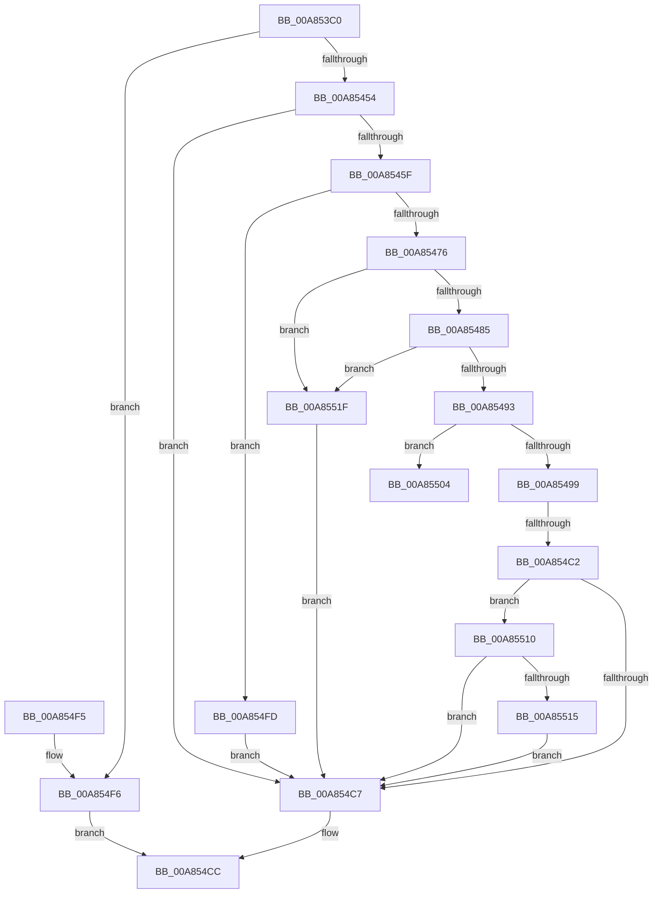

# NtSaveKeyEx

- RVA: `0x00A853C0`–`0x00A85526` (길이 `358` bytes)
- VA: `0x0000000140A853C0`
- 실행 섹션: `PAGE`
- PDB 이름 있음: `예`; PDB Function 태그: `예`
- unwind 정보 RVA: `0x000B799C`
- 디코드: `100`개 명령, `358/358` bytes 표시
- 미해석 바이트: `0` (있으면 어셈블리에 `.byte`로 보존)

> 이 문서는 커널 이미지의 기계어와 PDB 기호를 분석해 생성했습니다. 4번과 5번은 함수 원형과 자료형을 바이너리 사용 방식에서 추정한 C 해석이며 원본 소스 복구 결과는 아닙니다.

## 1. Dependencies

- 직접 호출 지점: **9**; 고유 호출 대상: **9**
- 직접 호출자로 확인된 함수: **1**
- RIP 상대 이미지 참조: **2**

### Outgoing calls
- `0x00A85432` → [CmpInitializeThreadInfo](../../text/3F/CmpInitializeThreadInfo_function_003FBE70.md) (function, `0x003FBE70`)
- `0x00A85447` → [CmpAcquireShutdownRundown](../../pagecmrc/BC/CmpAcquireShutdownRundown_function_00BC9400.md) (function, `0x00BC9400`)
- `0x00A85454` → [CmCheckNoTxContext](../87/CmCheckNoTxContext_function_00876A80.md) (function, `0x00876A80`)
- `0x00A85469` → [SeSinglePrivilegeCheck](../87/SeSinglePrivilegeCheck_function_00871E20.md) (function, `0x00871E20`)
- `0x00A854AF` → [IoConvertFileHandleToKernelHandle](IoConvertFileHandleToKernelHandle_function_00A85680.md) (function, `0x00A85680`)
- `0x00A854C7` → [CmpReleaseShutdownRundown](../../pagecmrc/BC/CmpReleaseShutdownRundown_function_00BC9880.md) (function, `0x00BC9880`)
- `0x00A854D0` → [CmCleanupThreadInfo](../../text/41/CmCleanupThreadInfo_function_0041FD50.md) (function, `0x0041FD50`)
- `0x00A854DE` → [_security_check_cookie](../../text/6A/_security_check_cookie_function_006AC640.md) (function, `0x006AC640`)
- `0x00A85518` → [ZwClose](../../text/6A/ZwClose_function_006AD2B0.md) (function, `0x006AD2B0`)

### Direct callers
- [NtSaveKey](../7E/NtSaveKey_function_007E1050.md) at `0x007E105A`

### Static image references
- `0x00A853D7` → RVA `0x00E0A740` (`.data`; read)
- `0x00A8545F` → RVA `0x00FD9AC0` (`PAGEDATA`; read)

## 2. Other-region calls and transfers

- 다른 실행 섹션으로 향하는 call: **6**
  - `0x00A85432` → [CmpInitializeThreadInfo](../../text/3F/CmpInitializeThreadInfo_function_003FBE70.md) (`PAGE` → `.text`)
  - `0x00A85447` → [CmpAcquireShutdownRundown](../../pagecmrc/BC/CmpAcquireShutdownRundown_function_00BC9400.md) (`PAGE` → `PAGECMRC`)
  - `0x00A854C7` → [CmpReleaseShutdownRundown](../../pagecmrc/BC/CmpReleaseShutdownRundown_function_00BC9880.md) (`PAGE` → `PAGECMRC`)
  - `0x00A854D0` → [CmCleanupThreadInfo](../../text/41/CmCleanupThreadInfo_function_0041FD50.md) (`PAGE` → `.text`)
  - `0x00A854DE` → [_security_check_cookie](../../text/6A/_security_check_cookie_function_006AC640.md) (`PAGE` → `.text`)
  - `0x00A85518` → [ZwClose](../../text/6A/ZwClose_function_006AD2B0.md) (`PAGE` → `.text`)
- call이 아닌 외부 분기/꼬리 이동: **2**
  - `0x00A854BC` → [sub_00B44216](../B4/Unknown_function_00B44216.md) (`tail-transfer`)
  - `0x00A8550B` → [sub_00B44216](../B4/Unknown_function_00B44216.md) (`tail-transfer`)

## 3. Assembly (complete function range)

```asm
00A853C0  40 55                           push rbp
00A853C2  53                              push rbx
00A853C3  56                              push rsi
00A853C4  57                              push rdi
00A853C5  41 54                           push r12
00A853C7  41 56                           push r14
00A853C9  41 57                           push r15
00A853CB  48 8D 6C 24 D9                  lea rbp, [rsp - 0x27]
00A853D0  48 81 EC E0 00 00 00            sub rsp, 0xe0
00A853D7  48 8B 05 62 53 38 00            mov rax, qword ptr [rip + 0x385362]
00A853DE  48 33 C4                        xor rax, rsp
00A853E1  48 89 45 1F                     mov qword ptr [rbp + 0x1f], rax
00A853E5  33 C0                           xor eax, eax
00A853E7  0F 57 C0                        xorps xmm0, xmm0
00A853EA  48 21 45 8F                     and qword ptr [rbp - 0x71], rax
00A853EE  0F 57 C9                        xorps xmm1, xmm1
00A853F1  48 21 45 87                     and qword ptr [rbp - 0x79], rax
00A853F5  48 8B F1                        mov rsi, rcx
00A853F8  48 89 45 B7                     mov qword ptr [rbp - 0x49], rax
00A853FC  48 8D 4D A7                     lea rcx, [rbp - 0x59]
00A85400  48 8D 45 97                     lea rax, [rbp - 0x69]
00A85404  45 8B F0                        mov r14d, r8d
00A85407  48 89 45 9F                     mov qword ptr [rbp - 0x61], rax
00A8540B  4C 8B E2                        mov r12, rdx
00A8540E  48 8D 45 97                     lea rax, [rbp - 0x69]
00A85412  48 89 45 97                     mov qword ptr [rbp - 0x69], rax
00A85416  0F 11 45 A7                     movups xmmword ptr [rbp - 0x59], xmm0
00A8541A  0F 11 4D BF                     movups xmmword ptr [rbp - 0x41], xmm1
00A8541E  0F 11 4D CF                     movups xmmword ptr [rbp - 0x31], xmm1
00A85422  0F 11 4D DF                     movups xmmword ptr [rbp - 0x21], xmm1
00A85426  0F 11 45 EF                     movups xmmword ptr [rbp - 0x11], xmm0
00A8542A  0F 11 45 FF                     movups xmmword ptr [rbp - 1], xmm0
00A8542E  0F 11 45 0F                     movups xmmword ptr [rbp + 0xf], xmm0
00A85432  E8 39 6A 97 FF                  call 0x1403fbe70
00A85437  65 48 8B 0C 25 88 01 00 00      mov rcx, qword ptr gs:[0x188]
00A85440  44 8A B9 32 02 00 00            mov r15b, byte ptr [rcx + 0x232]
00A85447  E8 B4 3F 14 00                  call 0x140bc9400
00A8544C  84 C0                           test al, al
00A8544E  0F 84 A2 00 00 00               je 0x140a854f6
00A85454  E8 27 16 DF FF                  call 0x140876a80
00A85459  8B D8                           mov ebx, eax
00A8545B  85 C0                           test eax, eax
00A8545D  78 68                           js 0x140a854c7
00A8545F  48 8B 0D 5A 46 55 00            mov rcx, qword ptr [rip + 0x55465a]
00A85466  41 8A D7                        mov dl, r15b
00A85469  E8 B2 C9 DE FF                  call 0x140871e20
00A8546E  84 C0                           test al, al
00A85470  0F 84 87 00 00 00               je 0x140a854fd
00A85476  41 8D 46 FF                     lea eax, [r14 - 1]
00A8547A  A9 FC FF FF FF                  test eax, 0xfffffffc
00A8547F  0F 85 9A 00 00 00               jne 0x140a8551f
00A85485  B8 03 00 00 00                  mov eax, 3
00A8548A  44 3B F0                        cmp r14d, eax
00A8548D  0F 84 8C 00 00 00               je 0x140a8551f
00A85493  41 80 FF 01                     cmp r15b, 1
00A85497  75 6B                           jne 0x140a85504
00A85499  45 33 C9                        xor r9d, r9d
00A8549C  48 8D 45 87                     lea rax, [rbp - 0x79]
00A854A0  41 8A D7                        mov dl, r15b
00A854A3  48 89 44 24 20                  mov qword ptr [rsp + 0x20], rax
00A854A8  49 8B CC                        mov rcx, r12
00A854AB  45 8D 41 02                     lea r8d, [r9 + 2]
00A854AF  E8 CC 01 00 00                  call 0x140a85680
00A854B4  48 8B 7D 87                     mov rdi, qword ptr [rbp - 0x79]
00A854B8  8B D8                           mov ebx, eax
00A854BA  85 C0                           test eax, eax
00A854BC  0F 89 54 ED 0B 00               jns 0x140b44216
00A854C2  48 85 FF                        test rdi, rdi
00A854C5  75 49                           jne 0x140a85510
00A854C7  E8 B4 43 14 00                  call 0x140bc9880
00A854CC  48 8D 4D A7                     lea rcx, [rbp - 0x59]
00A854D0  E8 7B A8 99 FF                  call 0x14041fd50
00A854D5  8B C3                           mov eax, ebx
00A854D7  48 8B 4D 1F                     mov rcx, qword ptr [rbp + 0x1f]
00A854DB  48 33 CC                        xor rcx, rsp
00A854DE  E8 5D 71 C2 FF                  call 0x1406ac640
00A854E3  48 81 C4 E0 00 00 00            add rsp, 0xe0
00A854EA  41 5F                           pop r15
00A854EC  41 5E                           pop r14
00A854EE  41 5C                           pop r12
00A854F0  5F                              pop rdi
00A854F1  5E                              pop rsi
00A854F2  5B                              pop rbx
00A854F3  5D                              pop rbp
00A854F4  C3                              ret
00A854F5  CC                              int3
00A854F6  BB 89 01 00 C0                  mov ebx, 0xc0000189
00A854FB  EB CF                           jmp 0x140a854cc
00A854FD  BB 61 00 00 C0                  mov ebx, 0xc0000061
00A85502  EB C3                           jmp 0x140a854c7
00A85504  49 8B FC                        mov rdi, r12
00A85507  4C 89 65 87                     mov qword ptr [rbp - 0x79], r12
00A8550B  E9 06 ED 0B 00                  jmp 0x140b44216
00A85510  49 3B FC                        cmp rdi, r12
00A85513  74 B2                           je 0x140a854c7
00A85515  48 8B CF                        mov rcx, rdi
00A85518  E8 93 7D C2 FF                  call 0x1406ad2b0
00A8551D  EB A8                           jmp 0x140a854c7
00A8551F  BB 0D 00 00 C0                  mov ebx, 0xc000000d
00A85524  EB A1                           jmp 0x140a854c7
```

## 4. C-style interpretation (structured pseudocode)

```c
__int64 __fastcall NtSaveKeyEx(__int64 a1, __int64 a2, int a3, int a4)
{
    __int64 result;
    __int64 v_rsp;
    unsigned __int64 v_stack_m40;
    unsigned __int64 v_stack_m50;
    unsigned __int64 v_stack_m5F;
    unsigned __int64 v_stack_m60;
    unsigned __int64 v_stack_m70;
    unsigned __int64 v_stack_m80;
    unsigned __int64 v_stack_m90;
    unsigned __int64 v_stack_mA0;
    unsigned __int64 v_stack_mA8;
    unsigned __int64 v_stack_mB8;
    unsigned __int64 v_stack_mC0;
    unsigned __int64 v_stack_mC8;
    unsigned __int64 v_stack_mD0;
    unsigned __int64 v_stack_mD8;
    unsigned __int64 v_stack_mF8;

    v_rsp = (v_rsp) - (224);
    result = (*(unsigned __int64 *)(v_rip + 3691362)) ^ (v_rsp);
    v_stack_m40 = result;
    result = 0;
    v_stack_mA8 = 0;
    v_stack_mC0 = v_stack_mC8;
    v_stack_mC8 = v_stack_mC8;
    v_stack_mB8 = v_xmm0;
    v_stack_mA0 = v_xmm1;
    v_stack_m90 = v_xmm1;
    v_stack_m80 = v_xmm1;
    v_stack_m70 = v_xmm0;
    v_stack_m60 = v_xmm0;
    v_stack_m50 = v_xmm0;
    result = CmpInitializeThreadInfo(v_stack_mB8, a2, a3, a4);
    result = CmpAcquireShutdownRundown(*(unsigned __int64 *)(gs_base + (0 + 392)), a2, a3, a4);
    if ((unsigned __int8)(result) == 0) goto loc_00A854F6;
    result = CmCheckNoTxContext(*(unsigned __int64 *)(gs_base + (0 + 392)), a2, a3, a4);
    if (sign_flag) goto loc_00A854C7;
    result = SeSinglePrivilegeCheck(*(unsigned __int64 *)(v_rip + 5588570), (unsigned __int8)(*(unsigned __int8 *)(*(unsigned __int64 *)(gs_base + (0 + 392)) + 562)), a3, a4);
    if ((unsigned __int8)(result) == 0) goto loc_00A854FD;
    if ((((unsigned int)((unsigned int)(a3) - 1)) & (0xFFFFFFFCULL)) != 0) goto loc_00A8551F;
    if (((unsigned int)((unsigned int)(a3))) == 3) goto loc_00A8551F;
    if (((unsigned __int8)(*(unsigned __int8 *)(*(unsigned __int64 *)(gs_base + (0 + 392)) + 562))) != 1) goto loc_00A85504;
    a4 = 0;
    v_stack_mF8 = v_stack_mD8;
    result = IoConvertFileHandleToKernelHandle(a2, (unsigned __int8)(*(unsigned __int8 *)(*(unsigned __int64 *)(gs_base + (0 + 392)) + 562)), a4 + 2, a4);
    if (v_stack_mD8 != 0) goto loc_00A85510;
loc_00A854C7:
    result = CmpReleaseShutdownRundown(a2, (unsigned __int8)(*(unsigned __int8 *)(*(unsigned __int64 *)(gs_base + (0 + 392)) + 562)), a4 + 2, a4);
loc_00A854CC:
    result = CmCleanupThreadInfo(v_stack_mB8, (unsigned __int8)(*(unsigned __int8 *)(*(unsigned __int64 *)(gs_base + (0 + 392)) + 562)), a4 + 2, a4);
    a1 = (v_stack_m40) ^ (v_rsp);
    result = _security_check_cookie(a1, (unsigned __int8)(*(unsigned __int8 *)(*(unsigned __int64 *)(gs_base + (0 + 392)) + 562)), a4 + 2, a4);
    v_rsp = (v_rsp) + (224);
    return result;
loc_00A854F6:
    goto loc_00A854CC;
loc_00A854FD:
    goto loc_00A854C7;
loc_00A85504:
    v_stack_mD8 = a2;
loc_00A85510:
    if (a2 == a2) goto loc_00A854C7;
    result = ZwClose(a2, (unsigned __int8)(*(unsigned __int8 *)(*(unsigned __int64 *)(gs_base + (0 + 392)) + 562)), a4 + 2, a4);
    goto loc_00A854C7;
loc_00A8551F:
    goto loc_00A854C7;
}
```

## 5. (Beta) C Style

```c
int64_t NtSaveKeyEx(int64_t Arg1, int64_t Arg2, void *Arg3, int32_t Arg4)
{
    uint8_t *arg3 = (uint8_t *)Arg3;

    int64_t result;
    int64_t local_rsp;
    uint64_t v_stack_m40;
    uint64_t v_stack_m50;
    uint64_t v_stack_m5F;
    uint64_t v_stack_m60;
    uint64_t v_stack_m70;
    uint64_t v_stack_m80;
    uint64_t v_stack_m90;
    uint64_t v_stack_mA0;
    uint64_t v_stack_mA8;
    uint64_t v_stack_mB8;
    uint64_t v_stack_mC0;
    uint64_t v_stack_mC8;
    uint64_t v_stack_mD0;
    uint64_t v_stack_mD8;
    uint64_t v_stack_mF8;

    local_rsp = (local_rsp) - (224);
    result = (*(uint64_t *)(v_rip + 0x385362)) ^ (local_rsp);
    v_stack_m40 = result;
    result = 0;
    v_stack_mA8 = 0;
    v_stack_mC0 = v_stack_mC8;
    v_stack_mC8 = v_stack_mC8;
    v_stack_mB8 = v_xmm0;
    v_stack_mA0 = v_xmm1;
    v_stack_m90 = v_xmm1;
    v_stack_m80 = v_xmm1;
    v_stack_m70 = v_xmm0;
    v_stack_m60 = v_xmm0;
    v_stack_m50 = v_xmm0;
    result = CmpInitializeThreadInfo(v_stack_mB8, Arg2, Arg3, Arg4);
    result = CmpAcquireShutdownRundown(*(uint64_t *)(gs_base + (0 + 0x188)), Arg2, Arg3, Arg4);
    if ((uint8_t)(result) == 0) goto loc_00A854F6;
    result = CmCheckNoTxContext(*(uint64_t *)(gs_base + (0 + 0x188)), Arg2, Arg3, Arg4);
    if (sign_flag) goto loc_00A854C7;
    result = SeSinglePrivilegeCheck(*(uint64_t *)(v_rip + 0x55465A), (uint8_t)(*(uint8_t *)(*(uint64_t *)(gs_base + (0 + 0x188)) + 0x232)), Arg3, Arg4);
    if ((uint8_t)(result) == 0) goto loc_00A854FD;
    if ((((uint32_t)((uint32_t)(Arg3) - 1)) & (0xFFFFFFFCULL)) != 0) goto loc_00A8551F;
    if (((uint32_t)((uint32_t)(Arg3))) == 3) goto loc_00A8551F;
    if (((uint8_t)(*(uint8_t *)(*(uint64_t *)(gs_base + (0 + 0x188)) + 0x232))) != 1) goto loc_00A85504;
    Arg4 = 0;
    v_stack_mF8 = v_stack_mD8;
    result = IoConvertFileHandleToKernelHandle(Arg2, (uint8_t)(*(uint8_t *)(*(uint64_t *)(gs_base + (0 + 0x188)) + 0x232)), Arg4 + 2, Arg4);
    if (v_stack_mD8 != 0) goto loc_00A85510;
loc_00A854C7:
    result = CmpReleaseShutdownRundown(Arg2, (uint8_t)(*(uint8_t *)(*(uint64_t *)(gs_base + (0 + 0x188)) + 0x232)), Arg4 + 2, Arg4);
loc_00A854CC:
    result = CmCleanupThreadInfo(v_stack_mB8, (uint8_t)(*(uint8_t *)(*(uint64_t *)(gs_base + (0 + 0x188)) + 0x232)), Arg4 + 2, Arg4);
    Arg1 = (v_stack_m40) ^ (local_rsp);
    result = _security_check_cookie(Arg1, (uint8_t)(*(uint8_t *)(*(uint64_t *)(gs_base + (0 + 0x188)) + 0x232)), Arg4 + 2, Arg4);
    local_rsp = (local_rsp) + (224);
    return result;
loc_00A854F6:
    goto loc_00A854CC;
loc_00A854FD:
    goto loc_00A854C7;
loc_00A85504:
    v_stack_mD8 = Arg2;
loc_00A85510:
    if (Arg2 == Arg2) goto loc_00A854C7;
    result = ZwClose(Arg2, (uint8_t)(*(uint8_t *)(*(uint64_t *)(gs_base + (0 + 0x188)) + 0x232)), Arg4 + 2, Arg4);
    goto loc_00A854C7;
loc_00A8551F:
    goto loc_00A854C7;
}
```

### 관측된 메모리 오프셋

구조체 형식이 확인되지 않은 접근은 인자 기준의 오프셋으로만 기록했습니다.

| 기준 인자 | 오프셋 표현 | 폭 (bit) | 접근 |
|---|---:|---:|---|
| `Arg3` | `- 0x1` | `32` | `R` |

## 6. Execution-region graph

[열기: 2D/3D 그래프와 함수 탐색 컨트롤 패널](../../../control-panel.html?section=page&rva=0x00A853C0&view=graph)

- 2D 그래프는 위에서 아래로 흐르고, 3D 그래프는 빈 공간을 드래그해 회전합니다. Shift+드래그는 이동, 휠은 확대·축소, 함수 노드 선택은 대상 보고서 이동입니다.

### Static fallback


