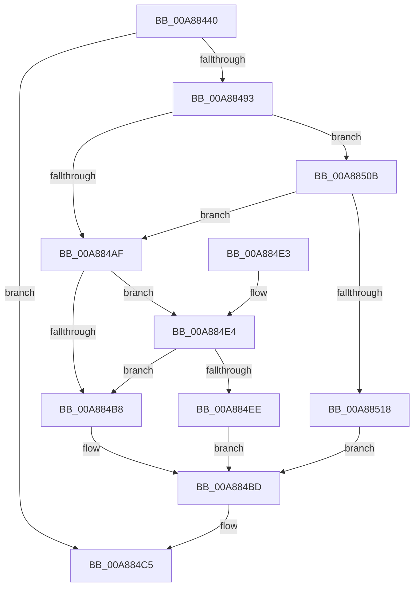

# NtSetContextThread

- RVA: `0x00A88440`–`0x00A8851F` (길이 `223` bytes)
- VA: `0x0000000140A88440`
- 실행 섹션: `PAGE`
- PDB 이름 있음: `예`; PDB Function 태그: `아니요`
- unwind 정보 RVA: `0x000B7FEC`
- 디코드: `57`개 명령, `223/223` bytes 표시
- 미해석 바이트: `0` (있으면 어셈블리에 `.byte`로 보존)

> 이 문서는 커널 이미지의 기계어와 PDB 기호를 분석해 생성했습니다. 4번과 5번은 함수 원형과 자료형을 바이너리 사용 방식에서 추정한 C 해석이며 원본 소스 복구 결과는 아닙니다.

## 1. Dependencies

- 직접 호출 지점: **6**; 고유 호출 대상: **5**
- 직접 호출자로 확인된 함수: **0**
- RIP 상대 이미지 참조: **1**

### Outgoing calls
- `0x00A88488` → [ObReferenceObjectByHandle](../86/ObReferenceObjectByHandle_function_00868DB0.md) (function, `0x00868DB0`)
- `0x00A88496` → [IoThreadToProcess](../../text/44/IoThreadToProcess_function_00448540.md) (function, `0x00448540`)
- `0x00A884C0` → [ObfDereferenceObject](../../text/2F/ObfDereferenceObject_function_002F9350.md) (function, `0x002F9350`)
- `0x00A884C7` → [PspLogAuditSetContextThreadEvent](PspLogAuditSetContextThreadEvent_function_00A88528.md) (function, `0x00A88528`)
- `0x00A88502` → [PspSetContextThreadInternal](../8D/PspSetContextThreadInternal_function_008D4420.md) (function, `0x008D4420`)
- `0x00A8850E` → [IoThreadToProcess](../../text/44/IoThreadToProcess_function_00448540.md) (function, `0x00448540`)

### Direct callers
- 이 함수 시작 RVA로 연결되는 직접 call은 확인되지 않았습니다. 간접 호출은 완전히 역산할 수 없습니다.

### Static image references
- `0x00A88469` → RVA `0x00FC6AC8` (`ALMOSTRO`; read)

## 2. Other-region calls and transfers

- 다른 실행 섹션으로 향하는 call: **3**
  - `0x00A88496` → [IoThreadToProcess](../../text/44/IoThreadToProcess_function_00448540.md) (`PAGE` → `.text`)
  - `0x00A884C0` → [ObfDereferenceObject](../../text/2F/ObfDereferenceObject_function_002F9350.md) (`PAGE` → `.text`)
  - `0x00A8850E` → [IoThreadToProcess](../../text/44/IoThreadToProcess_function_00448540.md) (`PAGE` → `.text`)
- 별도 외부 분기/꼬리 이동을 확인하지 못했습니다.

## 3. Assembly (complete function range)

```asm
00A88440  4C 8B DC                        mov r11, rsp
00A88443  49 89 5B 08                     mov qword ptr [r11 + 8], rbx
00A88447  49 89 6B 10                     mov qword ptr [r11 + 0x10], rbp
00A8844B  49 89 73 20                     mov qword ptr [r11 + 0x20], rsi
00A8844F  57                              push rdi
00A88450  48 83 EC 30                     sub rsp, 0x30
00A88454  65 48 8B 3C 25 88 01 00 00      mov rdi, qword ptr gs:[0x188]
00A8845D  49 8D 43 18                     lea rax, [r11 + 0x18]
00A88461  49 83 63 F0 00                  and qword ptr [r11 - 0x10], 0
00A88466  48 8B EA                        mov rbp, rdx
00A88469  4C 8B 05 58 E6 53 00            mov r8, qword ptr [rip + 0x53e658]
00A88470  BA 10 00 00 00                  mov edx, 0x10
00A88475  49 83 63 18 00                  and qword ptr [r11 + 0x18], 0
00A8847A  40 8A B7 32 02 00 00            mov sil, byte ptr [rdi + 0x232]
00A88481  44 8A CE                        mov r9b, sil
00A88484  49 89 43 E8                     mov qword ptr [r11 - 0x18], rax
00A88488  E8 23 09 DE FF                  call 0x140868db0
00A8848D  8B D8                           mov ebx, eax
00A8848F  85 C0                           test eax, eax
00A88491  78 32                           js 0x140a884c5
00A88493  48 8B CF                        mov rcx, rdi
00A88496  E8 A5 00 9C FF                  call 0x140448540
00A8849B  48 8B 7C 24 50                  mov rdi, qword ptr [rsp + 0x50]
00A884A0  48 8B D8                        mov rbx, rax
00A884A3  F7 80 F0 01 00 00 00 00 02 00   test dword ptr [rax + 0x1f0], 0x20000
00A884AD  75 5C                           jne 0x140a8850b
00A884AF  F7 47 74 00 04 00 00            test dword ptr [rdi + 0x74], 0x400
00A884B6  74 2C                           je 0x140a884e4
00A884B8  BB 08 00 00 C0                  mov ebx, 0xc0000008
00A884BD  48 8B CF                        mov rcx, rdi
00A884C0  E8 8B 0E 87 FF                  call 0x1402f9350
00A884C5  8B CB                           mov ecx, ebx
00A884C7  E8 5C 00 00 00                  call 0x140a88528
00A884CC  48 8B 6C 24 48                  mov rbp, qword ptr [rsp + 0x48]
00A884D1  8B C3                           mov eax, ebx
00A884D3  48 8B 5C 24 40                  mov rbx, qword ptr [rsp + 0x40]
00A884D8  48 8B 74 24 58                  mov rsi, qword ptr [rsp + 0x58]
00A884DD  48 83 C4 30                     add rsp, 0x30
00A884E1  5F                              pop rdi
00A884E2  C3                              ret
00A884E3  CC                              int3
00A884E4  48 83 BF 70 06 00 00 00         cmp qword ptr [rdi + 0x670], 0
00A884EC  75 CA                           jne 0x140a884b8
00A884EE  44 8A CE                        mov r9b, sil
00A884F1  C7 44 24 20 01 00 00 00         mov dword ptr [rsp + 0x20], 1
00A884F9  44 8A C6                        mov r8b, sil
00A884FC  48 8B D5                        mov rdx, rbp
00A884FF  48 8B CF                        mov rcx, rdi
00A88502  E8 19 BF E4 FF                  call 0x1408d4420
00A88507  8B D8                           mov ebx, eax
00A88509  EB B2                           jmp 0x140a884bd
00A8850B  48 8B CF                        mov rcx, rdi
00A8850E  E8 2D 00 9C FF                  call 0x140448540
00A88513  48 3B D8                        cmp rbx, rax
00A88516  75 97                           jne 0x140a884af
00A88518  BB 0A 06 00 C0                  mov ebx, 0xc000060a
00A8851D  EB 9E                           jmp 0x140a884bd
```

## 4. C-style interpretation (structured pseudocode)

```c
__int64 __fastcall NtSetContextThread(__int64 a1, __int64 a2)
{
    __int64 result;
    __int64 v_rsp;
    unsigned __int64 v_stack_p10;
    unsigned __int64 v_stack_p18;
    unsigned __int64 v_stack_p20;
    unsigned __int64 v_stack_p8;

    *(unsigned __int64 *)(v_rsp + 8) = v_rbx;
    *(unsigned __int64 *)(v_rsp + 16) = v_rbp;
    *(unsigned __int64 *)(v_rsp + 32) = v_rsi;
    v_rsp = (v_rsp) - (48);
    *(unsigned __int64 *)(v_rsp - 24) = v_rsp + 24;
    result = ObReferenceObjectByHandle(a1, 16, *(unsigned __int64 *)(v_rip + 5498456), (unsigned __int8)(*(unsigned __int8 *)(*(unsigned __int64 *)(gs_base + (0 + 392)) + 562)));
    if (sign_flag) goto loc_00A884C5;
    result = IoThreadToProcess(*(unsigned __int64 *)(gs_base + (0 + 392)), 16, *(unsigned __int64 *)(v_rip + 5498456), (unsigned __int8)(*(unsigned __int8 *)(*(unsigned __int64 *)(gs_base + (0 + 392)) + 562)));
    if (((*(unsigned int *)(result + 496)) & (0x20000ULL)) != 0) goto loc_00A8850B;
loc_00A884AF:
    if (((*(unsigned int *)(v_stack_p18 + 116)) & (0x400ULL)) == 0) goto loc_00A884E4;
loc_00A884B8:
loc_00A884BD:
    result = ObfDereferenceObject(v_stack_p18, 16, *(unsigned __int64 *)(v_rip + 5498456), (unsigned __int8)(*(unsigned __int8 *)(*(unsigned __int64 *)(gs_base + (0 + 392)) + 562)));
loc_00A884C5:
    result = PspLogAuditSetContextThreadEvent((unsigned int)((unsigned int)((unsigned int)(0xC0000008ULL))), 16, *(unsigned __int64 *)(v_rip + 5498456), (unsigned __int8)(*(unsigned __int8 *)(*(unsigned __int64 *)(gs_base + (0 + 392)) + 562)));
    v_rsp = (v_rsp) + (48);
    return (unsigned int)((unsigned int)((unsigned int)(0xC0000008ULL)));
loc_00A884E4:
    if ((*(unsigned __int64 *)(v_stack_p18 + 1648)) != 0) goto loc_00A884B8;
    v_stack_p20 = 1;
    result = PspSetContextThreadInternal(v_stack_p18, v_stack_p10, (unsigned __int8)(v_stack_p20), (unsigned __int8)(v_stack_p20));
    goto loc_00A884BD;
loc_00A8850B:
    result = IoThreadToProcess(v_stack_p18, v_stack_p10, (unsigned __int8)(v_stack_p20), (unsigned __int8)(v_stack_p20));
    if (((unsigned int)((unsigned int)(result))) != result) goto loc_00A884AF;
    goto loc_00A884BD;
}
```

## 5. (Beta) C Style

```c
int64_t NtSetContextThread(int64_t Arg1, int64_t Arg2)
{
    int64_t result;
    int64_t local_rsp;
    uint64_t v_stack_p10;
    uint64_t v_stack_p18;
    uint64_t v_stack_p20;
    uint64_t v_stack_p8;

    *(uint64_t *)(local_rsp + 0x8) = local_rbx;
    *(uint64_t *)(local_rsp + 0x10) = local_rbp;
    *(uint64_t *)(local_rsp + 0x20) = local_rsi;
    local_rsp = (local_rsp) - (48);
    *(uint64_t *)(local_rsp - 0x18) = local_rsp + 24;
    result = ObReferenceObjectByHandle(Arg1, 16, *(uint64_t *)(v_rip + 0x53E658), (uint8_t)(*(uint8_t *)(*(uint64_t *)(gs_base + (0 + 0x188)) + 0x232)));
    if (sign_flag) goto loc_00A884C5;
    result = IoThreadToProcess(*(uint64_t *)(gs_base + (0 + 0x188)), 16, *(uint64_t *)(v_rip + 0x53E658), (uint8_t)(*(uint8_t *)(*(uint64_t *)(gs_base + (0 + 0x188)) + 0x232)));
    if (((*(uint32_t *)(result + 0x1F0)) & (0x20000ULL)) != 0) goto loc_00A8850B;
loc_00A884AF:
    if (((*(uint32_t *)(v_stack_p18 + 0x74)) & (0x400ULL)) == 0) goto loc_00A884E4;
loc_00A884B8:
loc_00A884BD:
    result = ObfDereferenceObject(v_stack_p18, 16, *(uint64_t *)(v_rip + 0x53E658), (uint8_t)(*(uint8_t *)(*(uint64_t *)(gs_base + (0 + 0x188)) + 0x232)));
loc_00A884C5:
    result = PspLogAuditSetContextThreadEvent((uint32_t)((uint32_t)((uint32_t)(0xC0000008ULL))), 16, *(uint64_t *)(v_rip + 0x53E658), (uint8_t)(*(uint8_t *)(*(uint64_t *)(gs_base + (0 + 0x188)) + 0x232)));
    local_rsp = (local_rsp) + (48);
    return (uint32_t)((uint32_t)((uint32_t)(0xC0000008ULL)));
loc_00A884E4:
    if ((*(uint64_t *)(v_stack_p18 + 0x670)) != 0) goto loc_00A884B8;
    v_stack_p20 = 1;
    result = PspSetContextThreadInternal(v_stack_p18, v_stack_p10, (uint8_t)(v_stack_p20), (uint8_t)(v_stack_p20));
    goto loc_00A884BD;
loc_00A8850B:
    result = IoThreadToProcess(v_stack_p18, v_stack_p10, (uint8_t)(v_stack_p20), (uint8_t)(v_stack_p20));
    if (((uint32_t)((uint32_t)(result))) != result) goto loc_00A884AF;
    goto loc_00A884BD;
}
```

## 6. Execution-region graph

[열기: 2D/3D 그래프와 함수 탐색 컨트롤 패널](../../../control-panel.html?section=page&rva=0x00A88440&view=graph)

- 2D 그래프는 위에서 아래로 흐르고, 3D 그래프는 빈 공간을 드래그해 회전합니다. Shift+드래그는 이동, 휠은 확대·축소, 함수 노드 선택은 대상 보고서 이동입니다.

### Static fallback


