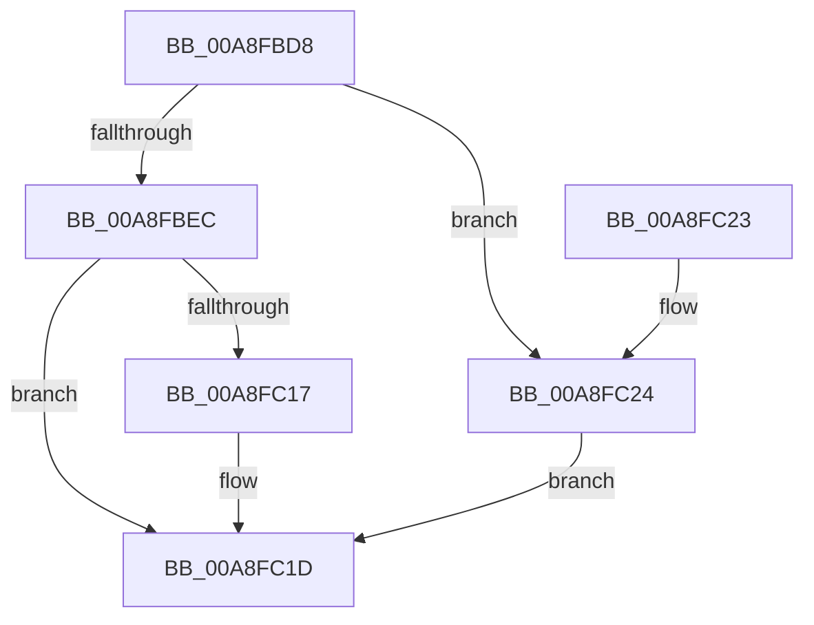

# ObGetHandleInformation

- RVA: `0x00A8FBD8`–`0x00A8FC2B` (길이 `83` bytes)
- VA: `0x0000000140A8FBD8`
- 실행 섹션: `PAGE`
- PDB 이름 있음: `예`; PDB Function 태그: `아니요`
- unwind 정보 RVA: `0x0008474C`
- 디코드: `25`개 명령, `83/83` bytes 표시
- 미해석 바이트: `0` (있으면 어셈블리에 `.byte`로 보존)

> 이 문서는 커널 이미지의 기계어와 PDB 기호를 분석해 생성했습니다. 4번과 5번은 함수 원형과 자료형을 바이너리 사용 방식에서 추정한 C 해석이며 원본 소스 복구 결과는 아닙니다.

## 1. Dependencies

- 직접 호출 지점: **1**; 고유 호출 대상: **1**
- 직접 호출자로 확인된 함수: **1**
- RIP 상대 이미지 참조: **1**

### Outgoing calls
- `0x00A8FC0D` → [ExpSnapShotHandleTables](../8A/ExpSnapShotHandleTables_function_008A25C0.md) (function, `0x008A25C0`)

### Direct callers
- [ExpGetHandleInformation](ExpGetHandleInformation_function_00A8FB40.md) at `0x00A8FBBB`

### Static image references
- `0x00A8FC06` → RVA `0x009C4CE0` (`ObpCaptureHandleInformation`; read)

## 2. Other-region calls and transfers

- 다른 실행 섹션으로 향하는 call: **0**
- 별도 외부 분기/꼬리 이동을 확인하지 못했습니다.

## 3. Assembly (complete function range)

```asm
00A8FBD8  40 53                           push rbx
00A8FBDA  48 83 EC 30                     sub rsp, 0x30
00A8FBDE  83 64 24 50 00                  and dword ptr [rsp + 0x50], 0
00A8FBE3  49 8B D9                        mov rbx, r9
00A8FBE6  41 83 F8 08                     cmp r8d, 8
00A8FBEA  72 38                           jb 0x140a8fc24
00A8FBEC  83 22 00                        and dword ptr [rdx], 0
00A8FBEF  48 8D 44 24 50                  lea rax, [rsp + 0x50]
00A8FBF4  45 8B C8                        mov r9d, r8d
00A8FBF7  C6 44 24 28 00                  mov byte ptr [rsp + 0x28], 0
00A8FBFC  4C 8B C2                        mov r8, rdx
00A8FBFF  48 89 44 24 20                  mov qword ptr [rsp + 0x20], rax
00A8FC04  8B D1                           mov edx, ecx
00A8FC06  48 8D 0D D3 50 F3 FF            lea rcx, [rip - 0xcaf2d]
00A8FC0D  E8 AE 29 E1 FF                  call 0x1408a25c0
00A8FC12  48 85 DB                        test rbx, rbx
00A8FC15  74 06                           je 0x140a8fc1d
00A8FC17  8B 4C 24 50                     mov ecx, dword ptr [rsp + 0x50]
00A8FC1B  89 0B                           mov dword ptr [rbx], ecx
00A8FC1D  48 83 C4 30                     add rsp, 0x30
00A8FC21  5B                              pop rbx
00A8FC22  C3                              ret
00A8FC23  CC                              int3
00A8FC24  B8 04 00 00 C0                  mov eax, 0xc0000004
00A8FC29  EB F2                           jmp 0x140a8fc1d
```

## 4. C-style interpretation (structured pseudocode)

```c
__int64 __fastcall ObGetHandleInformation(int a1, __int64 a2, int a3, __int64 a4)
{
    __int64 result;
    __int64 v_rsp;
    unsigned __int8 v_stack_m10;
    unsigned __int64 v_stack_m18;
    unsigned int v_stack_p18;

    v_rsp = (v_rsp) - (48);
    if (a3 < 8) goto loc_00A8FC24;
    v_stack_m10 = 0;
    v_stack_m18 = v_stack_p18;
    result = ExpSnapShotHandleTables(v_rip - 831277, (unsigned int)(a1), a2, (unsigned int)(a3));
    if (a4 != 0) {
        a1 = v_stack_p18;
        *(unsigned int *)(a4) = a1;
    }
    v_rsp = (v_rsp) + (48);
    return result;
loc_00A8FC24:
    goto loc_00A8FC1D;
}
```

## 5. (Beta) C Style

```c
int64_t ObGetHandleInformation(int32_t Arg1, void *Arg2, int32_t Arg3, int64_t Arg4)
{
    uint8_t *arg2 = (uint8_t *)Arg2;

    int64_t result;
    int64_t local_rsp;
    uint8_t v_stack_m10;
    uint64_t v_stack_m18;
    uint32_t v_stack_p18;

    local_rsp = (local_rsp) - (48);
    if (Arg3 < 8) goto loc_00A8FC24;
    v_stack_m10 = 0;
    v_stack_m18 = v_stack_p18;
    result = ExpSnapShotHandleTables(v_rip - 831277, (uint32_t)(Arg1), Arg2, (uint32_t)(Arg3));
    if (Arg4 != 0) {
        Arg1 = v_stack_p18;
        *(uint32_t *)(Arg4) = Arg1;
    }
    local_rsp = (local_rsp) + (48);
    return result;
loc_00A8FC24:
    goto loc_00A8FC1D;
}
```

### 관측된 메모리 오프셋

구조체 형식이 확인되지 않은 접근은 인자 기준의 오프셋으로만 기록했습니다.

| 기준 인자 | 오프셋 표현 | 폭 (bit) | 접근 |
|---|---:|---:|---|
| `Arg2` | `+ 0x0` | `32` | `R/W` |

## 6. Execution-region graph

[열기: 2D/3D 그래프와 함수 탐색 컨트롤 패널](../../../control-panel.html?section=page&rva=0x00A8FBD8&view=graph)

- 2D 그래프는 위에서 아래로 흐르고, 3D 그래프는 빈 공간을 드래그해 회전합니다. Shift+드래그는 이동, 휠은 확대·축소, 함수 노드 선택은 대상 보고서 이동입니다.

### Static fallback


