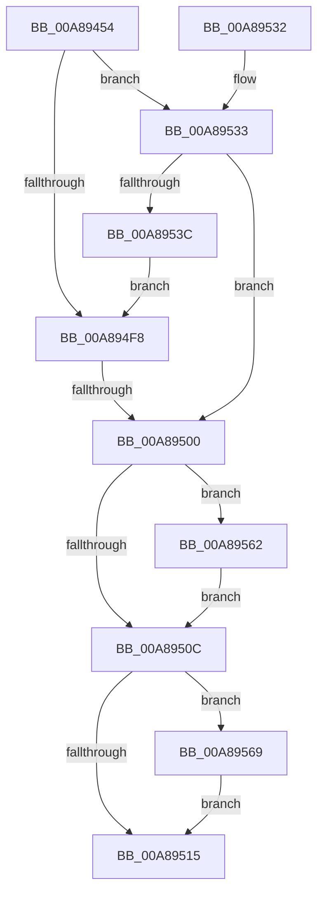

# PiDevCfgEnforceDevicePolicy

- RVA: `0x00A89454`–`0x00A89570` (길이 `284` bytes)
- VA: `0x0000000140A89454`
- 실행 섹션: `PAGE`
- PDB 이름 있음: `예`; PDB Function 태그: `예`
- unwind 정보 RVA: `0x000B82DC`
- 디코드: `78`개 명령, `284/284` bytes 표시
- 미해석 바이트: `0` (있으면 어셈블리에 `.byte`로 보존)

> 이 문서는 커널 이미지의 기계어와 PDB 기호를 분석해 생성했습니다. 4번과 5번은 함수 원형과 자료형을 바이너리 사용 방식에서 추정한 C 해석이며 원본 소스 복구 결과는 아닙니다.

## 1. Dependencies

- 직접 호출 지점: **4**; 고유 호출 대상: **3**
- 직접 호출자로 확인된 함수: **1**
- RIP 상대 이미지 참조: **3**

### Outgoing calls
- `0x00A894EC` → [ZwOpenKey](../../text/6A/ZwOpenKey_function_006AD310.md) (function, `0x006AD310`)
- `0x00A8955B` → [IopOpenRegistryKeyEx](../A5/IopOpenRegistryKeyEx_function_00A51B44.md) (function, `0x00A51B44`)
- `0x00A89562` → [ZwClose](../../text/6A/ZwClose_function_006AD2B0.md) (function, `0x006AD2B0`)
- `0x00A89569` → [ZwClose](../../text/6A/ZwClose_function_006AD2B0.md) (function, `0x006AD2B0`)

### Direct callers
- [PiDevCfgConfigureDevice](../97/PiDevCfgConfigureDevice_function_00977BB4.md) at `0x009787AC`

### Static image references
- `0x00A89484` → RVA `0x00AFEB30` (` ?? ::NNGAKEGL::`string'`; read)
- `0x00A89533` → RVA `0x00E0A9E0` (`.data`; read)
- `0x00A8953C` → RVA `0x00AFEBC0` (` ?? ::NNGAKEGL::`string'`; read)

## 2. Other-region calls and transfers

- 다른 실행 섹션으로 향하는 call: **3**
  - `0x00A894EC` → [ZwOpenKey](../../text/6A/ZwOpenKey_function_006AD310.md) (`PAGE` → `.text`)
  - `0x00A89562` → [ZwClose](../../text/6A/ZwClose_function_006AD2B0.md) (`PAGE` → `.text`)
  - `0x00A89569` → [ZwClose](../../text/6A/ZwClose_function_006AD2B0.md) (`PAGE` → `.text`)
- call이 아닌 외부 분기/꼬리 이동: **1**
  - `0x00A894FA` → [sub_00B453C2](../B4/Unknown_function_00B453C2.md) (`tail-transfer`)

## 3. Assembly (complete function range)

```asm
00A89454  48 8B C4                        mov rax, rsp
00A89457  48 89 58 08                     mov qword ptr [rax + 8], rbx
00A8945B  4C 89 40 18                     mov qword ptr [rax + 0x18], r8
00A8945F  48 89 50 10                     mov qword ptr [rax + 0x10], rdx
00A89463  55                              push rbp
00A89464  56                              push rsi
00A89465  57                              push rdi
00A89466  41 54                           push r12
00A89468  41 55                           push r13
00A8946A  41 56                           push r14
00A8946C  41 57                           push r15
00A8946E  48 8D 68 A1                     lea rbp, [rax - 0x5f]
00A89472  48 81 EC C0 00 00 00            sub rsp, 0xc0
00A89479  45 33 ED                        xor r13d, r13d
00A8947C  48 C7 45 9F 86 00 88 00         mov qword ptr [rbp - 0x61], 0x880086
00A89484  48 8D 05 A5 56 07 00            lea rax, [rip + 0x756a5]
00A8948B  4C 89 6D 8F                     mov qword ptr [rbp - 0x71], r13
00A8948F  48 89 45 A7                     mov qword ptr [rbp - 0x59], rax
00A89493  4D 8B F0                        mov r14, r8
00A89496  48 8D 45 9F                     lea rax, [rbp - 0x61]
00A8949A  4C 89 6D 97                     mov qword ptr [rbp - 0x69], r13
00A8949E  48 8B F9                        mov rdi, rcx
00A894A1  48 89 45 FF                     mov qword ptr [rbp - 1], rax
00A894A5  0F 57 C0                        xorps xmm0, xmm0
00A894A8  4C 89 6D B7                     mov qword ptr [rbp - 0x49], r13
00A894AC  BB 19 00 02 00                  mov ebx, 0x20019
00A894B1  4C 89 6D BF                     mov qword ptr [rbp - 0x41], r13
00A894B5  4C 8D 45 EF                     lea r8, [rbp - 0x11]
00A894B9  4C 89 6D C7                     mov qword ptr [rbp - 0x39], r13
00A894BD  8B D3                           mov edx, ebx
00A894BF  4C 89 6D D7                     mov qword ptr [rbp - 0x29], r13
00A894C3  48 8D 4D CF                     lea rcx, [rbp - 0x31]
00A894C7  4C 89 6D DF                     mov qword ptr [rbp - 0x21], r13
00A894CB  44 88 6D 7F                     mov byte ptr [rbp + 0x7f], r13b
00A894CF  48 C7 45 EF 30 00 00 00         mov qword ptr [rbp - 0x11], 0x30
00A894D7  48 C7 45 07 40 02 00 00         mov qword ptr [rbp + 7], 0x240
00A894DF  4C 89 6D CF                     mov qword ptr [rbp - 0x31], r13
00A894E3  4C 89 6D F7                     mov qword ptr [rbp - 9], r13
00A894E7  F3 0F 7F 45 0F                  movdqu xmmword ptr [rbp + 0xf], xmm0
00A894EC  E8 1F 3E C2 FF                  call 0x1406ad310
00A894F1  3D 34 00 00 C0                  cmp eax, 0xc0000034
00A894F6  74 3B                           je 0x140a89533
00A894F8  85 C0                           test eax, eax
00A894FA  0F 89 C2 BE 0B 00               jns 0x140b453c2
00A89500  41 8B DD                        mov ebx, r13d
00A89503  48 8B 4D 8F                     mov rcx, qword ptr [rbp - 0x71]
00A89507  48 85 C9                        test rcx, rcx
00A8950A  75 56                           jne 0x140a89562
00A8950C  48 8B 4D CF                     mov rcx, qword ptr [rbp - 0x31]
00A89510  48 85 C9                        test rcx, rcx
00A89513  75 54                           jne 0x140a89569
00A89515  8B C3                           mov eax, ebx
00A89517  48 8B 9C 24 00 01 00 00         mov rbx, qword ptr [rsp + 0x100]
00A8951F  48 81 C4 C0 00 00 00            add rsp, 0xc0
00A89526  41 5F                           pop r15
00A89528  41 5E                           pop r14
00A8952A  41 5D                           pop r13
00A8952C  41 5C                           pop r12
00A8952E  5F                              pop rdi
00A8952F  5E                              pop rsi
00A89530  5D                              pop rbp
00A89531  C3                              ret
00A89532  CC                              int3
00A89533  44 38 2D A6 14 38 00            cmp byte ptr [rip + 0x3814a6], r13b
00A8953A  74 C4                           je 0x140a89500
00A8953C  48 8D 05 7D 56 07 00            lea rax, [rip + 0x7567d]
00A89543  C7 45 9F 60 00 62 00            mov dword ptr [rbp - 0x61], 0x620060
00A8954A  44 8B CB                        mov r9d, ebx
00A8954D  48 89 45 A7                     mov qword ptr [rbp - 0x59], rax
00A89551  4C 8D 45 9F                     lea r8, [rbp - 0x61]
00A89555  33 D2                           xor edx, edx
00A89557  48 8D 4D CF                     lea rcx, [rbp - 0x31]
00A8955B  E8 E4 85 FC FF                  call 0x140a51b44
00A89560  EB 96                           jmp 0x140a894f8
00A89562  E8 49 3D C2 FF                  call 0x1406ad2b0
00A89567  EB A3                           jmp 0x140a8950c
00A89569  E8 42 3D C2 FF                  call 0x1406ad2b0
00A8956E  EB A5                           jmp 0x140a89515
```

## 4. C-style interpretation (structured pseudocode)

```c
__int64 __fastcall PiDevCfgEnforceDevicePolicy(__int64 a1, __int64 a2, __int64 a3)
{
    __int64 result;
    __int64 v_r13;
    __int64 v_rsp;
    unsigned __int64 v_stack_p8;

    *(unsigned __int64 *)(v_rsp + 8) = v_rbx;
    *(unsigned __int64 *)(v_rsp + 24) = a3;
    *(unsigned __int64 *)(v_rsp + 16) = a2;
    v_rsp = (v_rsp) - (192);
    v_r13 = 0;
    *(unsigned __int64 *)(v_rsp - 95 - 97) = 0x880086ULL;
    *(unsigned __int64 *)(v_rsp - 95 - 113) = 0;
    *(unsigned __int64 *)(v_rsp - 95 - 89) = v_rip + 480933;
    *(unsigned __int64 *)(v_rsp - 95 - 105) = 0;
    *(unsigned __int64 *)(v_rsp - 95 - 1) = v_rsp - 95 - 97;
    *(unsigned __int64 *)(v_rsp - 95 - 73) = 0;
    *(unsigned __int64 *)(v_rsp - 95 - 65) = 0;
    *(unsigned __int64 *)(v_rsp - 95 - 57) = 0;
    *(unsigned __int64 *)(v_rsp - 95 - 41) = 0;
    *(unsigned __int64 *)(v_rsp - 95 - 33) = 0;
    *(unsigned __int8 *)(v_rsp - 95 + 127) = 0;
    *(unsigned __int64 *)(v_rsp - 95 - 17) = 48;
    *(unsigned __int64 *)(v_rsp - 95 + 7) = 576;
    *(unsigned __int64 *)(v_rsp - 95 - 49) = 0;
    *(unsigned __int64 *)(v_rsp - 95 - 9) = 0;
    *(unsigned __int64 *)(v_rsp - 95 + 15) = v_xmm0;
    result = ZwOpenKey(v_rsp - 95 - 49, (unsigned int)((unsigned int)((unsigned int)(0x20019ULL))), v_rsp - 95 - 17, a4);
    if (((unsigned int)(result)) == 0xC0000034ULL) goto loc_00A89533;
loc_00A894F8:
loc_00A89500:
    if (*(unsigned __int64 *)(v_rsp - 95 - 113) != 0) goto loc_00A89562;
loc_00A8950C:
    if (*(unsigned __int64 *)(v_rsp - 95 - 49) != 0) goto loc_00A89569;
loc_00A89515:
    v_rsp = (v_rsp) + (192);
    return 0;
loc_00A89533:
    if ((*(unsigned __int8 *)(v_rip + 3675302)) == 0) goto loc_00A89500;
    *(unsigned int *)(v_rsp - 95 - 97) = 0x620060ULL;
    *(unsigned __int64 *)(v_rsp - 95 - 89) = v_rip + 480893;
    a2 = 0;
    result = IopOpenRegistryKeyEx(v_rsp - 95 - 49, a2, v_rsp - 95 - 97, (unsigned int)((unsigned int)(v_stack_p8)));
    goto loc_00A894F8;
loc_00A89562:
    result = ZwClose(v_rsp - 95 - 49, a2, v_rsp - 95 - 97, (unsigned int)((unsigned int)(v_stack_p8)));
    goto loc_00A8950C;
loc_00A89569:
    result = ZwClose(v_rsp - 95 - 49, a2, v_rsp - 95 - 97, (unsigned int)((unsigned int)(v_stack_p8)));
    goto loc_00A89515;
}
```

## 5. (Beta) C Style

```c
int64_t PiDevCfgEnforceDevicePolicy(int64_t Arg1, int64_t Arg2, int64_t Arg3)
{
    int64_t result;
    int64_t local_r13;
    int64_t local_rsp;
    uint64_t v_stack_p8;

    *(uint64_t *)(local_rsp + 0x8) = local_rbx;
    *(uint64_t *)(local_rsp + 0x18) = Arg3;
    *(uint64_t *)(local_rsp + 0x10) = Arg2;
    local_rsp = (local_rsp) - (192);
    local_r13 = 0;
    *(uint64_t *)(local_rsp - 0x5F - 0x61) = 0x880086ULL;
    *(uint64_t *)(local_rsp - 0x5F - 0x71) = 0;
    *(uint64_t *)(local_rsp - 0x5F - 0x59) = v_rip + 480933;
    *(uint64_t *)(local_rsp - 0x5F - 0x69) = 0;
    *(uint64_t *)(local_rsp - 0x5F - 0x1) = local_rsp - 95 - 97;
    *(uint64_t *)(local_rsp - 0x5F - 0x49) = 0;
    *(uint64_t *)(local_rsp - 0x5F - 0x41) = 0;
    *(uint64_t *)(local_rsp - 0x5F - 0x39) = 0;
    *(uint64_t *)(local_rsp - 0x5F - 0x29) = 0;
    *(uint64_t *)(local_rsp - 0x5F - 0x21) = 0;
    *(uint8_t *)(local_rsp - 0x5F + 0x7F) = 0;
    *(uint64_t *)(local_rsp - 0x5F - 0x11) = 48;
    *(uint64_t *)(local_rsp - 0x5F + 0x7) = 576;
    *(uint64_t *)(local_rsp - 0x5F - 0x31) = 0;
    *(uint64_t *)(local_rsp - 0x5F - 0x9) = 0;
    *(uint64_t *)(local_rsp - 0x5F + 0xF) = v_xmm0;
    result = ZwOpenKey(local_rsp - 95 - 49, (uint32_t)((uint32_t)((uint32_t)(0x20019ULL))), local_rsp - 95 - 17, a4);
    if (((uint32_t)(result)) == 0xC0000034ULL) goto loc_00A89533;
loc_00A894F8:
loc_00A89500:
    if (*(uint64_t *)(local_rsp - 0x5F - 0x71) != 0) goto loc_00A89562;
loc_00A8950C:
    if (*(uint64_t *)(local_rsp - 0x5F - 0x31) != 0) goto loc_00A89569;
loc_00A89515:
    local_rsp = (local_rsp) + (192);
    return 0;
loc_00A89533:
    if ((*(uint8_t *)(v_rip + 0x3814A6)) == 0) goto loc_00A89500;
    *(uint32_t *)(local_rsp - 0x5F - 0x61) = 0x620060ULL;
    *(uint64_t *)(local_rsp - 0x5F - 0x59) = v_rip + 480893;
    Arg2 = 0;
    result = IopOpenRegistryKeyEx(local_rsp - 95 - 49, Arg2, local_rsp - 95 - 97, (uint32_t)((uint32_t)(v_stack_p8)));
    goto loc_00A894F8;
loc_00A89562:
    result = ZwClose(local_rsp - 95 - 49, Arg2, local_rsp - 95 - 97, (uint32_t)((uint32_t)(v_stack_p8)));
    goto loc_00A8950C;
loc_00A89569:
    result = ZwClose(local_rsp - 95 - 49, Arg2, local_rsp - 95 - 97, (uint32_t)((uint32_t)(v_stack_p8)));
    goto loc_00A89515;
}
```

## 6. Execution-region graph

[열기: 2D/3D 그래프와 함수 탐색 컨트롤 패널](../../../control-panel.html?section=page&rva=0x00A89454&view=graph)

- 2D 그래프는 위에서 아래로 흐르고, 3D 그래프는 빈 공간을 드래그해 회전합니다. Shift+드래그는 이동, 휠은 확대·축소, 함수 노드 선택은 대상 보고서 이동입니다.

### Static fallback


