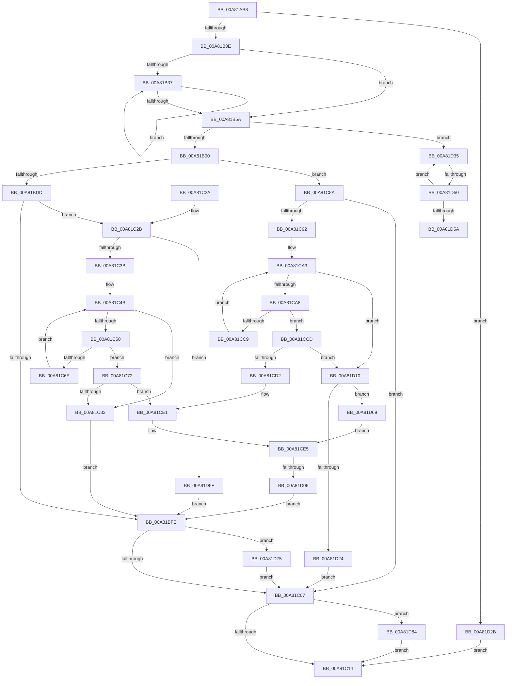

# PiDevCfgResolveVariable

- RVA: `0x00A81AB8`–`0x00A81D8E` (길이 `726` bytes)
- VA: `0x0000000140A81AB8`
- 실행 섹션: `PAGE`
- PDB 이름 있음: `예`; PDB Function 태그: `예`
- unwind 정보 RVA: `0x000B71A0`
- 디코드: `199`개 명령, `726/726` bytes 표시
- 미해석 바이트: `0` (있으면 어셈블리에 `.byte`로 보존)

> 이 문서는 커널 이미지의 기계어와 PDB 기호를 분석해 생성했습니다. 4번과 5번은 함수 원형과 자료형을 바이너리 사용 방식에서 추정한 C 해석이며 원본 소스 복구 결과는 아닙니다.

## 1. Dependencies

- 직접 호출 지점: **13**; 고유 호출 대상: **12**
- 직접 호출자로 확인된 함수: **8**
- RIP 상대 이미지 참조: **2**

### Outgoing calls
- `0x00A81B15` → [RtlInitUnicodeString](../../text/42/RtlInitUnicodeString_function_0042A780.md) (function, `0x0042A780`)
- `0x00A81B1D` → [PsGetCurrentServerSiloGlobals](../../text/2F/PsGetCurrentServerSiloGlobals_function_002FE1F0.md) (function, `0x002FE1F0`)
- `0x00A81B41` → [NLS_UPCASE](../../text/3F/NLS_UPCASE_function_003FF700.md) (function, `0x003FF700`)
- `0x00A81BC9` → [ZwOpenKey](../../text/6A/ZwOpenKey_function_006AD310.md) (function, `0x006AD310`)
- `0x00A81BEF` → [IopGetRegistryValue](../99/IopGetRegistryValue_function_009990EC.md) (function, `0x009990EC`)
- `0x00A81C2E` → [PnpValidateRegistryString](../../text/4B/PnpValidateRegistryString_function_004B763C.md) (function, `0x004B763C`)
- `0x00A81C65` → [wcsicmp](../../text/50/wcsicmp_function_00500080.md) (function, `0x00500080`)
- `0x00A81CC0` → [wcsicmp](../../text/50/wcsicmp_function_00500080.md) (function, `0x00500080`)
- `0x00A81CF5` → [ExAllocatePool2](../../poolcode/B8/ExAllocatePool2_function_00B820F0.md) (function, `0x00B820F0`)
- `0x00A81D1B` → [PnpStringToDwordValue](../../text/4E/PnpStringToDwordValue_function_004E1894.md) (function, `0x004E1894`)
- `0x00A81D43` → [RtlEqualUnicodeString](../93/RtlEqualUnicodeString_function_00932A20.md) (function, `0x00932A20`)
- `0x00A81D7A` → [ExFreePoolWithTag](../../poolcode/B8/ExFreePoolWithTag_function_00B82870.md) (function, `0x00B82870`)
- `0x00A81D84` → [ZwClose](../../text/6A/ZwClose_function_006AD2B0.md) (function, `0x006AD2B0`)

### Direct callers
- [PiDevCfgQueryResolveValue](../../text/5A/PiDevCfgQueryResolveValue_function_005A801C.md) at `0x005A80D0`
- [PiDevCfgResolveVariableFormatString](../73/PiDevCfgResolveVariableFormatString_function_00735AB0.md) at `0x00735C1F`
- [PiDevCfgResolveVariableKeyValue](../73/PiDevCfgResolveVariableKeyValue_function_007361B0.md) at `0x00736253`
- [PiDevCfgResolveVariableSwitchCase](../73/PiDevCfgResolveVariableSwitchCase_function_00736390.md) at `0x00736410`
- [PiDevCfgResolveVariableSwitchCase](../73/PiDevCfgResolveVariableSwitchCase_function_00736390.md) at `0x0073653E`
- [PiDevCfgResolveVariableExpression](../AA/PiDevCfgResolveVariableExpression_function_00AA8C00.md) at `0x00AA9CEE`
- [PiDevCfgResolveVariableKeyHandle](../AB/PiDevCfgResolveVariableKeyHandle_function_00AB2A24.md) at `0x00AB2E04`
- [sub_00B2C5F4](../B2/Unknown_function_00B2C5F4.md) at `0x00B2C62C`
- [sub_00B2C5F4](../B2/Unknown_function_00B2C5F4.md) at `0x00B2C770`
- [sub_00B2C5F4](../B2/Unknown_function_00B2C5F4.md) at `0x00B2C988`
- [sub_00B467A6](../B4/Unknown_function_00B467A6.md) at `0x00B4684F`

### Static image references
- `0x00A81BE8` → RVA `0x00B53AB4` (` ?? ::LBKOJDO::`string'`; read)
- `0x00A81C3F` → RVA `0x00000000` (`image boundary/outside`; read)

## 2. Other-region calls and transfers

- 다른 실행 섹션으로 향하는 call: **11**
  - `0x00A81B15` → [RtlInitUnicodeString](../../text/42/RtlInitUnicodeString_function_0042A780.md) (`PAGE` → `.text`)
  - `0x00A81B1D` → [PsGetCurrentServerSiloGlobals](../../text/2F/PsGetCurrentServerSiloGlobals_function_002FE1F0.md) (`PAGE` → `.text`)
  - `0x00A81B41` → [NLS_UPCASE](../../text/3F/NLS_UPCASE_function_003FF700.md) (`PAGE` → `.text`)
  - `0x00A81BC9` → [ZwOpenKey](../../text/6A/ZwOpenKey_function_006AD310.md) (`PAGE` → `.text`)
  - `0x00A81C2E` → [PnpValidateRegistryString](../../text/4B/PnpValidateRegistryString_function_004B763C.md) (`PAGE` → `.text`)
  - `0x00A81C65` → [wcsicmp](../../text/50/wcsicmp_function_00500080.md) (`PAGE` → `.text`)
  - `0x00A81CC0` → [wcsicmp](../../text/50/wcsicmp_function_00500080.md) (`PAGE` → `.text`)
  - `0x00A81CF5` → [ExAllocatePool2](../../poolcode/B8/ExAllocatePool2_function_00B820F0.md) (`PAGE` → `POOLCODE`)
  - `0x00A81D1B` → [PnpStringToDwordValue](../../text/4E/PnpStringToDwordValue_function_004E1894.md) (`PAGE` → `.text`)
  - `0x00A81D7A` → [ExFreePoolWithTag](../../poolcode/B8/ExFreePoolWithTag_function_00B82870.md) (`PAGE` → `POOLCODE`)
  - `0x00A81D84` → [ZwClose](../../text/6A/ZwClose_function_006AD2B0.md) (`PAGE` → `.text`)
- call이 아닌 외부 분기/꼬리 이동: **3**
  - `0x00A81D00` → [sub_00B4387E + 0x20](../B4/Unknown_function_00B4387E.md) (`tail-transfer`)
  - `0x00A81D4A` → [sub_00B4387E](../B4/Unknown_function_00B4387E.md) (`tail-transfer`)
  - `0x00A81D5A` → [sub_00B4387E](../B4/Unknown_function_00B4387E.md) (`tail-transfer`)

## 3. Assembly (complete function range)

```asm
00A81AB8  48 8B C4                        mov rax, rsp
00A81ABB  4C 89 40 18                     mov qword ptr [rax + 0x18], r8
00A81ABF  48 89 50 10                     mov qword ptr [rax + 0x10], rdx
00A81AC3  48 89 48 08                     mov qword ptr [rax + 8], rcx
00A81AC7  55                              push rbp
00A81AC8  53                              push rbx
00A81AC9  56                              push rsi
00A81ACA  57                              push rdi
00A81ACB  41 54                           push r12
00A81ACD  41 55                           push r13
00A81ACF  41 56                           push r14
00A81AD1  41 57                           push r15
00A81AD3  48 8D 68 A1                     lea rbp, [rax - 0x5f]
00A81AD7  48 81 EC 98 00 00 00            sub rsp, 0x98
00A81ADE  45 33 FF                        xor r15d, r15d
00A81AE1  0F 57 C0                        xorps xmm0, xmm0
00A81AE4  4C 8B E1                        mov r12, rcx
00A81AE7  41 8B DF                        mov ebx, r15d
00A81AEA  45 8B F7                        mov r14d, r15d
00A81AED  4C 89 7D A7                     mov qword ptr [rbp - 0x59], r15
00A81AF1  45 8B EF                        mov r13d, r15d
00A81AF4  4C 89 7D AF                     mov qword ptr [rbp - 0x51], r15
00A81AF8  0F 11 45 C7                     movups xmmword ptr [rbp - 0x39], xmm0
00A81AFC  4C 89 7D BF                     mov qword ptr [rbp - 0x41], r15
00A81B00  44 89 7D 7F                     mov dword ptr [rbp + 0x7f], r15d
00A81B04  66 44 39 3A                     cmp word ptr [rdx], r15w
00A81B08  0F 84 1D 02 00 00               je 0x140a81d2b
00A81B0E  48 8D 4D C7                     lea rcx, [rbp - 0x39]
00A81B12  4D 89 38                        mov qword ptr [r8], r15
00A81B15  E8 66 8C 9A FF                  call 0x14042a780
00A81B1A  45 8B DF                        mov r11d, r15d
00A81B1D  E8 CE C6 87 FF                  call 0x1402fe1f0
00A81B22  44 0F B7 55 C7                  movzx r10d, word ptr [rbp - 0x39]
00A81B27  41 D1 EA                        shr r10d, 1
00A81B2A  48 8B 7D CF                     mov rdi, qword ptr [rbp - 0x31]
00A81B2E  48 8B B0 B0 04 00 00            mov rsi, qword ptr [rax + 0x4b0]
00A81B35  74 23                           je 0x140a81b5a
00A81B37  0F B7 17                        movzx edx, word ptr [rdi]
00A81B3A  48 8B CE                        mov rcx, rsi
00A81B3D  48 8D 7F 02                     lea rdi, [rdi + 2]
00A81B41  E8 BA DB 97 FF                  call 0x1403ff700
00A81B46  45 69 DB 3F 00 01 00            imul r11d, r11d, 0x1003f
00A81B4D  44 0F B7 C8                     movzx r9d, ax
00A81B51  45 03 D9                        add r11d, r9d
00A81B54  41 83 C2 FF                     add r10d, -1
00A81B58  75 DD                           jne 0x140a81b37
00A81B5A  B8 11 08 04 02                  mov eax, 0x2040811
00A81B5F  41 F7 E3                        mul r11d
00A81B62  41 8B C3                        mov eax, r11d
00A81B65  2B C2                           sub eax, edx
00A81B67  D1 E8                           shr eax, 1
00A81B69  03 C2                           add eax, edx
00A81B6B  C1 E8 06                        shr eax, 6
00A81B6E  6B C0 7F                        imul eax, eax, 0x7f
00A81B71  44 2B D8                        sub r11d, eax
00A81B74  45 8B FB                        mov r15d, r11d
00A81B77  49 C1 E7 04                     shl r15, 4
00A81B7B  4D 03 7C 24 18                  add r15, qword ptr [r12 + 0x18]
00A81B80  4C 89 7D D7                     mov qword ptr [rbp - 0x29], r15
00A81B84  49 8B 37                        mov rsi, qword ptr [r15]
00A81B87  49 3B F7                        cmp rsi, r15
00A81B8A  0F 85 A5 01 00 00               jne 0x140a81d35
00A81B90  45 33 FF                        xor r15d, r15d
00A81B93  49 8B 44 24 10                  mov rax, qword ptr [r12 + 0x10]
00A81B98  4C 8D 45 DF                     lea r8, [rbp - 0x21]
00A81B9C  48 89 45 E7                     mov qword ptr [rbp - 0x19], rax
00A81BA0  48 8D 4D A7                     lea rcx, [rbp - 0x59]
00A81BA4  48 8D 45 C7                     lea rax, [rbp - 0x39]
00A81BA8  48 C7 45 DF 30 00 00 00         mov qword ptr [rbp - 0x21], 0x30
00A81BB0  0F 57 C0                        xorps xmm0, xmm0
00A81BB3  48 89 45 EF                     mov qword ptr [rbp - 0x11], rax
00A81BB7  BA 19 00 02 00                  mov edx, 0x20019
00A81BBC  48 C7 45 F7 40 02 00 00         mov qword ptr [rbp - 9], 0x240
00A81BC4  F3 0F 7F 45 FF                  movdqu xmmword ptr [rbp - 1], xmm0
00A81BC9  E8 42 B7 C2 FF                  call 0x1406ad310
00A81BCE  8B D8                           mov ebx, eax
00A81BD0  BE 34 00 00 C0                  mov esi, 0xc0000034
00A81BD5  85 C0                           test eax, eax
00A81BD7  0F 88 AD 00 00 00               js 0x140a81c8a
00A81BDD  48 8B 4D A7                     mov rcx, qword ptr [rbp - 0x59]
00A81BE1  4C 8D 4D AF                     lea r9, [rbp - 0x51]
00A81BE5  45 33 C0                        xor r8d, r8d
00A81BE8  48 8D 15 C5 1E 0D 00            lea rdx, [rip + 0xd1ec5]
00A81BEF  E8 F8 74 F1 FF                  call 0x1409990ec
00A81BF4  4C 8B 75 AF                     mov r14, qword ptr [rbp - 0x51]
00A81BF8  8B D8                           mov ebx, eax
00A81BFA  85 C0                           test eax, eax
00A81BFC  79 2D                           jns 0x140a81c2b
00A81BFE  4D 85 F6                        test r14, r14
00A81C01  0F 85 6E 01 00 00               jne 0x140a81d75
00A81C07  48 8B 4D A7                     mov rcx, qword ptr [rbp - 0x59]
00A81C0B  48 85 C9                        test rcx, rcx
00A81C0E  0F 85 70 01 00 00               jne 0x140a81d84
00A81C14  8B C3                           mov eax, ebx
00A81C16  48 81 C4 98 00 00 00            add rsp, 0x98
00A81C1D  41 5F                           pop r15
00A81C1F  41 5E                           pop r14
00A81C21  41 5D                           pop r13
00A81C23  41 5C                           pop r12
00A81C25  5F                              pop rdi
00A81C26  5E                              pop rsi
00A81C27  5B                              pop rbx
00A81C28  5D                              pop rbp
00A81C29  C3                              ret
00A81C2A  CC                              int3
00A81C2B  49 8B CE                        mov rcx, r14
00A81C2E  E8 09 5A A3 FF                  call 0x1404b763c
00A81C33  84 C0                           test al, al
00A81C35  0F 84 24 01 00 00               je 0x140a81d5f
00A81C3B  45 8B 7E 08                     mov r15d, dword ptr [r14 + 8]
00A81C3F  4C 8D 25 BA E3 57 FF            lea r12, [rip - 0xa81c46]
00A81C46  4D 03 FE                        add r15, r14
00A81C49  33 FF                           xor edi, edi
00A81C4B  83 FF 08                        cmp edi, 8
00A81C4E  73 33                           jae 0x140a81c83
00A81C50  8B C7                           mov eax, edi
00A81C52  49 8B D7                        mov rdx, r15
00A81C55  48 C1 E0 04                     shl rax, 4
00A81C59  48 89 45 7F                     mov qword ptr [rbp + 0x7f], rax
00A81C5D  4A 8B 8C 20 80 D6 B4 00         mov rcx, qword ptr [rax + r12 + 0xb4d680]
00A81C65  E8 16 E4 A7 FF                  call 0x140500080
00A81C6A  85 C0                           test eax, eax
00A81C6C  74 04                           je 0x140a81c72
00A81C6E  FF C7                           inc edi
00A81C70  EB D9                           jmp 0x140a81c4b
00A81C72  48 8B 45 7F                     mov rax, qword ptr [rbp + 0x7f]
00A81C76  4E 8B BC 20 88 D6 B4 00         mov r15, qword ptr [rax + r12 + 0xb4d688]
00A81C7E  4D 85 FF                        test r15, r15
00A81C81  75 5E                           jne 0x140a81ce1
00A81C83  8B DE                           mov ebx, esi
00A81C85  E9 74 FF FF FF                  jmp 0x140a81bfe
00A81C8A  3B C6                           cmp eax, esi
00A81C8C  0F 85 75 FF FF FF               jne 0x140a81c07
00A81C92  4C 8B 6D 6F                     mov r13, qword ptr [rbp + 0x6f]
00A81C96  4C 8D 25 63 E3 57 FF            lea r12, [rip - 0xa81c9d]
00A81C9D  41 8B DF                        mov ebx, r15d
00A81CA0  41 8B FF                        mov edi, r15d
00A81CA3  83 FF 04                        cmp edi, 4
00A81CA6  73 68                           jae 0x140a81d10
00A81CA8  8B C7                           mov eax, edi
00A81CAA  4D 8D BC 24 C0 CF B4 00         lea r15, [r12 + 0xb4cfc0]
00A81CB2  49 8B D5                        mov rdx, r13
00A81CB5  48 8D 0C 40                     lea rcx, [rax + rax*2]
00A81CB9  4D 8D 3C CF                     lea r15, [r15 + rcx*8]
00A81CBD  49 8B 0F                        mov rcx, qword ptr [r15]
00A81CC0  E8 BB E3 A7 FF                  call 0x140500080
00A81CC5  85 C0                           test eax, eax
00A81CC7  74 04                           je 0x140a81ccd
00A81CC9  FF C7                           inc edi
00A81CCB  EB D6                           jmp 0x140a81ca3
00A81CCD  4D 85 FF                        test r15, r15
00A81CD0  74 3E                           je 0x140a81d10
00A81CD2  49 8B 57 08                     mov rdx, qword ptr [r15 + 8]
00A81CD6  45 8B 6F 10                     mov r13d, dword ptr [r15 + 0x10]
00A81CDA  4D 8B FE                        mov r15, r14
00A81CDD  48 89 55 BF                     mov qword ptr [rbp - 0x41], rdx
00A81CE1  4C 8B 65 6F                     mov r12, qword ptr [rbp + 0x6f]
00A81CE5  BA 30 00 00 00                  mov edx, 0x30
00A81CEA  B9 00 01 00 00                  mov ecx, 0x100
00A81CEF  41 B8 50 70 64 63               mov r8d, 0x63647050
00A81CF5  E8 F6 03 10 00                  call 0x140b820f0
00A81CFA  48 8B F8                        mov rdi, rax
00A81CFD  48 85 C0                        test rax, rax
00A81D00  0F 85 98 1B 0C 00               jne 0x140b4389e
00A81D06  BB 9A 00 00 C0                  mov ebx, 0xc000009a
00A81D0B  E9 EE FE FF FF                  jmp 0x140a81bfe
00A81D10  4C 8B 65 6F                     mov r12, qword ptr [rbp + 0x6f]
00A81D14  48 8D 55 7F                     lea rdx, [rbp + 0x7f]
00A81D18  49 8B CC                        mov rcx, r12
00A81D1B  E8 74 FB A5 FF                  call 0x1404e1894
00A81D20  84 C0                           test al, al
00A81D22  75 45                           jne 0x140a81d69
00A81D24  8B DE                           mov ebx, esi
00A81D26  E9 DC FE FF FF                  jmp 0x140a81c07
00A81D2B  BB 34 00 00 C0                  mov ebx, 0xc0000034
00A81D30  E9 DF FE FF FF                  jmp 0x140a81c14
00A81D35  48 8D 56 10                     lea rdx, [rsi + 0x10]
00A81D39  41 B0 01                        mov r8b, 1
00A81D3C  48 8D 4D C7                     lea rcx, [rbp - 0x39]
00A81D40  48 8B FE                        mov rdi, rsi
00A81D43  E8 D8 0C EB FF                  call 0x140932a20
00A81D48  84 C0                           test al, al
00A81D4A  0F 85 2E 1B 0C 00               jne 0x140b4387e
00A81D50  48 8B 36                        mov rsi, qword ptr [rsi]
00A81D53  33 FF                           xor edi, edi
00A81D55  49 3B F7                        cmp rsi, r15
00A81D58  75 DB                           jne 0x140a81d35
00A81D5A  E9 1F 1B 0C 00                  jmp 0x140b4387e
00A81D5F  BB 01 00 00 C0                  mov ebx, 0xc0000001
00A81D64  E9 95 FE FF FF                  jmp 0x140a81bfe
00A81D69  44 8B 6D 7F                     mov r13d, dword ptr [rbp + 0x7f]
00A81D6D  4D 8B FE                        mov r15, r14
00A81D70  E9 70 FF FF FF                  jmp 0x140a81ce5
00A81D75  33 D2                           xor edx, edx
00A81D77  49 8B CE                        mov rcx, r14
00A81D7A  E8 F1 0A 10 00                  call 0x140b82870
00A81D7F  E9 83 FE FF FF                  jmp 0x140a81c07
00A81D84  E8 27 B5 C2 FF                  call 0x1406ad2b0
00A81D89  E9 86 FE FF FF                  jmp 0x140a81c14
```

## 4. C-style interpretation (structured pseudocode)

```c
__int64 __fastcall PiDevCfgResolveVariable(__int64 a1, __int64 a2, __int64 a3)
{
    __int64 result;
    __int64 v_r10;
    __int64 v_r11;
    __int64 v_r15;
    __int64 v_rdi;
    __int64 v_rsp;

    *(unsigned __int64 *)(v_rsp + 24) = a3;
    *(unsigned __int64 *)(v_rsp + 16) = a2;
    *(unsigned __int64 *)(v_rsp + 8) = a1;
    v_rsp = (v_rsp) - (152);
    v_r15 = 0;
    *(unsigned __int64 *)(v_rsp - 95 - 89) = 0;
    *(unsigned __int64 *)(v_rsp - 95 - 81) = 0;
    *(unsigned __int64 *)(v_rsp - 95 - 57) = v_xmm0;
    *(unsigned __int64 *)(v_rsp - 95 - 65) = 0;
    *(unsigned int *)(v_rsp - 95 + 127) = 0;
    if ((*(unsigned __int16 *)(a2)) == 0) goto loc_00A81D2B;
    *(unsigned __int64 *)(a3) = 0;
    result = RtlInitUnicodeString(v_rsp - 95 - 57, a2, a3, a4);
    result = PsGetCurrentServerSiloGlobals(v_rsp - 95 - 57, a2, a3, a4);
    v_r10 = (unsigned int)((*(unsigned __int16 *)(v_rsp - 95 - 57)) >> (1));
    if (condition_is_equal) goto loc_00A81B5A;
loc_00A81B37:
    result = NLS_UPCASE(*(unsigned __int64 *)(result + 1200), *(unsigned __int16 *)(*(unsigned __int64 *)(v_rsp - 95 - 49)), a3, a4);
    v_r11 = (unsigned int)((0) * (0));
    v_r11 = (unsigned int)((v_r11) + ((unsigned int)((unsigned __int16)(result))));
    v_r10 = (unsigned int)((v_r10) + (-1));
    if (condition_is_not_equal) goto loc_00A81B37;
loc_00A81B5A:
    result = (unsigned int)(((unsigned int)((unsigned int)(v_r11))) - ((unsigned int)(*(unsigned __int16 *)(*(unsigned __int64 *)(v_rsp - 95 - 49)))));
    result = (unsigned int)((result) >> (1));
    result = (unsigned int)((result) + ((unsigned int)(*(unsigned __int16 *)(*(unsigned __int64 *)(v_rsp - 95 - 49)))));
    result = (unsigned int)((result) >> (6));
    result = (unsigned int)((result) * ((unsigned int)(result)));
    v_r11 = (unsigned int)((v_r11) - ((unsigned int)(result)));
    v_r15 = ((unsigned int)((unsigned int)(v_r11))) << (4);
    v_r15 = (v_r15) + (*(unsigned __int64 *)(a1 + 24));
    *(unsigned __int64 *)(v_rsp - 95 - 41) = v_r15;
    if ((*(unsigned __int64 *)(v_r15)) != v_r15) goto loc_00A81D35;
    v_r15 = 0;
    *(unsigned __int64 *)(v_rsp - 95 - 25) = *(unsigned __int64 *)(a1 + 16);
    *(unsigned __int64 *)(v_rsp - 95 - 33) = 48;
    *(unsigned __int64 *)(v_rsp - 95 - 17) = v_rsp - 95 - 57;
    *(unsigned __int64 *)(v_rsp - 95 - 9) = 576;
    *(unsigned __int64 *)(v_rsp - 95 - 1) = v_xmm0;
    result = ZwOpenKey(v_rsp - 95 - 89, (unsigned int)(0x20019ULL), v_rsp - 95 - 33, (unsigned __int16)(result));
    if (sign_flag) goto loc_00A81C8A;
    a3 = 0;
    result = IopGetRegistryValue(*(unsigned __int64 *)(v_rsp - 95 - 89), v_rip + 859845, a3, v_rsp - 95 - 81);
    if (!sign_flag) goto loc_00A81C2B;
loc_00A81BFE:
    if (*(unsigned __int64 *)(v_rsp - 95 - 81) != 0) goto loc_00A81D75;
loc_00A81C07:
    if (*(unsigned __int64 *)(v_rsp - 95 - 89) != 0) goto loc_00A81D84;
loc_00A81C14:
    v_rsp = (v_rsp) + (152);
    return (unsigned int)((unsigned int)((unsigned int)((unsigned int)(result))));
loc_00A81C2B:
    result = PnpValidateRegistryString(*(unsigned __int64 *)(v_rsp - 95 - 81), v_rip + 859845, a3, v_rsp - 95 - 81);
    if ((unsigned __int8)(result) == 0) goto loc_00A81D5F;
    v_r15 = ((unsigned int)(*(unsigned int *)(*(unsigned __int64 *)(v_rsp - 95 - 81) + 8))) + (*(unsigned __int64 *)(v_rsp - 95 - 81));
    v_rdi = 0;
loc_00A81C4B:
    if (0 >= 8) goto loc_00A81C83;
    result = (0) << (4);
    *(unsigned __int64 *)(v_rsp - 95 + 127) = result;
    result = wcsicmp(*(unsigned __int64 *)(result + v_rip - 11017286 * 1 + 11851392), v_r15, a3, v_rsp - 95 - 81);
    if ((unsigned int)(result) == 0) goto loc_00A81C72;
    v_rdi = (unsigned int)((v_rdi) + 1);
    goto loc_00A81C4B;
loc_00A81C72:
    if (*(unsigned __int64 *)(*(unsigned __int64 *)(v_rsp - 95 + 127) + v_rip - 11017286 * 1 + 11851400) != 0) goto loc_00A81CE1;
loc_00A81C83:
    goto loc_00A81BFE;
loc_00A81C8A:
    if (((unsigned int)(*(unsigned __int64 *)(v_rsp - 95 + 127))) != ((unsigned int)((unsigned int)(0xC0000034ULL)))) goto loc_00A81C07;
loc_00A81CA3:
    if (((unsigned int)((unsigned int)((unsigned int)(*(unsigned __int64 *)(*(unsigned __int64 *)(v_rsp - 95 + 127) + v_rip - 11017286 * 1 + 11851400))))) >= 4) goto loc_00A81D10;
    result = wcsicmp(*(unsigned __int64 *)(v_rip - 11017373 + 11849664 + (unsigned int)((unsigned int)((unsigned int)((unsigned int)(*(unsigned __int64 *)(*(unsigned __int64 *)(v_rsp - 95 + 127) + v_rip - 11017286 * 1 + 11851400))))) + (unsigned int)((unsigned int)((unsigned int)((unsigned int)(*(unsigned __int64 *)(*(unsigned __int64 *)(v_rsp - 95 + 127) + v_rip - 11017286 * 1 + 11851400))))) * 2 * 8), *(unsigned __int64 *)(v_rsp - 95 + 111), a3, v_rsp - 95 - 81);
    if ((unsigned int)(result) == 0) goto loc_00A81CCD;
    v_rdi = (unsigned int)(((unsigned int)((unsigned int)(*(unsigned __int64 *)(*(unsigned __int64 *)(v_rsp - 95 + 127) + v_rip - 11017286 * 1 + 11851400)))) + 1);
    goto loc_00A81CA3;
loc_00A81CCD:
    if (v_rip - 11017373 + 11849664 + (unsigned int)((unsigned int)((unsigned int)((unsigned int)(*(unsigned __int64 *)(*(unsigned __int64 *)(v_rsp - 95 + 127) + v_rip - 11017286 * 1 + 11851400))))) + (unsigned int)((unsigned int)((unsigned int)((unsigned int)(*(unsigned __int64 *)(*(unsigned __int64 *)(v_rsp - 95 + 127) + v_rip - 11017286 * 1 + 11851400))))) * 2 * 8 == 0) goto loc_00A81D10;
    *(unsigned __int64 *)(v_rsp - 95 - 65) = *(unsigned __int64 *)(v_rip - 11017373 + 11849664 + (unsigned int)((unsigned int)((unsigned int)((unsigned int)(*(unsigned __int64 *)(*(unsigned __int64 *)(v_rsp - 95 + 127) + v_rip - 11017286 * 1 + 11851400))))) + (unsigned int)((unsigned int)((unsigned int)((unsigned int)(*(unsigned __int64 *)(*(unsigned __int64 *)(v_rsp - 95 + 127) + v_rip - 11017286 * 1 + 11851400))))) * 2 * 8 + 8);
loc_00A81CE1:
loc_00A81CE5:
    result = ExAllocatePool2(256, 48, (unsigned int)(0x63647050ULL), v_rsp - 95 - 81);
    goto loc_00A81BFE;
loc_00A81D10:
    result = PnpStringToDwordValue(*(unsigned __int64 *)(v_rsp - 95 + 111), v_rsp - 95 + 127, (unsigned int)(0x63647050ULL), v_rsp - 95 - 81);
    if ((unsigned __int8)(result) != 0) goto loc_00A81D69;
    goto loc_00A81C07;
loc_00A81D2B:
    goto loc_00A81C14;
loc_00A81D35:
    result = RtlEqualUnicodeString(v_rsp - 95 - 57, (unsigned int)(0xC0000034ULL) + 16, 1, v_rsp - 95 - 81);
    v_rdi = 0;
    if ((*(unsigned __int64 *)((unsigned int)(0xC0000034ULL))) != (*(unsigned __int64 *)(v_rsp - 95 - 81))) goto loc_00A81D35;
loc_00A81D5F:
    goto loc_00A81BFE;
loc_00A81D69:
    goto loc_00A81CE5;
loc_00A81D75:
    a2 = 0;
    result = ExFreePoolWithTag(*(unsigned __int64 *)(v_rsp - 95 - 81), a2, 1, v_rsp - 95 - 81);
    goto loc_00A81C07;
loc_00A81D84:
    result = ZwClose(*(unsigned __int64 *)(v_rsp - 95 - 81), a2, 1, v_rsp - 95 - 81);
    goto loc_00A81C14;
}
```

## 5. (Beta) C Style

```c
int64_t PiDevCfgResolveVariable(void *Arg1, void *Arg2, void *Arg3)
{
    uint8_t *arg1 = (uint8_t *)Arg1;
    uint8_t *arg2 = (uint8_t *)Arg2;
    uint8_t *arg3 = (uint8_t *)Arg3;

    int64_t result;
    int64_t local_r10;
    int64_t local_r11;
    int64_t local_r15;
    int64_t local_rdi;
    int64_t local_rsp;

    *(void **)(local_rsp + 0x18) = Arg3;
    *(void **)(local_rsp + 0x10) = Arg2;
    *(void **)(local_rsp + 0x8) = Arg1;
    local_rsp = (local_rsp) - (152);
    local_r15 = 0;
    *(uint64_t *)(local_rsp - 0x5F - 0x59) = 0;
    *(uint64_t *)(local_rsp - 0x5F - 0x51) = 0;
    *(uint64_t *)(local_rsp - 0x5F - 0x39) = v_xmm0;
    *(uint64_t *)(local_rsp - 0x5F - 0x41) = 0;
    *(uint32_t *)(local_rsp - 0x5F + 0x7F) = 0;
    if ((*(uint16_t *)(arg2)) == 0) goto loc_00A81D2B;
    *(uint64_t *)(arg3) = 0;
    result = RtlInitUnicodeString(local_rsp - 95 - 57, Arg2, Arg3, a4);
    result = PsGetCurrentServerSiloGlobals(local_rsp - 95 - 57, Arg2, Arg3, a4);
    local_r10 = (uint32_t)((*(uint16_t *)(local_rsp - 0x5F - 0x39)) >> (1));
    if (condition_is_equal) goto loc_00A81B5A;
loc_00A81B37:
    result = NLS_UPCASE(*(uint64_t *)(result + 0x4B0), *(uint16_t *)(*(uint64_t *)(local_rsp - 0x5F - 0x31)), Arg3, a4);
    local_r11 = (uint32_t)((0) * (0));
    local_r11 = (uint32_t)((local_r11) + ((uint32_t)((uint16_t)(result))));
    local_r10 = (uint32_t)((local_r10) + (-1));
    if (condition_is_not_equal) goto loc_00A81B37;
loc_00A81B5A:
    result = (uint32_t)(((uint32_t)((uint32_t)(local_r11))) - ((uint32_t)(*(uint16_t *)(*(uint64_t *)(local_rsp - 0x5F - 0x31)))));
    result = (uint32_t)((result) >> (1));
    result = (uint32_t)((result) + ((uint32_t)(*(uint16_t *)(*(uint64_t *)(local_rsp - 0x5F - 0x31)))));
    result = (uint32_t)((result) >> (6));
    result = (uint32_t)((result) * ((uint32_t)(result)));
    local_r11 = (uint32_t)((local_r11) - ((uint32_t)(result)));
    local_r15 = ((uint32_t)((uint32_t)(local_r11))) << (4);
    local_r15 = (local_r15) + (*(uint64_t *)(arg1 + 0x18));
    *(uint64_t *)(local_rsp - 0x5F - 0x29) = local_r15;
    if ((*(uint64_t *)(local_r15)) != local_r15) goto loc_00A81D35;
    local_r15 = 0;
    *(uint64_t *)(local_rsp - 0x5F - 0x19) = *(uint64_t *)(arg1 + 0x10);
    *(uint64_t *)(local_rsp - 0x5F - 0x21) = 48;
    *(uint64_t *)(local_rsp - 0x5F - 0x11) = local_rsp - 95 - 57;
    *(uint64_t *)(local_rsp - 0x5F - 0x9) = 576;
    *(uint64_t *)(local_rsp - 0x5F - 0x1) = v_xmm0;
    result = ZwOpenKey(local_rsp - 95 - 89, (uint32_t)(0x20019ULL), local_rsp - 95 - 33, (uint16_t)(result));
    if (sign_flag) goto loc_00A81C8A;
    Arg3 = 0;
    result = IopGetRegistryValue(*(uint64_t *)(local_rsp - 0x5F - 0x59), v_rip + 859845, Arg3, local_rsp - 95 - 81);
    if (!sign_flag) goto loc_00A81C2B;
loc_00A81BFE:
    if (*(uint64_t *)(local_rsp - 0x5F - 0x51) != 0) goto loc_00A81D75;
loc_00A81C07:
    if (*(uint64_t *)(local_rsp - 0x5F - 0x59) != 0) goto loc_00A81D84;
loc_00A81C14:
    local_rsp = (local_rsp) + (152);
    return (uint32_t)((uint32_t)((uint32_t)((uint32_t)(result))));
loc_00A81C2B:
    result = PnpValidateRegistryString(*(uint64_t *)(local_rsp - 0x5F - 0x51), v_rip + 859845, Arg3, local_rsp - 95 - 81);
    if ((uint8_t)(result) == 0) goto loc_00A81D5F;
    local_r15 = ((uint32_t)(*(uint32_t *)(*(uint64_t *)(local_rsp - 0x5F - 0x51) + 0x8))) + (*(uint64_t *)(local_rsp - 0x5F - 0x51));
    local_rdi = 0;
loc_00A81C4B:
    if (0 >= 8) goto loc_00A81C83;
    result = (0) << (4);
    *(uint64_t *)(local_rsp - 0x5F + 0x7F) = result;
    result = wcsicmp(*(uint64_t *)(result + v_rip - 0xA81C46 * 1 + 0xB4D680), local_r15, Arg3, local_rsp - 95 - 81);
    if ((uint32_t)(result) == 0) goto loc_00A81C72;
    local_rdi = (uint32_t)((local_rdi) + 1);
    goto loc_00A81C4B;
loc_00A81C72:
    if (*(uint64_t *)(*(uint64_t *)(local_rsp - 0x5F + 0x7F) + v_rip - 0xA81C46 * 1 + 0xB4D688) != 0) goto loc_00A81CE1;
loc_00A81C83:
    goto loc_00A81BFE;
loc_00A81C8A:
    if (((uint32_t)(*(uint64_t *)(local_rsp - 0x5F + 0x7F))) != ((uint32_t)((uint32_t)(0xC0000034ULL)))) goto loc_00A81C07;
loc_00A81CA3:
    if (((uint32_t)((uint32_t)((uint32_t)(*(uint64_t *)(*(uint64_t *)(local_rsp - 0x5F + 0x7F) + v_rip - 0xA81C46 * 1 + 0xB4D688))))) >= 4) goto loc_00A81D10;
    result = wcsicmp(*(uint64_t *)(v_rip - 0xA81C9D + 0xB4CFC0 + (uint32_t)((uint32_t)((uint32_t)((uint32_t)(*(uint64_t *)(*(uint64_t *)(local_rsp - 0x5F + 0x7F) + v_rip - 0xA81C46 * 1 + 0xB4D688))))) + (uint32_t)((uint32_t)((uint32_t)((uint32_t)(*(uint64_t *)(*(uint64_t *)(local_rsp - 0x5F + 0x7F) + v_rip - 0xA81C46 * 1 + 0xB4D688))))) * 2 * 8), *(uint64_t *)(local_rsp - 0x5F + 0x6F), Arg3, local_rsp - 95 - 81);
    if ((uint32_t)(result) == 0) goto loc_00A81CCD;
    local_rdi = (uint32_t)(((uint32_t)((uint32_t)(*(uint64_t *)(*(uint64_t *)(local_rsp - 0x5F + 0x7F) + v_rip - 0xA81C46 * 1 + 0xB4D688)))) + 1);
    goto loc_00A81CA3;
loc_00A81CCD:
    if (v_rip - 11017373 + 11849664 + (uint32_t)((uint32_t)((uint32_t)((uint32_t)(*(uint64_t *)(*(uint64_t *)(local_rsp - 0x5F + 0x7F) + v_rip - 0xA81C46 * 1 + 0xB4D688))))) + (uint32_t)((uint32_t)((uint32_t)((uint32_t)(*(uint64_t *)(*(uint64_t *)(local_rsp - 0x5F + 0x7F) + v_rip - 0xA81C46 * 1 + 0xB4D688))))) * 2 * 8 == 0) goto loc_00A81D10;
    *(uint64_t *)(local_rsp - 0x5F - 0x41) = *(uint64_t *)(v_rip - 0xA81C9D + 0xB4CFC0 + (uint32_t)((uint32_t)((uint32_t)((uint32_t)(*(uint64_t *)(*(uint64_t *)(local_rsp - 0x5F + 0x7F) + v_rip - 0xA81C46 * 1 + 0xB4D688))))) + (uint32_t)((uint32_t)((uint32_t)((uint32_t)(*(uint64_t *)(*(uint64_t *)(local_rsp - 0x5F + 0x7F) + v_rip - 0xA81C46 * 1 + 0xB4D688))))) * 2 * 8 + 0x8);
loc_00A81CE1:
loc_00A81CE5:
    result = ExAllocatePool2(256, 48, (uint32_t)(0x63647050ULL), local_rsp - 95 - 81);
    goto loc_00A81BFE;
loc_00A81D10:
    result = PnpStringToDwordValue(*(uint64_t *)(local_rsp - 0x5F + 0x6F), local_rsp - 95 + 127, (uint32_t)(0x63647050ULL), local_rsp - 95 - 81);
    if ((uint8_t)(result) != 0) goto loc_00A81D69;
    goto loc_00A81C07;
loc_00A81D2B:
    goto loc_00A81C14;
loc_00A81D35:
    result = RtlEqualUnicodeString(local_rsp - 95 - 57, (uint32_t)(0xC0000034ULL) + 16, 1, local_rsp - 95 - 81);
    local_rdi = 0;
    if ((*(uint64_t *)((uint32_t)(0xC0000034ULL))) != (*(uint64_t *)(local_rsp - 0x5F - 0x51))) goto loc_00A81D35;
loc_00A81D5F:
    goto loc_00A81BFE;
loc_00A81D69:
    goto loc_00A81CE5;
loc_00A81D75:
    Arg2 = 0;
    result = ExFreePoolWithTag(*(uint64_t *)(local_rsp - 0x5F - 0x51), Arg2, 1, local_rsp - 95 - 81);
    goto loc_00A81C07;
loc_00A81D84:
    result = ZwClose(*(uint64_t *)(local_rsp - 0x5F - 0x51), Arg2, 1, local_rsp - 95 - 81);
    goto loc_00A81C14;
}
```

### 관측된 메모리 오프셋

구조체 형식이 확인되지 않은 접근은 인자 기준의 오프셋으로만 기록했습니다.

| 기준 인자 | 오프셋 표현 | 폭 (bit) | 접근 |
|---|---:|---:|---|
| `Arg1` | `+ 0x10` | `64` | `R` |
| `Arg1` | `+ 0x18` | `64` | `R` |
| `Arg2` | `+ 0x0` | `16` | `R` |
| `Arg3` | `+ 0x0` | `64` | `W` |

## 6. Execution-region graph

[열기: 2D/3D 그래프와 함수 탐색 컨트롤 패널](../../../control-panel.html?section=page&rva=0x00A81AB8&view=graph)

- 2D 그래프는 위에서 아래로 흐르고, 3D 그래프는 빈 공간을 드래그해 회전합니다. Shift+드래그는 이동, 휠은 확대·축소, 함수 노드 선택은 대상 보고서 이동입니다.

### Static fallback


