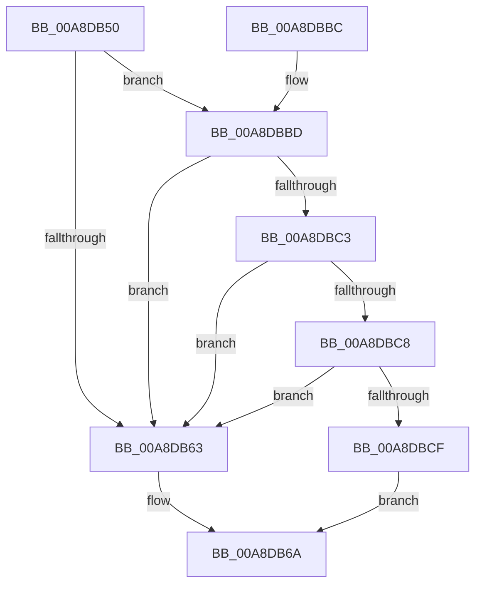

# PiDevCfgSetObjectProperty

- RVA: `0x00A8DB50`–`0x00A8DBDC` (길이 `140` bytes)
- VA: `0x0000000140A8DB50`
- 실행 섹션: `PAGE`
- PDB 이름 있음: `예`; PDB Function 태그: `아니요`
- unwind 정보 RVA: `0x000B892C`
- 디코드: `33`개 명령, `140/140` bytes 표시
- 미해석 바이트: `0` (있으면 어셈블리에 `.byte`로 보존)

> 이 문서는 커널 이미지의 기계어와 PDB 기호를 분석해 생성했습니다. 4번과 5번은 함수 원형과 자료형을 바이너리 사용 방식에서 추정한 C 해석이며 원본 소스 복구 결과는 아닙니다.

## 1. Dependencies

- 직접 호출 지점: **1**; 고유 호출 대상: **1**
- 직접 호출자로 확인된 함수: **9**
- RIP 상대 이미지 참조: **1**

### Outgoing calls
- `0x00A8DBB2` → [PiPnpRtlSetObjectProperty](../8F/PiPnpRtlSetObjectProperty_function_008F62A0.md) (function, `0x008F62A0`)

### Direct callers
- [PiDevCfgRequestDriverConfigurations](../73/PiDevCfgRequestDriverConfigurations_function_00735778.md) at `0x0073588A`
- [PpDevCfgProcessDeviceExtensions](../73/PpDevCfgProcessDeviceExtensions_function_00736C2C.md) at `0x00736F86`
- [PpDevCfgProcessDeviceExtensions](../73/PpDevCfgProcessDeviceExtensions_function_00736C2C.md) at `0x007370C1`
- [PpDevCfgProcessDeviceExtensions](../73/PpDevCfgProcessDeviceExtensions_function_00736C2C.md) at `0x00737188`
- [PpDevCfgProcessDeviceExtensions](../73/PpDevCfgProcessDeviceExtensions_function_00736C2C.md) at `0x007371D4`
- [PpDevCfgProcessDeviceExtensions](../73/PpDevCfgProcessDeviceExtensions_function_00736C2C.md) at `0x0073720C`
- [PpDevCfgProcessDeviceExtensions](../73/PpDevCfgProcessDeviceExtensions_function_00736C2C.md) at `0x00737252`
- [PpDevCfgProcessDeviceExtensions](../73/PpDevCfgProcessDeviceExtensions_function_00736C2C.md) at `0x00737281`
- [PiDevCfgProcessDevice](../97/PiDevCfgProcessDevice_function_00976D34.md) at `0x00977149`
- [PiDevCfgProcessDevice](../97/PiDevCfgProcessDevice_function_00976D34.md) at `0x009774DF`
- [PiDevCfgConfigureDevice](../97/PiDevCfgConfigureDevice_function_00977BB4.md) at `0x00978A82`
- [PiDevCfgConfigureDevice](../97/PiDevCfgConfigureDevice_function_00977BB4.md) at `0x00978ACE`
- [PiDevCfgConfigureDevice](../97/PiDevCfgConfigureDevice_function_00977BB4.md) at `0x00978B48`
- [PiDevCfgConfigureDevice](../97/PiDevCfgConfigureDevice_function_00977BB4.md) at `0x00978BA7`
- [PiDevCfgConfigureDevice](../97/PiDevCfgConfigureDevice_function_00977BB4.md) at `0x00978BF0`
- [PiDevCfgConfigureDevice](../97/PiDevCfgConfigureDevice_function_00977BB4.md) at `0x00978C44`
- [PiDevCfgConfigureDevice](../97/PiDevCfgConfigureDevice_function_00977BB4.md) at `0x00978C91`
- [PiDevCfgConfigureDevice](../97/PiDevCfgConfigureDevice_function_00977BB4.md) at `0x00978CE0`
- [PiDevCfgConfigureDevice](../97/PiDevCfgConfigureDevice_function_00977BB4.md) at `0x00978D88`
- [PiDevCfgConfigureDevice](../97/PiDevCfgConfigureDevice_function_00977BB4.md) at `0x00978EDA`
- [PiDevCfgConfigureDevice](../97/PiDevCfgConfigureDevice_function_00977BB4.md) at `0x00978F6D`
- [PiDevCfgConfigureDevice](../97/PiDevCfgConfigureDevice_function_00977BB4.md) at `0x00978FD4`
- [PiDevCfgConfigureDevice](../97/PiDevCfgConfigureDevice_function_00977BB4.md) at `0x009790A8`
- [PiDevCfgConfigureDevice](../97/PiDevCfgConfigureDevice_function_00977BB4.md) at `0x009790F6`
- [PiDevCfgConfigureDevice](../97/PiDevCfgConfigureDevice_function_00977BB4.md) at `0x009791AA`
- [PiDevCfgConfigureDevice](../97/PiDevCfgConfigureDevice_function_00977BB4.md) at `0x00979201`
- [PiDevCfgConfigureDevice](../97/PiDevCfgConfigureDevice_function_00977BB4.md) at `0x009794C9`
- [PiDevCfgConfigureDevice](../97/PiDevCfgConfigureDevice_function_00977BB4.md) at `0x00979507`
- [PiDevCfgConfigureDevice](../97/PiDevCfgConfigureDevice_function_00977BB4.md) at `0x00979545`
- [PiDevCfgConfigureDevice](../97/PiDevCfgConfigureDevice_function_00977BB4.md) at `0x00979583`
- [PiDevCfgConfigureDevice](../97/PiDevCfgConfigureDevice_function_00977BB4.md) at `0x009795C1`
- [PiDevCfgConfigureDevice](../97/PiDevCfgConfigureDevice_function_00977BB4.md) at `0x00979627`
- [PiDevCfgConfigureDevice](../97/PiDevCfgConfigureDevice_function_00977BB4.md) at `0x00979676`
- [PiDevCfgConfigureDevice](../97/PiDevCfgConfigureDevice_function_00977BB4.md) at `0x009796C9`
- [PiDevCfgConfigureDevice](../97/PiDevCfgConfigureDevice_function_00977BB4.md) at `0x00979718`
- [PiDevCfgConfigureDevice](../97/PiDevCfgConfigureDevice_function_00977BB4.md) at `0x0097976B`
- [PiDevCfgConfigureDevice](../97/PiDevCfgConfigureDevice_function_00977BB4.md) at `0x009797BA`
- [PiDevCfgConfigureDevice](../97/PiDevCfgConfigureDevice_function_00977BB4.md) at `0x0097980D`
- [PiDevCfgConfigureDevice](../97/PiDevCfgConfigureDevice_function_00977BB4.md) at `0x0097985C`
- [PiDevCfgConfigureDevice](../97/PiDevCfgConfigureDevice_function_00977BB4.md) at `0x009798AF`
- [PiDevCfgConfigureDevice](../97/PiDevCfgConfigureDevice_function_00977BB4.md) at `0x009798FE`
- [PiDevCfgConfigureDevice](../97/PiDevCfgConfigureDevice_function_00977BB4.md) at `0x00979A15`
- [PiDevCfgConfigureDevice](../97/PiDevCfgConfigureDevice_function_00977BB4.md) at `0x00979A53`
- [PiDevCfgConfigureDevice](../97/PiDevCfgConfigureDevice_function_00977BB4.md) at `0x00979A97`
- [PiDevCfgConfigureDevice](../97/PiDevCfgConfigureDevice_function_00977BB4.md) at `0x00979D50`
- [PiDevCfgConfigureDevice](../97/PiDevCfgConfigureDevice_function_00977BB4.md) at `0x00979D9F`
- [PiDevCfgConfigureDevice](../97/PiDevCfgConfigureDevice_function_00977BB4.md) at `0x00979DFA`
- [PiDevCfgConfigureDevice](../97/PiDevCfgConfigureDevice_function_00977BB4.md) at `0x00979E49`
- [PiDevCfgConfigureDevice](../97/PiDevCfgConfigureDevice_function_00977BB4.md) at `0x00979EA1`
- [PiDevCfgConfigureDevice](../97/PiDevCfgConfigureDevice_function_00977BB4.md) at `0x00979EEF`
- [PiDevCfgConfigureDevice](../97/PiDevCfgConfigureDevice_function_00977BB4.md) at `0x00979F46`
- [PiDevCfgConfigureDevice](../97/PiDevCfgConfigureDevice_function_00977BB4.md) at `0x00979F97`
- [sub_00B2819A](../B2/Unknown_function_00B2819A.md) at `0x00B282FB`
- [sub_00B2834C](../B2/Unknown_function_00B2834C.md) at `0x00B2847E`
- [sub_00B29934](../B2/Unknown_function_00B29934.md) at `0x00B2996E`
- [sub_00B2C5F4](../B2/Unknown_function_00B2C5F4.md) at `0x00B2C917`
- [PpDevCfgInit](../../init/C3/PpDevCfgInit_function_00C351A4.md) at `0x00C354E6`

### Static image references
- `0x00A8DB54` → RVA `0x00E66398` (`.data`; read)

## 2. Other-region calls and transfers

- 다른 실행 섹션으로 향하는 call: **0**
- 별도 외부 분기/꼬리 이동을 확인하지 못했습니다.

## 3. Assembly (complete function range)

```asm
00A8DB50  48 83 EC 58                     sub rsp, 0x58
00A8DB54  48 3B 0D 3D 88 3D 00            cmp rcx, qword ptr [rip + 0x3d883d]
00A8DB5B  45 8B D1                        mov r10d, r9d
00A8DB5E  4D 8B D8                        mov r11, r8
00A8DB61  74 5A                           je 0x140a8dbbd
00A8DB63  8B 84 24 B0 00 00 00            mov eax, dword ptr [rsp + 0xb0]
00A8DB6A  4C 8B 8C 24 80 00 00 00         mov r9, qword ptr [rsp + 0x80]
00A8DB72  45 8B C2                        mov r8d, r10d
00A8DB75  89 44 24 48                     mov dword ptr [rsp + 0x48], eax
00A8DB79  49 8B D3                        mov rdx, r11
00A8DB7C  8B 84 24 A8 00 00 00            mov eax, dword ptr [rsp + 0xa8]
00A8DB83  89 44 24 40                     mov dword ptr [rsp + 0x40], eax
00A8DB87  48 8B 84 24 A0 00 00 00         mov rax, qword ptr [rsp + 0xa0]
00A8DB8F  48 89 44 24 38                  mov qword ptr [rsp + 0x38], rax
00A8DB94  8B 84 24 98 00 00 00            mov eax, dword ptr [rsp + 0x98]
00A8DB9B  89 44 24 30                     mov dword ptr [rsp + 0x30], eax
00A8DB9F  48 8B 84 24 90 00 00 00         mov rax, qword ptr [rsp + 0x90]
00A8DBA7  48 89 44 24 28                  mov qword ptr [rsp + 0x28], rax
00A8DBAC  48 83 64 24 20 00               and qword ptr [rsp + 0x20], 0
00A8DBB2  E8 E9 86 E6 FF                  call 0x1408f62a0
00A8DBB7  48 83 C4 58                     add rsp, 0x58
00A8DBBB  C3                              ret
00A8DBBC  CC                              int3
00A8DBBD  41 83 FA 01                     cmp r10d, 1
00A8DBC1  75 A0                           jne 0x140a8db63
00A8DBC3  48 85 D2                        test rdx, rdx
00A8DBC6  74 9B                           je 0x140a8db63
00A8DBC8  8B 02                           mov eax, dword ptr [rdx]
00A8DBCA  41 84 C2                        test r10b, al
00A8DBCD  74 94                           je 0x140a8db63
00A8DBCF  8B 84 24 B0 00 00 00            mov eax, dword ptr [rsp + 0xb0]
00A8DBD6  0F BA E8 11                     bts eax, 0x11
00A8DBDA  EB 8E                           jmp 0x140a8db6a
```

## 4. C-style interpretation (structured pseudocode)

```c
__int64 __fastcall PiDevCfgSetObjectProperty(__int64 a1, __int64 a2, __int64 a3, int a4, __int64 a5, __int64 a6, __int64 a7, unsigned int a8, __int64 a9, unsigned int a10, unsigned int a11)
{
    __int64 result;
    __int64 v_rsp;
    unsigned int v_stack_m10;
    unsigned int v_stack_m18;
    unsigned __int64 v_stack_m20;
    unsigned int v_stack_m28;
    unsigned __int64 v_stack_m30;
    unsigned __int64 v_stack_m38;

    v_rsp = (v_rsp) - (88);
    if (a1 == (*(unsigned __int64 *)(v_rip + 4032573))) goto loc_00A8DBBD;
loc_00A8DB63:
loc_00A8DB6A:
    v_stack_m10 = (unsigned int)((unsigned int)(a11));
    v_stack_m18 = (unsigned int)((unsigned int)(a10));
    v_stack_m20 = a9;
    v_stack_m28 = (unsigned int)((unsigned int)(a8));
    v_stack_m30 = a7;
    result = PiPnpRtlSetObjectProperty(a1, a3, (unsigned int)((unsigned int)((unsigned int)(a4))), a5);
    v_rsp = (v_rsp) + (88);
    return result;
loc_00A8DBBD:
    if (((unsigned int)((unsigned int)(a4))) != 1) goto loc_00A8DB63;
    if (a3 == 0) goto loc_00A8DB63;
    if ((((unsigned __int8)((unsigned int)(a4))) & ((unsigned __int8)((unsigned int)(*(unsigned int *)(a3))))) == 0) goto loc_00A8DB63;
    goto loc_00A8DB6A;
}
```

## 5. (Beta) C Style

```c
int64_t PiDevCfgSetObjectProperty(int64_t Arg1, int64_t Arg2, int64_t Arg3, int32_t Arg4, int64_t Arg5, uint64_t Arg6, int64_t Arg7, uint32_t Arg8, int64_t Arg9, uint32_t Arg10, uint32_t Arg11)
{
    int64_t result;
    int64_t local_rsp;
    uint32_t v_stack_m10;
    uint32_t v_stack_m18;
    uint64_t v_stack_m20;
    uint32_t v_stack_m28;
    uint64_t v_stack_m30;
    uint64_t v_stack_m38;

    local_rsp = (local_rsp) - (88);
    if (Arg1 == (*(uint64_t *)(v_rip + 0x3D883D))) goto loc_00A8DBBD;
loc_00A8DB63:
loc_00A8DB6A:
    v_stack_m10 = (uint32_t)((uint32_t)(Arg11));
    v_stack_m18 = (uint32_t)((uint32_t)(Arg10));
    v_stack_m20 = Arg9;
    v_stack_m28 = (uint32_t)((uint32_t)(Arg8));
    v_stack_m30 = Arg7;
    result = PiPnpRtlSetObjectProperty(Arg1, Arg3, (uint32_t)((uint32_t)((uint32_t)(Arg4))), Arg5);
    local_rsp = (local_rsp) + (88);
    return result;
loc_00A8DBBD:
    if (((uint32_t)((uint32_t)(Arg4))) != 1) goto loc_00A8DB63;
    if (Arg3 == 0) goto loc_00A8DB63;
    if ((((uint8_t)((uint32_t)(Arg4))) & ((uint8_t)((uint32_t)(*(uint32_t *)(Arg3))))) == 0) goto loc_00A8DB63;
    goto loc_00A8DB6A;
}
```

## 6. Execution-region graph

[열기: 2D/3D 그래프와 함수 탐색 컨트롤 패널](../../../control-panel.html?section=page&rva=0x00A8DB50&view=graph)

- 2D 그래프는 위에서 아래로 흐르고, 3D 그래프는 빈 공간을 드래그해 회전합니다. Shift+드래그는 이동, 휠은 확대·축소, 함수 노드 선택은 대상 보고서 이동입니다.

### Static fallback


