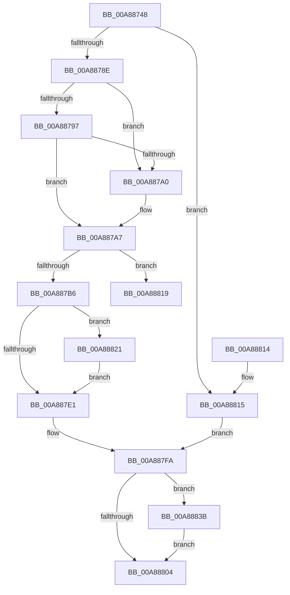

# PiDmListRemoveObjectWorker

- RVA: `0x00A88748`–`0x00A8883F` (길이 `247` bytes)
- VA: `0x0000000140A88748`
- 실행 섹션: `PAGE`
- PDB 이름 있음: `예`; PDB Function 태그: `예`
- unwind 정보 RVA: `0x000B8104`
- 디코드: `69`개 명령, `247/247` bytes 표시
- 미해석 바이트: `0` (있으면 어셈블리에 `.byte`로 보존)

> 이 문서는 커널 이미지의 기계어와 PDB 기호를 분석해 생성했습니다. 4번과 5번은 함수 원형과 자료형을 바이너리 사용 방식에서 추정한 C 해석이며 원본 소스 복구 결과는 아닙니다.

## 1. Dependencies

- 직접 호출 지점: **5**; 고유 호출 대상: **5**
- 직접 호출자로 확인된 함수: **2**
- RIP 상대 이미지 참조: **1**

### Outgoing calls
- `0x00A887C9` → [PiDmObjectManagerAcquireExclusiveLock](../95/PiDmObjectManagerAcquireExclusiveLock_function_00951334.md) (function, `0x00951334`)
- `0x00A887E4` → [PiDmObjectManagerReleaseLock](../95/PiDmObjectManagerReleaseLock_function_0095111C.md) (function, `0x0095111C`)
- `0x00A887F5` → [PiDmListUpdateAggregationCountWorker](PiDmListUpdateAggregationCountWorker_function_00A88848.md) (function, `0x00A88848`)
- `0x00A8882A` → [RtlDeleteElementGenericTableAvl](../../text/3E/RtlDeleteElementGenericTableAvl_function_003EE750.md) (function, `0x003EE750`)
- `0x00A88834` → [PiDmObjectRelease](../8E/PiDmObjectRelease_function_008E4F70.md) (function, `0x008E4F70`)

### Direct callers
- [PiDmListRemoveObject](../70/PiDmListRemoveObject_function_007045E8.md) at `0x00704637`
- [PiDmListRemoveList](../73/PiDmListRemoveList_function_00730474.md) at `0x007304EF`

### Static image references
- `0x00A88762` → RVA `0x000018A0` (`.rdata`; read)

## 2. Other-region calls and transfers

- 다른 실행 섹션으로 향하는 call: **1**
  - `0x00A8882A` → [RtlDeleteElementGenericTableAvl](../../text/3E/RtlDeleteElementGenericTableAvl_function_003EE750.md) (`PAGE` → `.text`)
- call이 아닌 외부 분기/꼬리 이동: **1**
  - `0x00A8881C` → [sub_00B45186 + 0x5](../B4/Unknown_function_00B45186.md) (`tail-transfer`)

## 3. Assembly (complete function range)

```asm
00A88748  48 89 5C 24 08                  mov qword ptr [rsp + 8], rbx
00A8874D  48 89 74 24 10                  mov qword ptr [rsp + 0x10], rsi
00A88752  4C 89 44 24 18                  mov qword ptr [rsp + 0x18], r8
00A88757  57                              push rdi
00A88758  48 83 EC 20                     sub rsp, 0x20
00A8875C  48 63 C1                        movsxd rax, ecx
00A8875F  48 8B FA                        mov rdi, rdx
00A88762  48 8D 15 37 91 57 FF            lea rdx, [rip - 0xa86ec9]
00A88769  49 8B F1                        mov rsi, r9
00A8876C  48 8D 0C 80                     lea rcx, [rax + rax*4]
00A88770  4C 8B 54 CA 08                  mov r10, qword ptr [rdx + rcx*8 + 8]
00A88775  48 8B 4C CA 18                  mov rcx, qword ptr [rdx + rcx*8 + 0x18]
00A8877A  4D 03 D0                        add r10, r8
00A8877D  49 03 C9                        add rcx, r9
00A88780  33 D2                           xor edx, edx
00A88782  4C 8B 01                        mov r8, qword ptr [rcx]
00A88785  4D 85 C0                        test r8, r8
00A88788  0F 84 87 00 00 00               je 0x140a88815
00A8878E  8D 5A 01                        lea ebx, [rdx + 1]
00A88791  49 39 48 08                     cmp qword ptr [r8 + 8], rcx
00A88795  75 09                           jne 0x140a887a0
00A88797  48 8B 41 08                     mov rax, qword ptr [rcx + 8]
00A8879B  48 39 08                        cmp qword ptr [rax], rcx
00A8879E  74 07                           je 0x140a887a7
00A887A0  B9 03 00 00 00                  mov ecx, 3
00A887A5  CD 29                           int 0x29
00A887A7  4C 89 00                        mov qword ptr [rax], r8
00A887AA  49 89 40 08                     mov qword ptr [r8 + 8], rax
00A887AE  41 8B 42 10                     mov eax, dword ptr [r10 + 0x10]
00A887B2  85 C0                           test eax, eax
00A887B4  74 63                           je 0x140a88819
00A887B6  8D 50 FF                        lea edx, [rax - 1]
00A887B9  41 89 52 10                     mov dword ptr [r10 + 0x10], edx
00A887BD  48 83 21 00                     and qword ptr [rcx], 0
00A887C1  48 83 61 08 00                  and qword ptr [rcx + 8], 0
00A887C6  48 8B CF                        mov rcx, rdi
00A887C9  E8 66 8B EC FF                  call 0x140951334
00A887CE  48 8B 44 24 40                  mov rax, qword ptr [rsp + 0x40]
00A887D3  FF 48 0C                        dec dword ptr [rax + 0xc]
00A887D6  48 8B 44 24 40                  mov rax, qword ptr [rsp + 0x40]
00A887DB  83 78 0C 00                     cmp dword ptr [rax + 0xc], 0
00A887DF  74 40                           je 0x140a88821
00A887E1  48 8B CF                        mov rcx, rdi
00A887E4  E8 33 89 EC FF                  call 0x14095111c
00A887E9  48 8B 4C 24 40                  mov rcx, qword ptr [rsp + 0x40]
00A887EE  41 83 C8 FF                     or r8d, 0xffffffff
00A887F2  48 8B D6                        mov rdx, rsi
00A887F5  E8 4E 00 00 00                  call 0x140a88848
00A887FA  48 8B 44 24 50                  mov rax, qword ptr [rsp + 0x50]
00A887FF  48 85 C0                        test rax, rax
00A88802  75 37                           jne 0x140a8883b
00A88804  48 8B 5C 24 30                  mov rbx, qword ptr [rsp + 0x30]
00A88809  48 8B 74 24 38                  mov rsi, qword ptr [rsp + 0x38]
00A8880E  48 83 C4 20                     add rsp, 0x20
00A88812  5F                              pop rdi
00A88813  C3                              ret
00A88814  CC                              int3
00A88815  32 DB                           xor bl, bl
00A88817  EB E1                           jmp 0x140a887fa
00A88819  49 8B 02                        mov rax, qword ptr [r10]
00A8881C  E9 6A C9 0B 00                  jmp 0x140b4518b
00A88821  48 8D 4F 68                     lea rcx, [rdi + 0x68]
00A88825  48 8D 54 24 40                  lea rdx, [rsp + 0x40]
00A8882A  E8 21 5F 96 FF                  call 0x1403ee750
00A8882F  48 8B 4C 24 40                  mov rcx, qword ptr [rsp + 0x40]
00A88834  E8 37 C7 E5 FF                  call 0x1408e4f70
00A88839  EB A6                           jmp 0x140a887e1
00A8883B  88 18                           mov byte ptr [rax], bl
00A8883D  EB C5                           jmp 0x140a88804
```

## 4. C-style interpretation (structured pseudocode)

```c
__int64 __fastcall PiDmListRemoveObjectWorker(int a1, __int64 a2, __int64 a3, __int64 a4, __int64 a5)
{
    __int64 result;
    __int64 v_r10;
    __int64 v_rbx;
    __int64 v_rsp;
    unsigned __int64 v_stack_p10;
    unsigned __int64 v_stack_p18;
    unsigned __int64 v_stack_p40;
    unsigned __int64 v_stack_p8;

    v_stack_p8 = v_rbx;
    v_stack_p10 = v_rsi;
    v_stack_p18 = a3;
    v_rsp = (v_rsp) - (32);
    v_r10 = (*(unsigned __int64 *)(v_rip - 11038409 + (int)(a1) + (int)(a1) * 4 * 8 + 8)) + (a3);
    a1 = (*(unsigned __int64 *)(v_rip - 11038409 + (int)(a1) + (int)(a1) * 4 * 8 + 24)) + (a4);
    a2 = 0;
    if (*(unsigned __int64 *)(a1) == 0) goto loc_00A88815;
    if ((*(unsigned __int64 *)(*(unsigned __int64 *)(a1) + 8)) != a1) goto loc_00A887A0;
    if ((*(unsigned __int64 *)(*(unsigned __int64 *)(a1 + 8))) != a1) {
        a1 = 3;
    }
    *(unsigned __int64 *)(*(unsigned __int64 *)(a1 + 8)) = *(unsigned __int64 *)(a1);
    *(unsigned __int64 *)(*(unsigned __int64 *)(a1) + 8) = *(unsigned __int64 *)(a1 + 8);
    if ((unsigned int)((unsigned int)(*(unsigned int *)(v_r10 + 16))) == 0) goto loc_00A88819;
    *(unsigned int *)(v_r10 + 16) = (unsigned int)((unsigned int)(*(unsigned int *)(v_r10 + 16)) - 1);
    result = PiDmObjectManagerAcquireExclusiveLock(0, (unsigned int)(*(unsigned int *)(v_r10 + 16)) - 1, *(unsigned __int64 *)(a1), a4);
    if ((*(unsigned int *)(v_stack_p18 + 12)) == 0) goto loc_00A88821;
loc_00A887E1:
    result = PiDmObjectManagerReleaseLock(0, (unsigned int)(*(unsigned int *)(v_r10 + 16)) - 1, *(unsigned __int64 *)(a1), a4);
    a3 = (unsigned int)((*(unsigned __int64 *)(a1)) | (0xFFFFFFFFULL));
    result = PiDmListUpdateAggregationCountWorker(v_stack_p18, a4, a3, a4);
loc_00A887FA:
    if (a5 != 0) goto loc_00A8883B;
loc_00A88804:
    v_rsp = (v_rsp) + (32);
    return a5;
loc_00A88815:
    v_rbx = 0;
    goto loc_00A887FA;
loc_00A88819:
loc_00A88821:
    result = RtlDeleteElementGenericTableAvl(a2 + 104, v_stack_p40, a3, a4);
    result = PiDmObjectRelease(v_stack_p40, v_stack_p40, a3, a4);
    goto loc_00A887E1;
loc_00A8883B:
    *(unsigned __int8 *)(result) = 0;
    goto loc_00A88804;
}
```

## 5. (Beta) C Style

```c
int64_t PiDmListRemoveObjectWorker(void *Arg1, void *Arg2, int64_t Arg3, int64_t Arg4, int64_t Arg5)
{
    uint8_t *arg1 = (uint8_t *)Arg1;
    uint8_t *arg2 = (uint8_t *)Arg2;

    int64_t result;
    int64_t local_r10;
    int64_t local_rbx;
    int64_t local_rsp;
    uint64_t v_stack_p10;
    uint64_t v_stack_p18;
    uint64_t v_stack_p40;
    uint64_t v_stack_p8;

    v_stack_p8 = local_rbx;
    v_stack_p10 = local_rsi;
    v_stack_p18 = Arg3;
    local_rsp = (local_rsp) - (32);
    local_r10 = (*(uint64_t *)(v_rip - 0xA86EC9 + (int32_t)(arg1) + (int32_t)(arg1) * 4 * 8 + 0x8)) + (Arg3);
    Arg1 = (*(uint64_t *)(v_rip - 0xA86EC9 + (int32_t)(arg1) + (int32_t)(arg1) * 4 * 8 + 0x18)) + (Arg4);
    Arg2 = 0;
    if (*(uint64_t *)(arg1) == 0) goto loc_00A88815;
    if ((*(uint64_t *)(*(uint64_t *)(arg1) + 0x8)) != Arg1) goto loc_00A887A0;
    if ((*(uint64_t *)(*(uint64_t *)(arg1 + 0x8))) != Arg1) {
        Arg1 = 3;
    }
    *(uint64_t *)(*(uint64_t *)(arg1 + 0x8)) = *(uint64_t *)(arg1);
    *(uint64_t *)(*(uint64_t *)(arg1) + 0x8) = *(uint64_t *)(arg1 + 0x8);
    if ((uint32_t)((uint32_t)(*(uint32_t *)(local_r10 + 0x10))) == 0) goto loc_00A88819;
    *(uint32_t *)(local_r10 + 0x10) = (uint32_t)((uint32_t)(*(uint32_t *)(local_r10 + 0x10)) - 1);
    result = PiDmObjectManagerAcquireExclusiveLock(0, (uint32_t)(*(uint32_t *)(local_r10 + 0x10)) - 1, *(uint64_t *)(arg1), Arg4);
    if ((*(uint32_t *)(v_stack_p18 + 0xC)) == 0) goto loc_00A88821;
loc_00A887E1:
    result = PiDmObjectManagerReleaseLock(0, (uint32_t)(*(uint32_t *)(local_r10 + 0x10)) - 1, *(uint64_t *)(arg1), Arg4);
    Arg3 = (uint32_t)((*(uint64_t *)(arg1)) | (0xFFFFFFFFULL));
    result = PiDmListUpdateAggregationCountWorker(v_stack_p18, Arg4, Arg3, Arg4);
loc_00A887FA:
    if (Arg5 != 0) goto loc_00A8883B;
loc_00A88804:
    local_rsp = (local_rsp) + (32);
    return Arg5;
loc_00A88815:
    local_rbx = 0;
    goto loc_00A887FA;
loc_00A88819:
loc_00A88821:
    result = RtlDeleteElementGenericTableAvl(Arg2 + 104, v_stack_p40, Arg3, Arg4);
    result = PiDmObjectRelease(v_stack_p40, v_stack_p40, Arg3, Arg4);
    goto loc_00A887E1;
loc_00A8883B:
    *(uint8_t *)(result) = 0;
    goto loc_00A88804;
}
```

### 관측된 메모리 오프셋

구조체 형식이 확인되지 않은 접근은 인자 기준의 오프셋으로만 기록했습니다.

| 기준 인자 | 오프셋 표현 | 폭 (bit) | 접근 |
|---|---:|---:|---|
| `Arg1` | `+ 0x0 + rax*4` | `64` | `R` |
| `Arg2` | `+ 0x68` | `64` | `R` |

## 6. Execution-region graph

[열기: 2D/3D 그래프와 함수 탐색 컨트롤 패널](../../../control-panel.html?section=page&rva=0x00A88748&view=graph)

- 2D 그래프는 위에서 아래로 흐르고, 3D 그래프는 빈 공간을 드래그해 회전합니다. Shift+드래그는 이동, 휠은 확대·축소, 함수 노드 선택은 대상 보고서 이동입니다.

### Static fallback


