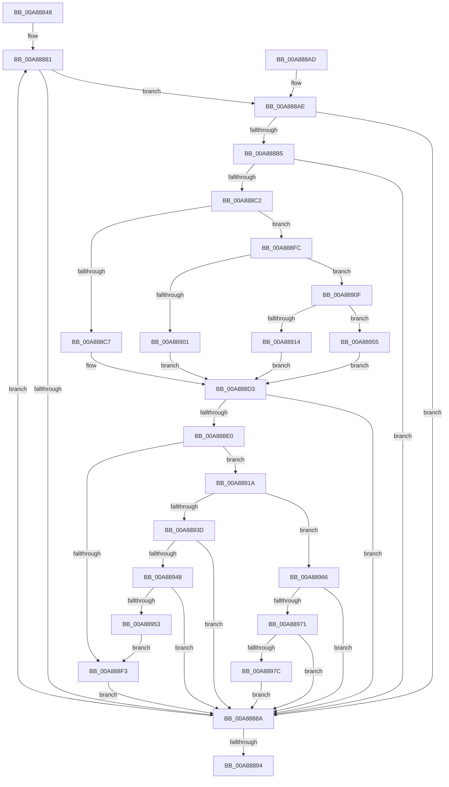

# PiDmListUpdateAggregationCountWorker

- RVA: `0x00A88848`–`0x00A88985` (길이 `317` bytes)
- VA: `0x0000000140A88848`
- 실행 섹션: `PAGE`
- PDB 이름 있음: `예`; PDB Function 태그: `아니요`
- unwind 정보 RVA: `0x000B8128`
- 디코드: `85`개 명령, `317/317` bytes 표시
- 미해석 바이트: `0` (있으면 어셈블리에 `.byte`로 보존)

> 이 문서는 커널 이미지의 기계어와 PDB 기호를 분석해 생성했습니다. 4번과 5번은 함수 원형과 자료형을 바이너리 사용 방식에서 추정한 C 해석이며 원본 소스 복구 결과는 아닙니다.

## 1. Dependencies

- 직접 호출 지점: **2**; 고유 호출 대상: **2**
- 직접 호출자로 확인된 함수: **2**
- RIP 상대 이미지 참조: **4**

### Outgoing calls
- `0x00A888D7` → [PiDmGetCachedKeyIndex](../8F/PiDmGetCachedKeyIndex_function_008F8E80.md) (function, `0x008F8E80`)
- `0x00A88934` → [PiDmCacheDataDecode](../8F/PiDmCacheDataDecode_function_008F17A0.md) (function, `0x008F17A0`)

### Direct callers
- [PiDmListAddObjectWorker](../95/PiDmListAddObjectWorker_function_009507B4.md) at `0x0095083D`
- [PiDmListRemoveObjectWorker](PiDmListRemoveObjectWorker_function_00A88748.md) at `0x00A887F5`

### Static image references
- `0x00A88864` → RVA `0x00001EF8` (`.rdata`; read)
- `0x00A888C7` → RVA `0x00001A70` (`.rdata`; read)
- `0x00A88901` → RVA `0x00001B60` (`.rdata`; read)
- `0x00A88955` → RVA `0x00001B90` (`.rdata`; read)

## 2. Other-region calls and transfers

- 다른 실행 섹션으로 향하는 call: **0**
- 별도 외부 분기/꼬리 이동을 확인하지 못했습니다.

## 3. Assembly (complete function range)

```asm
00A88848  48 8B C4                        mov rax, rsp
00A8884B  48 89 58 08                     mov qword ptr [rax + 8], rbx
00A8884F  48 89 68 10                     mov qword ptr [rax + 0x10], rbp
00A88853  48 89 70 18                     mov qword ptr [rax + 0x18], rsi
00A88857  57                              push rdi
00A88858  41 56                           push r14
00A8885A  41 57                           push r15
00A8885C  48 83 EC 40                     sub rsp, 0x40
00A88860  83 60 DC 00                     and dword ptr [rax - 0x24], 0
00A88864  48 8D 1D 8D 96 57 FF            lea rbx, [rip - 0xa86973]
00A8886B  83 60 D8 00                     and dword ptr [rax - 0x28], 0
00A8886F  45 8B F8                        mov r15d, r8d
00A88872  4C 8B F2                        mov r14, rdx
00A88875  C6 40 20 00                     mov byte ptr [rax + 0x20], 0
00A88879  48 8B F9                        mov rdi, rcx
00A8887C  BD 03 00 00 00                  mov ebp, 3
00A88881  8B 4B E8                        mov ecx, dword ptr [rbx - 0x18]
00A88884  41 39 4E 1C                     cmp dword ptr [r14 + 0x1c], ecx
00A88888  74 24                           je 0x140a888ae
00A8888A  48 83 C3 38                     add rbx, 0x38
00A8888E  48 83 ED 01                     sub rbp, 1
00A88892  75 ED                           jne 0x140a88881
00A88894  48 8B 5C 24 60                  mov rbx, qword ptr [rsp + 0x60]
00A88899  48 8B 6C 24 68                  mov rbp, qword ptr [rsp + 0x68]
00A8889E  48 8B 74 24 70                  mov rsi, qword ptr [rsp + 0x70]
00A888A3  48 83 C4 40                     add rsp, 0x40
00A888A7  41 5F                           pop r15
00A888A9  41 5E                           pop r14
00A888AB  5F                              pop rdi
00A888AC  C3                              ret
00A888AD  CC                              int3
00A888AE  8B 03                           mov eax, dword ptr [rbx]
00A888B0  39 47 1C                        cmp dword ptr [rdi + 0x1c], eax
00A888B3  75 D5                           jne 0x140a8888a
00A888B5  48 8B 73 18                     mov rsi, qword ptr [rbx + 0x18]
00A888B9  81 3C 37 00 00 00 80            cmp dword ptr [rdi + rsi], 0x80000000
00A888C0  74 C8                           je 0x140a8888a
00A888C2  83 E9 01                        sub ecx, 1
00A888C5  75 35                           jne 0x140a888fc
00A888C7  48 8D 0D A2 91 57 FF            lea rcx, [rip - 0xa86e5e]
00A888CE  BA 0A 00 00 00                  mov edx, 0xa
00A888D3  4C 8B 43 F0                     mov r8, qword ptr [rbx - 0x10]
00A888D7  E8 A4 05 E7 FF                  call 0x1408f8e80
00A888DC  3B C2                           cmp eax, edx
00A888DE  73 AA                           jae 0x140a8888a
00A888E0  8B C0                           mov eax, eax
00A888E2  48 8D 48 07                     lea rcx, [rax + 7]
00A888E6  48 8D 0C 48                     lea rcx, [rax + rcx*2]
00A888EA  49 8D 0C CE                     lea rcx, [r14 + rcx*8]
00A888EE  83 39 01                        cmp dword ptr [rcx], 1
00A888F1  77 27                           ja 0x140a8891a
00A888F3  C7 04 37 00 00 00 80            mov dword ptr [rdi + rsi], 0x80000000
00A888FA  EB 8E                           jmp 0x140a8888a
00A888FC  83 E9 02                        sub ecx, 2
00A888FF  75 0E                           jne 0x140a8890f
00A88901  48 8D 0D 58 92 57 FF            lea rcx, [rip - 0xa86da8]
00A88908  BA 01 00 00 00                  mov edx, 1
00A8890D  EB C4                           jmp 0x140a888d3
00A8890F  83 F9 02                        cmp ecx, 2
00A88912  74 41                           je 0x140a88955
00A88914  33 C9                           xor ecx, ecx
00A88916  33 D2                           xor edx, edx
00A88918  EB B9                           jmp 0x140a888d3
00A8891A  48 8D 44 24 34                  lea rax, [rsp + 0x34]
00A8891F  41 B9 01 00 00 00               mov r9d, 1
00A88925  4C 8D 44 24 78                  lea r8, [rsp + 0x78]
00A8892A  48 89 44 24 20                  mov qword ptr [rsp + 0x20], rax
00A8892F  48 8D 54 24 30                  lea rdx, [rsp + 0x30]
00A88934  E8 67 8E E6 FF                  call 0x1408f17a0
00A88939  85 C0                           test eax, eax
00A8893B  79 29                           jns 0x140a88966
00A8893D  3D 25 02 00 C0                  cmp eax, 0xc0000225
00A88942  0F 84 42 FF FF FF               je 0x140a8888a
00A88948  3D 23 00 00 C0                  cmp eax, 0xc0000023
00A8894D  0F 84 37 FF FF FF               je 0x140a8888a
00A88953  EB 9E                           jmp 0x140a888f3
00A88955  48 8D 0D 34 92 57 FF            lea rcx, [rip - 0xa86dcc]
00A8895C  BA 03 00 00 00                  mov edx, 3
00A88961  E9 6D FF FF FF                  jmp 0x140a888d3
00A88966  83 7C 24 30 11                  cmp dword ptr [rsp + 0x30], 0x11
00A8896B  0F 85 19 FF FF FF               jne 0x140a8888a
00A88971  80 7C 24 78 FF                  cmp byte ptr [rsp + 0x78], 0xff
00A88976  0F 85 0E FF FF FF               jne 0x140a8888a
00A8897C  44 01 3C 37                     add dword ptr [rdi + rsi], r15d
00A88980  E9 05 FF FF FF                  jmp 0x140a8888a
```

## 4. C-style interpretation (structured pseudocode)

```c
__int64 __fastcall PiDmListUpdateAggregationCountWorker(__int64 a1, __int64 a2, int a3)
{
    __int64 result;
    __int64 v_rbp;
    __int64 v_rbx;
    __int64 v_rsp;
    unsigned __int64 v_stack_p10;
    unsigned __int64 v_stack_p18;
    unsigned __int64 v_stack_p20;
    unsigned __int64 v_stack_p30;
    unsigned __int64 v_stack_p34;
    unsigned __int64 v_stack_p78;
    unsigned __int64 v_stack_p8;

    *(unsigned __int64 *)(v_rsp + 8) = v_rbx;
    *(unsigned __int64 *)(v_rsp + 16) = v_rbp;
    *(unsigned __int64 *)(v_rsp + 24) = v_rsi;
    v_rsp = (v_rsp) - (64);
    *(unsigned __int8 *)(v_rsp + 32) = 0;
loc_00A88881:
    if ((*(unsigned int *)(a2 + 28)) == ((unsigned int)((unsigned int)(*(unsigned int *)(v_rip - 11037043 - 24))))) goto loc_00A888AE;
loc_00A8888A:
    v_rbx = (v_rip - 11037043) + (56);
    v_rbp = (3) - (1);
    if (condition_is_not_equal) goto loc_00A88881;
    v_rsp = (v_rsp) + (64);
    return v_rsp;
loc_00A888AE:
    if ((*(unsigned int *)(a1 + 28)) != ((unsigned int)((unsigned int)(*(unsigned int *)(v_stack_p8))))) goto loc_00A8888A;
    if ((*(unsigned int *)(a1 + *(unsigned __int64 *)(v_stack_p8 + 24) * 1)) == 0x80000000ULL) goto loc_00A8888A;
    a1 = (unsigned int)(((unsigned int)(*(unsigned int *)(v_rip - 11037043 - 24))) - (1));
    if (condition_is_not_equal) goto loc_00A888FC;
loc_00A888D3:
    result = PiDmGetCachedKeyIndex(v_rip - 11038302, 10, *(unsigned __int64 *)(v_stack_p8 - 16), a4);
    if (((unsigned int)(result)) >= 10) goto loc_00A8888A;
    if ((*(unsigned int *)(a2 + (unsigned int)((unsigned int)(result)) + (unsigned int)((unsigned int)(result)) + 7 * 2 * 8)) > 1) goto loc_00A8891A;
loc_00A888F3:
    *(unsigned int *)(a1 + *(unsigned __int64 *)(v_stack_p8 + 24) * 1) = 0x80000000ULL;
    goto loc_00A8888A;
loc_00A888FC:
    a1 = (unsigned int)((a2 + (unsigned int)((unsigned int)(result)) + (unsigned int)((unsigned int)(result)) + 7 * 2 * 8) - (2));
    if (condition_is_not_equal) goto loc_00A8890F;
    goto loc_00A888D3;
loc_00A8890F:
    if (((unsigned int)(v_rip - 11038120)) == 2) goto loc_00A88955;
    a1 = 0;
    a2 = 0;
    goto loc_00A888D3;
loc_00A8891A:
    v_stack_p20 = v_stack_p34;
    result = PiDmCacheDataDecode(a1, v_stack_p30, v_stack_p78, 1);
    if (!sign_flag) goto loc_00A88966;
    if (((unsigned int)(result)) == 0xC0000225ULL) goto loc_00A8888A;
    if (((unsigned int)(result)) == 0xC0000023ULL) goto loc_00A8888A;
    goto loc_00A888F3;
loc_00A88955:
    goto loc_00A888D3;
loc_00A88966:
    if (v_stack_p30 != 17) goto loc_00A8888A;
    if (v_stack_p78 != 255) goto loc_00A8888A;
    goto loc_00A8888A;
}
```

## 5. (Beta) C Style

```c
int64_t PiDmListUpdateAggregationCountWorker(void *Arg1, void *Arg2, int32_t Arg3)
{
    uint8_t *arg1 = (uint8_t *)Arg1;
    uint8_t *arg2 = (uint8_t *)Arg2;

    int64_t result;
    int64_t local_rbp;
    int64_t local_rbx;
    int64_t local_rsp;
    uint64_t v_stack_p10;
    uint64_t v_stack_p18;
    uint64_t v_stack_p20;
    uint64_t v_stack_p30;
    uint64_t v_stack_p34;
    uint64_t v_stack_p78;
    uint64_t v_stack_p8;

    *(uint64_t *)(local_rsp + 0x8) = local_rbx;
    *(uint64_t *)(local_rsp + 0x10) = local_rbp;
    *(uint64_t *)(local_rsp + 0x18) = local_rsi;
    local_rsp = (local_rsp) - (64);
    *(uint8_t *)(local_rsp + 0x20) = 0;
loc_00A88881:
    if ((*(uint32_t *)(arg2 + 0x1C)) == ((uint32_t)((uint32_t)(*(uint32_t *)(v_rip - 0xA86973 - 0x18))))) goto loc_00A888AE;
loc_00A8888A:
    local_rbx = (v_rip - 11037043) + (56);
    local_rbp = (3) - (1);
    if (condition_is_not_equal) goto loc_00A88881;
    local_rsp = (local_rsp) + (64);
    return local_rsp;
loc_00A888AE:
    if ((*(uint32_t *)(arg1 + 0x1C)) != ((uint32_t)((uint32_t)(*(uint32_t *)(v_stack_p8))))) goto loc_00A8888A;
    if ((*(uint32_t *)(arg1 + *(uint64_t *)(v_stack_p8 + 0x18) * 1)) == 0x80000000ULL) goto loc_00A8888A;
    Arg1 = (uint32_t)(((uint32_t)(*(uint32_t *)(v_rip - 0xA86973 - 0x18))) - (1));
    if (condition_is_not_equal) goto loc_00A888FC;
loc_00A888D3:
    result = PiDmGetCachedKeyIndex(v_rip - 11038302, 10, *(uint64_t *)(v_stack_p8 - 0x10), a4);
    if (((uint32_t)(result)) >= 10) goto loc_00A8888A;
    if ((*(uint32_t *)(arg2 + (uint32_t)((uint32_t)(result)) + (uint32_t)((uint32_t)(result)) + 0x7 * 2 * 8)) > 1) goto loc_00A8891A;
loc_00A888F3:
    *(uint32_t *)(arg1 + *(uint64_t *)(v_stack_p8 + 0x18) * 1) = 0x80000000ULL;
    goto loc_00A8888A;
loc_00A888FC:
    Arg1 = (uint32_t)((Arg2 + (uint32_t)((uint32_t)(result)) + (uint32_t)((uint32_t)(result)) + 7 * 2 * 8) - (2));
    if (condition_is_not_equal) goto loc_00A8890F;
    goto loc_00A888D3;
loc_00A8890F:
    if (((uint32_t)(v_rip - 11038120)) == 2) goto loc_00A88955;
    Arg1 = 0;
    Arg2 = 0;
    goto loc_00A888D3;
loc_00A8891A:
    v_stack_p20 = v_stack_p34;
    result = PiDmCacheDataDecode(Arg1, v_stack_p30, v_stack_p78, 1);
    if (!sign_flag) goto loc_00A88966;
    if (((uint32_t)(result)) == 0xC0000225ULL) goto loc_00A8888A;
    if (((uint32_t)(result)) == 0xC0000023ULL) goto loc_00A8888A;
    goto loc_00A888F3;
loc_00A88955:
    goto loc_00A888D3;
loc_00A88966:
    if (v_stack_p30 != 17) goto loc_00A8888A;
    if (v_stack_p78 != 255) goto loc_00A8888A;
    goto loc_00A8888A;
}
```

### 관측된 메모리 오프셋

구조체 형식이 확인되지 않은 접근은 인자 기준의 오프셋으로만 기록했습니다.

| 기준 인자 | 오프셋 표현 | 폭 (bit) | 접근 |
|---|---:|---:|---|
| `Arg1` | `+ 0x0 + rsi*1` | `32` | `R` |
| `Arg1` | `+ 0x0 + rsi*1` | `32` | `R/W` |
| `Arg1` | `+ 0x0 + rsi*1` | `32` | `W` |
| `Arg1` | `+ 0x1C` | `32` | `R` |
| `Arg2` | `+ 0x0` | `32` | `R` |
| `Arg2` | `+ 0x0 + rcx*8` | `64` | `R` |
| `Arg2` | `+ 0x1C` | `32` | `R` |

## 6. Execution-region graph

[열기: 2D/3D 그래프와 함수 탐색 컨트롤 패널](../../../control-panel.html?section=page&rva=0x00A88848&view=graph)

- 2D 그래프는 위에서 아래로 흐르고, 3D 그래프는 빈 공간을 드래그해 회전합니다. Shift+드래그는 이동, 휠은 확대·축소, 함수 노드 선택은 대상 보고서 이동입니다.

### Static fallback


