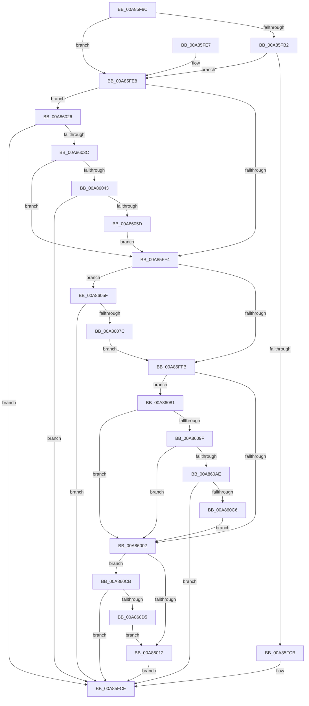

# PiHotSwapGetDefaultBusRemovalPolicy

- RVA: `0x00A85F8C`–`0x00A860DA` (길이 `334` bytes)
- VA: `0x0000000140A85F8C`
- 실행 섹션: `PAGE`
- PDB 이름 있음: `예`; PDB Function 태그: `아니요`
- unwind 정보 RVA: `0x000B7AC8`
- 디코드: `82`개 명령, `334/334` bytes 표시
- 미해석 바이트: `0` (있으면 어셈블리에 `.byte`로 보존)

> 이 문서는 커널 이미지의 기계어와 PDB 기호를 분석해 생성했습니다. 4번과 5번은 함수 원형과 자료형을 바이너리 사용 방식에서 추정한 C 해석이며 원본 소스 복구 결과는 아닙니다.

## 1. Dependencies

- 직접 호출 지점: **6**; 고유 호출 대상: **2**
- 직접 호출자로 확인된 함수: **1**
- RIP 상대 이미지 참조: **6**

### Outgoing calls
- `0x00A85FC2` → [wcsnicmp](../../text/50/wcsnicmp_function_005001C0.md) (function, `0x005001C0`)
- `0x00A86033` → [wcsnicmp](../../text/50/wcsnicmp_function_005001C0.md) (function, `0x005001C0`)
- `0x00A86050` → [wcsnicmp](../../text/50/wcsnicmp_function_005001C0.md) (function, `0x005001C0`)
- `0x00A8606F` → [wcsnicmp](../../text/50/wcsnicmp_function_005001C0.md) (function, `0x005001C0`)
- `0x00A86092` → [wcsnicmp](../../text/50/wcsnicmp_function_005001C0.md) (function, `0x005001C0`)
- `0x00A860B9` → [wcsicmp](../../text/50/wcsicmp_function_00500080.md) (function, `0x00500080`)

### Direct callers
- [PpHotSwapUpdateRemovalPolicy](PpHotSwapUpdateRemovalPolicy_function_00A85E40.md) at `0x00A85F6D`

### Static image references
- `0x00A85FB5` → RVA `0x00B001F0` (` ?? ::NNGAKEGL::`string'`; read)
- `0x00A86029` → RVA `0x00B00200` (` ?? ::NNGAKEGL::`string'`; read)
- `0x00A86046` → RVA `0x00B00210` (` ?? ::NNGAKEGL::`string'`; read)
- `0x00A86062` → RVA `0x00B00220` (` ?? ::NNGAKEGL::`string'`; read)
- `0x00A86085` → RVA `0x00B001D0` (` ?? ::NNGAKEGL::`string'`; read)
- `0x00A860B2` → RVA `0x00B001E0` (` ?? ::NNGAKEGL::`string'`; read)

## 2. Other-region calls and transfers

- 다른 실행 섹션으로 향하는 call: **6**
  - `0x00A85FC2` → [wcsnicmp](../../text/50/wcsnicmp_function_005001C0.md) (`PAGE` → `.text`)
  - `0x00A86033` → [wcsnicmp](../../text/50/wcsnicmp_function_005001C0.md) (`PAGE` → `.text`)
  - `0x00A86050` → [wcsnicmp](../../text/50/wcsnicmp_function_005001C0.md) (`PAGE` → `.text`)
  - `0x00A8606F` → [wcsnicmp](../../text/50/wcsnicmp_function_005001C0.md) (`PAGE` → `.text`)
  - `0x00A86092` → [wcsnicmp](../../text/50/wcsnicmp_function_005001C0.md) (`PAGE` → `.text`)
  - `0x00A860B9` → [wcsicmp](../../text/50/wcsicmp_function_00500080.md) (`PAGE` → `.text`)
- 별도 외부 분기/꼬리 이동을 확인하지 못했습니다.

## 3. Assembly (complete function range)

```asm
00A85F8C  48 89 5C 24 08                  mov qword ptr [rsp + 8], rbx
00A85F91  48 89 74 24 10                  mov qword ptr [rsp + 0x10], rsi
00A85F96  48 89 7C 24 18                  mov qword ptr [rsp + 0x18], rdi
00A85F9B  41 56                           push r14
00A85F9D  48 83 EC 20                     sub rsp, 0x20
00A85FA1  66 83 79 28 08                  cmp word ptr [rcx + 0x28], 8
00A85FA6  48 8D 71 30                     lea rsi, [rcx + 0x30]
00A85FAA  4C 8B F2                        mov r14, rdx
00A85FAD  48 8B F9                        mov rdi, rcx
00A85FB0  76 36                           jbe 0x140a85fe8
00A85FB2  48 8B 0E                        mov rcx, qword ptr [rsi]
00A85FB5  48 8D 15 34 A2 07 00            lea rdx, [rip + 0x7a234]
00A85FBC  41 B8 04 00 00 00               mov r8d, 4
00A85FC2  E8 F9 A1 A7 FF                  call 0x1405001c0
00A85FC7  85 C0                           test eax, eax
00A85FC9  75 1D                           jne 0x140a85fe8
00A85FCB  8D 58 05                        lea ebx, [rax + 5]
00A85FCE  48 8B 74 24 38                  mov rsi, qword ptr [rsp + 0x38]
00A85FD3  48 8B 7C 24 40                  mov rdi, qword ptr [rsp + 0x40]
00A85FD8  41 89 1E                        mov dword ptr [r14], ebx
00A85FDB  48 8B 5C 24 30                  mov rbx, qword ptr [rsp + 0x30]
00A85FE0  48 83 C4 20                     add rsp, 0x20
00A85FE4  41 5E                           pop r14
00A85FE6  C3                              ret
00A85FE7  CC                              int3
00A85FE8  66 83 7F 28 0A                  cmp word ptr [rdi + 0x28], 0xa
00A85FED  BB 05 00 00 00                  mov ebx, 5
00A85FF2  77 32                           ja 0x140a86026
00A85FF4  66 83 7F 28 0E                  cmp word ptr [rdi + 0x28], 0xe
00A85FF9  77 64                           ja 0x140a8605f
00A85FFB  66 83 7F 28 08                  cmp word ptr [rdi + 0x28], 8
00A86000  77 7F                           ja 0x140a86081
00A86002  48 8B 87 D0 02 00 00            mov rax, qword ptr [rdi + 0x2d0]
00A86009  48 85 C0                        test rax, rax
00A8600C  0F 85 B9 00 00 00               jne 0x140a860cb
00A86012  48 8B 47 10                     mov rax, qword ptr [rdi + 0x10]
00A86016  8A 88 D2 01 00 00               mov cl, byte ptr [rax + 0x1d2]
00A8601C  2A CB                           sub cl, bl
00A8601E  F6 D9                           neg cl
00A86020  1B C0                           sbb eax, eax
00A86022  03 D8                           add ebx, eax
00A86024  EB A8                           jmp 0x140a85fce
00A86026  48 8B 0E                        mov rcx, qword ptr [rsi]
00A86029  48 8D 15 D0 A1 07 00            lea rdx, [rip + 0x7a1d0]
00A86030  4C 8B C3                        mov r8, rbx
00A86033  E8 88 A1 A7 FF                  call 0x1405001c0
00A86038  85 C0                           test eax, eax
00A8603A  74 92                           je 0x140a85fce
00A8603C  66 83 7F 28 0A                  cmp word ptr [rdi + 0x28], 0xa
00A86041  76 B1                           jbe 0x140a85ff4
00A86043  48 8B 0E                        mov rcx, qword ptr [rsi]
00A86046  48 8D 15 C3 A1 07 00            lea rdx, [rip + 0x7a1c3]
00A8604D  4C 8B C3                        mov r8, rbx
00A86050  E8 6B A1 A7 FF                  call 0x1405001c0
00A86055  85 C0                           test eax, eax
00A86057  0F 84 71 FF FF FF               je 0x140a85fce
00A8605D  EB 95                           jmp 0x140a85ff4
00A8605F  48 8B 0E                        mov rcx, qword ptr [rsi]
00A86062  48 8D 15 B7 A1 07 00            lea rdx, [rip + 0x7a1b7]
00A86069  41 B8 07 00 00 00               mov r8d, 7
00A8606F  E8 4C A1 A7 FF                  call 0x1405001c0
00A86074  85 C0                           test eax, eax
00A86076  0F 84 52 FF FF FF               je 0x140a85fce
00A8607C  E9 7A FF FF FF                  jmp 0x140a85ffb
00A86081  48 8B 4F 30                     mov rcx, qword ptr [rdi + 0x30]
00A86085  48 8D 15 44 A1 07 00            lea rdx, [rip + 0x7a144]
00A8608C  41 B8 04 00 00 00               mov r8d, 4
00A86092  E8 29 A1 A7 FF                  call 0x1405001c0
00A86097  85 C0                           test eax, eax
00A86099  0F 85 63 FF FF FF               jne 0x140a86002
00A8609F  48 8B 4F 10                     mov rcx, qword ptr [rdi + 0x10]
00A860A3  66 83 79 38 0C                  cmp word ptr [rcx + 0x38], 0xc
00A860A8  0F 85 54 FF FF FF               jne 0x140a86002
00A860AE  48 8B 49 40                     mov rcx, qword ptr [rcx + 0x40]
00A860B2  48 8D 15 27 A1 07 00            lea rdx, [rip + 0x7a127]
00A860B9  E8 C2 9F A7 FF                  call 0x140500080
00A860BE  85 C0                           test eax, eax
00A860C0  0F 84 08 FF FF FF               je 0x140a85fce
00A860C6  E9 37 FF FF FF                  jmp 0x140a86002
00A860CB  F6 40 10 04                     test byte ptr [rax + 0x10], 4
00A860CF  0F 85 F9 FE FF FF               jne 0x140a85fce
00A860D5  E9 38 FF FF FF                  jmp 0x140a86012
```

## 4. C-style interpretation (structured pseudocode)

```c
__int64 __fastcall PiHotSwapGetDefaultBusRemovalPolicy(__int64 a1, __int64 a2)
{
    __int64 result;
    __int64 v_rbx;
    __int64 v_rsp;
    unsigned __int64 v_stack_p10;
    unsigned __int64 v_stack_p18;
    unsigned __int64 v_stack_p8;

    v_stack_p8 = v_rbx;
    v_stack_p10 = v_rsi;
    v_stack_p18 = v_rdi;
    v_rsp = (v_rsp) - (32);
    if ((*(unsigned __int16 *)(a1 + 40)) <= 8) goto loc_00A85FE8;
    result = wcsnicmp(*(unsigned __int64 *)(a1 + 48), v_rip + 500276, 4, a4);
    if ((unsigned int)(result) != 0) goto loc_00A85FE8;
loc_00A85FCE:
    *(unsigned int *)(a2) = (unsigned int)(result + 5);
    v_rsp = (v_rsp) + (32);
    return result;
loc_00A85FE8:
    if ((*(unsigned __int16 *)(v_stack_p18 + 40)) > 10) goto loc_00A86026;
loc_00A85FF4:
    if ((*(unsigned __int16 *)(v_stack_p18 + 40)) > 14) goto loc_00A8605F;
loc_00A85FFB:
    if ((*(unsigned __int16 *)(v_stack_p18 + 40)) > 8) goto loc_00A86081;
loc_00A86002:
    if (*(unsigned __int64 *)(v_stack_p18 + 720) != 0) goto loc_00A860CB;
loc_00A86012:
    a1 = (unsigned __int8)((*(unsigned __int8 *)(*(unsigned __int64 *)(v_stack_p18 + 16) + 466)) - (5));
    a1 = (unsigned __int8)(-(a1));
    v_rbx = (unsigned int)((5) + ((unsigned int)(*(unsigned __int64 *)(v_stack_p18 + 16))));
    goto loc_00A85FCE;
loc_00A86026:
    result = wcsnicmp(*(unsigned __int64 *)(v_stack_p10), v_rip + 500176, v_rbx, a4);
    if ((unsigned int)(result) == 0) goto loc_00A85FCE;
    if ((*(unsigned __int16 *)(v_stack_p18 + 40)) <= 10) goto loc_00A85FF4;
    result = wcsnicmp(*(unsigned __int64 *)(v_stack_p10), v_rip + 500163, v_rbx, a4);
    if ((unsigned int)(result) == 0) goto loc_00A85FCE;
    goto loc_00A85FF4;
loc_00A8605F:
    result = wcsnicmp(*(unsigned __int64 *)(v_stack_p10), v_rip + 500151, 7, a4);
    if ((unsigned int)(result) == 0) goto loc_00A85FCE;
    goto loc_00A85FFB;
loc_00A86081:
    result = wcsnicmp(*(unsigned __int64 *)(v_stack_p18 + 48), v_rip + 500036, 4, a4);
    if ((unsigned int)(result) != 0) goto loc_00A86002;
    if ((*(unsigned __int16 *)(*(unsigned __int64 *)(v_stack_p18 + 16) + 56)) != 12) goto loc_00A86002;
    result = wcsicmp(*(unsigned __int64 *)(*(unsigned __int64 *)(v_stack_p18 + 16) + 64), v_rip + 500007, 4, a4);
    if ((unsigned int)(result) == 0) goto loc_00A85FCE;
    goto loc_00A86002;
loc_00A860CB:
    if (((*(unsigned __int8 *)(result + 16)) & (4)) != 0) goto loc_00A85FCE;
    goto loc_00A86012;
}
```

## 5. (Beta) C Style

```c
int64_t PiHotSwapGetDefaultBusRemovalPolicy(void *Arg1, void *Arg2)
{
    uint8_t *arg1 = (uint8_t *)Arg1;
    uint8_t *arg2 = (uint8_t *)Arg2;

    int64_t result;
    int64_t local_rbx;
    int64_t local_rsp;
    uint64_t v_stack_p10;
    uint64_t v_stack_p18;
    uint64_t v_stack_p8;

    v_stack_p8 = local_rbx;
    v_stack_p10 = local_rsi;
    v_stack_p18 = local_rdi;
    local_rsp = (local_rsp) - (32);
    if ((*(uint16_t *)(arg1 + 0x28)) <= 8) goto loc_00A85FE8;
    result = wcsnicmp(*(uint64_t *)(arg1 + 0x30), v_rip + 500276, 4, a4);
    if ((uint32_t)(result) != 0) goto loc_00A85FE8;
loc_00A85FCE:
    *(uint32_t *)(arg2) = (uint32_t)(result + 5);
    local_rsp = (local_rsp) + (32);
    return result;
loc_00A85FE8:
    if ((*(uint16_t *)(v_stack_p18 + 0x28)) > 10) goto loc_00A86026;
loc_00A85FF4:
    if ((*(uint16_t *)(v_stack_p18 + 0x28)) > 14) goto loc_00A8605F;
loc_00A85FFB:
    if ((*(uint16_t *)(v_stack_p18 + 0x28)) > 8) goto loc_00A86081;
loc_00A86002:
    if (*(uint64_t *)(v_stack_p18 + 0x2D0) != 0) goto loc_00A860CB;
loc_00A86012:
    Arg1 = (uint8_t)((*(uint8_t *)(*(uint64_t *)(v_stack_p18 + 0x10) + 0x1D2)) - (5));
    Arg1 = (uint8_t)(-(Arg1));
    local_rbx = (uint32_t)((5) + ((uint32_t)(*(uint64_t *)(v_stack_p18 + 0x10))));
    goto loc_00A85FCE;
loc_00A86026:
    result = wcsnicmp(*(uint64_t *)(v_stack_p10), v_rip + 500176, local_rbx, a4);
    if ((uint32_t)(result) == 0) goto loc_00A85FCE;
    if ((*(uint16_t *)(v_stack_p18 + 0x28)) <= 10) goto loc_00A85FF4;
    result = wcsnicmp(*(uint64_t *)(v_stack_p10), v_rip + 500163, local_rbx, a4);
    if ((uint32_t)(result) == 0) goto loc_00A85FCE;
    goto loc_00A85FF4;
loc_00A8605F:
    result = wcsnicmp(*(uint64_t *)(v_stack_p10), v_rip + 500151, 7, a4);
    if ((uint32_t)(result) == 0) goto loc_00A85FCE;
    goto loc_00A85FFB;
loc_00A86081:
    result = wcsnicmp(*(uint64_t *)(v_stack_p18 + 0x30), v_rip + 500036, 4, a4);
    if ((uint32_t)(result) != 0) goto loc_00A86002;
    if ((*(uint16_t *)(*(uint64_t *)(v_stack_p18 + 0x10) + 0x38)) != 12) goto loc_00A86002;
    result = wcsicmp(*(uint64_t *)(*(uint64_t *)(v_stack_p18 + 0x10) + 0x40), v_rip + 500007, 4, a4);
    if ((uint32_t)(result) == 0) goto loc_00A85FCE;
    goto loc_00A86002;
loc_00A860CB:
    if (((*(uint8_t *)(result + 0x10)) & (4)) != 0) goto loc_00A85FCE;
    goto loc_00A86012;
}
```

### 관측된 메모리 오프셋

구조체 형식이 확인되지 않은 접근은 인자 기준의 오프셋으로만 기록했습니다.

| 기준 인자 | 오프셋 표현 | 폭 (bit) | 접근 |
|---|---:|---:|---|
| `Arg1` | `+ 0x0` | `64` | `R` |
| `Arg1` | `+ 0x10` | `64` | `R` |
| `Arg1` | `+ 0x28` | `16` | `R` |
| `Arg1` | `+ 0x30` | `64` | `R` |
| `Arg1` | `+ 0x2D0` | `64` | `R` |
| `Arg2` | `+ 0x0` | `32` | `W` |

## 6. Execution-region graph

[열기: 2D/3D 그래프와 함수 탐색 컨트롤 패널](../../../control-panel.html?section=page&rva=0x00A85F8C&view=graph)

- 2D 그래프는 위에서 아래로 흐르고, 3D 그래프는 빈 공간을 드래그해 회전합니다. Shift+드래그는 이동, 휠은 확대·축소, 함수 노드 선택은 대상 보고서 이동입니다.

### Static fallback


