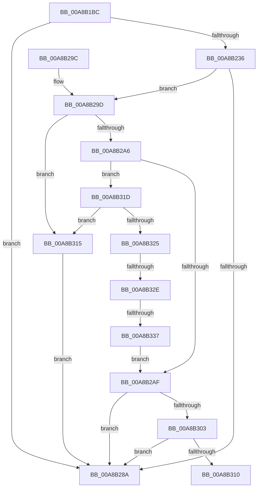

# PiUEventDeviceNeedsInstall

- RVA: `0x00A8B1BC`–`0x00A8B33C` (길이 `384` bytes)
- VA: `0x0000000140A8B1BC`
- 실행 섹션: `PAGE`
- PDB 이름 있음: `예`; PDB Function 태그: `예`
- unwind 정보 RVA: `0x000B8664`
- 디코드: `98`개 명령, `384/384` bytes 표시
- 미해석 바이트: `0` (있으면 어셈블리에 `.byte`로 보존)

> 이 문서는 커널 이미지의 기계어와 PDB 기호를 분석해 생성했습니다. 4번과 5번은 함수 원형과 자료형을 바이너리 사용 방식에서 추정한 C 해석이며 원본 소스 복구 결과는 아닙니다.

## 1. Dependencies

- 직접 호출 지점: **3**; 고유 호출 대상: **1**
- 직접 호출자로 확인된 함수: **1**
- RIP 상대 이미지 참조: **4**

### Outgoing calls
- `0x00A8B22B` → [PnpGetObjectProperty](../8E/PnpGetObjectProperty_function_008E2180.md) (function, `0x008E2180`)
- `0x00A8B27F` → [PnpGetObjectProperty](../8E/PnpGetObjectProperty_function_008E2180.md) (function, `0x008E2180`)
- `0x00A8B2F8` → [PnpGetObjectProperty](../8E/PnpGetObjectProperty_function_008E2180.md) (function, `0x008E2180`)

### Direct callers
- [PiUEventNotifyUserMode](../95/PiUEventNotifyUserMode_function_00954CB4.md) at `0x00954D3C`

### Static image references
- `0x00A8B203` → RVA `0x00E66398` (`.data`; read)
- `0x00A8B20A` → RVA `0x000142C0` (`.rdata`; read)
- `0x00A8B26E` → RVA `0x0001BF58` (`.rdata`; read)
- `0x00A8B2E7` → RVA `0x00011528` (`.rdata`; read)

## 2. Other-region calls and transfers

- 다른 실행 섹션으로 향하는 call: **0**
- call이 아닌 외부 분기/꼬리 이동: **3**
  - `0x00A8B310` → [sub_00B4608C](../B4/Unknown_function_00B4608C.md) (`tail-transfer`)
  - `0x00A8B328` → [sub_00B4608C](../B4/Unknown_function_00B4608C.md) (`tail-transfer`)
  - `0x00A8B331` → [sub_00B4608C](../B4/Unknown_function_00B4608C.md) (`tail-transfer`)

## 3. Assembly (complete function range)

```asm
00A8B1BC  4C 8B DC                        mov r11, rsp
00A8B1BF  49 89 5B 08                     mov qword ptr [r11 + 8], rbx
00A8B1C3  55                              push rbp
00A8B1C4  56                              push rsi
00A8B1C5  57                              push rdi
00A8B1C6  48 8B EC                        mov rbp, rsp
00A8B1C9  48 83 EC 70                     sub rsp, 0x70
00A8B1CD  33 F6                           xor esi, esi
00A8B1CF  48 8D 45 30                     lea rax, [rbp + 0x30]
00A8B1D3  89 74 24 50                     mov dword ptr [rsp + 0x50], esi
00A8B1D7  48 8B DA                        mov rbx, rdx
00A8B1DA  49 89 43 C0                     mov qword ptr [r11 - 0x40], rax
00A8B1DE  48 8B F9                        mov rdi, rcx
00A8B1E1  C7 44 24 40 04 00 00 00         mov dword ptr [rsp + 0x40], 4
00A8B1E9  48 8D 45 28                     lea rax, [rbp + 0x28]
00A8B1ED  49 89 43 B0                     mov qword ptr [r11 - 0x50], rax
00A8B1F1  44 8D 46 01                     lea r8d, [rsi + 1]
00A8B1F5  48 8D 45 38                     lea rax, [rbp + 0x38]
00A8B1F9  40 88 32                        mov byte ptr [rdx], sil
00A8B1FC  49 89 43 A8                     mov qword ptr [r11 - 0x58], rax
00A8B200  48 8B D1                        mov rdx, rcx
00A8B203  48 8B 0D 8E B1 3D 00            mov rcx, qword ptr [rip + 0x3db18e]
00A8B20A  48 8D 05 AF 90 58 FF            lea rax, [rip - 0xa76f51]
00A8B211  49 89 43 A0                     mov qword ptr [r11 - 0x60], rax
00A8B215  45 33 C9                        xor r9d, r9d
00A8B218  49 89 73 98                     mov qword ptr [r11 - 0x68], rsi
00A8B21C  89 75 28                        mov dword ptr [rbp + 0x28], esi
00A8B21F  89 75 F0                        mov dword ptr [rbp - 0x10], esi
00A8B222  89 75 F4                        mov dword ptr [rbp - 0xc], esi
00A8B225  89 75 38                        mov dword ptr [rbp + 0x38], esi
00A8B228  89 75 30                        mov dword ptr [rbp + 0x30], esi
00A8B22B  E8 50 6F E5 FF                  call 0x1408e2180
00A8B230  8B C8                           mov ecx, eax
00A8B232  85 C0                           test eax, eax
00A8B234  78 54                           js 0x140a8b28a
00A8B236  48 8B 0D 5B B1 3D 00            mov rcx, qword ptr [rip + 0x3db15b]
00A8B23D  48 8D 45 30                     lea rax, [rbp + 0x30]
00A8B241  89 74 24 50                     mov dword ptr [rsp + 0x50], esi
00A8B245  44 8D 46 01                     lea r8d, [rsi + 1]
00A8B249  48 89 44 24 48                  mov qword ptr [rsp + 0x48], rax
00A8B24E  45 33 C9                        xor r9d, r9d
00A8B251  C7 44 24 40 04 00 00 00         mov dword ptr [rsp + 0x40], 4
00A8B259  48 8D 45 F0                     lea rax, [rbp - 0x10]
00A8B25D  48 89 44 24 38                  mov qword ptr [rsp + 0x38], rax
00A8B262  48 8B D7                        mov rdx, rdi
00A8B265  48 8D 45 38                     lea rax, [rbp + 0x38]
00A8B269  48 89 44 24 30                  mov qword ptr [rsp + 0x30], rax
00A8B26E  48 8D 05 E3 0C 59 FF            lea rax, [rip - 0xa6f31d]
00A8B275  48 89 44 24 28                  mov qword ptr [rsp + 0x28], rax
00A8B27A  48 89 74 24 20                  mov qword ptr [rsp + 0x20], rsi
00A8B27F  E8 FC 6E E5 FF                  call 0x1408e2180
00A8B284  8B C8                           mov ecx, eax
00A8B286  85 C0                           test eax, eax
00A8B288  79 13                           jns 0x140a8b29d
00A8B28A  48 8B 9C 24 90 00 00 00         mov rbx, qword ptr [rsp + 0x90]
00A8B292  8B C1                           mov eax, ecx
00A8B294  48 83 C4 70                     add rsp, 0x70
00A8B298  5F                              pop rdi
00A8B299  5E                              pop rsi
00A8B29A  5D                              pop rbp
00A8B29B  C3                              ret
00A8B29C  CC                              int3
00A8B29D  F7 45 28 00 00 04 00            test dword ptr [rbp + 0x28], 0x40000
00A8B2A4  75 6F                           jne 0x140a8b315
00A8B2A6  F7 45 28 00 04 00 00            test dword ptr [rbp + 0x28], 0x400
00A8B2AD  75 6E                           jne 0x140a8b31d
00A8B2AF  48 8B 0D E2 B0 3D 00            mov rcx, qword ptr [rip + 0x3db0e2]
00A8B2B6  48 8D 45 30                     lea rax, [rbp + 0x30]
00A8B2BA  89 74 24 50                     mov dword ptr [rsp + 0x50], esi
00A8B2BE  45 33 C9                        xor r9d, r9d
00A8B2C1  48 89 44 24 48                  mov qword ptr [rsp + 0x48], rax
00A8B2C6  48 8B D7                        mov rdx, rdi
00A8B2C9  C7 44 24 40 04 00 00 00         mov dword ptr [rsp + 0x40], 4
00A8B2D1  48 8D 45 F4                     lea rax, [rbp - 0xc]
00A8B2D5  48 89 44 24 38                  mov qword ptr [rsp + 0x38], rax
00A8B2DA  48 8D 45 38                     lea rax, [rbp + 0x38]
00A8B2DE  48 89 44 24 30                  mov qword ptr [rsp + 0x30], rax
00A8B2E3  45 8D 41 01                     lea r8d, [r9 + 1]
00A8B2E7  48 8D 05 3A 62 58 FF            lea rax, [rip - 0xa79dc6]
00A8B2EE  48 89 44 24 28                  mov qword ptr [rsp + 0x28], rax
00A8B2F3  48 89 74 24 20                  mov qword ptr [rsp + 0x20], rsi
00A8B2F8  E8 83 6E E5 FF                  call 0x1408e2180
00A8B2FD  8B C8                           mov ecx, eax
00A8B2FF  85 C0                           test eax, eax
00A8B301  78 87                           js 0x140a8b28a
00A8B303  F7 45 F4 20 04 00 00            test dword ptr [rbp - 0xc], 0x420
00A8B30A  0F 84 7A FF FF FF               je 0x140a8b28a
00A8B310  E9 77 AD 0B 00                  jmp 0x140b4608c
00A8B315  40 88 33                        mov byte ptr [rbx], sil
00A8B318  E9 6D FF FF FF                  jmp 0x140a8b28a
00A8B31D  8B 45 F0                        mov eax, dword ptr [rbp - 0x10]
00A8B320  83 F8 16                        cmp eax, 0x16
00A8B323  74 F0                           je 0x140a8b315
00A8B325  83 F8 12                        cmp eax, 0x12
00A8B328  0F 84 5E AD 0B 00               je 0x140b4608c
00A8B32E  83 F8 01                        cmp eax, 1
00A8B331  0F 84 55 AD 0B 00               je 0x140b4608c
00A8B337  E9 73 FF FF FF                  jmp 0x140a8b2af
```

## 4. C-style interpretation (structured pseudocode)

```c
__int64 __fastcall PiUEventDeviceNeedsInstall(__int64 a1, __int64 a2, __int64 a3, int a4)
{
    __int64 result;
    __int64 v_rsi;
    __int64 v_rsp;
    unsigned int v_stack_m24;
    unsigned int v_stack_m28;
    unsigned int v_stack_m38;
    unsigned __int64 v_stack_m40;
    unsigned int v_stack_m48;
    unsigned __int64 v_stack_m50;
    unsigned __int64 v_stack_m58;
    unsigned __int64 v_stack_m60;
    unsigned __int64 v_stack_m68;
    unsigned __int64 v_stack_p10;
    unsigned __int64 v_stack_p18;
    unsigned __int64 v_stack_p20;
    unsigned __int64 v_stack_p28;
    unsigned __int64 v_stack_p30;
    unsigned __int64 v_stack_p38;
    unsigned int v_stack_p40;
    unsigned __int64 v_stack_p48;
    unsigned int v_stack_p50;
    unsigned __int64 v_stack_p8;

    *(unsigned __int64 *)(v_rsp + 8) = v_rbx;
    v_rsp = (v_rsp) - (112);
    v_rsi = 0;
    v_stack_m38 = 0;
    *(unsigned __int64 *)(v_rsp - 64) = v_stack_p18;
    v_stack_m48 = 4;
    *(unsigned __int64 *)(v_rsp - 80) = v_stack_p10;
    *(unsigned __int8 *)(a2) = 0;
    *(unsigned __int64 *)(v_rsp - 88) = v_stack_p20;
    *(unsigned __int64 *)(v_rsp - 96) = v_rip - 10973009;
    a4 = 0;
    *(unsigned __int64 *)(v_rsp - 104) = 0;
    v_stack_p10 = 0;
    v_stack_m28 = 0;
    v_stack_m24 = 0;
    v_stack_p20 = 0;
    v_stack_p18 = 0;
    result = PnpGetObjectProperty(*(unsigned __int64 *)(v_rip + 4043150), a1, v_rsi + 1, a4);
    if (sign_flag) goto loc_00A8B28A;
    v_stack_m38 = 0;
    v_stack_m40 = v_stack_p18;
    a4 = 0;
    v_stack_m48 = 4;
    v_stack_m50 = v_stack_m28;
    v_stack_m58 = v_stack_p20;
    v_stack_m60 = v_rip - 10941213;
    v_stack_m68 = 0;
    result = PnpGetObjectProperty(*(unsigned __int64 *)(v_rip + 4043099), a1, v_rsi + 1, a4);
    if (!sign_flag) goto loc_00A8B29D;
loc_00A8B28A:
    v_rsp = (v_rsp) + (112);
    return (unsigned int)((unsigned int)((unsigned int)((unsigned int)(result))));
loc_00A8B29D:
    if (((v_stack_p10) & (0x40000ULL)) != 0) goto loc_00A8B315;
    if (((v_stack_p10) & (0x400ULL)) != 0) goto loc_00A8B31D;
loc_00A8B2AF:
    v_stack_p50 = 0;
    a4 = 0;
    v_stack_p48 = v_stack_p18;
    v_stack_p40 = 4;
    v_stack_p38 = v_stack_m24;
    v_stack_p30 = v_stack_p20;
    v_stack_p28 = v_rip - 10984902;
    v_stack_p20 = 0;
    result = PnpGetObjectProperty(*(unsigned __int64 *)(v_rip + 4042978), a1, a4 + 1, a4);
    if (sign_flag) goto loc_00A8B28A;
    if (((v_stack_m24) & (0x420ULL)) == 0) goto loc_00A8B28A;
loc_00A8B315:
    *(unsigned __int8 *)(v_stack_p8) = 0;
    goto loc_00A8B28A;
loc_00A8B31D:
    if (((unsigned int)((unsigned int)(v_stack_m28))) == 22) goto loc_00A8B315;
    goto loc_00A8B2AF;
}
```

## 5. (Beta) C Style

```c
int64_t PiUEventDeviceNeedsInstall(int64_t Arg1, void *Arg2, int64_t Arg3, int32_t Arg4)
{
    uint8_t *arg2 = (uint8_t *)Arg2;

    int64_t result;
    int64_t local_rsi;
    int64_t local_rsp;
    uint32_t v_stack_m24;
    uint32_t v_stack_m28;
    uint32_t v_stack_m38;
    uint64_t v_stack_m40;
    uint32_t v_stack_m48;
    uint64_t v_stack_m50;
    uint64_t v_stack_m58;
    uint64_t v_stack_m60;
    uint64_t v_stack_m68;
    uint64_t v_stack_p10;
    uint64_t v_stack_p18;
    uint64_t v_stack_p20;
    uint64_t v_stack_p28;
    uint64_t v_stack_p30;
    uint64_t v_stack_p38;
    uint32_t v_stack_p40;
    uint64_t v_stack_p48;
    uint32_t v_stack_p50;
    uint64_t v_stack_p8;

    *(uint64_t *)(local_rsp + 0x8) = local_rbx;
    local_rsp = (local_rsp) - (112);
    local_rsi = 0;
    v_stack_m38 = 0;
    *(uint64_t *)(local_rsp - 0x40) = v_stack_p18;
    v_stack_m48 = 4;
    *(uint64_t *)(local_rsp - 0x50) = v_stack_p10;
    *(uint8_t *)(arg2) = 0;
    *(uint64_t *)(local_rsp - 0x58) = v_stack_p20;
    *(uint64_t *)(local_rsp - 0x60) = v_rip - 10973009;
    Arg4 = 0;
    *(uint64_t *)(local_rsp - 0x68) = 0;
    v_stack_p10 = 0;
    v_stack_m28 = 0;
    v_stack_m24 = 0;
    v_stack_p20 = 0;
    v_stack_p18 = 0;
    result = PnpGetObjectProperty(*(uint64_t *)(v_rip + 0x3DB18E), Arg1, local_rsi + 1, Arg4);
    if (sign_flag) goto loc_00A8B28A;
    v_stack_m38 = 0;
    v_stack_m40 = v_stack_p18;
    Arg4 = 0;
    v_stack_m48 = 4;
    v_stack_m50 = v_stack_m28;
    v_stack_m58 = v_stack_p20;
    v_stack_m60 = v_rip - 10941213;
    v_stack_m68 = 0;
    result = PnpGetObjectProperty(*(uint64_t *)(v_rip + 0x3DB15B), Arg1, local_rsi + 1, Arg4);
    if (!sign_flag) goto loc_00A8B29D;
loc_00A8B28A:
    local_rsp = (local_rsp) + (112);
    return (uint32_t)((uint32_t)((uint32_t)((uint32_t)(result))));
loc_00A8B29D:
    if (((v_stack_p10) & (0x40000ULL)) != 0) goto loc_00A8B315;
    if (((v_stack_p10) & (0x400ULL)) != 0) goto loc_00A8B31D;
loc_00A8B2AF:
    v_stack_p50 = 0;
    Arg4 = 0;
    v_stack_p48 = v_stack_p18;
    v_stack_p40 = 4;
    v_stack_p38 = v_stack_m24;
    v_stack_p30 = v_stack_p20;
    v_stack_p28 = v_rip - 10984902;
    v_stack_p20 = 0;
    result = PnpGetObjectProperty(*(uint64_t *)(v_rip + 0x3DB0E2), Arg1, Arg4 + 1, Arg4);
    if (sign_flag) goto loc_00A8B28A;
    if (((v_stack_m24) & (0x420ULL)) == 0) goto loc_00A8B28A;
loc_00A8B315:
    *(uint8_t *)(v_stack_p8) = 0;
    goto loc_00A8B28A;
loc_00A8B31D:
    if (((uint32_t)((uint32_t)(v_stack_m28))) == 22) goto loc_00A8B315;
    goto loc_00A8B2AF;
}
```

### 관측된 메모리 오프셋

구조체 형식이 확인되지 않은 접근은 인자 기준의 오프셋으로만 기록했습니다.

| 기준 인자 | 오프셋 표현 | 폭 (bit) | 접근 |
|---|---:|---:|---|
| `Arg2` | `+ 0x0` | `8` | `W` |

## 6. Execution-region graph

[열기: 2D/3D 그래프와 함수 탐색 컨트롤 패널](../../../control-panel.html?section=page&rva=0x00A8B1BC&view=graph)

- 2D 그래프는 위에서 아래로 흐르고, 3D 그래프는 빈 공간을 드래그해 회전합니다. Shift+드래그는 이동, 휠은 확대·축소, 함수 노드 선택은 대상 보고서 이동입니다.

### Static fallback


