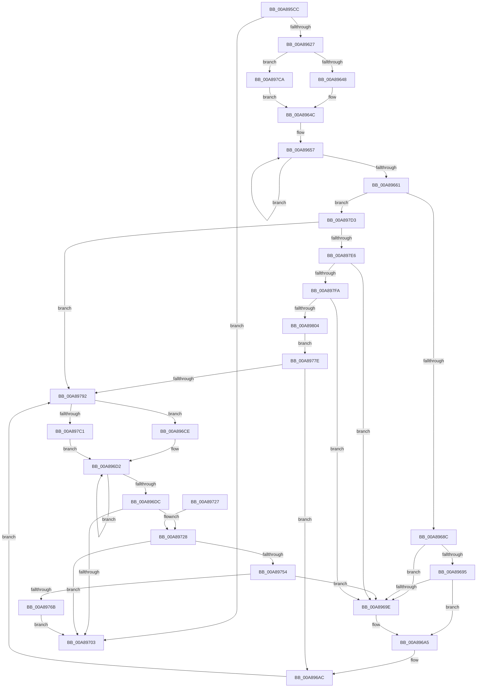

# PiUpdateDriverDBCache

- RVA: `0x00A895CC`–`0x00A89809` (길이 `573` bytes)
- VA: `0x0000000140A895CC`
- 실행 섹션: `PAGE`
- PDB 이름 있음: `예`; PDB Function 태그: `아니요`
- unwind 정보 RVA: `0x000B8338`
- 디코드: `146`개 명령, `573/573` bytes 표시
- 미해석 바이트: `0` (있으면 어셈블리에 `.byte`로 보존)

> 이 문서는 커널 이미지의 기계어와 PDB 기호를 분석해 생성했습니다. 4번과 5번은 함수 원형과 자료형을 바이너리 사용 방식에서 추정한 C 해석이며 원본 소스 복구 결과는 아닙니다.

## 1. Dependencies

- 직접 호출 지점: **11**; 고유 호출 대상: **10**
- 직접 호출자로 확인된 함수: **1**
- RIP 상대 이미지 참조: **7**

### Outgoing calls
- `0x00A89613` → [RtlImageNtHeader](../../text/44/RtlImageNtHeader_function_00443B60.md) (function, `0x00443B60`)
- `0x00A8963A` → [wcsrchr](../../text/50/wcsrchr_function_00501E50.md) (function, `0x00501E50`)
- `0x00A89677` → [RtlLookupElementGenericTableAvl](../../text/3F/RtlLookupElementGenericTableAvl_function_003FEFB0.md) (function, `0x003FEFB0`)
- `0x00A896BA` → [RtlDeleteElementGenericTableAvl](../../text/3E/RtlDeleteElementGenericTableAvl_function_003EE750.md) (function, `0x003EE750`)
- `0x00A896C4` → [ExFreePoolWithTag](../../poolcode/B8/ExFreePoolWithTag_function_00B82870.md) (function, `0x00B82870`)
- `0x00A896F5` → [ExAllocatePool2](../../poolcode/B8/ExAllocatePool2_function_00B820F0.md) (function, `0x00B820F0`)
- `0x00A8970A` → [_security_check_cookie](../../text/6A/_security_check_cookie_function_006AC640.md) (function, `0x006AC640`)
- `0x00A89733` → [memcpy](../../text/6C/memcpy_function_006C6840.md) (function, `0x006C6840`)
- `0x00A8974A` → [RtlInsertElementGenericTableAvl](../../text/3E/RtlInsertElementGenericTableAvl_function_003EE510.md) (function, `0x003EE510`)
- `0x00A897B0` → [wcsrchr](../../text/50/wcsrchr_function_00501E50.md) (function, `0x00501E50`)
- `0x00A897DA` → [RtlNumberGenericTableElementsAvl](../../text/46/RtlNumberGenericTableElementsAvl_function_004657E0.md) (function, `0x004657E0`)

### Direct callers
- [PiIsDriverBlocked](../99/PiIsDriverBlocked_function_0099C254.md) at `0x0099C498`

### Static image references
- `0x00A895E3` → RVA `0x00E0A740` (`.data`; read)
- `0x00A89627` → RVA `0x00FDA4F0` (`PAGEDATA`; write)
- `0x00A89670` → RVA `0x00FDA490` (`PAGEDATA`; read)
- `0x00A8967C` → RVA `0x00FDA088` (`PAGEDATA`; read)
- `0x00A89754` → RVA `0x00FDA090` (`PAGEDATA`; read)
- `0x00A89775` → RVA `0x00FDA090` (`PAGEDATA`; write)
- `0x00A8977E` → RVA `0x00FDA088` (`PAGEDATA`; write)

## 2. Other-region calls and transfers

- 다른 실행 섹션으로 향하는 call: **11**
  - `0x00A89613` → [RtlImageNtHeader](../../text/44/RtlImageNtHeader_function_00443B60.md) (`PAGE` → `.text`)
  - `0x00A8963A` → [wcsrchr](../../text/50/wcsrchr_function_00501E50.md) (`PAGE` → `.text`)
  - `0x00A89677` → [RtlLookupElementGenericTableAvl](../../text/3F/RtlLookupElementGenericTableAvl_function_003FEFB0.md) (`PAGE` → `.text`)
  - `0x00A896BA` → [RtlDeleteElementGenericTableAvl](../../text/3E/RtlDeleteElementGenericTableAvl_function_003EE750.md) (`PAGE` → `.text`)
  - `0x00A896C4` → [ExFreePoolWithTag](../../poolcode/B8/ExFreePoolWithTag_function_00B82870.md) (`PAGE` → `POOLCODE`)
  - `0x00A896F5` → [ExAllocatePool2](../../poolcode/B8/ExAllocatePool2_function_00B820F0.md) (`PAGE` → `POOLCODE`)
  - `0x00A8970A` → [_security_check_cookie](../../text/6A/_security_check_cookie_function_006AC640.md) (`PAGE` → `.text`)
  - `0x00A89733` → [memcpy](../../text/6C/memcpy_function_006C6840.md) (`PAGE` → `.text`)
  - `0x00A8974A` → [RtlInsertElementGenericTableAvl](../../text/3E/RtlInsertElementGenericTableAvl_function_003EE510.md) (`PAGE` → `.text`)
  - `0x00A897B0` → [wcsrchr](../../text/50/wcsrchr_function_00501E50.md) (`PAGE` → `.text`)
  - `0x00A897DA` → [RtlNumberGenericTableElementsAvl](../../text/46/RtlNumberGenericTableElementsAvl_function_004657E0.md) (`PAGE` → `.text`)
- 별도 외부 분기/꼬리 이동을 확인하지 못했습니다.

## 3. Assembly (complete function range)

```asm
00A895CC  48 89 5C 24 18                  mov qword ptr [rsp + 0x18], rbx
00A895D1  55                              push rbp
00A895D2  56                              push rsi
00A895D3  57                              push rdi
00A895D4  41 54                           push r12
00A895D6  41 55                           push r13
00A895D8  41 56                           push r14
00A895DA  41 57                           push r15
00A895DC  48 8B EC                        mov rbp, rsp
00A895DF  48 83 EC 60                     sub rsp, 0x60
00A895E3  48 8B 05 56 11 38 00            mov rax, qword ptr [rip + 0x381156]
00A895EA  48 33 C4                        xor rax, rsp
00A895ED  48 89 45 F8                     mov qword ptr [rbp - 8], rax
00A895F1  4C 8B 65 60                     mov r12, qword ptr [rbp + 0x60]
00A895F5  0F 57 C0                        xorps xmm0, xmm0
00A895F8  48 8B F1                        mov rsi, rcx
00A895FB  33 C0                           xor eax, eax
00A895FD  48 8B CA                        mov rcx, rdx
00A89600  48 89 45 F0                     mov qword ptr [rbp - 0x10], rax
00A89604  0F 11 45 C0                     movups xmmword ptr [rbp - 0x40], xmm0
00A89608  45 8B F9                        mov r15d, r9d
00A8960B  0F 11 45 D0                     movups xmmword ptr [rbp - 0x30], xmm0
00A8960F  0F 11 45 E0                     movups xmmword ptr [rbp - 0x20], xmm0
00A89613  E8 48 A5 9B FF                  call 0x140443b60
00A89618  45 33 ED                        xor r13d, r13d
00A8961B  4C 8B F0                        mov r14, rax
00A8961E  48 85 C0                        test rax, rax
00A89621  0F 84 DC 00 00 00               je 0x140a89703
00A89627  48 C7 05 BE 0E 55 00 01 00 00 00  mov qword ptr [rip + 0x550ebe], 1
00A89632  41 8D 55 5C                     lea edx, [r13 + 0x5c]
00A89636  48 8B 4E 08                     mov rcx, qword ptr [rsi + 8]
00A8963A  E8 11 88 A7 FF                  call 0x140501e50
00A8963F  48 85 C0                        test rax, rax
00A89642  0F 84 82 01 00 00               je 0x140a897ca
00A89648  48 83 C0 02                     add rax, 2
00A8964C  48 83 CF FF                     or rdi, 0xffffffffffffffff
00A89650  48 89 45 D8                     mov qword ptr [rbp - 0x28], rax
00A89654  48 8B CF                        mov rcx, rdi
00A89657  48 FF C1                        inc rcx
00A8965A  66 44 39 2C 48                  cmp word ptr [rax + rcx*2], r13w
00A8965F  75 F6                           jne 0x140a89657
00A89661  66 03 C9                        add cx, cx
00A89664  48 8D 55 C0                     lea rdx, [rbp - 0x40]
00A89668  66 89 4D D0                     mov word ptr [rbp - 0x30], cx
00A8966C  66 89 4D D2                     mov word ptr [rbp - 0x2e], cx
00A89670  48 8D 0D 19 0E 55 00            lea rcx, [rip + 0x550e19]
00A89677  E8 34 59 97 FF                  call 0x1403fefb0
00A8967C  48 8D 1D 05 0A 55 00            lea rbx, [rip + 0x550a05]
00A89683  48 85 C0                        test rax, rax
00A89686  0F 84 47 01 00 00               je 0x140a897d3
00A8968C  48 8B 10                        mov rdx, qword ptr [rax]
00A8968F  48 39 42 08                     cmp qword ptr [rdx + 8], rax
00A89693  75 09                           jne 0x140a8969e
00A89695  48 8B 48 08                     mov rcx, qword ptr [rax + 8]
00A89699  48 39 01                        cmp qword ptr [rcx], rax
00A8969C  74 07                           je 0x140a896a5
00A8969E  B9 03 00 00 00                  mov ecx, 3
00A896A3  CD 29                           int 0x29
00A896A5  48 89 11                        mov qword ptr [rcx], rdx
00A896A8  48 89 4A 08                     mov qword ptr [rdx + 8], rcx
00A896AC  48 8B 58 18                     mov rbx, qword ptr [rax + 0x18]
00A896B0  48 8D 0D D9 0D 55 00            lea rcx, [rip + 0x550dd9]
00A896B7  48 8B D0                        mov rdx, rax
00A896BA  E8 91 50 96 FF                  call 0x1403ee750
00A896BF  33 D2                           xor edx, edx
00A896C1  48 8B CB                        mov rcx, rbx
00A896C4  E8 A7 91 0F 00                  call 0x140b82870
00A896C9  E9 C4 00 00 00                  jmp 0x140a89792
00A896CE  48 8B 5E 08                     mov rbx, qword ptr [rsi + 8]
00A896D2  48 FF C7                        inc rdi
00A896D5  66 44 39 2C 7B                  cmp word ptr [rbx + rdi*2], r13w
00A896DA  75 F6                           jne 0x140a896d2
00A896DC  66 03 FF                        add di, di
00A896DF  B9 00 01 00 00                  mov ecx, 0x100
00A896E4  0F B7 D7                        movzx edx, di
00A896E7  41 B8 50 70 20 20               mov r8d, 0x20207050
00A896ED  66 89 55 D2                     mov word ptr [rbp - 0x2e], dx
00A896F1  66 89 55 D0                     mov word ptr [rbp - 0x30], dx
00A896F5  E8 F6 89 0F 00                  call 0x140b820f0
00A896FA  48 89 45 D8                     mov qword ptr [rbp - 0x28], rax
00A896FE  48 85 C0                        test rax, rax
00A89701  75 25                           jne 0x140a89728
00A89703  48 8B 4D F8                     mov rcx, qword ptr [rbp - 8]
00A89707  48 33 CC                        xor rcx, rsp
00A8970A  E8 31 2F C2 FF                  call 0x1406ac640
00A8970F  48 8B 9C 24 B0 00 00 00         mov rbx, qword ptr [rsp + 0xb0]
00A89717  48 83 C4 60                     add rsp, 0x60
00A8971B  41 5F                           pop r15
00A8971D  41 5E                           pop r14
00A8971F  41 5D                           pop r13
00A89721  41 5C                           pop r12
00A89723  5F                              pop rdi
00A89724  5E                              pop rsi
00A89725  5D                              pop rbp
00A89726  C3                              ret
00A89727  CC                              int3
00A89728  44 0F B7 45 D0                  movzx r8d, word ptr [rbp - 0x30]
00A8972D  48 8B D3                        mov rdx, rbx
00A89730  48 8B C8                        mov rcx, rax
00A89733  E8 08 D1 C3 FF                  call 0x1406c6840
00A89738  45 33 C9                        xor r9d, r9d
00A8973B  48 8D 55 C0                     lea rdx, [rbp - 0x40]
00A8973F  48 8D 0D 4A 0D 55 00            lea rcx, [rip + 0x550d4a]
00A89746  45 8D 41 38                     lea r8d, [r9 + 0x38]
00A8974A  E8 C1 4D 96 FF                  call 0x1403ee510
00A8974F  48 85 C0                        test rax, rax
00A89752  74 AF                           je 0x140a89703
00A89754  48 8B 0D 35 09 55 00            mov rcx, qword ptr [rip + 0x550935]
00A8975B  48 8D 15 26 09 55 00            lea rdx, [rip + 0x550926]
00A89762  48 39 11                        cmp qword ptr [rcx], rdx
00A89765  0F 85 33 FF FF FF               jne 0x140a8969e
00A8976B  48 89 10                        mov qword ptr [rax], rdx
00A8976E  48 89 48 08                     mov qword ptr [rax + 8], rcx
00A89772  48 89 01                        mov qword ptr [rcx], rax
00A89775  48 89 05 14 09 55 00            mov qword ptr [rip + 0x550914], rax
00A8977C  EB 85                           jmp 0x140a89703
00A8977E  48 89 0D 03 09 55 00            mov qword ptr [rip + 0x550903], rcx
00A89785  48 89 59 08                     mov qword ptr [rcx + 8], rbx
00A89789  48 85 C0                        test rax, rax
00A8978C  0F 85 1A FF FF FF               jne 0x140a896ac
00A89792  41 0F 10 04 24                  movups xmm0, xmmword ptr [r12]
00A89797  48 8B 4E 08                     mov rcx, qword ptr [rsi + 8]
00A8979B  BA 5C 00 00 00                  mov edx, 0x5c
00A897A0  44 89 7D E4                     mov dword ptr [rbp - 0x1c], r15d
00A897A4  F3 0F 7F 45 E8                  movdqu xmmword ptr [rbp - 0x18], xmm0
00A897A9  41 8B 46 08                     mov eax, dword ptr [r14 + 8]
00A897AD  89 45 E0                        mov dword ptr [rbp - 0x20], eax
00A897B0  E8 9B 86 A7 FF                  call 0x140501e50
00A897B5  48 8B D8                        mov rbx, rax
00A897B8  48 85 C0                        test rax, rax
00A897BB  0F 84 0D FF FF FF               je 0x140a896ce
00A897C1  48 83 C3 02                     add rbx, 2
00A897C5  E9 08 FF FF FF                  jmp 0x140a896d2
00A897CA  48 8B 46 08                     mov rax, qword ptr [rsi + 8]
00A897CE  E9 79 FE FF FF                  jmp 0x140a8964c
00A897D3  48 8D 0D B6 0C 55 00            lea rcx, [rip + 0x550cb6]
00A897DA  E8 01 C0 9D FF                  call 0x1404657e0
00A897DF  3D 00 01 00 00                  cmp eax, 0x100
00A897E4  72 AC                           jb 0x140a89792
00A897E6  48 8B 05 9B 08 55 00            mov rax, qword ptr [rip + 0x55089b]
00A897ED  48 8B 08                        mov rcx, qword ptr [rax]
00A897F0  48 39 58 08                     cmp qword ptr [rax + 8], rbx
00A897F4  0F 85 A4 FE FF FF               jne 0x140a8969e
00A897FA  48 39 41 08                     cmp qword ptr [rcx + 8], rax
00A897FE  0F 85 9A FE FF FF               jne 0x140a8969e
00A89804  E9 75 FF FF FF                  jmp 0x140a8977e
```

## 4. C-style interpretation (structured pseudocode)

```c
__int64 __fastcall PiUpdateDriverDBCache(__int64 a1, __int64 a2, __int64 a3, int a4, __int64 a5)
{
    __int64 result;
    __int64 v_r13;
    __int64 v_rbx;
    __int64 v_rdi;
    __int64 v_rsp;
    unsigned __int64 v_stack_m40;
    unsigned __int64 v_stack_m48;
    unsigned __int64 v_stack_m50;
    unsigned int v_stack_m54;
    unsigned __int64 v_stack_m58;
    unsigned __int64 v_stack_m60;
    unsigned __int16 v_stack_m66;
    unsigned __int64 v_stack_m68;
    unsigned __int64 v_stack_m78;
    unsigned __int64 v_stack_p18;

    v_stack_p18 = v_rbx;
    v_rsp = (v_rsp) - (96);
    result = (*(unsigned __int64 *)(v_rip + 3674454)) ^ (v_rsp);
    v_stack_m40 = result;
    result = 0;
    v_stack_m48 = 0;
    v_stack_m78 = v_xmm0;
    v_stack_m68 = v_xmm0;
    v_stack_m58 = v_xmm0;
    result = RtlImageNtHeader(a2, a2, a3, a4);
    v_r13 = 0;
    if (result == 0) goto loc_00A89703;
    *(unsigned __int64 *)(v_rip + 5574334) = 1;
    result = wcsrchr(*(unsigned __int64 *)(a1 + 8), v_r13 + 92, a3, a4);
    if (result == 0) goto loc_00A897CA;
    result = (result) + (2);
loc_00A8964C:
    v_rdi = (v_rdi) | (-1);
    v_stack_m60 = result;
loc_00A89657:
    a1 = (v_rdi) + 1;
    if ((*(unsigned __int16 *)(result + a1 * 2)) != 0) goto loc_00A89657;
    a1 = (unsigned __int16)((a1) + ((unsigned __int16)(a1)));
    v_stack_m68 = (unsigned __int16)(a1);
    v_stack_m66 = (unsigned __int16)(a1);
    result = RtlLookupElementGenericTableAvl(v_rip + 5574169, v_stack_m78, a3, a4);
    if (result == 0) goto loc_00A897D3;
    if ((*(unsigned __int64 *)(*(unsigned __int64 *)(result) + 8)) != result) goto loc_00A8969E;
    if ((*(unsigned __int64 *)(*(unsigned __int64 *)(result + 8))) != result) {
        a1 = 3;
    }
    *(unsigned __int64 *)(a1) = *(unsigned __int64 *)(result);
    *(unsigned __int64 *)(*(unsigned __int64 *)(result) + 8) = a1;
loc_00A896AC:
    result = RtlDeleteElementGenericTableAvl(v_rip + 5574105, result, a3, a4);
    a2 = 0;
    result = ExFreePoolWithTag(*(unsigned __int64 *)(result + 24), a2, a3, a4);
    goto loc_00A89792;
loc_00A896CE:
loc_00A896D2:
    v_rdi = (v_rdi) + 1;
    if ((*(unsigned __int16 *)(*(unsigned __int64 *)(a1 + 8) + v_rdi * 2)) != 0) goto loc_00A896D2;
    v_rdi = (unsigned __int16)((v_rdi) + ((unsigned __int16)(v_rdi)));
    v_stack_m66 = (unsigned __int16)((unsigned __int16)(v_rdi));
    v_stack_m68 = (unsigned __int16)((unsigned __int16)(v_rdi));
    result = ExAllocatePool2(256, (unsigned __int16)(v_rdi), (unsigned int)(0x20207050ULL), a4);
    v_stack_m60 = result;
    if (result != 0) goto loc_00A89728;
loc_00A89703:
    a1 = (v_stack_m40) ^ (v_rsp);
    result = _security_check_cookie(a1, (unsigned __int16)(v_rdi), (unsigned int)(0x20207050ULL), a4);
    v_rsp = (v_rsp) + (96);
    return result;
loc_00A89728:
    result = memcpy(result, v_stack_p18, v_stack_m68, a4);
    a4 = 0;
    result = RtlInsertElementGenericTableAvl(v_rip + 5573962, v_stack_m78, a4 + 56, a4);
    if (result == 0) goto loc_00A89703;
    if ((*(unsigned __int64 *)(*(unsigned __int64 *)(v_rip + 5572917))) != (v_rip + 5572902)) goto loc_00A8969E;
    *(unsigned __int64 *)(result) = v_rip + 5572902;
    *(unsigned __int64 *)(result + 8) = *(unsigned __int64 *)(v_rip + 5572917);
    *(unsigned __int64 *)(*(unsigned __int64 *)(v_rip + 5572917)) = result;
    *(unsigned __int64 *)(v_rip + 5572884) = result;
    goto loc_00A89703;
loc_00A8977E:
    *(unsigned __int64 *)(v_rip + 5572867) = *(unsigned __int64 *)(v_rip + 5572917);
    *(unsigned __int64 *)(*(unsigned __int64 *)(v_rip + 5572917) + 8) = v_stack_p18;
    if (result != 0) goto loc_00A896AC;
loc_00A89792:
    v_stack_m54 = (unsigned int)((unsigned int)(a4));
    v_stack_m50 = v_xmm0;
    v_stack_m58 = (unsigned int)((unsigned int)(*(unsigned int *)(result + 8)));
    result = wcsrchr(*(unsigned __int64 *)(a1 + 8), 92, a4 + 56, a4);
    if (result == 0) goto loc_00A896CE;
    v_rbx = (result) + (2);
    goto loc_00A896D2;
loc_00A897CA:
    goto loc_00A8964C;
loc_00A897D3:
    result = RtlNumberGenericTableElementsAvl(v_rip + 5573814, 92, a4 + 56, a4);
    if (((unsigned int)(result)) < 256) goto loc_00A89792;
    if ((*(unsigned __int64 *)(*(unsigned __int64 *)(v_rip + 5572763) + 8)) != v_rbx) goto loc_00A8969E;
    if ((*(unsigned __int64 *)(*(unsigned __int64 *)(*(unsigned __int64 *)(v_rip + 5572763)) + 8)) != (*(unsigned __int64 *)(v_rip + 5572763))) goto loc_00A8969E;
    goto loc_00A8977E;
}
```

## 5. (Beta) C Style

```c
int64_t PiUpdateDriverDBCache(void *Arg1, int64_t Arg2, int64_t Arg3, int32_t Arg4, void *Arg5)
{
    uint8_t *arg1 = (uint8_t *)Arg1;
    uint8_t *arg5 = (uint8_t *)Arg5;

    int64_t result;
    int64_t local_r13;
    int64_t local_rbx;
    int64_t local_rdi;
    int64_t local_rsp;
    uint64_t v_stack_m40;
    uint64_t v_stack_m48;
    uint64_t v_stack_m50;
    uint32_t v_stack_m54;
    uint64_t v_stack_m58;
    uint64_t v_stack_m60;
    uint16_t v_stack_m66;
    uint64_t v_stack_m68;
    uint64_t v_stack_m78;
    uint64_t v_stack_p18;

    v_stack_p18 = local_rbx;
    local_rsp = (local_rsp) - (96);
    result = (*(uint64_t *)(v_rip + 0x381156)) ^ (local_rsp);
    v_stack_m40 = result;
    result = 0;
    v_stack_m48 = 0;
    v_stack_m78 = v_xmm0;
    v_stack_m68 = v_xmm0;
    v_stack_m58 = v_xmm0;
    result = RtlImageNtHeader(Arg2, Arg2, Arg3, Arg4);
    local_r13 = 0;
    if (result == 0) goto loc_00A89703;
    *(uint64_t *)(v_rip + 0x550EBE) = 1;
    result = wcsrchr(*(uint64_t *)(arg1 + 0x8), local_r13 + 92, Arg3, Arg4);
    if (result == 0) goto loc_00A897CA;
    result = (result) + (2);
loc_00A8964C:
    local_rdi = (local_rdi) | (-1);
    v_stack_m60 = result;
loc_00A89657:
    Arg1 = (local_rdi) + 1;
    if ((*(uint16_t *)(result + arg1 * 2)) != 0) goto loc_00A89657;
    Arg1 = (uint16_t)((Arg1) + ((uint16_t)(Arg1)));
    v_stack_m68 = (uint16_t)(Arg1);
    v_stack_m66 = (uint16_t)(Arg1);
    result = RtlLookupElementGenericTableAvl(v_rip + 5574169, v_stack_m78, Arg3, Arg4);
    if (result == 0) goto loc_00A897D3;
    if ((*(uint64_t *)(*(uint64_t *)(result) + 0x8)) != result) goto loc_00A8969E;
    if ((*(uint64_t *)(*(uint64_t *)(result + 0x8))) != result) {
        Arg1 = 3;
    }
    *(uint64_t *)(arg1) = *(uint64_t *)(result);
    *(void **)(*(uint64_t *)(result) + 0x8) = Arg1;
loc_00A896AC:
    result = RtlDeleteElementGenericTableAvl(v_rip + 5574105, result, Arg3, Arg4);
    Arg2 = 0;
    result = ExFreePoolWithTag(*(uint64_t *)(result + 0x18), Arg2, Arg3, Arg4);
    goto loc_00A89792;
loc_00A896CE:
loc_00A896D2:
    local_rdi = (local_rdi) + 1;
    if ((*(uint16_t *)(*(uint64_t *)(arg1 + 0x8) + local_rdi * 2)) != 0) goto loc_00A896D2;
    local_rdi = (uint16_t)((local_rdi) + ((uint16_t)(local_rdi)));
    v_stack_m66 = (uint16_t)((uint16_t)(local_rdi));
    v_stack_m68 = (uint16_t)((uint16_t)(local_rdi));
    result = ExAllocatePool2(256, (uint16_t)(local_rdi), (uint32_t)(0x20207050ULL), Arg4);
    v_stack_m60 = result;
    if (result != 0) goto loc_00A89728;
loc_00A89703:
    Arg1 = (v_stack_m40) ^ (local_rsp);
    result = _security_check_cookie(Arg1, (uint16_t)(local_rdi), (uint32_t)(0x20207050ULL), Arg4);
    local_rsp = (local_rsp) + (96);
    return result;
loc_00A89728:
    result = memcpy(result, v_stack_p18, v_stack_m68, Arg4);
    Arg4 = 0;
    result = RtlInsertElementGenericTableAvl(v_rip + 5573962, v_stack_m78, Arg4 + 56, Arg4);
    if (result == 0) goto loc_00A89703;
    if ((*(uint64_t *)(*(uint64_t *)(v_rip + 0x550935))) != (v_rip + 5572902)) goto loc_00A8969E;
    *(uint64_t *)(result) = v_rip + 5572902;
    *(uint64_t *)(result + 0x8) = *(uint64_t *)(v_rip + 0x550935);
    *(uint64_t *)(*(uint64_t *)(v_rip + 0x550935)) = result;
    *(uint64_t *)(v_rip + 0x550914) = result;
    goto loc_00A89703;
loc_00A8977E:
    *(uint64_t *)(v_rip + 0x550903) = *(uint64_t *)(v_rip + 0x550935);
    *(uint64_t *)(*(uint64_t *)(v_rip + 0x550935) + 0x8) = v_stack_p18;
    if (result != 0) goto loc_00A896AC;
loc_00A89792:
    v_stack_m54 = (uint32_t)((uint32_t)(Arg4));
    v_stack_m50 = v_xmm0;
    v_stack_m58 = (uint32_t)((uint32_t)(*(uint32_t *)(result + 0x8)));
    result = wcsrchr(*(uint64_t *)(arg1 + 0x8), 92, Arg4 + 56, Arg4);
    if (result == 0) goto loc_00A896CE;
    local_rbx = (result) + (2);
    goto loc_00A896D2;
loc_00A897CA:
    goto loc_00A8964C;
loc_00A897D3:
    result = RtlNumberGenericTableElementsAvl(v_rip + 5573814, 92, Arg4 + 56, Arg4);
    if (((uint32_t)(result)) < 256) goto loc_00A89792;
    if ((*(uint64_t *)(*(uint64_t *)(v_rip + 0x55089B) + 0x8)) != local_rbx) goto loc_00A8969E;
    if ((*(uint64_t *)(*(uint64_t *)(*(uint64_t *)(v_rip + 0x55089B)) + 0x8)) != (*(uint64_t *)(v_rip + 0x55089B))) goto loc_00A8969E;
    goto loc_00A8977E;
}
```

### 관측된 메모리 오프셋

구조체 형식이 확인되지 않은 접근은 인자 기준의 오프셋으로만 기록했습니다.

| 기준 인자 | 오프셋 표현 | 폭 (bit) | 접근 |
|---|---:|---:|---|
| `Arg1` | `+ 0x8` | `64` | `R` |
| `Arg5` | `+ 0x0` | `128` | `R` |

## 6. Execution-region graph

[열기: 2D/3D 그래프와 함수 탐색 컨트롤 패널](../../../control-panel.html?section=page&rva=0x00A895CC&view=graph)

- 2D 그래프는 위에서 아래로 흐르고, 3D 그래프는 빈 공간을 드래그해 회전합니다. Shift+드래그는 이동, 휠은 확대·축소, 함수 노드 선택은 대상 보고서 이동입니다.

### Static fallback


