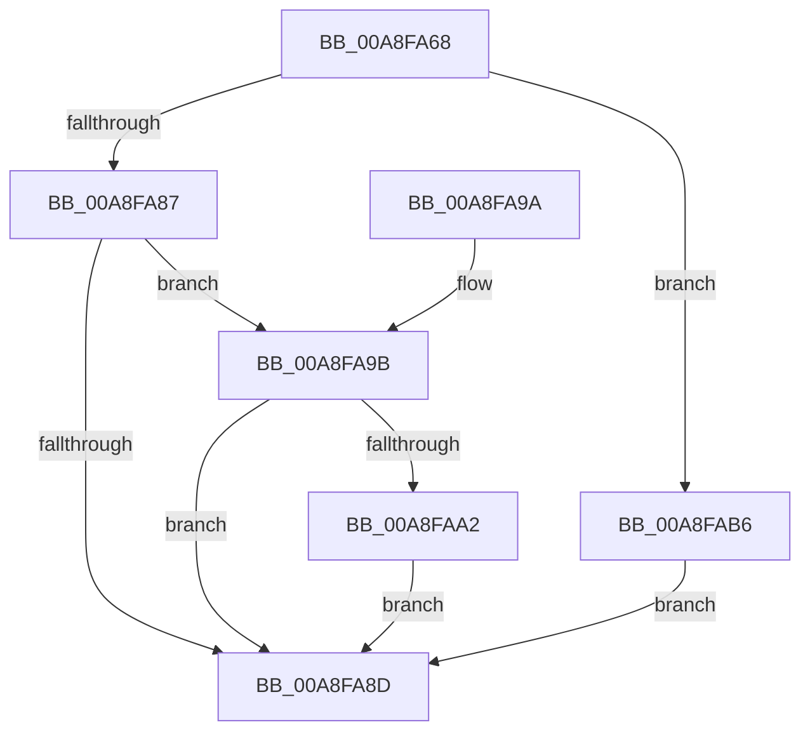

# PipDeviceRemovalCheckDeviceNodeState

- RVA: `0x00A8FA68`–`0x00A8FABA` (길이 `82` bytes)
- VA: `0x0000000140A8FA68`
- 실행 섹션: `PAGE`
- PDB 이름 있음: `예`; PDB Function 태그: `아니요`
- unwind 정보 RVA: `0x000AE450`
- 디코드: `26`개 명령, `82/82` bytes 표시
- 미해석 바이트: `0` (있으면 어셈블리에 `.byte`로 보존)

> 이 문서는 커널 이미지의 기계어와 PDB 기호를 분석해 생성했습니다. 4번과 5번은 함수 원형과 자료형을 바이너리 사용 방식에서 추정한 C 해석이며 원본 소스 복구 결과는 아닙니다.

## 1. Dependencies

- 직접 호출 지점: **2**; 고유 호출 대상: **2**
- 직접 호출자로 확인된 함수: **1**
- RIP 상대 이미지 참조: **0**

### Outgoing calls
- `0x00A8FAA2` → [PipRestoreDevNodeState](../../text/5A/PipRestoreDevNodeState_function_005A7100.md) (function, `0x005A7100`)
- `0x00A8FAAF` → [PipSetDevNodeState](../../text/47/PipSetDevNodeState_function_00470708.md) (function, `0x00470708`)

### Direct callers
- [PnpRequestDeviceRemovalWorker](PnpRequestDeviceRemovalWorker_function_00A8F958.md) at `0x00A8F985`

### Static image references
- 디코드된 RIP-relative 메모리 참조가 없습니다.

## 2. Other-region calls and transfers

- 다른 실행 섹션으로 향하는 call: **2**
  - `0x00A8FAA2` → [PipRestoreDevNodeState](../../text/5A/PipRestoreDevNodeState_function_005A7100.md) (`PAGE` → `.text`)
  - `0x00A8FAAF` → [PipSetDevNodeState](../../text/47/PipSetDevNodeState_function_00470708.md) (`PAGE` → `.text`)
- 별도 외부 분기/꼬리 이동을 확인하지 못했습니다.

## 3. Assembly (complete function range)

```asm
00A8FA68  48 89 5C 24 08                  mov qword ptr [rsp + 8], rbx
00A8FA6D  57                              push rdi
00A8FA6E  48 83 EC 20                     sub rsp, 0x20
00A8FA72  44 8B 89 2C 01 00 00            mov r9d, dword ptr [rcx + 0x12c]
00A8FA79  48 8B F9                        mov rdi, rcx
00A8FA7C  B3 01                           mov bl, 1
00A8FA7E  41 81 E9 10 03 00 00            sub r9d, 0x310
00A8FA85  74 2F                           je 0x140a8fab6
00A8FA87  41 83 F9 01                     cmp r9d, 1
00A8FA8B  74 0E                           je 0x140a8fa9b
00A8FA8D  8A C3                           mov al, bl
00A8FA8F  48 8B 5C 24 30                  mov rbx, qword ptr [rsp + 0x30]
00A8FA94  48 83 C4 20                     add rsp, 0x20
00A8FA98  5F                              pop rdi
00A8FA99  C3                              ret
00A8FA9A  CC                              int3
00A8FA9B  32 DB                           xor bl, bl
00A8FA9D  45 84 C0                        test r8b, r8b
00A8FAA0  74 EB                           je 0x140a8fa8d
00A8FAA2  E8 59 76 B1 FF                  call 0x1405a7100
00A8FAA7  BA 10 03 00 00                  mov edx, 0x310
00A8FAAC  48 8B CF                        mov rcx, rdi
00A8FAAF  E8 54 0C 9E FF                  call 0x140470708
00A8FAB4  EB D7                           jmp 0x140a8fa8d
00A8FAB6  32 DB                           xor bl, bl
00A8FAB8  EB D3                           jmp 0x140a8fa8d
```

## 4. C-style interpretation (structured pseudocode)

```c
__int64 __fastcall PipDeviceRemovalCheckDeviceNodeState(__int64 a1, __int64 a2, unsigned __int8 a3)
{
    __int64 result;
    __int64 v_rbx;
    __int64 v_rsp;
    unsigned __int64 v_stack_p8;

    v_stack_p8 = v_rbx;
    v_rsp = (v_rsp) - (32);
    a4 = (unsigned int)(((unsigned int)(*(unsigned int *)(a1 + 300))) - (784));
    if (condition_is_equal) goto loc_00A8FAB6;
    if (((unsigned int)(a4)) == 1) goto loc_00A8FA9B;
loc_00A8FA8D:
    v_rsp = (v_rsp) + (32);
    return 1;
loc_00A8FA9B:
    v_rbx = 0;
    if (a3 == 0) goto loc_00A8FA8D;
    result = PipRestoreDevNodeState(a1, a2, a3, a4);
    result = PipSetDevNodeState(a1, 784, a3, a4);
    goto loc_00A8FA8D;
loc_00A8FAB6:
    v_rbx = 0;
    goto loc_00A8FA8D;
}
```

## 5. (Beta) C Style

```c
int64_t PipDeviceRemovalCheckDeviceNodeState(void *Arg1, int64_t Arg2, uint8_t Arg3)
{
    uint8_t *arg1 = (uint8_t *)Arg1;

    int64_t result;
    int64_t local_rbx;
    int64_t local_rsp;
    uint64_t v_stack_p8;

    v_stack_p8 = local_rbx;
    local_rsp = (local_rsp) - (32);
    a4 = (uint32_t)(((uint32_t)(*(uint32_t *)(arg1 + 0x12C))) - (784));
    if (condition_is_equal) goto loc_00A8FAB6;
    if (((uint32_t)(a4)) == 1) goto loc_00A8FA9B;
loc_00A8FA8D:
    local_rsp = (local_rsp) + (32);
    return 1;
loc_00A8FA9B:
    local_rbx = 0;
    if (Arg3 == 0) goto loc_00A8FA8D;
    result = PipRestoreDevNodeState(Arg1, Arg2, Arg3, a4);
    result = PipSetDevNodeState(Arg1, 784, Arg3, a4);
    goto loc_00A8FA8D;
loc_00A8FAB6:
    local_rbx = 0;
    goto loc_00A8FA8D;
}
```

### 관측된 메모리 오프셋

구조체 형식이 확인되지 않은 접근은 인자 기준의 오프셋으로만 기록했습니다.

| 기준 인자 | 오프셋 표현 | 폭 (bit) | 접근 |
|---|---:|---:|---|
| `Arg1` | `+ 0x12C` | `32` | `R` |

## 6. Execution-region graph

[열기: 2D/3D 그래프와 함수 탐색 컨트롤 패널](../../../control-panel.html?section=page&rva=0x00A8FA68&view=graph)

- 2D 그래프는 위에서 아래로 흐르고, 3D 그래프는 빈 공간을 드래그해 회전합니다. Shift+드래그는 이동, 휠은 확대·축소, 함수 노드 선택은 대상 보고서 이동입니다.

### Static fallback


