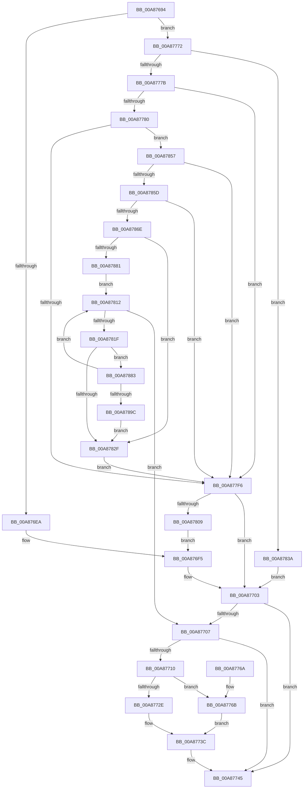

# PipGenerateContainerID

- RVA: `0x00A87694`–`0x00A8789E` (길이 `522` bytes)
- VA: `0x0000000140A87694`
- 실행 섹션: `PAGE`
- PDB 이름 있음: `예`; PDB Function 태그: `아니요`
- unwind 정보 RVA: `0x000B7DF8`
- 디코드: `138`개 명령, `522/522` bytes 표시
- 미해석 바이트: `0` (있으면 어셈블리에 `.byte`로 보존)

> 이 문서는 커널 이미지의 기계어와 PDB 기호를 분석해 생성했습니다. 4번과 5번은 함수 원형과 자료형을 바이너리 사용 방식에서 추정한 C 해석이며 원본 소스 복구 결과는 아닙니다.

## 1. Dependencies

- 직접 호출 지점: **15**; 고유 호출 대상: **14**
- 직접 호출자로 확인된 함수: **1**
- RIP 상대 이미지 참조: **3**

### Outgoing calls
- `0x00A876FC` → [RtlStringFromGUIDEx](../91/RtlStringFromGUIDEx_function_00915450.md) (function, `0x00915450`)
- `0x00A87721` → [ExAllocatePool2](../../poolcode/B8/ExAllocatePool2_function_00B820F0.md) (function, `0x00B820F0`)
- `0x00A87737` → [memcpy](../../text/6C/memcpy_function_006C6840.md) (function, `0x006C6840`)
- `0x00A87740` → [ExFreePool](../../poolcode/B8/ExFreePool_function_00B82850.md) (function, `0x00B82850`)
- `0x00A8774E` → [_security_check_cookie](../../text/6A/_security_check_cookie_function_006AC640.md) (function, `0x006AC640`)
- `0x00A8779A` → [ExAcquireResourceSharedLite](../../text/21/ExAcquireResourceSharedLite_function_00211BC0.md) (function, `0x00211BC0`)
- `0x00A877DA` → [CmGetDeviceRegProp](../8E/CmGetDeviceRegProp_function_008ED870.md) (function, `0x008ED870`)
- `0x00A877E8` → [ExReleaseResourceLite](../../text/25/ExReleaseResourceLite_function_0025FA10.md) (function, `0x0025FA10`)
- `0x00A877ED` → [KeLeaveCriticalRegion](../../text/25/KeLeaveCriticalRegion_function_0025D8B0.md) (function, `0x0025D8B0`)
- `0x00A877FA` → [ExUuidCreate](../91/ExUuidCreate_function_00917500.md) (function, `0x00917500`)
- `0x00A87833` → [RtlFreeAnsiString](../9C/RtlFreeAnsiString_function_009C0800.md) (function, `0x009C0800`)
- `0x00A87841` → [RtlCreateUnicodeString](../9B/RtlCreateUnicodeString_function_009BD860.md) (function, `0x009BD860`)
- `0x00A87865` → [RtlCreateUnicodeString](../9B/RtlCreateUnicodeString_function_009BD860.md) (function, `0x009BD860`)
- `0x00A87876` → [RtlGUIDFromString](../8F/RtlGUIDFromString_function_008F1EF0.md) (function, `0x008F1EF0`)
- `0x00A8788D` → [RtlCompareMemory](../../text/6B/RtlCompareMemory_function_006BA670.md) (function, `0x006BA670`)

### Direct callers
- [PiProcessNewDeviceNode](../A2/PiProcessNewDeviceNode_function_00A28F20.md) at `0x00A29D73`

### Static image references
- `0x00A876AC` → RVA `0x00E0A740` (`.data`; read)
- `0x00A87789` → RVA `0x00F8C600` (`.data`; read)
- `0x00A877A7` → RVA `0x00E66398` (`.data`; read)

## 2. Other-region calls and transfers

- 다른 실행 섹션으로 향하는 call: **8**
  - `0x00A87721` → [ExAllocatePool2](../../poolcode/B8/ExAllocatePool2_function_00B820F0.md) (`PAGE` → `POOLCODE`)
  - `0x00A87737` → [memcpy](../../text/6C/memcpy_function_006C6840.md) (`PAGE` → `.text`)
  - `0x00A87740` → [ExFreePool](../../poolcode/B8/ExFreePool_function_00B82850.md) (`PAGE` → `POOLCODE`)
  - `0x00A8774E` → [_security_check_cookie](../../text/6A/_security_check_cookie_function_006AC640.md) (`PAGE` → `.text`)
  - `0x00A8779A` → [ExAcquireResourceSharedLite](../../text/21/ExAcquireResourceSharedLite_function_00211BC0.md) (`PAGE` → `.text`)
  - `0x00A877E8` → [ExReleaseResourceLite](../../text/25/ExReleaseResourceLite_function_0025FA10.md) (`PAGE` → `.text`)
  - `0x00A877ED` → [KeLeaveCriticalRegion](../../text/25/KeLeaveCriticalRegion_function_0025D8B0.md) (`PAGE` → `.text`)
  - `0x00A8788D` → [RtlCompareMemory](../../text/6B/RtlCompareMemory_function_006BA670.md) (`PAGE` → `.text`)
- 별도 외부 분기/꼬리 이동을 확인하지 못했습니다.

## 3. Assembly (complete function range)

```asm
00A87694  48 89 5C 24 18                  mov qword ptr [rsp + 0x18], rbx
00A87699  55                              push rbp
00A8769A  56                              push rsi
00A8769B  57                              push rdi
00A8769C  41 56                           push r14
00A8769E  41 57                           push r15
00A876A0  48 8D 6C 24 D1                  lea rbp, [rsp - 0x2f]
00A876A5  48 81 EC D0 00 00 00            sub rsp, 0xd0
00A876AC  48 8B 05 8D 30 38 00            mov rax, qword ptr [rip + 0x38308d]
00A876B3  48 33 C4                        xor rax, rsp
00A876B6  48 89 45 1F                     mov qword ptr [rbp + 0x1f], rax
00A876BA  4C 8B 75 7F                     mov r14, qword ptr [rbp + 0x7f]
00A876BE  45 33 FF                        xor r15d, r15d
00A876C1  44 89 7D AF                     mov dword ptr [rbp - 0x51], r15d
00A876C5  0F 57 C0                        xorps xmm0, xmm0
00A876C8  44 89 7D B3                     mov dword ptr [rbp - 0x4d], r15d
00A876CC  48 8B DA                        mov rbx, rdx
00A876CF  4C 89 7D 9F                     mov qword ptr [rbp - 0x61], r15
00A876D3  48 8B F9                        mov rdi, rcx
00A876D6  4D 89 3E                        mov qword ptr [r14], r15
00A876D9  4C 89 7D A7                     mov qword ptr [rbp - 0x59], r15
00A876DD  0F 11 45 B7                     movups xmmword ptr [rbp - 0x49], xmm0
00A876E1  45 84 C0                        test r8b, r8b
00A876E4  0F 85 88 00 00 00               jne 0x140a87772
00A876EA  48 8B 49 10                     mov rcx, qword ptr [rcx + 0x10]
00A876EE  48 81 C1 98 02 00 00            add rcx, 0x298
00A876F5  41 B0 01                        mov r8b, 1
00A876F8  48 8D 55 9F                     lea rdx, [rbp - 0x61]
00A876FC  E8 4F DD E8 FF                  call 0x140915450
00A87701  8B D8                           mov ebx, eax
00A87703  85 DB                           test ebx, ebx
00A87705  78 3E                           js 0x140a87745
00A87707  48 8B 7D A7                     mov rdi, qword ptr [rbp - 0x59]
00A8770B  48 85 FF                        test rdi, rdi
00A8770E  74 35                           je 0x140a87745
00A87710  0F B7 75 A1                     movzx esi, word ptr [rbp - 0x5f]
00A87714  41 B8 50 70 65 6E               mov r8d, 0x6e657050
00A8771A  8B D6                           mov edx, esi
00A8771C  B9 00 01 00 00                  mov ecx, 0x100
00A87721  E8 CA A9 0F 00                  call 0x140b820f0
00A87726  49 89 06                        mov qword ptr [r14], rax
00A87729  48 85 C0                        test rax, rax
00A8772C  74 3D                           je 0x140a8776b
00A8772E  44 8B C6                        mov r8d, esi
00A87731  48 8B D7                        mov rdx, rdi
00A87734  48 8B C8                        mov rcx, rax
00A87737  E8 04 F1 C3 FF                  call 0x1406c6840
00A8773C  48 8B 4D A7                     mov rcx, qword ptr [rbp - 0x59]
00A87740  E8 0B B1 0F 00                  call 0x140b82850
00A87745  8B C3                           mov eax, ebx
00A87747  48 8B 4D 1F                     mov rcx, qword ptr [rbp + 0x1f]
00A8774B  48 33 CC                        xor rcx, rsp
00A8774E  E8 ED 4E C2 FF                  call 0x1406ac640
00A87753  48 8B 9C 24 10 01 00 00         mov rbx, qword ptr [rsp + 0x110]
00A8775B  48 81 C4 D0 00 00 00            add rsp, 0xd0
00A87762  41 5F                           pop r15
00A87764  41 5E                           pop r14
00A87766  5F                              pop rdi
00A87767  5E                              pop rsi
00A87768  5D                              pop rbp
00A87769  C3                              ret
00A8776A  CC                              int3
00A8776B  BB 9A 00 00 C0                  mov ebx, 0xc000009a
00A87770  EB CA                           jmp 0x140a8773c
00A87772  4D 85 C9                        test r9, r9
00A87775  0F 85 BF 00 00 00               jne 0x140a8783a
00A8777B  48 85 DB                        test rbx, rbx
00A8777E  74 76                           je 0x140a877f6
00A87780  65 48 8B 04 25 88 01 00 00      mov rax, qword ptr gs:[0x188]
00A87789  48 8D 0D 70 4E 50 00            lea rcx, [rip + 0x504e70]
00A87790  B2 01                           mov dl, 1
00A87792  66 FF 88 E4 01 00 00            dec word ptr [rax + 0x1e4]
00A87799  90                              nop
00A8779A  E8 21 A4 78 FF                  call 0x140211bc0
00A8779F  48 8B 57 30                     mov rdx, qword ptr [rdi + 0x30]
00A877A3  48 8D 45 AF                     lea rax, [rbp - 0x51]
00A877A7  48 8B 0D EA EB 3D 00            mov rcx, qword ptr [rip + 0x3debea]
00A877AE  41 B9 25 00 00 00               mov r9d, 0x25
00A877B4  44 89 7C 24 38                  mov dword ptr [rsp + 0x38], r15d
00A877B9  4C 8B C3                        mov r8, rbx
00A877BC  48 89 44 24 30                  mov qword ptr [rsp + 0x30], rax
00A877C1  48 8D 45 CF                     lea rax, [rbp - 0x31]
00A877C5  48 89 44 24 28                  mov qword ptr [rsp + 0x28], rax
00A877CA  48 8D 45 B3                     lea rax, [rbp - 0x4d]
00A877CE  48 89 44 24 20                  mov qword ptr [rsp + 0x20], rax
00A877D3  C7 45 AF 4E 00 00 00            mov dword ptr [rbp - 0x51], 0x4e
00A877DA  E8 91 60 E6 FF                  call 0x1408ed870
00A877DF  48 8D 0D 1A 4E 50 00            lea rcx, [rip + 0x504e1a]
00A877E6  8B D8                           mov ebx, eax
00A877E8  E8 23 82 7D FF                  call 0x14025fa10
00A877ED  E8 BE 60 7D FF                  call 0x14025d8b0
00A877F2  85 DB                           test ebx, ebx
00A877F4  79 61                           jns 0x140a87857
00A877F6  48 8D 4D B7                     lea rcx, [rbp - 0x49]
00A877FA  E8 01 FD E8 FF                  call 0x140917500
00A877FF  8B D8                           mov ebx, eax
00A87801  85 C0                           test eax, eax
00A87803  0F 88 FA FE FF FF               js 0x140a87703
00A87809  48 8D 4D B7                     lea rcx, [rbp - 0x49]
00A8780D  E9 E3 FE FF FF                  jmp 0x140a876f5
00A87812  48 8B 7F 10                     mov rdi, qword ptr [rdi + 0x10]
00A87816  48 85 FF                        test rdi, rdi
00A87819  0F 84 E8 FE FF FF               je 0x140a87707
00A8781F  48 8D 8F 98 02 00 00            lea rcx, [rdi + 0x298]
00A87826  48 8D 45 B7                     lea rax, [rbp - 0x49]
00A8782A  48 3B C8                        cmp rcx, rax
00A8782D  75 54                           jne 0x140a87883
00A8782F  48 8D 4D 9F                     lea rcx, [rbp - 0x61]
00A87833  E8 C8 8F F3 FF                  call 0x1409c0800
00A87838  EB BC                           jmp 0x140a877f6
00A8783A  49 8B D1                        mov rdx, r9
00A8783D  48 8D 4D 9F                     lea rcx, [rbp - 0x61]
00A87841  E8 1A 60 F3 FF                  call 0x1409bd860
00A87846  F6 D8                           neg al
00A87848  1B DB                           sbb ebx, ebx
00A8784A  F7 D3                           not ebx
00A8784C  81 E3 9A 00 00 C0               and ebx, 0xc000009a
00A87852  E9 AC FE FF FF                  jmp 0x140a87703
00A87857  83 7D B3 01                     cmp dword ptr [rbp - 0x4d], 1
00A8785B  75 99                           jne 0x140a877f6
00A8785D  48 8D 55 CF                     lea rdx, [rbp - 0x31]
00A87861  48 8D 4D 9F                     lea rcx, [rbp - 0x61]
00A87865  E8 F6 5F F3 FF                  call 0x1409bd860
00A8786A  84 C0                           test al, al
00A8786C  74 88                           je 0x140a877f6
00A8786E  48 8D 55 B7                     lea rdx, [rbp - 0x49]
00A87872  48 8D 4D 9F                     lea rcx, [rbp - 0x61]
00A87876  E8 75 A6 E6 FF                  call 0x1408f1ef0
00A8787B  8B D8                           mov ebx, eax
00A8787D  85 C0                           test eax, eax
00A8787F  78 AE                           js 0x140a8782f
00A87881  EB 8F                           jmp 0x140a87812
00A87883  41 B8 10 00 00 00               mov r8d, 0x10
00A87889  48 8D 55 B7                     lea rdx, [rbp - 0x49]
00A8788D  E8 DE 2D C3 FF                  call 0x1406ba670
00A87892  48 83 F8 10                     cmp rax, 0x10
00A87896  0F 85 76 FF FF FF               jne 0x140a87812
00A8789C  EB 91                           jmp 0x140a8782f
```

## 4. C-style interpretation (structured pseudocode)

```c
__int64 __fastcall PipGenerateContainerID(__int64 a1, __int64 a2, unsigned __int8 a3, __int64 a4, __int64 a5)
{
    __int64 result;
    __int64 v_r15;
    __int64 v_rbx;
    __int64 v_rsp;
    unsigned __int64 v_stack_m38;
    unsigned __int64 v_stack_m57;
    unsigned __int64 v_stack_m88;
    unsigned __int64 v_stack_mA0;
    unsigned int v_stack_mA4;
    unsigned int v_stack_mA8;
    unsigned __int64 v_stack_mB0;
    unsigned __int16 v_stack_mB6;
    unsigned __int64 v_stack_mB8;
    unsigned __int64 v_stack_p18;
    unsigned __int64 v_stack_p20;
    unsigned __int64 v_stack_p28;
    unsigned __int64 v_stack_p30;
    unsigned int v_stack_p38;

    v_stack_p18 = v_rbx;
    v_rsp = (v_rsp) - (208);
    result = (*(unsigned __int64 *)(v_rip + 3682445)) ^ (v_rsp);
    v_stack_m38 = result;
    v_r15 = 0;
    v_stack_mA8 = 0;
    v_stack_mA4 = 0;
    v_stack_mB8 = 0;
    *(unsigned __int64 *)(a5) = 0;
    v_stack_mB0 = 0;
    v_stack_mA0 = v_xmm0;
    if (a3 != 0) goto loc_00A87772;
    a1 = (*(unsigned __int64 *)(a1 + 16)) + (664);
loc_00A876F5:
    result = RtlStringFromGUIDEx(a1, v_stack_mB8, 1, a4);
loc_00A87703:
    if (sign_flag) goto loc_00A87745;
loc_00A87707:
    if (v_stack_mB0 == 0) goto loc_00A87745;
    result = ExAllocatePool2(256, (unsigned int)((unsigned int)(v_stack_mB6)), (unsigned int)(0x6E657050ULL), a4);
    *(unsigned __int64 *)(a5) = result;
    if (result == 0) goto loc_00A8776B;
    result = memcpy(result, v_stack_mB0, (unsigned int)((unsigned int)(v_stack_mB6)), a4);
loc_00A8773C:
    result = ExFreePool(v_stack_mB0, v_stack_mB0, (unsigned int)((unsigned int)(v_stack_mB6)), a4);
loc_00A87745:
    a1 = (v_stack_m38) ^ (v_rsp);
    result = _security_check_cookie(a1, v_stack_mB0, (unsigned int)((unsigned int)(v_stack_mB6)), a4);
    v_rsp = (v_rsp) + (208);
    return result;
loc_00A8776B:
    goto loc_00A8773C;
loc_00A87772:
    if (a4 != 0) goto loc_00A8783A;
    if ((unsigned int)(0xC000009AULL) == 0) goto loc_00A877F6;
    result = ExAcquireResourceSharedLite(v_rip + 5262960, 1, (unsigned int)((unsigned int)(v_stack_mB6)), a4);
    v_stack_p38 = 0;
    v_stack_p30 = v_stack_mA8;
    v_stack_p28 = v_stack_m88;
    v_stack_p20 = v_stack_mA4;
    v_stack_mA8 = 78;
    result = CmGetDeviceRegProp(*(unsigned __int64 *)(v_rip + 4058090), *(unsigned __int64 *)(v_stack_mB0 + 48), (unsigned int)(0xC000009AULL), 37);
    result = ExReleaseResourceLite(v_rip + 5262874, *(unsigned __int64 *)(v_stack_mB0 + 48), (unsigned int)(0xC000009AULL), 37);
    result = KeLeaveCriticalRegion(v_rip + 5262874, *(unsigned __int64 *)(v_stack_mB0 + 48), (unsigned int)(0xC000009AULL), 37);
    if (!sign_flag) goto loc_00A87857;
loc_00A877F6:
    result = ExUuidCreate(v_stack_mA0, *(unsigned __int64 *)(v_stack_mB0 + 48), (unsigned int)(0xC000009AULL), 37);
    if (sign_flag) goto loc_00A87703;
    goto loc_00A876F5;
loc_00A87812:
    if (*(unsigned __int64 *)(v_stack_mB0 + 16) == 0) goto loc_00A87707;
    if ((*(unsigned __int64 *)(v_stack_mB0 + 16) + 664) != v_stack_mA0) goto loc_00A87883;
loc_00A8782F:
    result = RtlFreeAnsiString(v_stack_mB8, *(unsigned __int64 *)(v_stack_mB0 + 48), (unsigned int)(0xC000009AULL), 37);
    goto loc_00A877F6;
loc_00A8783A:
    result = RtlCreateUnicodeString(v_stack_mB8, 37, (unsigned int)(0xC000009AULL), 37);
    result = (unsigned __int8)(-(result));
    v_rbx = (unsigned int)(~((unsigned int)((unsigned int)(result))));
    v_rbx = (unsigned int)((v_rbx) & (0xC000009AULL));
    goto loc_00A87703;
loc_00A87857:
    if (v_stack_mA4 != 1) goto loc_00A877F6;
    result = RtlCreateUnicodeString(v_stack_mB8, v_stack_m88, (unsigned int)(0xC000009AULL), 37);
    if ((unsigned __int8)(result) == 0) goto loc_00A877F6;
    result = RtlGUIDFromString(v_stack_mB8, v_stack_mA0, (unsigned int)(0xC000009AULL), 37);
    if (sign_flag) goto loc_00A8782F;
    goto loc_00A87812;
loc_00A87883:
    result = RtlCompareMemory(v_stack_mB8, v_stack_mA0, 16, 37);
    if (result != 16) goto loc_00A87812;
    goto loc_00A8782F;
}
```

## 5. (Beta) C Style

```c
int64_t PipGenerateContainerID(void *Arg1, int64_t Arg2, uint8_t Arg3, int64_t Arg4, void *Arg5)
{
    uint8_t *arg1 = (uint8_t *)Arg1;
    uint8_t *arg5 = (uint8_t *)Arg5;

    int64_t result;
    int64_t local_r15;
    int64_t local_rbx;
    int64_t local_rsp;
    uint64_t v_stack_m38;
    uint64_t v_stack_m57;
    uint64_t v_stack_m88;
    uint64_t v_stack_mA0;
    uint32_t v_stack_mA4;
    uint32_t v_stack_mA8;
    uint64_t v_stack_mB0;
    uint16_t v_stack_mB6;
    uint64_t v_stack_mB8;
    uint64_t v_stack_p18;
    uint64_t v_stack_p20;
    uint64_t v_stack_p28;
    uint64_t v_stack_p30;
    uint32_t v_stack_p38;

    v_stack_p18 = local_rbx;
    local_rsp = (local_rsp) - (208);
    result = (*(uint64_t *)(v_rip + 0x38308D)) ^ (local_rsp);
    v_stack_m38 = result;
    local_r15 = 0;
    v_stack_mA8 = 0;
    v_stack_mA4 = 0;
    v_stack_mB8 = 0;
    *(uint64_t *)(arg5) = 0;
    v_stack_mB0 = 0;
    v_stack_mA0 = v_xmm0;
    if (Arg3 != 0) goto loc_00A87772;
    Arg1 = (*(uint64_t *)(arg1 + 0x10)) + (664);
loc_00A876F5:
    result = RtlStringFromGUIDEx(Arg1, v_stack_mB8, 1, Arg4);
loc_00A87703:
    if (sign_flag) goto loc_00A87745;
loc_00A87707:
    if (v_stack_mB0 == 0) goto loc_00A87745;
    result = ExAllocatePool2(256, (uint32_t)((uint32_t)(v_stack_mB6)), (uint32_t)(0x6E657050ULL), Arg4);
    *(uint64_t *)(arg5) = result;
    if (result == 0) goto loc_00A8776B;
    result = memcpy(result, v_stack_mB0, (uint32_t)((uint32_t)(v_stack_mB6)), Arg4);
loc_00A8773C:
    result = ExFreePool(v_stack_mB0, v_stack_mB0, (uint32_t)((uint32_t)(v_stack_mB6)), Arg4);
loc_00A87745:
    Arg1 = (v_stack_m38) ^ (local_rsp);
    result = _security_check_cookie(Arg1, v_stack_mB0, (uint32_t)((uint32_t)(v_stack_mB6)), Arg4);
    local_rsp = (local_rsp) + (208);
    return result;
loc_00A8776B:
    goto loc_00A8773C;
loc_00A87772:
    if (Arg4 != 0) goto loc_00A8783A;
    if ((uint32_t)(0xC000009AULL) == 0) goto loc_00A877F6;
    result = ExAcquireResourceSharedLite(v_rip + 5262960, 1, (uint32_t)((uint32_t)(v_stack_mB6)), Arg4);
    v_stack_p38 = 0;
    v_stack_p30 = v_stack_mA8;
    v_stack_p28 = v_stack_m88;
    v_stack_p20 = v_stack_mA4;
    v_stack_mA8 = 78;
    result = CmGetDeviceRegProp(*(uint64_t *)(v_rip + 0x3DEBEA), *(uint64_t *)(v_stack_mB0 + 0x30), (uint32_t)(0xC000009AULL), 37);
    result = ExReleaseResourceLite(v_rip + 5262874, *(uint64_t *)(v_stack_mB0 + 0x30), (uint32_t)(0xC000009AULL), 37);
    result = KeLeaveCriticalRegion(v_rip + 5262874, *(uint64_t *)(v_stack_mB0 + 0x30), (uint32_t)(0xC000009AULL), 37);
    if (!sign_flag) goto loc_00A87857;
loc_00A877F6:
    result = ExUuidCreate(v_stack_mA0, *(uint64_t *)(v_stack_mB0 + 0x30), (uint32_t)(0xC000009AULL), 37);
    if (sign_flag) goto loc_00A87703;
    goto loc_00A876F5;
loc_00A87812:
    if (*(uint64_t *)(v_stack_mB0 + 0x10) == 0) goto loc_00A87707;
    if ((*(uint64_t *)(v_stack_mB0 + 0x10) + 664) != v_stack_mA0) goto loc_00A87883;
loc_00A8782F:
    result = RtlFreeAnsiString(v_stack_mB8, *(uint64_t *)(v_stack_mB0 + 0x30), (uint32_t)(0xC000009AULL), 37);
    goto loc_00A877F6;
loc_00A8783A:
    result = RtlCreateUnicodeString(v_stack_mB8, 37, (uint32_t)(0xC000009AULL), 37);
    result = (uint8_t)(-(result));
    local_rbx = (uint32_t)(~((uint32_t)((uint32_t)(result))));
    local_rbx = (uint32_t)((local_rbx) & (0xC000009AULL));
    goto loc_00A87703;
loc_00A87857:
    if (v_stack_mA4 != 1) goto loc_00A877F6;
    result = RtlCreateUnicodeString(v_stack_mB8, v_stack_m88, (uint32_t)(0xC000009AULL), 37);
    if ((uint8_t)(result) == 0) goto loc_00A877F6;
    result = RtlGUIDFromString(v_stack_mB8, v_stack_mA0, (uint32_t)(0xC000009AULL), 37);
    if (sign_flag) goto loc_00A8782F;
    goto loc_00A87812;
loc_00A87883:
    result = RtlCompareMemory(v_stack_mB8, v_stack_mA0, 16, 37);
    if (result != 16) goto loc_00A87812;
    goto loc_00A8782F;
}
```

### 관측된 메모리 오프셋

구조체 형식이 확인되지 않은 접근은 인자 기준의 오프셋으로만 기록했습니다.

| 기준 인자 | 오프셋 표현 | 폭 (bit) | 접근 |
|---|---:|---:|---|
| `Arg1` | `+ 0x10` | `64` | `R` |
| `Arg1` | `+ 0x30` | `64` | `R` |
| `Arg5` | `+ 0x0` | `64` | `W` |

## 6. Execution-region graph

[열기: 2D/3D 그래프와 함수 탐색 컨트롤 패널](../../../control-panel.html?section=page&rva=0x00A87694&view=graph)

- 2D 그래프는 위에서 아래로 흐르고, 3D 그래프는 빈 공간을 드래그해 회전합니다. Shift+드래그는 이동, 휠은 확대·축소, 함수 노드 선택은 대상 보고서 이동입니다.

### Static fallback


