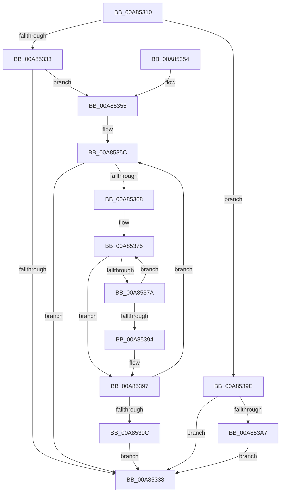

# PipQueryBindingResolution

- RVA: `0x00A85310`–`0x00A853B4` (길이 `164` bytes)
- VA: `0x0000000140A85310`
- 실행 섹션: `PAGE`
- PDB 이름 있음: `예`; PDB Function 태그: `아니요`
- unwind 정보 RVA: `0x000B7964`
- 디코드: `52`개 명령, `164/164` bytes 표시
- 미해석 바이트: `0` (있으면 어셈블리에 `.byte`로 보존)

> 이 문서는 커널 이미지의 기계어와 PDB 기호를 분석해 생성했습니다. 4번과 5번은 함수 원형과 자료형을 바이너리 사용 방식에서 추정한 C 해석이며 원본 소스 복구 결과는 아닙니다.

## 1. Dependencies

- 직접 호출 지점: **1**; 고유 호출 대상: **1**
- 직접 호출자로 확인된 함수: **3**
- RIP 상대 이미지 참조: **1**

### Outgoing calls
- `0x00A8538B` → [RtlEqualUnicodeString](../93/RtlEqualUnicodeString_function_00932A20.md) (function, `0x00932A20`)

### Direct callers
- [IoResolveDependency](../../text/4C/IoResolveDependency_function_004C4380.md) at `0x004C43B3`
- [IoDuplicateDependency](../72/IoDuplicateDependency_function_00727580.md) at `0x007275E5`
- [PipSetDependency](../72/PipSetDependency_function_00727F24.md) at `0x00727F39`
- [PipSetDependency](../72/PipSetDependency_function_00727F24.md) at `0x00727F63`

### Static image references
- `0x00A85355` → RVA `0x00F8CE80` (`.data`; read)

## 2. Other-region calls and transfers

- 다른 실행 섹션으로 향하는 call: **0**
- 별도 외부 분기/꼬리 이동을 확인하지 못했습니다.

## 3. Assembly (complete function range)

```asm
00A85310  48 89 5C 24 08                  mov qword ptr [rsp + 8], rbx
00A85315  48 89 6C 24 10                  mov qword ptr [rsp + 0x10], rbp
00A8531A  48 89 74 24 18                  mov qword ptr [rsp + 0x18], rsi
00A8531F  57                              push rdi
00A85320  41 56                           push r14
00A85322  41 57                           push r15
00A85324  48 83 EC 20                     sub rsp, 0x20
00A85328  8B 11                           mov edx, dword ptr [rcx]
00A8532A  33 DB                           xor ebx, ebx
00A8532C  48 8B F9                        mov rdi, rcx
00A8532F  85 D2                           test edx, edx
00A85331  74 6B                           je 0x140a8539e
00A85333  83 FA 01                        cmp edx, 1
00A85336  74 1D                           je 0x140a85355
00A85338  48 8B 6C 24 48                  mov rbp, qword ptr [rsp + 0x48]
00A8533D  48 8B C3                        mov rax, rbx
00A85340  48 8B 5C 24 40                  mov rbx, qword ptr [rsp + 0x40]
00A85345  48 8B 74 24 50                  mov rsi, qword ptr [rsp + 0x50]
00A8534A  48 83 C4 20                     add rsp, 0x20
00A8534E  41 5F                           pop r15
00A85350  41 5E                           pop r14
00A85352  5F                              pop rdi
00A85353  C3                              ret
00A85354  CC                              int3
00A85355  48 8B 35 24 7B 50 00            mov rsi, qword ptr [rip + 0x507b24]
00A8535C  48 8D 05 1D 7B 50 00            lea rax, [rip + 0x507b1d]
00A85363  48 3B F0                        cmp rsi, rax
00A85366  74 D0                           je 0x140a85338
00A85368  48 8B EE                        mov rbp, rsi
00A8536B  48 8B 36                        mov rsi, qword ptr [rsi]
00A8536E  4C 8D 7D 38                     lea r15, [rbp + 0x38]
00A85372  4D 8B 37                        mov r14, qword ptr [r15]
00A85375  4D 3B F7                        cmp r14, r15
00A85378  74 1D                           je 0x140a85397
00A8537A  48 8B 57 08                     mov rdx, qword ptr [rdi + 8]
00A8537E  49 8B CE                        mov rcx, r14
00A85381  4D 8B 36                        mov r14, qword ptr [r14]
00A85384  48 83 C1 10                     add rcx, 0x10
00A85388  41 B0 01                        mov r8b, 1
00A8538B  E8 90 D6 EA FF                  call 0x140932a20
00A85390  84 C0                           test al, al
00A85392  74 E1                           je 0x140a85375
00A85394  48 8B DD                        mov rbx, rbp
00A85397  48 85 DB                        test rbx, rbx
00A8539A  74 C0                           je 0x140a8535c
00A8539C  EB 9A                           jmp 0x140a85338
00A8539E  48 8B 41 08                     mov rax, qword ptr [rcx + 8]
00A853A2  48 85 C0                        test rax, rax
00A853A5  74 91                           je 0x140a85338
00A853A7  48 8B 80 38 01 00 00            mov rax, qword ptr [rax + 0x138]
00A853AE  48 8B 58 50                     mov rbx, qword ptr [rax + 0x50]
00A853B2  EB 84                           jmp 0x140a85338
```

## 4. C-style interpretation (structured pseudocode)

```c
__int64 __fastcall PipQueryBindingResolution(__int64 a1)
{
    __int64 result;
    __int64 v_rbx;
    __int64 v_rsp;
    unsigned __int64 v_stack_p10;
    unsigned __int64 v_stack_p18;
    unsigned __int64 v_stack_p8;

    v_stack_p8 = v_rbx;
    v_stack_p10 = v_rbp;
    v_stack_p18 = v_rsi;
    v_rsp = (v_rsp) - (32);
    v_rbx = 0;
    if ((unsigned int)((unsigned int)(*(unsigned int *)(a1))) == 0) goto loc_00A8539E;
    if (((unsigned int)((unsigned int)(*(unsigned int *)(a1)))) == 1) goto loc_00A85355;
loc_00A85338:
    v_rsp = (v_rsp) + (32);
    return 0;
loc_00A85355:
loc_00A8535C:
    if ((*(unsigned __int64 *)(v_rip + 5274404)) == (v_rip + 5274397)) goto loc_00A85338;
loc_00A85375:
    if ((*(unsigned __int64 *)(*(unsigned __int64 *)(v_rip + 5274404) + 56)) == (*(unsigned __int64 *)(v_rip + 5274404) + 56)) goto loc_00A85397;
    a1 = (*(unsigned __int64 *)(*(unsigned __int64 *)(v_rip + 5274404) + 56)) + (16);
    result = RtlEqualUnicodeString(a1, *(unsigned __int64 *)(a1 + 8), 1, a4);
    if ((unsigned __int8)(result) == 0) goto loc_00A85375;
loc_00A85397:
    if (*(unsigned __int64 *)(v_rip + 5274404) == 0) goto loc_00A8535C;
    goto loc_00A85338;
loc_00A8539E:
    if (*(unsigned __int64 *)(a1 + 8) == 0) goto loc_00A85338;
    goto loc_00A85338;
}
```

## 5. (Beta) C Style

```c
int64_t PipQueryBindingResolution(void *Arg1)
{
    uint8_t *arg1 = (uint8_t *)Arg1;

    int64_t result;
    int64_t local_rbx;
    int64_t local_rsp;
    uint64_t v_stack_p10;
    uint64_t v_stack_p18;
    uint64_t v_stack_p8;

    v_stack_p8 = local_rbx;
    v_stack_p10 = local_rbp;
    v_stack_p18 = local_rsi;
    local_rsp = (local_rsp) - (32);
    local_rbx = 0;
    if ((uint32_t)((uint32_t)(*(uint32_t *)(arg1))) == 0) goto loc_00A8539E;
    if (((uint32_t)((uint32_t)(*(uint32_t *)(arg1)))) == 1) goto loc_00A85355;
loc_00A85338:
    local_rsp = (local_rsp) + (32);
    return 0;
loc_00A85355:
loc_00A8535C:
    if ((*(uint64_t *)(v_rip + 0x507B24)) == (v_rip + 5274397)) goto loc_00A85338;
loc_00A85375:
    if ((*(uint64_t *)(*(uint64_t *)(v_rip + 0x507B24) + 0x38)) == (*(uint64_t *)(v_rip + 0x507B24) + 56)) goto loc_00A85397;
    Arg1 = (*(uint64_t *)(*(uint64_t *)(v_rip + 0x507B24) + 0x38)) + (16);
    result = RtlEqualUnicodeString(Arg1, *(uint64_t *)(arg1 + 0x8), 1, a4);
    if ((uint8_t)(result) == 0) goto loc_00A85375;
loc_00A85397:
    if (*(uint64_t *)(v_rip + 0x507B24) == 0) goto loc_00A8535C;
    goto loc_00A85338;
loc_00A8539E:
    if (*(uint64_t *)(arg1 + 0x8) == 0) goto loc_00A85338;
    goto loc_00A85338;
}
```

### 관측된 메모리 오프셋

구조체 형식이 확인되지 않은 접근은 인자 기준의 오프셋으로만 기록했습니다.

| 기준 인자 | 오프셋 표현 | 폭 (bit) | 접근 |
|---|---:|---:|---|
| `Arg1` | `+ 0x0` | `32` | `R` |
| `Arg1` | `+ 0x8` | `64` | `R` |

## 6. Execution-region graph

[열기: 2D/3D 그래프와 함수 탐색 컨트롤 패널](../../../control-panel.html?section=page&rva=0x00A85310&view=graph)

- 2D 그래프는 위에서 아래로 흐르고, 3D 그래프는 빈 공간을 드래그해 회전합니다. Shift+드래그는 이동, 휠은 확대·축소, 함수 노드 선택은 대상 보고서 이동입니다.

### Static fallback


