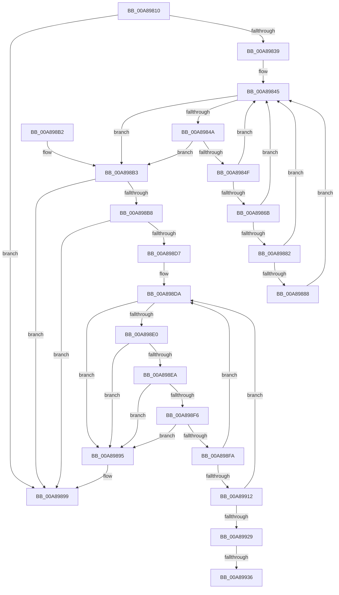

# PnpBuildUnsafeRemovalDeviceList

- RVA: `0x00A89810`–`0x00A89957` (길이 `327` bytes)
- VA: `0x0000000140A89810`
- 실행 섹션: `PAGE`
- PDB 이름 있음: `예`; PDB Function 태그: `예`
- unwind 정보 RVA: `0x000B838C`
- 디코드: `99`개 명령, `327/327` bytes 표시
- 미해석 바이트: `0` (있으면 어셈블리에 `.byte`로 보존)

> 이 문서는 커널 이미지의 기계어와 PDB 기호를 분석해 생성했습니다. 4번과 5번은 함수 원형과 자료형을 바이너리 사용 방식에서 추정한 C 해석이며 원본 소스 복구 결과는 아닙니다.

## 1. Dependencies

- 직접 호출 지점: **4**; 고유 호출 대상: **3**
- 직접 호출자로 확인된 함수: **1**
- RIP 상대 이미지 참조: **0**

### Outgoing calls
- `0x00A89879` → [PnpIsBeingRemovedSafely](PnpIsBeingRemovedSafely_function_00A89960.md) (function, `0x00A89960`)
- `0x00A898C7` → [ExAllocatePool2](../../poolcode/B8/ExAllocatePool2_function_00B820F0.md) (function, `0x00B820F0`)
- `0x00A89920` → [PnpIsBeingRemovedSafely](PnpIsBeingRemovedSafely_function_00A89960.md) (function, `0x00A89960`)
- `0x00A8993E` → [memcpy](../../text/6C/memcpy_function_006C6840.md) (function, `0x006C6840`)

### Direct callers
- [PnpProcessQueryRemoveAndEject](../A0/PnpProcessQueryRemoveAndEject_function_00A05170.md) at `0x00A05551`

### Static image references
- 디코드된 RIP-relative 메모리 참조가 없습니다.

## 2. Other-region calls and transfers

- 다른 실행 섹션으로 향하는 call: **2**
  - `0x00A898C7` → [ExAllocatePool2](../../poolcode/B8/ExAllocatePool2_function_00B820F0.md) (`PAGE` → `POOLCODE`)
  - `0x00A8993E` → [memcpy](../../text/6C/memcpy_function_006C6840.md) (`PAGE` → `.text`)
- call이 아닌 외부 분기/꼬리 이동: **2**
  - `0x00A89930` → [sub_00B45864](../B4/Unknown_function_00B45864.md) (`tail-transfer`)
  - `0x00A89952` → [sub_00B45864](../B4/Unknown_function_00B45864.md) (`tail-transfer`)

## 3. Assembly (complete function range)

```asm
00A89810  48 89 5C 24 08                  mov qword ptr [rsp + 8], rbx
00A89815  48 89 6C 24 10                  mov qword ptr [rsp + 0x10], rbp
00A8981A  48 89 74 24 18                  mov qword ptr [rsp + 0x18], rsi
00A8981F  57                              push rdi
00A89820  41 56                           push r14
00A89822  41 57                           push r15
00A89824  48 83 EC 20                     sub rsp, 0x20
00A89828  45 33 FF                        xor r15d, r15d
00A8982B  49 8B F0                        mov rsi, r8
00A8982E  4D 89 38                        mov qword ptr [r8], r15
00A89831  48 8B FA                        mov rdi, rdx
00A89834  48 85 D2                        test rdx, rdx
00A89837  74 60                           je 0x140a89899
00A89839  4C 8B 1A                        mov r11, qword ptr [rdx]
00A8983C  45 8B CF                        mov r9d, r15d
00A8983F  45 8B D7                        mov r10d, r15d
00A89842  45 8B 33                        mov r14d, dword ptr [r11]
00A89845  45 3B D6                        cmp r10d, r14d
00A89848  73 69                           jae 0x140a898b3
00A8984A  4D 85 DB                        test r11, r11
00A8984D  74 64                           je 0x140a898b3
00A8984F  41 8B C2                        mov eax, r10d
00A89852  41 8D 6A 01                     lea ebp, [r10 + 1]
00A89856  44 8B D5                        mov r10d, ebp
00A89859  48 8D 0C 40                     lea rcx, [rax + rax*2]
00A8985D  41 8B 54 CB 18                  mov edx, dword ptr [r11 + rcx*8 + 0x18]
00A89862  49 8B 44 CB 10                  mov rax, qword ptr [r11 + rcx*8 + 0x10]
00A89867  85 D2                           test edx, edx
00A89869  74 DA                           je 0x140a89845
00A8986B  48 8B 80 38 01 00 00            mov rax, qword ptr [rax + 0x138]
00A89872  48 8B 58 28                     mov rbx, qword ptr [rax + 0x28]
00A89876  48 8B CB                        mov rcx, rbx
00A89879  E8 E2 00 00 00                  call 0x140a89960
00A8987E  84 C0                           test al, al
00A89880  75 C3                           jne 0x140a89845
00A89882  4C 39 7B 30                     cmp qword ptr [rbx + 0x30], r15
00A89886  74 BD                           je 0x140a89845
00A89888  0F B7 43 28                     movzx eax, word ptr [rbx + 0x28]
00A8988C  41 83 C1 02                     add r9d, 2
00A89890  44 03 C8                        add r9d, eax
00A89893  EB B0                           jmp 0x140a89845
00A89895  66 44 89 3B                     mov word ptr [rbx], r15w
00A89899  48 8B 5C 24 40                  mov rbx, qword ptr [rsp + 0x40]
00A8989E  48 8B 6C 24 48                  mov rbp, qword ptr [rsp + 0x48]
00A898A3  48 8B 74 24 50                  mov rsi, qword ptr [rsp + 0x50]
00A898A8  48 83 C4 20                     add rsp, 0x20
00A898AC  41 5F                           pop r15
00A898AE  41 5E                           pop r14
00A898B0  5F                              pop rdi
00A898B1  C3                              ret
00A898B2  CC                              int3
00A898B3  45 85 C9                        test r9d, r9d
00A898B6  74 E1                           je 0x140a89899
00A898B8  41 8D 51 02                     lea edx, [r9 + 2]
00A898BC  B9 00 01 00 00                  mov ecx, 0x100
00A898C1  41 B8 50 6E 70 4B               mov r8d, 0x4b706e50
00A898C7  E8 24 88 0F 00                  call 0x140b820f0
00A898CC  48 89 06                        mov qword ptr [rsi], rax
00A898CF  48 8B D8                        mov rbx, rax
00A898D2  48 85 C0                        test rax, rax
00A898D5  74 C2                           je 0x140a89899
00A898D7  45 8B CF                        mov r9d, r15d
00A898DA  44 38 7F 08                     cmp byte ptr [rdi + 8], r15b
00A898DE  74 B5                           je 0x140a89895
00A898E0  48 8B 17                        mov rdx, qword ptr [rdi]
00A898E3  8B 0A                           mov ecx, dword ptr [rdx]
00A898E5  44 3B C9                        cmp r9d, ecx
00A898E8  73 AB                           jae 0x140a89895
00A898EA  41 8B C1                        mov eax, r9d
00A898ED  F7 D0                           not eax
00A898EF  03 C1                           add eax, ecx
00A898F1  48 85 D2                        test rdx, rdx
00A898F4  74 9F                           je 0x140a89895
00A898F6  3B C1                           cmp eax, ecx
00A898F8  73 9B                           jae 0x140a89895
00A898FA  48 8D 0C 40                     lea rcx, [rax + rax*2]
00A898FE  48 8B 44 CA 10                  mov rax, qword ptr [rdx + rcx*8 + 0x10]
00A89903  41 8D 69 01                     lea ebp, [r9 + 1]
00A89907  8B 54 CA 18                     mov edx, dword ptr [rdx + rcx*8 + 0x18]
00A8990B  44 8B CD                        mov r9d, ebp
00A8990E  85 D2                           test edx, edx
00A89910  74 C8                           je 0x140a898da
00A89912  48 8B 80 38 01 00 00            mov rax, qword ptr [rax + 0x138]
00A89919  48 8B 70 28                     mov rsi, qword ptr [rax + 0x28]
00A8991D  48 8B CE                        mov rcx, rsi
00A89920  E8 3B 00 00 00                  call 0x140a89960
00A89925  84 C0                           test al, al
00A89927  75 B1                           jne 0x140a898da
00A89929  48 8B 56 30                     mov rdx, qword ptr [rsi + 0x30]
00A8992D  48 85 D2                        test rdx, rdx
00A89930  0F 84 2E BF 0B 00               je 0x140b45864
00A89936  44 0F B7 46 28                  movzx r8d, word ptr [rsi + 0x28]
00A8993B  48 8B CB                        mov rcx, rbx
00A8993E  E8 FD CE C3 FF                  call 0x1406c6840
00A89943  0F B7 46 28                     movzx eax, word ptr [rsi + 0x28]
00A89947  48 D1 E8                        shr rax, 1
00A8994A  48 8D 1C 43                     lea rbx, [rbx + rax*2]
00A8994E  48 83 C3 02                     add rbx, 2
00A89952  E9 0D BF 0B 00                  jmp 0x140b45864
```

## 4. C-style interpretation (structured pseudocode)

```c
__int64 __fastcall PnpBuildUnsafeRemovalDeviceList(__int64 a1, __int64 a2, __int64 a3)
{
    __int64 result;
    __int64 v_r15;
    __int64 v_rbx;
    __int64 v_rsp;
    unsigned __int64 v_stack_p10;
    unsigned __int64 v_stack_p18;
    unsigned __int64 v_stack_p8;

    v_stack_p8 = v_rbx;
    v_stack_p10 = v_rbp;
    v_stack_p18 = v_rsi;
    v_rsp = (v_rsp) - (32);
    v_r15 = 0;
    *(unsigned __int64 *)(a3) = 0;
    if (a2 == 0) goto loc_00A89899;
loc_00A89845:
    if (0 >= ((unsigned int)((unsigned int)(*(unsigned int *)(*(unsigned __int64 *)(a2)))))) goto loc_00A898B3;
    if (*(unsigned __int64 *)(a2) == 0) goto loc_00A898B3;
    if ((unsigned int)((unsigned int)(*(unsigned int *)(*(unsigned __int64 *)(a2) + 0 + 0 * 2 * 8 + 24))) == 0) goto loc_00A89845;
    result = PnpIsBeingRemovedSafely(*(unsigned __int64 *)(*(unsigned __int64 *)(*(unsigned __int64 *)(*(unsigned __int64 *)(a2) + 0 + 0 * 2 * 8 + 16) + 312) + 40), (unsigned int)(*(unsigned int *)(*(unsigned __int64 *)(a2) + 0 + 0 * 2 * 8 + 24)), a3, 0);
    if ((unsigned __int8)(result) != 0) goto loc_00A89845;
    if ((*(unsigned __int64 *)(*(unsigned __int64 *)(*(unsigned __int64 *)(*(unsigned __int64 *)(*(unsigned __int64 *)(a2) + 0 + 0 * 2 * 8 + 16) + 312) + 40) + 48)) == 0) goto loc_00A89845;
    a4 = (unsigned int)((0) + (2));
    a4 = (unsigned int)((a4) + ((unsigned int)(*(unsigned __int16 *)(*(unsigned __int64 *)(*(unsigned __int64 *)(*(unsigned __int64 *)(*(unsigned __int64 *)(a2) + 0 + 0 * 2 * 8 + 16) + 312) + 40) + 40))));
    goto loc_00A89845;
loc_00A89895:
    *(unsigned __int16 *)(*(unsigned __int64 *)(*(unsigned __int64 *)(*(unsigned __int64 *)(*(unsigned __int64 *)(a2) + 0 + 0 * 2 * 8 + 16) + 312) + 40)) = 0;
loc_00A89899:
    v_rsp = (v_rsp) + (32);
    return *(unsigned __int16 *)(*(unsigned __int64 *)(*(unsigned __int64 *)(*(unsigned __int64 *)(*(unsigned __int64 *)(a2) + 0 + 0 * 2 * 8 + 16) + 312) + 40) + 40);
loc_00A898B3:
    if ((unsigned int)(a4) == 0) goto loc_00A89899;
    result = ExAllocatePool2(256, a4 + 2, (unsigned int)(0x4B706E50ULL), a4);
    *(unsigned __int64 *)(v_stack_p18) = result;
    if (result == 0) goto loc_00A89899;
loc_00A898DA:
    if ((*(unsigned __int8 *)(a2 + 8)) == 0) goto loc_00A89895;
    if (0 >= ((unsigned int)((unsigned int)(*(unsigned int *)(*(unsigned __int64 *)(a2)))))) goto loc_00A89895;
    result = (unsigned int)(~(0));
    result = (unsigned int)((result) + ((unsigned int)((unsigned int)(*(unsigned int *)(*(unsigned __int64 *)(a2))))));
    if (*(unsigned __int64 *)(a2) == 0) goto loc_00A89895;
    if (((unsigned int)(result)) >= ((unsigned int)((unsigned int)(*(unsigned int *)(*(unsigned __int64 *)(a2)))))) goto loc_00A89895;
    if ((unsigned int)((unsigned int)(*(unsigned int *)(*(unsigned __int64 *)(a2) + result + result * 2 * 8 + 24))) == 0) goto loc_00A898DA;
    result = PnpIsBeingRemovedSafely(*(unsigned __int64 *)(*(unsigned __int64 *)(*(unsigned __int64 *)(*(unsigned __int64 *)(a2) + result + result * 2 * 8 + 16) + 312) + 40), (unsigned int)(*(unsigned int *)(*(unsigned __int64 *)(a2) + result + result * 2 * 8 + 24)), (unsigned int)(0x4B706E50ULL), (unsigned int)((unsigned int)(0 + 1)));
    if ((unsigned __int8)(result) != 0) goto loc_00A898DA;
    result = memcpy(result, *(unsigned __int64 *)(*(unsigned __int64 *)(*(unsigned __int64 *)(*(unsigned __int64 *)(*(unsigned __int64 *)(a2) + result + result * 2 * 8 + 16) + 312) + 40) + 48), *(unsigned __int16 *)(*(unsigned __int64 *)(*(unsigned __int64 *)(*(unsigned __int64 *)(*(unsigned __int64 *)(a2) + result + result * 2 * 8 + 16) + 312) + 40) + 40), (unsigned int)((unsigned int)(0 + 1)));
    result = (*(unsigned __int16 *)(*(unsigned __int64 *)(*(unsigned __int64 *)(*(unsigned __int64 *)(*(unsigned __int64 *)(a2) + result + result * 2 * 8 + 16) + 312) + 40) + 40)) >> (1);
    v_rbx = (result + result * 2) + (2);
}
```

## 5. (Beta) C Style

```c
int64_t PnpBuildUnsafeRemovalDeviceList(int64_t Arg1, void *Arg2, void *Arg3)
{
    uint8_t *arg2 = (uint8_t *)Arg2;
    uint8_t *arg3 = (uint8_t *)Arg3;

    int64_t result;
    int64_t local_r15;
    int64_t local_rbx;
    int64_t local_rsp;
    uint64_t v_stack_p10;
    uint64_t v_stack_p18;
    uint64_t v_stack_p8;

    v_stack_p8 = local_rbx;
    v_stack_p10 = local_rbp;
    v_stack_p18 = local_rsi;
    local_rsp = (local_rsp) - (32);
    local_r15 = 0;
    *(uint64_t *)(arg3) = 0;
    if (Arg2 == NULL) goto loc_00A89899;
loc_00A89845:
    if (0 >= ((uint32_t)((uint32_t)(*(uint32_t *)(*(uint64_t *)(arg2)))))) goto loc_00A898B3;
    if (*(uint64_t *)(arg2) == 0) goto loc_00A898B3;
    if ((uint32_t)((uint32_t)(*(uint32_t *)(*(uint64_t *)(arg2) + 0x0 + 0x0 * 2 * 8 + 0x18))) == 0) goto loc_00A89845;
    result = PnpIsBeingRemovedSafely(*(uint64_t *)(*(uint64_t *)(*(uint64_t *)(*(uint64_t *)(arg2) + 0x0 + 0x0 * 2 * 8 + 0x10) + 0x138) + 0x28), (uint32_t)(*(uint32_t *)(*(uint64_t *)(arg2) + 0x0 + 0x0 * 2 * 8 + 0x18)), Arg3, 0);
    if ((uint8_t)(result) != 0) goto loc_00A89845;
    if ((*(uint64_t *)(*(uint64_t *)(*(uint64_t *)(*(uint64_t *)(*(uint64_t *)(arg2) + 0x0 + 0x0 * 2 * 8 + 0x10) + 0x138) + 0x28) + 0x30)) == 0) goto loc_00A89845;
    a4 = (uint32_t)((0) + (2));
    a4 = (uint32_t)((a4) + ((uint32_t)(*(uint16_t *)(*(uint64_t *)(*(uint64_t *)(*(uint64_t *)(*(uint64_t *)(arg2) + 0x0 + 0x0 * 2 * 8 + 0x10) + 0x138) + 0x28) + 0x28))));
    goto loc_00A89845;
loc_00A89895:
    *(uint16_t *)(*(uint64_t *)(*(uint64_t *)(*(uint64_t *)(*(uint64_t *)(arg2) + 0x0 + 0x0 * 2 * 8 + 0x10) + 0x138) + 0x28)) = 0;
loc_00A89899:
    local_rsp = (local_rsp) + (32);
    return *(uint16_t *)(*(uint64_t *)(*(uint64_t *)(*(uint64_t *)(*(uint64_t *)(arg2) + 0x0 + 0x0 * 2 * 8 + 0x10) + 0x138) + 0x28) + 0x28);
loc_00A898B3:
    if ((uint32_t)(a4) == 0) goto loc_00A89899;
    result = ExAllocatePool2(256, a4 + 2, (uint32_t)(0x4B706E50ULL), a4);
    *(uint64_t *)(v_stack_p18) = result;
    if (result == 0) goto loc_00A89899;
loc_00A898DA:
    if ((*(uint8_t *)(arg2 + 0x8)) == 0) goto loc_00A89895;
    if (0 >= ((uint32_t)((uint32_t)(*(uint32_t *)(*(uint64_t *)(arg2)))))) goto loc_00A89895;
    result = (uint32_t)(~(0));
    result = (uint32_t)((result) + ((uint32_t)((uint32_t)(*(uint32_t *)(*(uint64_t *)(arg2))))));
    if (*(uint64_t *)(arg2) == 0) goto loc_00A89895;
    if (((uint32_t)(result)) >= ((uint32_t)((uint32_t)(*(uint32_t *)(*(uint64_t *)(arg2)))))) goto loc_00A89895;
    if ((uint32_t)((uint32_t)(*(uint32_t *)(*(uint64_t *)(arg2) + result + result * 2 * 8 + 0x18))) == 0) goto loc_00A898DA;
    result = PnpIsBeingRemovedSafely(*(uint64_t *)(*(uint64_t *)(*(uint64_t *)(*(uint64_t *)(arg2) + result + result * 2 * 8 + 0x10) + 0x138) + 0x28), (uint32_t)(*(uint32_t *)(*(uint64_t *)(arg2) + result + result * 2 * 8 + 0x18)), (uint32_t)(0x4B706E50ULL), (uint32_t)((uint32_t)(0 + 1)));
    if ((uint8_t)(result) != 0) goto loc_00A898DA;
    result = memcpy(result, *(uint64_t *)(*(uint64_t *)(*(uint64_t *)(*(uint64_t *)(*(uint64_t *)(arg2) + result + result * 2 * 8 + 0x10) + 0x138) + 0x28) + 0x30), *(uint16_t *)(*(uint64_t *)(*(uint64_t *)(*(uint64_t *)(*(uint64_t *)(arg2) + result + result * 2 * 8 + 0x10) + 0x138) + 0x28) + 0x28), (uint32_t)((uint32_t)(0 + 1)));
    result = (*(uint16_t *)(*(uint64_t *)(*(uint64_t *)(*(uint64_t *)(*(uint64_t *)(arg2) + result + result * 2 * 8 + 0x10) + 0x138) + 0x28) + 0x28)) >> (1);
    local_rbx = (result + result * 2) + (2);
}
```

### 관측된 메모리 오프셋

구조체 형식이 확인되지 않은 접근은 인자 기준의 오프셋으로만 기록했습니다.

| 기준 인자 | 오프셋 표현 | 폭 (bit) | 접근 |
|---|---:|---:|---|
| `Arg2` | `+ 0x0` | `64` | `R` |
| `Arg2` | `+ 0x8` | `8` | `R` |
| `Arg3` | `+ 0x0` | `64` | `W` |

## 6. Execution-region graph

[열기: 2D/3D 그래프와 함수 탐색 컨트롤 패널](../../../control-panel.html?section=page&rva=0x00A89810&view=graph)

- 2D 그래프는 위에서 아래로 흐르고, 3D 그래프는 빈 공간을 드래그해 회전합니다. Shift+드래그는 이동, 휠은 확대·축소, 함수 노드 선택은 대상 보고서 이동입니다.

### Static fallback


