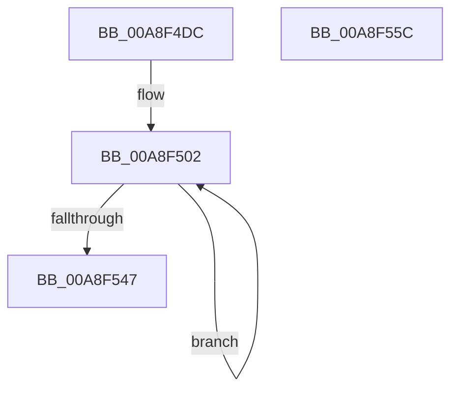

# PnpClearDeviceTemporaryProperties

- RVA: `0x00A8F4DC`–`0x00A8F55D` (길이 `129` bytes)
- VA: `0x0000000140A8F4DC`
- 실행 섹션: `PAGE`
- PDB 이름 있음: `예`; PDB Function 태그: `아니요`
- unwind 정보 RVA: `0x0006F874`
- 디코드: `31`개 명령, `129/129` bytes 표시
- 미해석 바이트: `0` (있으면 어셈블리에 `.byte`로 보존)

> 이 문서는 커널 이미지의 기계어와 PDB 기호를 분석해 생성했습니다. 4번과 5번은 함수 원형과 자료형을 바이너리 사용 방식에서 추정한 C 해석이며 원본 소스 복구 결과는 아닙니다.

## 1. Dependencies

- 직접 호출 지점: **1**; 고유 호출 대상: **1**
- 직접 호출자로 확인된 함수: **2**
- RIP 상대 이미지 참조: **2**

### Outgoing calls
- `0x00A8F538` → [PnpSetObjectProperty](../8F/PnpSetObjectProperty_function_008F66E8.md) (function, `0x008F66E8`)

### Direct callers
- [PiProcessNewDeviceNode](../A2/PiProcessNewDeviceNode_function_00A28F20.md) at `0x00A29701`
- [sub_00B420B0](../B4/Unknown_function_00B420B0.md) at `0x00B42318`

### Static image references
- `0x00A8F4F3` → RVA `0x00009FD0` (`.rdata`; read)
- `0x00A8F526` → RVA `0x00E66398` (`.data`; read)

## 2. Other-region calls and transfers

- 다른 실행 섹션으로 향하는 call: **0**
- 별도 외부 분기/꼬리 이동을 확인하지 못했습니다.

## 3. Assembly (complete function range)

```asm
00A8F4DC  48 89 5C 24 08                  mov qword ptr [rsp + 8], rbx
00A8F4E1  48 89 6C 24 10                  mov qword ptr [rsp + 0x10], rbp
00A8F4E6  48 89 74 24 18                  mov qword ptr [rsp + 0x18], rsi
00A8F4EB  57                              push rdi
00A8F4EC  48 83 EC 50                     sub rsp, 0x50
00A8F4F0  48 8B F2                        mov rsi, rdx
00A8F4F3  48 8D 1D D6 AA 57 FF            lea rbx, [rip - 0xa8552a]
00A8F4FA  48 8B E9                        mov rbp, rcx
00A8F4FD  BF 03 00 00 00                  mov edi, 3
00A8F502  83 64 24 48 00                  and dword ptr [rsp + 0x48], 0
00A8F507  4C 8B CE                        mov r9, rsi
00A8F50A  83 64 24 40 00                  and dword ptr [rsp + 0x40], 0
00A8F50F  41 B8 01 00 00 00               mov r8d, 1
00A8F515  48 83 64 24 38 00               and qword ptr [rsp + 0x38], 0
00A8F51B  48 8B D5                        mov rdx, rbp
00A8F51E  48 8B 03                        mov rax, qword ptr [rbx]
00A8F521  83 64 24 30 00                  and dword ptr [rsp + 0x30], 0
00A8F526  48 8B 0D 6B 6E 3D 00            mov rcx, qword ptr [rip + 0x3d6e6b]
00A8F52D  48 89 44 24 28                  mov qword ptr [rsp + 0x28], rax
00A8F532  48 83 64 24 20 00               and qword ptr [rsp + 0x20], 0
00A8F538  E8 AB 71 E6 FF                  call 0x1408f66e8
00A8F53D  48 8D 5B 08                     lea rbx, [rbx + 8]
00A8F541  48 83 EF 01                     sub rdi, 1
00A8F545  75 BB                           jne 0x140a8f502
00A8F547  48 8B 5C 24 60                  mov rbx, qword ptr [rsp + 0x60]
00A8F54C  48 8B 6C 24 68                  mov rbp, qword ptr [rsp + 0x68]
00A8F551  48 8B 74 24 70                  mov rsi, qword ptr [rsp + 0x70]
00A8F556  48 83 C4 50                     add rsp, 0x50
00A8F55A  5F                              pop rdi
00A8F55B  C3                              ret
00A8F55C  CC                              int3
```

## 4. C-style interpretation (structured pseudocode)

```c
__int64 __fastcall PnpClearDeviceTemporaryProperties(__int64 a1, __int64 a2)
{
    __int64 result;
    __int64 v_rdi;
    __int64 v_rsp;
    unsigned int v_stack_m10;
    unsigned int v_stack_m18;
    unsigned __int64 v_stack_m20;
    unsigned int v_stack_m28;
    unsigned __int64 v_stack_m30;
    unsigned __int64 v_stack_m38;
    unsigned __int64 v_stack_p10;
    unsigned __int64 v_stack_p18;
    unsigned __int64 v_stack_p8;

    v_stack_p8 = v_rbx;
    v_stack_p10 = v_rbp;
    v_stack_p18 = v_rsi;
    v_rsp = (v_rsp) - (80);
loc_00A8F502:
    v_stack_m30 = *(unsigned __int64 *)(v_rip - 11031850);
    result = PnpSetObjectProperty(*(unsigned __int64 *)(v_rip + 4025963), a1, 1, a2);
    v_rdi = (3) - (1);
    if (condition_is_not_equal) goto loc_00A8F502;
    v_rsp = (v_rsp) + (80);
    return result;
}
```

## 5. (Beta) C Style

```c
int64_t PnpClearDeviceTemporaryProperties(int64_t Arg1, int64_t Arg2)
{
    int64_t result;
    int64_t local_rdi;
    int64_t local_rsp;
    uint32_t v_stack_m10;
    uint32_t v_stack_m18;
    uint64_t v_stack_m20;
    uint32_t v_stack_m28;
    uint64_t v_stack_m30;
    uint64_t v_stack_m38;
    uint64_t v_stack_p10;
    uint64_t v_stack_p18;
    uint64_t v_stack_p8;

    v_stack_p8 = local_rbx;
    v_stack_p10 = local_rbp;
    v_stack_p18 = local_rsi;
    local_rsp = (local_rsp) - (80);
loc_00A8F502:
    v_stack_m30 = *(uint64_t *)(v_rip - 0xA8552A);
    result = PnpSetObjectProperty(*(uint64_t *)(v_rip + 0x3D6E6B), Arg1, 1, Arg2);
    local_rdi = (3) - (1);
    if (condition_is_not_equal) goto loc_00A8F502;
    local_rsp = (local_rsp) + (80);
    return result;
}
```

## 6. Execution-region graph

[열기: 2D/3D 그래프와 함수 탐색 컨트롤 패널](../../../control-panel.html?section=page&rva=0x00A8F4DC&view=graph)

- 2D 그래프는 위에서 아래로 흐르고, 3D 그래프는 빈 공간을 드래그해 회전합니다. Shift+드래그는 이동, 휠은 확대·축소, 함수 노드 선택은 대상 보고서 이동입니다.

### Static fallback


