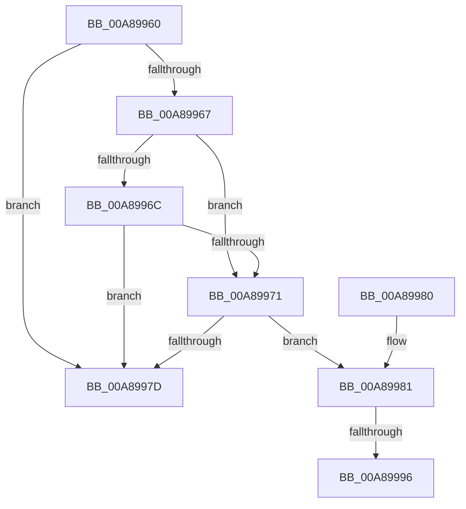

# PnpIsBeingRemovedSafely

- RVA: `0x00A89960`–`0x00A899A2` (길이 `66` bytes)
- VA: `0x0000000140A89960`
- 실행 섹션: `PAGE`
- PDB 이름 있음: `예`; PDB Function 태그: `예`
- unwind 정보 RVA: `0x000DB714`
- 디코드: `18`개 명령, `66/66` bytes 표시
- 미해석 바이트: `0` (있으면 어셈블리에 `.byte`로 보존)

> 이 문서는 커널 이미지의 기계어와 PDB 기호를 분석해 생성했습니다. 4번과 5번은 함수 원형과 자료형을 바이너리 사용 방식에서 추정한 C 해석이며 원본 소스 복구 결과는 아닙니다.

## 1. Dependencies

- 직접 호출 지점: **0**; 고유 호출 대상: **0**
- 직접 호출자로 확인된 함수: **1**
- RIP 상대 이미지 참조: **0**

### Outgoing calls
- 직접 디코드된 call 명령이 없습니다.

### Direct callers
- [PnpBuildUnsafeRemovalDeviceList](PnpBuildUnsafeRemovalDeviceList_function_00A89810.md) at `0x00A89879`
- [PnpBuildUnsafeRemovalDeviceList](PnpBuildUnsafeRemovalDeviceList_function_00A89810.md) at `0x00A89920`

### Static image references
- 디코드된 RIP-relative 메모리 참조가 없습니다.

## 2. Other-region calls and transfers

- 다른 실행 섹션으로 향하는 call: **0**
- call이 아닌 외부 분기/꼬리 이동: **2**
  - `0x00A89990` → `0x00B4586C` (`tail-transfer`)
  - `0x00A8999D` → `0x00B4586C` (`tail-transfer`)

## 3. Assembly (complete function range)

```asm
00A89960  4C 8B C1                        mov r8, rcx
00A89963  85 D2                           test edx, edx
00A89965  74 16                           je 0x140a8997d
00A89967  83 EA 01                        sub edx, 1
00A8996A  74 05                           je 0x140a89971
00A8996C  83 FA 01                        cmp edx, 1
00A8996F  75 0C                           jne 0x140a8997d
00A89971  F7 81 30 02 00 00 00 02 00 00   test dword ptr [rcx + 0x230], 0x200
00A8997B  74 04                           je 0x140a89981
00A8997D  B0 01                           mov al, 1
00A8997F  C3                              ret
00A89980  CC                              int3
00A89981  8B 89 2C 01 00 00               mov ecx, dword ptr [rcx + 0x12c]
00A89987  8D 81 F0 FC FF FF               lea eax, [rcx - 0x310]
00A8998D  83 F8 01                        cmp eax, 1
00A89990  0F 87 D6 BE 0B 00               ja 0x140b4586c
00A89996  41 8B 88 30 01 00 00            mov ecx, dword ptr [r8 + 0x130]
00A8999D  E9 CA BE 0B 00                  jmp 0x140b4586c
```

## 4. C-style interpretation (structured pseudocode)

```c
__int64 __fastcall PnpIsBeingRemovedSafely(__int64 a1, int a2)
{
    if (a2 == 0) goto loc_00A8997D;
    a2 = (unsigned int)((a2) - (1));
    if (condition_is_equal) goto loc_00A89971;
    if (a2 != 1) goto loc_00A8997D;
loc_00A89971:
    if (((*(unsigned int *)(a1 + 560)) & (512)) == 0) goto loc_00A89981;
loc_00A8997D:
    return 1;
loc_00A89981:
}
```

## 5. (Beta) C Style

```c
int64_t PnpIsBeingRemovedSafely(void *Arg1, int32_t Arg2)
{
    uint8_t *arg1 = (uint8_t *)Arg1;

    if (Arg2 == 0) goto loc_00A8997D;
    Arg2 = (uint32_t)((Arg2) - (1));
    if (condition_is_equal) goto loc_00A89971;
    if (Arg2 != 1) goto loc_00A8997D;
loc_00A89971:
    if (((*(uint32_t *)(arg1 + 0x230)) & (512)) == 0) goto loc_00A89981;
loc_00A8997D:
    return 1;
loc_00A89981:
}
```

### 관측된 메모리 오프셋

구조체 형식이 확인되지 않은 접근은 인자 기준의 오프셋으로만 기록했습니다.

| 기준 인자 | 오프셋 표현 | 폭 (bit) | 접근 |
|---|---:|---:|---|
| `Arg1` | `+ 0x12C` | `32` | `R` |
| `Arg1` | `+ 0x130` | `32` | `R` |
| `Arg1` | `+ 0x230` | `32` | `R` |

## 6. Execution-region graph

[열기: 2D/3D 그래프와 함수 탐색 컨트롤 패널](../../../control-panel.html?section=page&rva=0x00A89960&view=graph)

- 2D 그래프는 위에서 아래로 흐르고, 3D 그래프는 빈 공간을 드래그해 회전합니다. Shift+드래그는 이동, 휠은 확대·축소, 함수 노드 선택은 대상 보고서 이동입니다.

### Static fallback


