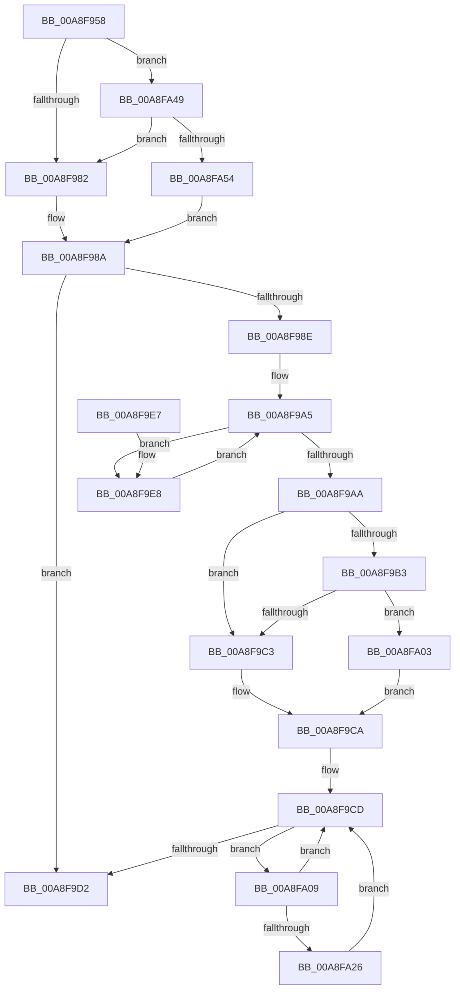

# PnpRequestDeviceRemovalWorker

- RVA: `0x00A8F958`–`0x00A8FA61` (길이 `265` bytes)
- VA: `0x0000000140A8F958`
- 실행 섹션: `PAGE`
- PDB 이름 있음: `예`; PDB Function 태그: `아니요`
- unwind 정보 RVA: `0x000B8C78`
- 디코드: `72`개 명령, `265/265` bytes 표시
- 미해석 바이트: `0` (있으면 어셈블리에 `.byte`로 보존)

> 이 문서는 커널 이미지의 기계어와 PDB 기호를 분석해 생성했습니다. 4번과 5번은 함수 원형과 자료형을 바이너리 사용 방식에서 추정한 C 해석이며 원본 소스 복구 결과는 아닙니다.

## 1. Dependencies

- 직접 호출 지점: **6**; 고유 호출 대상: **5**
- 직접 호출자로 확인된 함수: **2**
- RIP 상대 이미지 참조: **1**

### Outgoing calls
- `0x00A8F985` → [PipDeviceRemovalCheckDeviceNodeState](PipDeviceRemovalCheckDeviceNodeState_function_00A8FA68.md) (function, `0x00A8FA68`)
- `0x00A8F99C` → [PipSetDevNodeState](../../text/47/PipSetDevNodeState_function_00470708.md) (function, `0x00470708`)
- `0x00A8F9F9` → [PnpRequestDeviceRemovalWorker](PnpRequestDeviceRemovalWorker_function_00A8F958.md) (function, `0x00A8F958`)
- `0x00A8FA11` → [PiListEntryToDependencyEdge](../../text/4F/PiListEntryToDependencyEdge_function_004F9648.md) (function, `0x004F9648`)
- `0x00A8FA42` → [PnpRequestDeviceRemovalWorker](PnpRequestDeviceRemovalWorker_function_00A8F958.md) (function, `0x00A8F958`)
- `0x00A8FA57` → [PipIsDevNodeDNStarted](../../text/47/PipIsDevNodeDNStarted_function_00470870.md) (function, `0x00470870`)

### Direct callers
- [PnpRequestDeviceRemoval](../8F/PnpRequestDeviceRemoval_function_008FC294.md) at `0x008FC2D9`
- [PnpRequestDeviceRemovalWorker](PnpRequestDeviceRemovalWorker_function_00A8F958.md) at `0x00A8F9F9`
- [PnpRequestDeviceRemovalWorker](PnpRequestDeviceRemovalWorker_function_00A8F958.md) at `0x00A8FA42`

### Static image references
- `0x00A8F9C3` → RVA `0x00F8CE70` (`.data`; read)

## 2. Other-region calls and transfers

- 다른 실행 섹션으로 향하는 call: **3**
  - `0x00A8F99C` → [PipSetDevNodeState](../../text/47/PipSetDevNodeState_function_00470708.md) (`PAGE` → `.text`)
  - `0x00A8FA11` → [PiListEntryToDependencyEdge](../../text/4F/PiListEntryToDependencyEdge_function_004F9648.md) (`PAGE` → `.text`)
  - `0x00A8FA57` → [PipIsDevNodeDNStarted](../../text/47/PipIsDevNodeDNStarted_function_00470870.md) (`PAGE` → `.text`)
- 별도 외부 분기/꼬리 이동을 확인하지 못했습니다.

## 3. Assembly (complete function range)

```asm
00A8F958  48 89 5C 24 08                  mov qword ptr [rsp + 8], rbx
00A8F95D  48 89 6C 24 10                  mov qword ptr [rsp + 0x10], rbp
00A8F962  48 89 74 24 18                  mov qword ptr [rsp + 0x18], rsi
00A8F967  57                              push rdi
00A8F968  48 83 EC 30                     sub rsp, 0x30
00A8F96C  41 8B F1                        mov esi, r9d
00A8F96F  41 8A F8                        mov dil, r8b
00A8F972  48 8B DA                        mov rbx, rdx
00A8F975  48 8B E9                        mov rbp, rcx
00A8F978  41 83 F9 02                     cmp r9d, 2
00A8F97C  0F 85 C7 00 00 00               jne 0x140a8fa49
00A8F982  48 8B CB                        mov rcx, rbx
00A8F985  E8 DE 00 00 00                  call 0x140a8fa68
00A8F98A  84 C0                           test al, al
00A8F98C  74 44                           je 0x140a8f9d2
00A8F98E  40 F6 DF                        neg dil
00A8F991  48 8B CB                        mov rcx, rbx
00A8F994  1B D2                           sbb edx, edx
00A8F996  81 C2 11 03 00 00               add edx, 0x311
00A8F99C  E8 67 0D 9E FF                  call 0x140470708
00A8F9A1  48 8B 7B 08                     mov rdi, qword ptr [rbx + 8]
00A8F9A5  48 85 FF                        test rdi, rdi
00A8F9A8  75 3E                           jne 0x140a8f9e8
00A8F9AA  48 8B 43 20                     mov rax, qword ptr [rbx + 0x20]
00A8F9AE  48 85 C0                        test rax, rax
00A8F9B1  74 10                           je 0x140a8f9c3
00A8F9B3  48 8B 80 38 01 00 00            mov rax, qword ptr [rax + 0x138]
00A8F9BA  48 8B 58 50                     mov rbx, qword ptr [rax + 0x50]
00A8F9BE  48 85 DB                        test rbx, rbx
00A8F9C1  75 40                           jne 0x140a8fa03
00A8F9C3  48 8D 1D A6 D4 4F 00            lea rbx, [rip + 0x4fd4a6]
00A8F9CA  48 8B 3B                        mov rdi, qword ptr [rbx]
00A8F9CD  48 3B FB                        cmp rdi, rbx
00A8F9D0  75 37                           jne 0x140a8fa09
00A8F9D2  48 8B 5C 24 40                  mov rbx, qword ptr [rsp + 0x40]
00A8F9D7  48 8B 6C 24 48                  mov rbp, qword ptr [rsp + 0x48]
00A8F9DC  48 8B 74 24 50                  mov rsi, qword ptr [rsp + 0x50]
00A8F9E1  48 83 C4 30                     add rsp, 0x30
00A8F9E5  5F                              pop rdi
00A8F9E6  C3                              ret
00A8F9E7  CC                              int3
00A8F9E8  44 8B CE                        mov r9d, esi
00A8F9EB  C6 44 24 20 01                  mov byte ptr [rsp + 0x20], 1
00A8F9F0  41 B0 01                        mov r8b, 1
00A8F9F3  48 8B D7                        mov rdx, rdi
00A8F9F6  48 8B CD                        mov rcx, rbp
00A8F9F9  E8 5A FF FF FF                  call 0x140a8f958
00A8F9FE  48 8B 3F                        mov rdi, qword ptr [rdi]
00A8FA01  EB A2                           jmp 0x140a8f9a5
00A8FA03  48 83 C3 20                     add rbx, 0x20
00A8FA07  EB C1                           jmp 0x140a8f9ca
00A8FA09  BA 01 00 00 00                  mov edx, 1
00A8FA0E  48 8B CF                        mov rcx, rdi
00A8FA11  E8 32 9C A6 FF                  call 0x1404f9648
00A8FA16  48 8B 3F                        mov rdi, qword ptr [rdi]
00A8FA19  48 8B 48 28                     mov rcx, qword ptr [rax + 0x28]
00A8FA1D  48 8B 41 30                     mov rax, qword ptr [rcx + 0x30]
00A8FA21  48 85 C0                        test rax, rax
00A8FA24  74 A7                           je 0x140a8f9cd
00A8FA26  48 8B 80 38 01 00 00            mov rax, qword ptr [rax + 0x138]
00A8FA2D  41 B9 01 00 00 00               mov r9d, 1
00A8FA33  45 33 C0                        xor r8d, r8d
00A8FA36  C6 44 24 20 00                  mov byte ptr [rsp + 0x20], 0
00A8FA3B  48 8B CD                        mov rcx, rbp
00A8FA3E  48 8B 50 28                     mov rdx, qword ptr [rax + 0x28]
00A8FA42  E8 11 FF FF FF                  call 0x140a8f958
00A8FA47  EB 84                           jmp 0x140a8f9cd
00A8FA49  80 7C 24 60 00                  cmp byte ptr [rsp + 0x60], 0
00A8FA4E  0F 85 2E FF FF FF               jne 0x140a8f982
00A8FA54  48 8B CB                        mov rcx, rbx
00A8FA57  E8 14 0E 9E FF                  call 0x140470870
00A8FA5C  E9 29 FF FF FF                  jmp 0x140a8f98a
```

## 4. C-style interpretation (structured pseudocode)

```c
__int64 __fastcall PnpRequestDeviceRemovalWorker(__int64 a1, __int64 a2, unsigned __int8 a3, int a4, unsigned __int8 a5)
{
    __int64 result;
    __int64 v_rbx;
    __int64 v_rdi;
    __int64 v_rsp;
    unsigned __int64 v_stack_p10;
    unsigned __int64 v_stack_p18;
    unsigned __int8 v_stack_p20;
    unsigned __int64 v_stack_p8;

    v_stack_p8 = v_rbx;
    v_stack_p10 = v_rbp;
    v_stack_p18 = v_rsi;
    v_rsp = (v_rsp) - (48);
    if (a4 != 2) goto loc_00A8FA49;
loc_00A8F982:
    result = PipDeviceRemovalCheckDeviceNodeState(a2, a2, a3, a4);
loc_00A8F98A:
    if ((unsigned __int8)(result) == 0) goto loc_00A8F9D2;
    v_rdi = (unsigned __int8)(-(a3));
    a2 = (unsigned int)((a2) + (785));
    result = PipSetDevNodeState(a2, a2, a3, a4);
loc_00A8F9A5:
    if (*(unsigned __int64 *)(a2 + 8) != 0) goto loc_00A8F9E8;
    if (*(unsigned __int64 *)(a2 + 32) == 0) goto loc_00A8F9C3;
    if (*(unsigned __int64 *)(*(unsigned __int64 *)(*(unsigned __int64 *)(a2 + 32) + 312) + 80) != 0) goto loc_00A8FA03;
loc_00A8F9C3:
loc_00A8F9CA:
loc_00A8F9CD:
    if ((*(unsigned __int64 *)(v_rip + 5231782)) != (v_rip + 5231782)) goto loc_00A8FA09;
loc_00A8F9D2:
    v_rsp = (v_rsp) + (48);
    return *(unsigned __int64 *)(*(unsigned __int64 *)(a2 + 32) + 312);
loc_00A8F9E8:
    v_stack_p20 = 1;
    result = PnpRequestDeviceRemovalWorker(v_stack_p10, *(unsigned __int64 *)(v_rip + 5231782), 1, (unsigned int)((unsigned int)(v_stack_p18)));
    goto loc_00A8F9A5;
loc_00A8FA03:
    v_rbx = (v_stack_p8) + (32);
    goto loc_00A8F9CA;
loc_00A8FA09:
    result = PiListEntryToDependencyEdge(*(unsigned __int64 *)(*(unsigned __int64 *)(v_rip + 5231782)), 1, 1, (unsigned int)((unsigned int)(v_stack_p18)));
    if (*(unsigned __int64 *)(*(unsigned __int64 *)(result + 40) + 48) == 0) goto loc_00A8F9CD;
    a3 = 0;
    v_stack_p20 = 0;
    result = PnpRequestDeviceRemovalWorker(v_stack_p10, *(unsigned __int64 *)(*(unsigned __int64 *)(*(unsigned __int64 *)(*(unsigned __int64 *)(result + 40) + 48) + 312) + 40), a3, 1);
    goto loc_00A8F9CD;
loc_00A8FA49:
    if (a5 != 0) goto loc_00A8F982;
    result = PipIsDevNodeDNStarted(v_rbx, *(unsigned __int64 *)(*(unsigned __int64 *)(*(unsigned __int64 *)(*(unsigned __int64 *)(result + 40) + 48) + 312) + 40), a3, 1);
    goto loc_00A8F98A;
}
```

## 5. (Beta) C Style

```c
int64_t PnpRequestDeviceRemovalWorker(int64_t Arg1, void *Arg2, uint8_t Arg3, int32_t Arg4, uint8_t Arg5)
{
    uint8_t *arg2 = (uint8_t *)Arg2;

    int64_t result;
    int64_t local_rbx;
    int64_t local_rdi;
    int64_t local_rsp;
    uint64_t v_stack_p10;
    uint64_t v_stack_p18;
    uint8_t v_stack_p20;
    uint64_t v_stack_p8;

    v_stack_p8 = local_rbx;
    v_stack_p10 = local_rbp;
    v_stack_p18 = local_rsi;
    local_rsp = (local_rsp) - (48);
    if (Arg4 != 2) goto loc_00A8FA49;
loc_00A8F982:
    result = PipDeviceRemovalCheckDeviceNodeState(Arg2, Arg2, Arg3, Arg4);
loc_00A8F98A:
    if ((uint8_t)(result) == 0) goto loc_00A8F9D2;
    local_rdi = (uint8_t)(-(Arg3));
    Arg2 = (uint32_t)((Arg2) + (785));
    result = PipSetDevNodeState(Arg2, Arg2, Arg3, Arg4);
loc_00A8F9A5:
    if (*(uint64_t *)(arg2 + 0x8) != 0) goto loc_00A8F9E8;
    if (*(uint64_t *)(arg2 + 0x20) == 0) goto loc_00A8F9C3;
    if (*(uint64_t *)(*(uint64_t *)(*(uint64_t *)(arg2 + 0x20) + 0x138) + 0x50) != 0) goto loc_00A8FA03;
loc_00A8F9C3:
loc_00A8F9CA:
loc_00A8F9CD:
    if ((*(uint64_t *)(v_rip + 0x4FD4A6)) != (v_rip + 5231782)) goto loc_00A8FA09;
loc_00A8F9D2:
    local_rsp = (local_rsp) + (48);
    return *(uint64_t *)(*(uint64_t *)(arg2 + 0x20) + 0x138);
loc_00A8F9E8:
    v_stack_p20 = 1;
    result = PnpRequestDeviceRemovalWorker(v_stack_p10, *(uint64_t *)(v_rip + 0x4FD4A6), 1, (uint32_t)((uint32_t)(v_stack_p18)));
    goto loc_00A8F9A5;
loc_00A8FA03:
    local_rbx = (v_stack_p8) + (32);
    goto loc_00A8F9CA;
loc_00A8FA09:
    result = PiListEntryToDependencyEdge(*(uint64_t *)(*(uint64_t *)(v_rip + 0x4FD4A6)), 1, 1, (uint32_t)((uint32_t)(v_stack_p18)));
    if (*(uint64_t *)(*(uint64_t *)(result + 0x28) + 0x30) == 0) goto loc_00A8F9CD;
    Arg3 = 0;
    v_stack_p20 = 0;
    result = PnpRequestDeviceRemovalWorker(v_stack_p10, *(uint64_t *)(*(uint64_t *)(*(uint64_t *)(*(uint64_t *)(result + 0x28) + 0x30) + 0x138) + 0x28), Arg3, 1);
    goto loc_00A8F9CD;
loc_00A8FA49:
    if (Arg5 != 0) goto loc_00A8F982;
    result = PipIsDevNodeDNStarted(local_rbx, *(uint64_t *)(*(uint64_t *)(*(uint64_t *)(*(uint64_t *)(result + 0x28) + 0x30) + 0x138) + 0x28), Arg3, 1);
    goto loc_00A8F98A;
}
```

### 관측된 메모리 오프셋

구조체 형식이 확인되지 않은 접근은 인자 기준의 오프셋으로만 기록했습니다.

| 기준 인자 | 오프셋 표현 | 폭 (bit) | 접근 |
|---|---:|---:|---|
| `Arg2` | `+ 0x8` | `64` | `R` |
| `Arg2` | `+ 0x20` | `64` | `R` |

## 6. Execution-region graph

[열기: 2D/3D 그래프와 함수 탐색 컨트롤 패널](../../../control-panel.html?section=page&rva=0x00A8F958&view=graph)

- 2D 그래프는 위에서 아래로 흐르고, 3D 그래프는 빈 공간을 드래그해 회전합니다. Shift+드래그는 이동, 휠은 확대·축소, 함수 노드 선택은 대상 보고서 이동입니다.

### Static fallback


