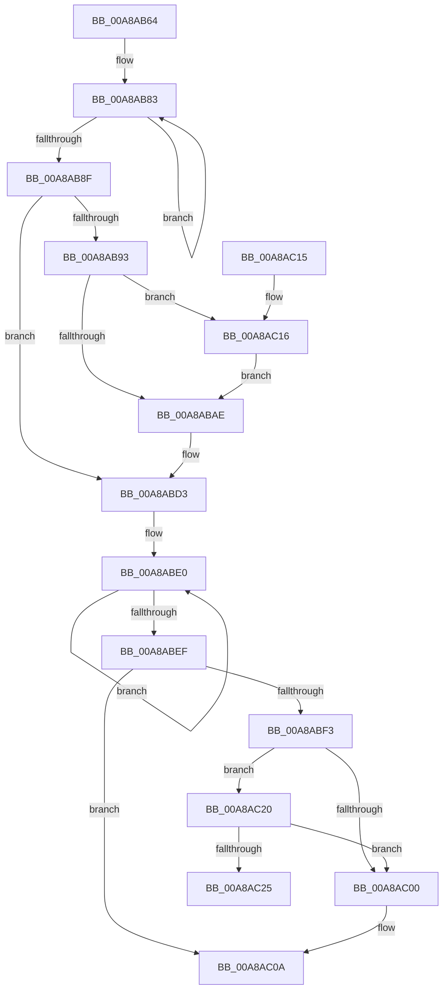

# PoFxAbandonDevice

- RVA: `0x00A8AB64`–`0x00A8AC37` (길이 `211` bytes)
- VA: `0x0000000140A8AB64`
- 실행 섹션: `PAGE`
- PDB 이름 있음: `예`; PDB Function 태그: `예`
- unwind 정보 RVA: `0x00088DA0`
- 디코드: `51`개 명령, `211/211` bytes 표시
- 미해석 바이트: `0` (있으면 어셈블리에 `.byte`로 보존)

> 이 문서는 커널 이미지의 기계어와 PDB 기호를 분석해 생성했습니다. 4번과 5번은 함수 원형과 자료형을 바이너리 사용 방식에서 추정한 C 해석이며 원본 소스 복구 결과는 아닙니다.

## 1. Dependencies

- 직접 호출 지점: **4**; 고유 호출 대상: **4**
- 직접 호출자로 확인된 함수: **2**
- RIP 상대 이미지 참조: **0**

### Outgoing calls
- `0x00A8AB71` → [PopDirectedDripsDiagDestroyDeviceDiagnostic](PopDirectedDripsDiagDestroyDeviceDiagnostic_function_00A8AC40.md) (function, `0x00A8AC40`)
- `0x00A8AB96` → [PopFxUnregisterDeviceOrWait](PopFxUnregisterDeviceOrWait_function_00A8AD00.md) (function, `0x00A8AD00`)
- `0x00A8ABBE` → [PopDiagTraceFxDevicePreparation](PopDiagTraceFxDevicePreparation_function_00A8AD78.md) (function, `0x00A8AD78`)
- `0x00A8AC19` → [PopPluginAbandonDevice](../../text/4E/PopPluginAbandonDevice_function_004E3EAC.md) (function, `0x004E3EAC`)

### Direct callers
- [IopRemoveDevice](../8F/IopRemoveDevice_function_008FC7FC.md) at `0x008FC9AE`
- [PnpDriverLoadingFailed](../AB/PnpDriverLoadingFailed_function_00AB8928.md) at `0x00AB8B3C`

### Static image references
- 디코드된 RIP-relative 메모리 참조가 없습니다.

## 2. Other-region calls and transfers

- 다른 실행 섹션으로 향하는 call: **1**
  - `0x00A8AC19` → [PopPluginAbandonDevice](../../text/4E/PopPluginAbandonDevice_function_004E3EAC.md) (`PAGE` → `.text`)
- call이 아닌 외부 분기/꼬리 이동: **1**
  - `0x00A8AC32` → [sub_00B4604E](../B4/Unknown_function_00B4604E.md) (`tail-transfer`)

## 3. Assembly (complete function range)

```asm
00A8AB64  48 89 5C 24 08                  mov qword ptr [rsp + 8], rbx
00A8AB69  57                              push rdi
00A8AB6A  48 83 EC 20                     sub rsp, 0x20
00A8AB6E  48 8B D9                        mov rbx, rcx
00A8AB71  E8 CA 00 00 00                  call 0x140a8ac40
00A8AB76  0F 0D 8B 28 01 00 00            prefetchw byte ptr [rbx + 0x128]
00A8AB7D  8B 83 28 01 00 00               mov eax, dword ptr [rbx + 0x128]
00A8AB83  8B C8                           mov ecx, eax
00A8AB85  F0 0F B1 8B 28 01 00 00         lock cmpxchg dword ptr [rbx + 0x128], ecx
00A8AB8D  75 F4                           jne 0x140a8ab83
00A8AB8F  A8 01                           test al, 1
00A8AB91  74 40                           je 0x140a8abd3
00A8AB93  48 8B CB                        mov rcx, rbx
00A8AB96  E8 65 01 00 00                  call 0x140a8ad00
00A8AB9B  48 8B 8B 90 00 00 00            mov rcx, qword ptr [rbx + 0x90]
00A8ABA2  48 8D BB 80 00 00 00            lea rdi, [rbx + 0x80]
00A8ABA9  48 85 C9                        test rcx, rcx
00A8ABAC  75 68                           jne 0x140a8ac16
00A8ABAE  48 8B 93 90 00 00 00            mov rdx, qword ptr [rbx + 0x90]
00A8ABB5  45 33 C9                        xor r9d, r9d
00A8ABB8  4C 8B C7                        mov r8, rdi
00A8ABBB  48 8B CB                        mov rcx, rbx
00A8ABBE  E8 B5 01 00 00                  call 0x140a8ad78
00A8ABC3  48 83 A3 90 00 00 00 00         and qword ptr [rbx + 0x90], 0
00A8ABCB  F0 83 A3 28 01 00 00 FE         lock and dword ptr [rbx + 0x128], 0xfffffffe
00A8ABD3  0F 0D 8B 28 01 00 00            prefetchw byte ptr [rbx + 0x128]
00A8ABDA  8B 83 28 01 00 00               mov eax, dword ptr [rbx + 0x128]
00A8ABE0  8B C8                           mov ecx, eax
00A8ABE2  83 E1 FD                        and ecx, 0xfffffffd
00A8ABE5  F0 0F B1 8B 28 01 00 00         lock cmpxchg dword ptr [rbx + 0x128], ecx
00A8ABED  75 F1                           jne 0x140a8abe0
00A8ABEF  A8 02                           test al, 2
00A8ABF1  74 17                           je 0x140a8ac0a
00A8ABF3  48 8B 83 88 00 00 00            mov rax, qword ptr [rbx + 0x88]
00A8ABFA  48 39 43 30                     cmp qword ptr [rbx + 0x30], rax
00A8ABFE  75 20                           jne 0x140a8ac20
00A8AC00  0F 57 C0                        xorps xmm0, xmm0
00A8AC03  0F 11 83 80 00 00 00            movups xmmword ptr [rbx + 0x80], xmm0
00A8AC0A  48 8B 5C 24 30                  mov rbx, qword ptr [rsp + 0x30]
00A8AC0F  48 83 C4 20                     add rsp, 0x20
00A8AC13  5F                              pop rdi
00A8AC14  C3                              ret
00A8AC15  CC                              int3
00A8AC16  48 8B D7                        mov rdx, rdi
00A8AC19  E8 8E 92 A5 FF                  call 0x1404e3eac
00A8AC1E  EB 8E                           jmp 0x140a8abae
00A8AC20  48 85 C0                        test rax, rax
00A8AC23  74 DB                           je 0x140a8ac00
00A8AC25  0F 0D 8B 28 01 00 00            prefetchw byte ptr [rbx + 0x128]
00A8AC2C  8B 83 28 01 00 00               mov eax, dword ptr [rbx + 0x128]
00A8AC32  E9 17 B4 0B 00                  jmp 0x140b4604e
```

## 4. C-style interpretation (structured pseudocode)

```c
__int64 __fastcall PoFxAbandonDevice(__int64 a1, __int64 a2, __int64 a3, int a4)
{
    __int64 result;
    __int64 v_rsp;
    unsigned __int64 v_stack_p8;

    v_stack_p8 = v_rbx;
    v_rsp = (v_rsp) - (32);
    result = PopDirectedDripsDiagDestroyDeviceDiagnostic(a1, a2, a3, a4);
loc_00A8AB83:
    if (condition_is_not_equal) goto loc_00A8AB83;
    if ((((unsigned __int8)((unsigned int)(*(unsigned int *)(a1 + 296)))) & (1)) == 0) goto loc_00A8ABD3;
    result = PopFxUnregisterDeviceOrWait(a1, a2, a3, a4);
    if (*(unsigned __int64 *)(a1 + 144) != 0) goto loc_00A8AC16;
loc_00A8ABAE:
    a4 = 0;
    result = PopDiagTraceFxDevicePreparation(a1, *(unsigned __int64 *)(a1 + 144), a1 + 128, a4);
loc_00A8ABD3:
loc_00A8ABE0:
    a1 = (unsigned int)(((unsigned int)((unsigned int)((unsigned int)(*(unsigned int *)(a1 + 296))))) & (0xFFFFFFFDULL));
    if (condition_is_not_equal) goto loc_00A8ABE0;
    if ((((unsigned __int8)((unsigned int)(*(unsigned int *)(a1 + 296)))) & (2)) == 0) goto loc_00A8AC0A;
    if ((*(unsigned __int64 *)(a1 + 48)) != (*(unsigned __int64 *)(a1 + 136))) goto loc_00A8AC20;
loc_00A8AC00:
    *(unsigned __int64 *)(a1 + 128) = v_xmm0;
loc_00A8AC0A:
    v_rsp = (v_rsp) + (32);
    return *(unsigned __int64 *)(a1 + 136);
loc_00A8AC16:
    result = PopPluginAbandonDevice(a1, a1 + 128, a1 + 128, a4);
    goto loc_00A8ABAE;
loc_00A8AC20:
    if (result == 0) goto loc_00A8AC00;
}
```

## 5. (Beta) C Style

```c
int64_t PoFxAbandonDevice(void *Arg1, int64_t Arg2, int64_t Arg3, int32_t Arg4)
{
    uint8_t *arg1 = (uint8_t *)Arg1;

    int64_t result;
    int64_t local_rsp;
    uint64_t v_stack_p8;

    v_stack_p8 = local_rbx;
    local_rsp = (local_rsp) - (32);
    result = PopDirectedDripsDiagDestroyDeviceDiagnostic(Arg1, Arg2, Arg3, Arg4);
loc_00A8AB83:
    if (condition_is_not_equal) goto loc_00A8AB83;
    if ((((uint8_t)((uint32_t)(*(uint32_t *)(arg1 + 0x128)))) & (1)) == 0) goto loc_00A8ABD3;
    result = PopFxUnregisterDeviceOrWait(Arg1, Arg2, Arg3, Arg4);
    if (*(uint64_t *)(arg1 + 0x90) != 0) goto loc_00A8AC16;
loc_00A8ABAE:
    Arg4 = 0;
    result = PopDiagTraceFxDevicePreparation(Arg1, *(uint64_t *)(arg1 + 0x90), Arg1 + 128, Arg4);
loc_00A8ABD3:
loc_00A8ABE0:
    Arg1 = (uint32_t)(((uint32_t)((uint32_t)((uint32_t)(*(uint32_t *)(arg1 + 0x128))))) & (0xFFFFFFFDULL));
    if (condition_is_not_equal) goto loc_00A8ABE0;
    if ((((uint8_t)((uint32_t)(*(uint32_t *)(arg1 + 0x128)))) & (2)) == 0) goto loc_00A8AC0A;
    if ((*(uint64_t *)(arg1 + 0x30)) != (*(uint64_t *)(arg1 + 0x88))) goto loc_00A8AC20;
loc_00A8AC00:
    *(uint64_t *)(arg1 + 0x80) = v_xmm0;
loc_00A8AC0A:
    local_rsp = (local_rsp) + (32);
    return *(uint64_t *)(arg1 + 0x88);
loc_00A8AC16:
    result = PopPluginAbandonDevice(Arg1, Arg1 + 128, Arg1 + 128, Arg4);
    goto loc_00A8ABAE;
loc_00A8AC20:
    if (result == 0) goto loc_00A8AC00;
}
```

### 관측된 메모리 오프셋

구조체 형식이 확인되지 않은 접근은 인자 기준의 오프셋으로만 기록했습니다.

| 기준 인자 | 오프셋 표현 | 폭 (bit) | 접근 |
|---|---:|---:|---|
| `Arg1` | `+ 0x30` | `64` | `R` |
| `Arg1` | `+ 0x80` | `64` | `R` |
| `Arg1` | `+ 0x80` | `128` | `R` |
| `Arg1` | `+ 0x88` | `64` | `R` |
| `Arg1` | `+ 0x90` | `64` | `R` |
| `Arg1` | `+ 0x90` | `64` | `R/W` |
| `Arg1` | `+ 0x128` | `8` | `R` |
| `Arg1` | `+ 0x128` | `32` | `R` |
| `Arg1` | `+ 0x128` | `32` | `R/W` |

## 6. Execution-region graph

[열기: 2D/3D 그래프와 함수 탐색 컨트롤 패널](../../../control-panel.html?section=page&rva=0x00A8AB64&view=graph)

- 2D 그래프는 위에서 아래로 흐르고, 3D 그래프는 빈 공간을 드래그해 회전합니다. Shift+드래그는 이동, 휠은 확대·축소, 함수 노드 선택은 대상 보고서 이동입니다.

### Static fallback


