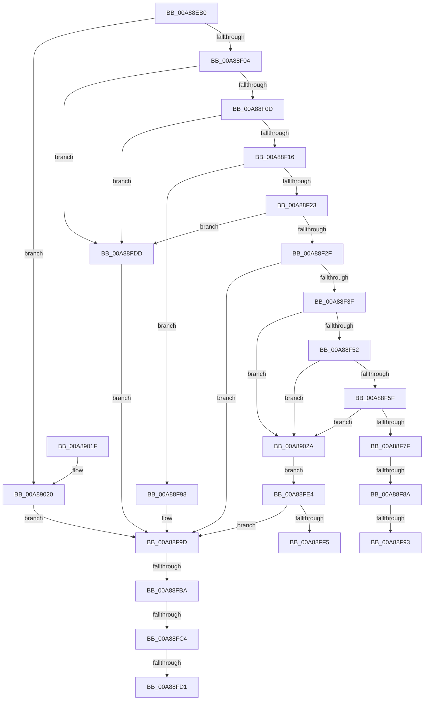

# PoFxSetTargetDripsDevicePowerState

- RVA: `0x00A88EB0`–`0x00A89031` (길이 `385` bytes)
- VA: `0x0000000140A88EB0`
- 실행 섹션: `PAGE`
- PDB 이름 있음: `예`; PDB Function 태그: `예`
- unwind 정보 RVA: `0x000B8198`
- 디코드: `98`개 명령, `385/385` bytes 표시
- 미해석 바이트: `0` (있으면 어셈블리에 `.byte`로 보존)

> 이 문서는 커널 이미지의 기계어와 PDB 기호를 분석해 생성했습니다. 4번과 5번은 함수 원형과 자료형을 바이너리 사용 방식에서 추정한 C 해석이며 원본 소스 복구 결과는 아닙니다.

## 1. Dependencies

- 직접 호출 지점: **5**; 고유 호출 대상: **5**
- 직접 호출자로 확인된 함수: **0**
- RIP 상대 이미지 참조: **4**

### Outgoing calls
- `0x00A88F34` → [PopFxTryReferenceDevice](../../text/2C/PopFxTryReferenceDevice_function_002C0628.md) (function, `0x002C0628`)
- `0x00A88F72` → [PopPepGetMinimumDevicePowerState](../../text/4A/PopPepGetMinimumDevicePowerState_function_004ABE50.md) (function, `0x004ABE50`)
- `0x00A88FA8` → [RtlInitUnicodeString](../../text/42/RtlInitUnicodeString_function_0042A780.md) (function, `0x0042A780`)
- `0x00A88FEC` → [PopFxDereferenceDevice](../../text/27/PopFxDereferenceDevice_function_0027038C.md) (function, `0x0027038C`)
- `0x00A88FFE` → [_security_check_cookie](../../text/6A/_security_check_cookie_function_006AC640.md) (function, `0x006AC640`)

### Direct callers
- 이 함수 시작 RVA로 연결되는 직접 call은 확인되지 않았습니다. 간접 호출은 완전히 역산할 수 없습니다.

### Static image references
- `0x00A88ECE` → RVA `0x00E0A740` (`.data`; read)
- `0x00A88EDC` → RVA `0x00E676AC` (`.data`; read)
- `0x00A88F16` → RVA `0x00E27EC0` (`.data`; read)
- `0x00A88F9D` → RVA `0x00AFCAD0` (` ?? ::NNGAKEGL::`string'`; read)

## 2. Other-region calls and transfers

- 다른 실행 섹션으로 향하는 call: **5**
  - `0x00A88F34` → [PopFxTryReferenceDevice](../../text/2C/PopFxTryReferenceDevice_function_002C0628.md) (`PAGE` → `.text`)
  - `0x00A88F72` → [PopPepGetMinimumDevicePowerState](../../text/4A/PopPepGetMinimumDevicePowerState_function_004ABE50.md) (`PAGE` → `.text`)
  - `0x00A88FA8` → [RtlInitUnicodeString](../../text/42/RtlInitUnicodeString_function_0042A780.md) (`PAGE` → `.text`)
  - `0x00A88FEC` → [PopFxDereferenceDevice](../../text/27/PopFxDereferenceDevice_function_0027038C.md) (`PAGE` → `.text`)
  - `0x00A88FFE` → [_security_check_cookie](../../text/6A/_security_check_cookie_function_006AC640.md) (`PAGE` → `.text`)
- call이 아닌 외부 분기/꼬리 이동: **7**
  - `0x00A88F84` → [sub_00B451A2 + 0x8](../B4/Unknown_function_00B451A2.md) (`tail-transfer`)
  - `0x00A88F8D` → [sub_00B451A2](../B4/Unknown_function_00B451A2.md) (`tail-transfer`)
  - `0x00A88F93` → [sub_00B451A2 + 0x8](../B4/Unknown_function_00B451A2.md) (`tail-transfer`)
  - `0x00A88FB4` → [sub_00B451A2 + 0x73](../B4/Unknown_function_00B451A2.md) (`tail-transfer`)
  - `0x00A88FBE` → [sub_00B451A2 + 0x73](../B4/Unknown_function_00B451A2.md) (`tail-transfer`)
  - `0x00A88FCB` → [sub_00B451A2 + 0x73](../B4/Unknown_function_00B451A2.md) (`tail-transfer`)
  - `0x00A88FD8` → [sub_00B451A2 + 0x73](../B4/Unknown_function_00B451A2.md) (`tail-transfer`)

## 3. Assembly (complete function range)

```asm
00A88EB0  48 89 5C 24 10                  mov qword ptr [rsp + 0x10], rbx
00A88EB5  48 89 74 24 18                  mov qword ptr [rsp + 0x18], rsi
00A88EBA  55                              push rbp
00A88EBB  57                              push rdi
00A88EBC  41 54                           push r12
00A88EBE  41 56                           push r14
00A88EC0  41 57                           push r15
00A88EC2  48 8D 6C 24 C9                  lea rbp, [rsp - 0x37]
00A88EC7  48 81 EC E0 00 00 00            sub rsp, 0xe0
00A88ECE  48 8B 05 6B 18 38 00            mov rax, qword ptr [rip + 0x38186b]
00A88ED5  48 33 C4                        xor rax, rsp
00A88ED8  48 89 45 27                     mov qword ptr [rbp + 0x27], rax
00A88EDC  8B 05 CA E7 3D 00               mov eax, dword ptr [rip + 0x3de7ca]
00A88EE2  45 33 E4                        xor r12d, r12d
00A88EE5  44 89 65 87                     mov dword ptr [rbp - 0x79], r12d
00A88EE9  0F 57 C0                        xorps xmm0, xmm0
00A88EEC  44 89 65 8B                     mov dword ptr [rbp - 0x75], r12d
00A88EF0  8B F2                           mov esi, edx
00A88EF2  48 8B F9                        mov rdi, rcx
00A88EF5  45 8B F4                        mov r14d, r12d
00A88EF8  0F 11 45 9F                     movups xmmword ptr [rbp - 0x61], xmm0
00A88EFC  85 C0                           test eax, eax
00A88EFE  0F 84 1C 01 00 00               je 0x140a89020
00A88F04  83 FA 01                        cmp edx, 1
00A88F07  0F 84 D0 00 00 00               je 0x140a88fdd
00A88F0D  83 FA 04                        cmp edx, 4
00A88F10  0F 8F C7 00 00 00               jg 0x140a88fdd
00A88F16  44 8B 3D A3 EF 39 00            mov r15d, dword ptr [rip + 0x39efa3]
00A88F1D  41 83 FF FF                     cmp r15d, -1
00A88F21  74 75                           je 0x140a88f98
00A88F23  4C 8B F1                        mov r14, rcx
00A88F26  48 85 C9                        test rcx, rcx
00A88F29  0F 84 AE 00 00 00               je 0x140a88fdd
00A88F2F  41 8D 54 24 02                  lea edx, [r12 + 2]
00A88F34  E8 EF 76 83 FF                  call 0x1402c0628
00A88F39  8B D8                           mov ebx, eax
00A88F3B  85 C0                           test eax, eax
00A88F3D  78 5E                           js 0x140a88f9d
00A88F3F  33 C0                           xor eax, eax
00A88F41  F0 44 0F B1 A7 60 03 00 00      lock cmpxchg dword ptr [rdi + 0x360], r12d
00A88F4A  A8 10                           test al, 0x10
00A88F4C  0F 84 D8 00 00 00               je 0x140a8902a
00A88F52  49 8B 4E 38                     mov rcx, qword ptr [r14 + 0x38]
00A88F56  48 85 C9                        test rcx, rcx
00A88F59  0F 84 CB 00 00 00               je 0x140a8902a
00A88F5F  48 8D 45 8B                     lea rax, [rbp - 0x75]
00A88F63  41 B0 01                        mov r8b, 1
00A88F66  4C 8D 4D 87                     lea r9, [rbp - 0x79]
00A88F6A  48 89 44 24 20                  mov qword ptr [rsp + 0x20], rax
00A88F6F  41 8B D7                        mov edx, r15d
00A88F72  E8 D9 2E A2 FF                  call 0x1404abe50
00A88F77  84 C0                           test al, al
00A88F79  0F 84 AB 00 00 00               je 0x140a8902a
00A88F7F  8B 45 8B                        mov eax, dword ptr [rbp - 0x75]
00A88F82  85 F6                           test esi, esi
00A88F84  0F 85 20 C2 0B 00               jne 0x140b451aa
00A88F8A  39 45 87                        cmp dword ptr [rbp - 0x79], eax
00A88F8D  0F 84 0F C2 0B 00               je 0x140b451a2
00A88F93  E9 12 C2 0B 00                  jmp 0x140b451aa
00A88F98  BB 01 00 00 C0                  mov ebx, 0xc0000001
00A88F9D  48 8D 15 2C 3B 07 00            lea rdx, [rip + 0x73b2c]
00A88FA4  48 8D 4D 9F                     lea rcx, [rbp - 0x61]
00A88FA8  E8 D3 17 9A FF                  call 0x14042a780
00A88FAD  4C 8D 45 9F                     lea r8, [rbp - 0x61]
00A88FB1  4D 85 F6                        test r14, r14
00A88FB4  0F 84 5B C2 0B 00               je 0x140b45215
00A88FBA  4D 39 66 30                     cmp qword ptr [r14 + 0x30], r12
00A88FBE  0F 84 51 C2 0B 00               je 0x140b45215
00A88FC4  4D 39 A6 D8 04 00 00            cmp qword ptr [r14 + 0x4d8], r12
00A88FCB  0F 84 44 C2 0B 00               je 0x140b45215
00A88FD1  4D 8D 86 D0 04 00 00            lea r8, [r14 + 0x4d0]
00A88FD8  E9 38 C2 0B 00                  jmp 0x140b45215
00A88FDD  BB 0D 00 00 C0                  mov ebx, 0xc000000d
00A88FE2  EB B9                           jmp 0x140a88f9d
00A88FE4  BA 02 00 00 00                  mov edx, 2
00A88FE9  48 8B CF                        mov rcx, rdi
00A88FEC  E8 9B 73 7E FF                  call 0x14027038c
00A88FF1  85 DB                           test ebx, ebx
00A88FF3  78 A8                           js 0x140a88f9d
00A88FF5  8B C3                           mov eax, ebx
00A88FF7  48 8B 4D 27                     mov rcx, qword ptr [rbp + 0x27]
00A88FFB  48 33 CC                        xor rcx, rsp
00A88FFE  E8 3D 36 C2 FF                  call 0x1406ac640
00A89003  4C 8D 9C 24 E0 00 00 00         lea r11, [rsp + 0xe0]
00A8900B  49 8B 5B 38                     mov rbx, qword ptr [r11 + 0x38]
00A8900F  49 8B 73 40                     mov rsi, qword ptr [r11 + 0x40]
00A89013  49 8B E3                        mov rsp, r11
00A89016  41 5F                           pop r15
00A89018  41 5E                           pop r14
00A8901A  41 5C                           pop r12
00A8901C  5F                              pop rdi
00A8901D  5D                              pop rbp
00A8901E  C3                              ret
00A8901F  CC                              int3
00A89020  BB BB 00 00 C0                  mov ebx, 0xc00000bb
00A89025  E9 73 FF FF FF                  jmp 0x140a88f9d
00A8902A  BB 01 00 00 C0                  mov ebx, 0xc0000001
00A8902F  EB B3                           jmp 0x140a88fe4
```

## 4. C-style interpretation (structured pseudocode)

```c
__int64 __fastcall PoFxSetTargetDripsDevicePowerState(__int64 a1, int a2)
{
    __int64 result;
    __int64 v_r12;
    __int64 v_rsp;
    unsigned __int64 v_stack_m28;
    unsigned __int64 v_stack_m38;
    unsigned __int64 v_stack_m5F;
    unsigned __int64 v_stack_mC0;
    unsigned int v_stack_mD4;
    unsigned int v_stack_mD8;
    unsigned __int64 v_stack_mE8;
    unsigned __int64 v_stack_p10;
    unsigned __int64 v_stack_p18;

    v_stack_p10 = v_rbx;
    v_stack_p18 = v_rsi;
    v_rsp = (v_rsp) - (224);
    result = (*(unsigned __int64 *)(v_rip + 3676267)) ^ (v_rsp);
    v_stack_m38 = result;
    v_r12 = 0;
    v_stack_mD8 = 0;
    v_stack_mD4 = 0;
    v_stack_mC0 = v_xmm0;
    if ((unsigned int)((unsigned int)(*(unsigned int *)(v_rip + 4057034))) == 0) goto loc_00A89020;
    if (a2 == 1) goto loc_00A88FDD;
    if (a2 > 4) goto loc_00A88FDD;
    if (((unsigned int)((unsigned int)(*(unsigned int *)(v_rip + 3796899)))) == -1) goto loc_00A88F98;
    if (a1 == 0) goto loc_00A88FDD;
    result = PopFxTryReferenceDevice(a1, v_r12 + 2, a3, a4);
    if (sign_flag) goto loc_00A88F9D;
    result = 0;
    if (((0) & (16)) == 0) goto loc_00A8902A;
    if (*(unsigned __int64 *)(a1 + 56) == 0) goto loc_00A8902A;
    v_stack_mE8 = v_stack_mD4;
    result = PopPepGetMinimumDevicePowerState(*(unsigned __int64 *)(a1 + 56), (unsigned int)((unsigned int)((unsigned int)(*(unsigned int *)(v_rip + 3796899)))), 1, v_stack_mD8);
    if ((unsigned __int8)(result) == 0) goto loc_00A8902A;
loc_00A88F98:
loc_00A88F9D:
    result = RtlInitUnicodeString(v_stack_mC0, v_rip + 473900, 1, v_stack_mD8);
loc_00A88FDD:
    goto loc_00A88F9D;
loc_00A88FE4:
    result = PopFxDereferenceDevice(a1, 2, a1 + 1232, v_stack_mD8);
    if (sign_flag) goto loc_00A88F9D;
    a1 = (v_stack_m38) ^ (v_rsp);
    result = _security_check_cookie(a1, 2, a1 + 1232, v_stack_mD8);
    return result;
loc_00A89020:
    goto loc_00A88F9D;
loc_00A8902A:
    goto loc_00A88FE4;
}
```

## 5. (Beta) C Style

```c
int64_t PoFxSetTargetDripsDevicePowerState(void *Arg1, int32_t Arg2)
{
    uint8_t *arg1 = (uint8_t *)Arg1;

    int64_t result;
    int64_t local_r12;
    int64_t local_rsp;
    uint64_t v_stack_m28;
    uint64_t v_stack_m38;
    uint64_t v_stack_m5F;
    uint64_t v_stack_mC0;
    uint32_t v_stack_mD4;
    uint32_t v_stack_mD8;
    uint64_t v_stack_mE8;
    uint64_t v_stack_p10;
    uint64_t v_stack_p18;

    v_stack_p10 = local_rbx;
    v_stack_p18 = local_rsi;
    local_rsp = (local_rsp) - (224);
    result = (*(uint64_t *)(v_rip + 0x38186B)) ^ (local_rsp);
    v_stack_m38 = result;
    local_r12 = 0;
    v_stack_mD8 = 0;
    v_stack_mD4 = 0;
    v_stack_mC0 = v_xmm0;
    if ((uint32_t)((uint32_t)(*(uint32_t *)(v_rip + 0x3DE7CA))) == 0) goto loc_00A89020;
    if (Arg2 == 1) goto loc_00A88FDD;
    if (Arg2 > 4) goto loc_00A88FDD;
    if (((uint32_t)((uint32_t)(*(uint32_t *)(v_rip + 0x39EFA3)))) == -1) goto loc_00A88F98;
    if (Arg1 == NULL) goto loc_00A88FDD;
    result = PopFxTryReferenceDevice(Arg1, local_r12 + 2, a3, a4);
    if (sign_flag) goto loc_00A88F9D;
    result = 0;
    if (((0) & (16)) == 0) goto loc_00A8902A;
    if (*(uint64_t *)(arg1 + 0x38) == 0) goto loc_00A8902A;
    v_stack_mE8 = v_stack_mD4;
    result = PopPepGetMinimumDevicePowerState(*(uint64_t *)(arg1 + 0x38), (uint32_t)((uint32_t)((uint32_t)(*(uint32_t *)(v_rip + 0x39EFA3)))), 1, v_stack_mD8);
    if ((uint8_t)(result) == 0) goto loc_00A8902A;
loc_00A88F98:
loc_00A88F9D:
    result = RtlInitUnicodeString(v_stack_mC0, v_rip + 473900, 1, v_stack_mD8);
loc_00A88FDD:
    goto loc_00A88F9D;
loc_00A88FE4:
    result = PopFxDereferenceDevice(Arg1, 2, Arg1 + 1232, v_stack_mD8);
    if (sign_flag) goto loc_00A88F9D;
    Arg1 = (v_stack_m38) ^ (local_rsp);
    result = _security_check_cookie(Arg1, 2, Arg1 + 1232, v_stack_mD8);
    return result;
loc_00A89020:
    goto loc_00A88F9D;
loc_00A8902A:
    goto loc_00A88FE4;
}
```

### 관측된 메모리 오프셋

구조체 형식이 확인되지 않은 접근은 인자 기준의 오프셋으로만 기록했습니다.

| 기준 인자 | 오프셋 표현 | 폭 (bit) | 접근 |
|---|---:|---:|---|
| `Arg1` | `+ 0x38` | `64` | `R` |
| `Arg1` | `+ 0x360` | `32` | `R` |

## 6. Execution-region graph

[열기: 2D/3D 그래프와 함수 탐색 컨트롤 패널](../../../control-panel.html?section=page&rva=0x00A88EB0&view=graph)

- 2D 그래프는 위에서 아래로 흐르고, 3D 그래프는 빈 공간을 드래그해 회전합니다. Shift+드래그는 이동, 휠은 확대·축소, 함수 노드 선택은 대상 보고서 이동입니다.

### Static fallback


