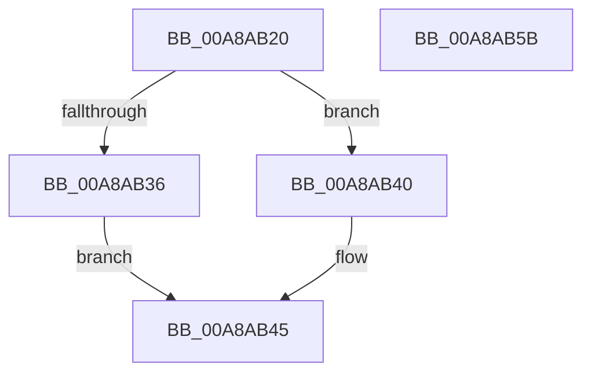

# PoFxUnregisterDevice

- RVA: `0x00A8AB20`–`0x00A8AB5C` (길이 `60` bytes)
- VA: `0x0000000140A8AB20`
- 실행 섹션: `PAGE`
- PDB 이름 있음: `예`; PDB Function 태그: `아니요`
- unwind 정보 RVA: `0x0005CAAC`
- 디코드: `19`개 명령, `60/60` bytes 표시
- 미해석 바이트: `0` (있으면 어셈블리에 `.byte`로 보존)

> 이 문서는 커널 이미지의 기계어와 PDB 기호를 분석해 생성했습니다. 4번과 5번은 함수 원형과 자료형을 바이너리 사용 방식에서 추정한 C 해석이며 원본 소스 복구 결과는 아닙니다.

## 1. Dependencies

- 직접 호출 지점: **3**; 고유 호출 대상: **3**
- 직접 호출자로 확인된 함수: **1**
- RIP 상대 이미지 참조: **0**

### Outgoing calls
- `0x00A8AB39` → [PopFxUnregisterDeviceOrWait](PopFxUnregisterDeviceOrWait_function_00A8AD00.md) (function, `0x00A8AD00`)
- `0x00A8AB40` → [PopFxUnregisterDevice](PopFxUnregisterDevice_function_00A8AE84.md) (function, `0x00A8AE84`)
- `0x00A8AB4B` → [PopFxDestroyDeviceDpm](../../text/4E/PopFxDestroyDeviceDpm_function_004E394C.md) (function, `0x004E394C`)

### Direct callers
- [DifPoFxUnregisterDeviceWrapper](../../text/63/DifPoFxUnregisterDeviceWrapper_function_0063A2B0.md) at `0x0063A376`

### Static image references
- 디코드된 RIP-relative 메모리 참조가 없습니다.

## 2. Other-region calls and transfers

- 다른 실행 섹션으로 향하는 call: **1**
  - `0x00A8AB4B` → [PopFxDestroyDeviceDpm](../../text/4E/PopFxDestroyDeviceDpm_function_004E394C.md) (`PAGE` → `.text`)
- 별도 외부 분기/꼬리 이동을 확인하지 못했습니다.

## 3. Assembly (complete function range)

```asm
00A8AB20  48 89 5C 24 08                  mov qword ptr [rsp + 8], rbx
00A8AB25  57                              push rdi
00A8AB26  48 83 EC 20                     sub rsp, 0x20
00A8AB2A  48 8B 79 30                     mov rdi, qword ptr [rcx + 0x30]
00A8AB2E  48 8B D9                        mov rbx, rcx
00A8AB31  48 85 FF                        test rdi, rdi
00A8AB34  74 0A                           je 0x140a8ab40
00A8AB36  48 8B CF                        mov rcx, rdi
00A8AB39  E8 C2 01 00 00                  call 0x140a8ad00
00A8AB3E  EB 05                           jmp 0x140a8ab45
00A8AB40  E8 3F 03 00 00                  call 0x140a8ae84
00A8AB45  48 8B D3                        mov rdx, rbx
00A8AB48  48 8B CF                        mov rcx, rdi
00A8AB4B  E8 FC 8D A5 FF                  call 0x1404e394c
00A8AB50  48 8B 5C 24 30                  mov rbx, qword ptr [rsp + 0x30]
00A8AB55  48 83 C4 20                     add rsp, 0x20
00A8AB59  5F                              pop rdi
00A8AB5A  C3                              ret
00A8AB5B  CC                              int3
```

## 4. C-style interpretation (structured pseudocode)

```c
__int64 __fastcall PoFxUnregisterDevice(__int64 a1)
{
    __int64 result;
    __int64 v_rsp;
    unsigned __int64 v_stack_p8;

    v_stack_p8 = v_rbx;
    v_rsp = (v_rsp) - (32);
    if (*(unsigned __int64 *)(a1 + 48) == 0) goto loc_00A8AB40;
    result = PopFxUnregisterDeviceOrWait(*(unsigned __int64 *)(a1 + 48), a2, a3, a4);
    goto loc_00A8AB45;
loc_00A8AB40:
    result = PopFxUnregisterDevice(*(unsigned __int64 *)(a1 + 48), a2, a3, a4);
loc_00A8AB45:
    result = PopFxDestroyDeviceDpm(*(unsigned __int64 *)(a1 + 48), a1, a3, a4);
    v_rsp = (v_rsp) + (32);
    return result;
}
```

## 5. (Beta) C Style

```c
int64_t PoFxUnregisterDevice(void *Arg1)
{
    uint8_t *arg1 = (uint8_t *)Arg1;

    int64_t result;
    int64_t local_rsp;
    uint64_t v_stack_p8;

    v_stack_p8 = local_rbx;
    local_rsp = (local_rsp) - (32);
    if (*(uint64_t *)(arg1 + 0x30) == 0) goto loc_00A8AB40;
    result = PopFxUnregisterDeviceOrWait(*(uint64_t *)(arg1 + 0x30), a2, a3, a4);
    goto loc_00A8AB45;
loc_00A8AB40:
    result = PopFxUnregisterDevice(*(uint64_t *)(arg1 + 0x30), a2, a3, a4);
loc_00A8AB45:
    result = PopFxDestroyDeviceDpm(*(uint64_t *)(arg1 + 0x30), Arg1, a3, a4);
    local_rsp = (local_rsp) + (32);
    return result;
}
```

### 관측된 메모리 오프셋

구조체 형식이 확인되지 않은 접근은 인자 기준의 오프셋으로만 기록했습니다.

| 기준 인자 | 오프셋 표현 | 폭 (bit) | 접근 |
|---|---:|---:|---|
| `Arg1` | `+ 0x30` | `64` | `R` |

## 6. Execution-region graph

[열기: 2D/3D 그래프와 함수 탐색 컨트롤 패널](../../../control-panel.html?section=page&rva=0x00A8AB20&view=graph)

- 2D 그래프는 위에서 아래로 흐르고, 3D 그래프는 빈 공간을 드래그해 회전합니다. Shift+드래그는 이동, 휠은 확대·축소, 함수 노드 선택은 대상 보고서 이동입니다.

### Static fallback


