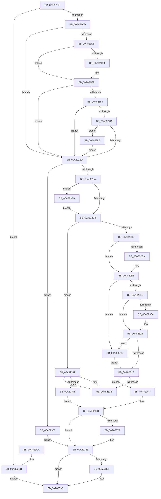

# PoRegisterPowerSettingCallback

- RVA: `0x00A82150`–`0x00A8240E` (길이 `702` bytes)
- VA: `0x0000000140A82150`
- 실행 섹션: `PAGE`
- PDB 이름 있음: `예`; PDB Function 태그: `아니요`
- unwind 정보 RVA: `0x000B7250`
- 디코드: `170`개 명령, `702/702` bytes 표시
- 미해석 바이트: `0` (있으면 어셈블리에 `.byte`로 보존)

> 이 문서는 커널 이미지의 기계어와 PDB 기호를 분석해 생성했습니다. 4번과 5번은 함수 원형과 자료형을 바이너리 사용 방식에서 추정한 C 해석이며 원본 소스 복구 결과는 아닙니다.

## 1. Dependencies

- 직접 호출 지점: **11**; 고유 호출 대상: **11**
- 직접 호출자로 확인된 함수: **13**
- RIP 상대 이미지 참조: **15**

### Outgoing calls
- `0x00A821C0` → [PopStateIsSessionSpecific](../91/PopStateIsSessionSpecific_function_0091529C.md) (function, `0x0091529C`)
- `0x00A82208` → [memset](../../text/6C/memset_function_006C6C40.md) (function, `0x006C6C40`)
- `0x00A82224` → [RtlPcToFileName](../../text/3F/RtlPcToFileName_function_003FEBB0.md) (function, `0x003FEBB0`)
- `0x00A82260` → [EmClientRuleEvaluate](../../pagelk/B7/EmClientRuleEvaluate_function_00B77E90.md) (function, `0x00B77E90`)
- `0x00A82274` → [ExAcquireFastMutex](../../text/20/ExAcquireFastMutex_function_0020E5A0.md) (function, `0x0020E5A0`)
- `0x00A82289` → [ExAllocatePool2](../../poolcode/B8/ExAllocatePool2_function_00B820F0.md) (function, `0x00B820F0`)
- `0x00A822D1` → [PopFindPowerSettingConfiguration](../91/PopFindPowerSettingConfiguration_function_009152E0.md) (function, `0x009152E0`)
- `0x00A8238A` → [ExReleaseFastMutex](../../text/25/ExReleaseFastMutex_function_002519C0.md) (function, `0x002519C0`)
- `0x00A82399` → [PopSetNotificationWork](../../text/48/PopSetNotificationWork_function_00482C78.md) (function, `0x00482C78`)
- `0x00A823AA` → [_security_check_cookie](../../text/6A/_security_check_cookie_function_006AC640.md) (function, `0x006AC640`)
- `0x00A823ED` → [PopEnsureErratumSubscribed](../../text/5D/PopEnsureErratumSubscribed_function_005D46A0.md) (function, `0x005D46A0`)

### Direct callers
- [HvlPhase2Initialize](../../text/58/HvlPhase2Initialize_function_00583EA0.md) at `0x00584151`
- [PopIdleInitAoAcDozeS4Timer](../76/PopIdleInitAoAcDozeS4Timer_function_0076886C.md) at `0x007688DB`
- [PopAdaptiveStandbyInitialize](../76/PopAdaptiveStandbyInitialize_function_0076DDF8.md) at `0x0076DFDF`
- [SSHSupportRegisterPowerSettingCallback](../77/SSHSupportRegisterPowerSettingCallback_function_007749F8.md) at `0x00774A1B`
- [CmpInitializeLazyWriters](../7E/CmpInitializeLazyWriters_function_007EEF34.md) at `0x007EF02E`
- [PopSetPowerSettingValue](../91/PopSetPowerSettingValue_function_00914E54.md) at `0x00915261`
- [TtmInitCurrentSession](../98/TtmInitCurrentSession_function_0098AA18.md) at `0x0098ABDC`
- [TtmInitCurrentSession](../98/TtmInitCurrentSession_function_0098AA18.md) at `0x0098AC08`
- [VslRegisterIumPowerCallbacks](../../init/C2/VslRegisterIumPowerCallbacks_function_00C29DF0.md) at `0x00C29E70`
- [VslRegisterIumPowerCallbacks](../../init/C2/VslRegisterIumPowerCallbacks_function_00C29DF0.md) at `0x00C29E8E`
- [PopInitializePowerSettingCallbacks](../../init/C3/PopInitializePowerSettingCallbacks_function_00C3E6E8.md) at `0x00C3E71B`
- [PopInitializePowerSettingCallbacks](../../init/C3/PopInitializePowerSettingCallbacks_function_00C3E6E8.md) at `0x00C3E755`
- [PopInitializePowerSettingCallbacks](../../init/C3/PopInitializePowerSettingCallbacks_function_00C3E6E8.md) at `0x00C3E774`
- [PopInitializePowerSettingCallbacks](../../init/C3/PopInitializePowerSettingCallbacks_function_00C3E6E8.md) at `0x00C3E793`
- [PpmInfoRegisterCallbacks](../../init/C4/PpmInfoRegisterCallbacks_function_00C40664.md) at `0x00C406BE`
- [PpmInfoRegisterCallbacks](../../init/C4/PpmInfoRegisterCallbacks_function_00C40664.md) at `0x00C406DA`
- [PopEsInit](../../init/C4/PopEsInit_function_00C42F24.md) at `0x00C42FAE`
- [PopEsInit](../../init/C4/PopEsInit_function_00C42F24.md) at `0x00C42FCC`
- [PopModernStandbyNotificationInit](../../init/C4/PopModernStandbyNotificationInit_function_00C43948.md) at `0x00C43987`
- [PopModernStandbyNotificationInit](../../init/C4/PopModernStandbyNotificationInit_function_00C43948.md) at `0x00C439AF`
- [PopModernStandbyNotificationInit](../../init/C4/PopModernStandbyNotificationInit_function_00C43948.md) at `0x00C439D7`
- [PopModernStandbyNotificationInit](../../init/C4/PopModernStandbyNotificationInit_function_00C43948.md) at `0x00C439FF`
- [PopPowerAggregatorInitialize](../../init/C7/PopPowerAggregatorInitialize_function_00C77B94.md) at `0x00C77DA5`

### Static image references
- `0x00A8216F` → RVA `0x00E0A740` (`.data`; read)
- `0x00A82180` → RVA `0x00F0CE0C` (`.data`; read)
- `0x00A821D8` → RVA `0x0001C130` (`.rdata`; read)
- `0x00A821E4` → RVA `0x0001C138` (`.rdata`; read)
- `0x00A82259` → RVA `0x0001BCD8` (`.rdata`; read)
- `0x00A8226D` → RVA `0x00F0DF40` (`.data`; read)
- `0x00A822E1` → RVA `0x0001BCC8` (`.rdata`; read)
- `0x00A822EE` → RVA `0x0001BCD0` (`.rdata`; read)
- `0x00A82301` → RVA `0x0001BCB8` (`.rdata`; read)
- `0x00A8230E` → RVA `0x0001BCC0` (`.rdata`; read)
- `0x00A82332` → RVA `0x00F0C6E8` (`.data`; read)
- `0x00A82339` → RVA `0x00F0C6E0` (`.data`; read)
- `0x00A8234F` → RVA `0x00F0C6E8` (`.data`; write)
- `0x00A8236F` → RVA `0x00F0CA60` (`.data`; read)
- `0x00A823D7` → RVA `0x00F0DF80` (`.data`; read)

## 2. Other-region calls and transfers

- 다른 실행 섹션으로 향하는 call: **9**
  - `0x00A82208` → [memset](../../text/6C/memset_function_006C6C40.md) (`PAGE` → `.text`)
  - `0x00A82224` → [RtlPcToFileName](../../text/3F/RtlPcToFileName_function_003FEBB0.md) (`PAGE` → `.text`)
  - `0x00A82260` → [EmClientRuleEvaluate](../../pagelk/B7/EmClientRuleEvaluate_function_00B77E90.md) (`PAGE` → `PAGELK`)
  - `0x00A82274` → [ExAcquireFastMutex](../../text/20/ExAcquireFastMutex_function_0020E5A0.md) (`PAGE` → `.text`)
  - `0x00A82289` → [ExAllocatePool2](../../poolcode/B8/ExAllocatePool2_function_00B820F0.md) (`PAGE` → `POOLCODE`)
  - `0x00A8238A` → [ExReleaseFastMutex](../../text/25/ExReleaseFastMutex_function_002519C0.md) (`PAGE` → `.text`)
  - `0x00A82399` → [PopSetNotificationWork](../../text/48/PopSetNotificationWork_function_00482C78.md) (`PAGE` → `.text`)
  - `0x00A823AA` → [_security_check_cookie](../../text/6A/_security_check_cookie_function_006AC640.md) (`PAGE` → `.text`)
  - `0x00A823ED` → [PopEnsureErratumSubscribed](../../text/5D/PopEnsureErratumSubscribed_function_005D46A0.md) (`PAGE` → `.text`)
- 별도 외부 분기/꼬리 이동을 확인하지 못했습니다.

## 3. Assembly (complete function range)

```asm
00A82150  48 89 5C 24 08                  mov qword ptr [rsp + 8], rbx
00A82155  55                              push rbp
00A82156  56                              push rsi
00A82157  57                              push rdi
00A82158  41 54                           push r12
00A8215A  41 55                           push r13
00A8215C  41 56                           push r14
00A8215E  41 57                           push r15
00A82160  48 8D AC 24 80 FE FF FF         lea rbp, [rsp - 0x180]
00A82168  48 81 EC 80 02 00 00            sub rsp, 0x280
00A8216F  48 8B 05 CA 85 38 00            mov rax, qword ptr [rip + 0x3885ca]
00A82176  48 33 C4                        xor rax, rsp
00A82179  48 89 85 70 01 00 00            mov qword ptr [rbp + 0x170], rax
00A82180  8B 05 86 AC 48 00               mov eax, dword ptr [rip + 0x48ac86]
00A82186  0F 57 C0                        xorps xmm0, xmm0
00A82189  4C 8B A5 E0 01 00 00            mov r12, qword ptr [rbp + 0x1e0]
00A82190  0F 57 C9                        xorps xmm1, xmm1
00A82193  83 64 24 20 00                  and dword ptr [rsp + 0x20], 0
00A82198  4D 8B E9                        mov r13, r9
00A8219B  48 83 64 24 28 00               and qword ptr [rsp + 0x28], 0
00A821A1  4D 8B F8                        mov r15, r8
00A821A4  48 89 4C 24 40                  mov qword ptr [rsp + 0x40], rcx
00A821A9  48 8B FA                        mov rdi, rdx
00A821AC  48 8B CA                        mov rcx, rdx
00A821AF  89 44 24 24                     mov dword ptr [rsp + 0x24], eax
00A821B3  0F 11 44 24 48                  movups xmmword ptr [rsp + 0x48], xmm0
00A821B8  45 32 F6                        xor r14b, r14b
00A821BB  0F 11 4C 24 30                  movups xmmword ptr [rsp + 0x30], xmm1
00A821C0  E8 D7 30 E9 FF                  call 0x14091529c
00A821C5  84 C0                           test al, al
00A821C7  0F 85 FE 01 00 00               jne 0x140a823cb
00A821CD  33 F6                           xor esi, esi
00A821CF  4D 85 FF                        test r15, r15
00A821D2  0F 84 95 00 00 00               je 0x140a8226d
00A821D8  48 8B 0D 51 9F 59 FF            mov rcx, qword ptr [rip - 0xa660af]
00A821DF  48 2B 0F                        sub rcx, qword ptr [rdi]
00A821E2  75 0B                           jne 0x140a821ef
00A821E4  48 8B 0D 4D 9F 59 FF            mov rcx, qword ptr [rip - 0xa660b3]
00A821EB  48 2B 4F 08                     sub rcx, qword ptr [rdi + 8]
00A821EF  48 85 C9                        test rcx, rcx
00A821F2  75 79                           jne 0x140a8226d
00A821F4  BB 08 02 00 00                  mov ebx, 0x208
00A821F9  48 8D 4C 24 60                  lea rcx, [rsp + 0x60]
00A821FE  44 8B C3                        mov r8d, ebx
00A82201  33 D2                           xor edx, edx
00A82203  0F 11 44 24 30                  movups xmmword ptr [rsp + 0x30], xmm0
00A82208  E8 33 4A C4 FF                  call 0x1406c6c40
00A8220D  48 8D 44 24 60                  lea rax, [rsp + 0x60]
00A82212  66 89 5C 24 32                  mov word ptr [rsp + 0x32], bx
00A82217  48 8D 54 24 30                  lea rdx, [rsp + 0x30]
00A8221C  48 89 44 24 38                  mov qword ptr [rsp + 0x38], rax
00A82221  49 8B CF                        mov rcx, r15
00A82224  E8 87 C9 97 FF                  call 0x1403febb0
00A82229  85 C0                           test eax, eax
00A8222B  78 40                           js 0x140a8226d
00A8222D  48 8D 44 24 30                  lea rax, [rsp + 0x30]
00A82232  C7 44 24 50 10 00 00 00         mov dword ptr [rsp + 0x50], 0x10
00A8223A  48 89 44 24 48                  mov qword ptr [rsp + 0x48], rax
00A8223F  4C 8D 4C 24 20                  lea r9, [rsp + 0x20]
00A82244  48 8D 44 24 48                  lea rax, [rsp + 0x48]
00A82249  41 B8 01 00 00 00               mov r8d, 1
00A8224F  48 8D 54 24 28                  lea rdx, [rsp + 0x28]
00A82254  48 89 44 24 28                  mov qword ptr [rsp + 0x28], rax
00A82259  48 8D 0D 78 9A 59 FF            lea rcx, [rip - 0xa66588]
00A82260  E8 2B 5C 0F 00                  call 0x140b77e90
00A82265  85 C0                           test eax, eax
00A82267  0F 89 65 01 00 00               jns 0x140a823d2
00A8226D  48 8D 0D CC BC 48 00            lea rcx, [rip + 0x48bccc]
00A82274  E8 27 C3 78 FF                  call 0x14020e5a0
00A82279  BA 70 00 00 00                  mov edx, 0x70
00A8227E  B9 00 01 00 00                  mov ecx, 0x100
00A82283  41 B8 50 53 65 74               mov r8d, 0x74655350
00A82289  E8 62 FE 0F 00                  call 0x140b820f0
00A8228E  48 8B D8                        mov rbx, rax
00A82291  48 85 C0                        test rax, rax
00A82294  0F 84 BE 00 00 00               je 0x140a82358
00A8229A  C7 40 10 50 53 65 74            mov dword ptr [rax + 0x10], 0x74655350
00A822A1  0F 10 07                        movups xmm0, xmmword ptr [rdi]
00A822A4  4C 89 78 50                     mov qword ptr [rax + 0x50], r15
00A822A8  4C 89 68 58                     mov qword ptr [rax + 0x58], r13
00A822AC  F3 0F 7F 40 34                  movdqu xmmword ptr [rax + 0x34], xmm0
00A822B1  48 8B 44 24 40                  mov rax, qword ptr [rsp + 0x40]
00A822B6  48 89 43 60                     mov qword ptr [rbx + 0x60], rax
00A822BA  48 85 F6                        test rsi, rsi
00A822BD  0F 85 27 01 00 00               jne 0x140a823ea
00A822C3  0F 10 07                        movups xmm0, xmmword ptr [rdi]
00A822C6  83 CA FF                        or edx, 0xffffffff
00A822C9  48 8B CF                        mov rcx, rdi
00A822CC  F3 0F 7F 43 24                  movdqu xmmword ptr [rbx + 0x24], xmm0
00A822D1  E8 0A 30 E9 FF                  call 0x1409152e0
00A822D6  48 8B D0                        mov rdx, rax
00A822D9  48 85 C0                        test rax, rax
00A822DC  74 54                           je 0x140a82332
00A822DE  48 8B 0F                        mov rcx, qword ptr [rdi]
00A822E1  48 2B 0D E0 99 59 FF            sub rcx, qword ptr [rip - 0xa66620]
00A822E8  75 0B                           jne 0x140a822f5
00A822EA  48 8B 4F 08                     mov rcx, qword ptr [rdi + 8]
00A822EE  48 2B 0D DB 99 59 FF            sub rcx, qword ptr [rip - 0xa66625]
00A822F5  48 85 C9                        test rcx, rcx
00A822F8  0F 84 FD 00 00 00               je 0x140a823fb
00A822FE  48 8B 07                        mov rax, qword ptr [rdi]
00A82301  48 2B 05 B0 99 59 FF            sub rax, qword ptr [rip - 0xa66650]
00A82308  75 0B                           jne 0x140a82315
00A8230A  48 8B 47 08                     mov rax, qword ptr [rdi + 8]
00A8230E  48 2B 05 AB 99 59 FF            sub rax, qword ptr [rip - 0xa66655]
00A82315  48 85 C0                        test rax, rax
00A82318  0F 84 DD 00 00 00               je 0x140a823fb
00A8231E  48 8D 42 10                     lea rax, [rdx + 0x10]
00A82322  48 8B 48 08                     mov rcx, qword ptr [rax + 8]
00A82326  48 39 01                        cmp qword ptr [rcx], rax
00A82329  74 34                           je 0x140a8235f
00A8232B  B9 03 00 00 00                  mov ecx, 3
00A82330  CD 29                           int 0x29
00A82332  48 8B 05 AF A3 48 00            mov rax, qword ptr [rip + 0x48a3af]
00A82339  48 8D 0D A0 A3 48 00            lea rcx, [rip + 0x48a3a0]
00A82340  48 39 08                        cmp qword ptr [rax], rcx
00A82343  75 E6                           jne 0x140a8232b
00A82345  48 89 0B                        mov qword ptr [rbx], rcx
00A82348  48 89 43 08                     mov qword ptr [rbx + 8], rax
00A8234C  48 89 18                        mov qword ptr [rax], rbx
00A8234F  48 89 1D 92 A3 48 00            mov qword ptr [rip + 0x48a392], rbx
00A82356  EB 15                           jmp 0x140a8236d
00A82358  BF 9A 00 00 C0                  mov edi, 0xc000009a
00A8235D  EB 24                           jmp 0x140a82383
00A8235F  48 89 03                        mov qword ptr [rbx], rax
00A82362  48 89 4B 08                     mov qword ptr [rbx + 8], rcx
00A82366  48 89 19                        mov qword ptr [rcx], rbx
00A82369  48 89 58 08                     mov qword ptr [rax + 8], rbx
00A8236D  33 FF                           xor edi, edi
00A8236F  83 3D EA A6 48 00 03            cmp dword ptr [rip + 0x48a6ea], 3
00A82376  41 0F 93 C6                     setae r14b
00A8237A  4D 85 E4                        test r12, r12
00A8237D  74 04                           je 0x140a82383
00A8237F  49 89 1C 24                     mov qword ptr [r12], rbx
00A82383  48 8D 0D B6 BB 48 00            lea rcx, [rip + 0x48bbb6]
00A8238A  E8 31 F6 7C FF                  call 0x1402519c0
00A8238F  45 84 F6                        test r14b, r14b
00A82392  74 0A                           je 0x140a8239e
00A82394  B9 20 00 00 00                  mov ecx, 0x20
00A82399  E8 DA 08 A0 FF                  call 0x140482c78
00A8239E  8B C7                           mov eax, edi
00A823A0  48 8B 8D 70 01 00 00            mov rcx, qword ptr [rbp + 0x170]
00A823A7  48 33 CC                        xor rcx, rsp
00A823AA  E8 91 A2 C2 FF                  call 0x1406ac640
00A823AF  48 8B 9C 24 C0 02 00 00         mov rbx, qword ptr [rsp + 0x2c0]
00A823B7  48 81 C4 80 02 00 00            add rsp, 0x280
00A823BE  41 5F                           pop r15
00A823C0  41 5E                           pop r14
00A823C2  41 5D                           pop r13
00A823C4  41 5C                           pop r12
00A823C6  5F                              pop rdi
00A823C7  5E                              pop rsi
00A823C8  5D                              pop rbp
00A823C9  C3                              ret
00A823CA  CC                              int3
00A823CB  BF 0D 00 00 C0                  mov edi, 0xc000000d
00A823D0  EB CC                           jmp 0x140a8239e
00A823D2  83 7C 24 20 02                  cmp dword ptr [rsp + 0x20], 2
00A823D7  48 8D 05 A2 BB 48 00            lea rax, [rip + 0x48bba2]
00A823DE  48 0F 45 C6                     cmovne rax, rsi
00A823E2  48 8B F0                        mov rsi, rax
00A823E5  E9 83 FE FF FF                  jmp 0x140a8226d
00A823EA  48 8B CE                        mov rcx, rsi
00A823ED  E8 AE 22 B5 FF                  call 0x1405d46a0
00A823F2  48 8D 7E 10                     lea rdi, [rsi + 0x10]
00A823F6  E9 C8 FE FF FF                  jmp 0x140a822c3
00A823FB  48 63 44 24 24                  movsxd rax, dword ptr [rsp + 0x24]
00A82400  48 8B 4C C2 40                  mov rcx, qword ptr [rdx + rax*8 + 0x40]
00A82405  48 89 4B 48                     mov qword ptr [rbx + 0x48], rcx
00A82409  E9 10 FF FF FF                  jmp 0x140a8231e
```

## 4. C-style interpretation (structured pseudocode)

```c
__int64 __fastcall PoRegisterPowerSettingCallback(__int64 a1, __int64 a2, __int64 a3, __int64 a4, __int64 a5)
{
    __int64 result;
    __int64 v_r14;
    __int64 v_rdi;
    __int64 v_rsi;
    __int64 v_rsp;
    unsigned __int64 v_stack_m1B8;
    unsigned __int64 v_stack_m258;
    unsigned int v_stack_m268;
    unsigned __int64 v_stack_m270;
    unsigned __int64 v_stack_m278;
    unsigned __int64 v_stack_m280;
    unsigned __int16 v_stack_m286;
    unsigned __int64 v_stack_m288;
    unsigned __int64 v_stack_m290;
    unsigned int v_stack_m294;
    unsigned int v_stack_m298;
    unsigned __int64 v_stack_m48;
    unsigned int v_stack_p20;
    unsigned int v_stack_p24;
    unsigned __int64 v_stack_p8;

    v_stack_p8 = v_rbx;
    v_rsp = (v_rsp) - (640);
    result = (*(unsigned __int64 *)(v_rip + 3704266)) ^ (v_rsp);
    v_stack_m48 = result;
    v_stack_m278 = a1;
    v_stack_m294 = (unsigned int)((unsigned int)(*(unsigned int *)(v_rip + 4762758)));
    v_stack_m270 = v_xmm0;
    v_r14 = 0;
    v_stack_m288 = v_xmm1;
    result = PopStateIsSessionSpecific(a2, a2, a3, a4);
    if ((unsigned __int8)(result) != 0) goto loc_00A823CB;
    v_rsi = 0;
    if (a3 == 0) goto loc_00A8226D;
    a1 = (*(unsigned __int64 *)(v_rip - 10903727)) - (*(unsigned __int64 *)(a2));
    if (!(condition_is_not_equal)) {
        a1 = *(unsigned __int64 *)(v_rip - 10903731);
        a1 = (a1) - (*(unsigned __int64 *)(a2 + 8));
    }
    if (a1 != 0) goto loc_00A8226D;
    a2 = 0;
    v_stack_m288 = v_xmm0;
    result = memset(v_stack_m258, a2, 520, a4);
    v_stack_m286 = 520;
    v_stack_m280 = v_stack_m258;
    result = RtlPcToFileName(a3, v_stack_m288, 520, a4);
    if (sign_flag) goto loc_00A8226D;
    v_stack_m268 = 16;
    v_stack_m270 = v_stack_m288;
    v_stack_m290 = v_stack_m270;
    result = EmClientRuleEvaluate(v_rip - 10904968, v_stack_m290, 1, v_stack_m298);
    if (!sign_flag) goto loc_00A823D2;
loc_00A8226D:
    result = ExAcquireFastMutex(v_rip + 4766924, v_stack_m290, 1, v_stack_m298);
    result = ExAllocatePool2(256, 112, (unsigned int)(0x74655350ULL), v_stack_m298);
    if (result == 0) goto loc_00A82358;
    *(unsigned int *)(result + 16) = 0x74655350ULL;
    *(unsigned __int64 *)(result + 80) = a3;
    *(unsigned __int64 *)(result + 88) = a4;
    *(unsigned __int64 *)(result + 52) = v_xmm0;
    *(unsigned __int64 *)(result + 96) = v_stack_m278;
    if (0 != 0) goto loc_00A823EA;
loc_00A822C3:
    a2 = (unsigned int)((112) | (0xFFFFFFFFULL));
    *(unsigned __int64 *)(result + 36) = v_xmm0;
    result = PopFindPowerSettingConfiguration(a2, a2, (unsigned int)(0x74655350ULL), v_stack_m298);
    if (result == 0) goto loc_00A82332;
    a1 = (*(unsigned __int64 *)(a2)) - (*(unsigned __int64 *)(v_rip - 10905120));
    if (!(condition_is_not_equal)) {
        a1 = *(unsigned __int64 *)(a2 + 8);
        a1 = (a1) - (*(unsigned __int64 *)(v_rip - 10905125));
    }
    if (a1 == 0) goto loc_00A823FB;
    result = (*(unsigned __int64 *)(a2)) - (*(unsigned __int64 *)(v_rip - 10905168));
    if (!(condition_is_not_equal)) {
        result = *(unsigned __int64 *)(a2 + 8);
        result = (result) - (*(unsigned __int64 *)(v_rip - 10905173));
    }
    if (result == 0) goto loc_00A823FB;
loc_00A8231E:
    if ((*(unsigned __int64 *)(*(unsigned __int64 *)(result + 16 + 8))) == (result + 16)) goto loc_00A8235F;
loc_00A8232B:
loc_00A82332:
    if ((*(unsigned __int64 *)(*(unsigned __int64 *)(v_rip + 4760495))) != (v_rip + 4760480)) goto loc_00A8232B;
    *(unsigned __int64 *)(result) = v_rip + 4760480;
    *(unsigned __int64 *)(result + 8) = *(unsigned __int64 *)(v_rip + 4760495);
    *(unsigned __int64 *)(*(unsigned __int64 *)(v_rip + 4760495)) = result;
    *(unsigned __int64 *)(v_rip + 4760466) = result;
    goto loc_00A8236D;
loc_00A82358:
    goto loc_00A82383;
loc_00A8235F:
    *(unsigned __int64 *)(result) = *(unsigned __int64 *)(v_rip + 4760495);
    *(unsigned __int64 *)(result + 8) = v_rip + 4760480;
    *(unsigned __int64 *)(v_rip + 4760480) = result;
    *(unsigned __int64 *)(*(unsigned __int64 *)(v_rip + 4760495) + 8) = result;
loc_00A8236D:
    v_rdi = 0;
    v_r14 = ((*(unsigned int *)(v_rip + 4761322)) >= 3) ? 1 : 0;
    if (a5 != 0) {
        *(unsigned __int64 *)(a5) = result;
    }
    result = ExReleaseFastMutex(v_rip + 4766646, result, (unsigned int)(0x74655350ULL), v_stack_m298);
    if ((unsigned __int8)(v_r14) != 0) {
        a1 = 32;
        result = PopSetNotificationWork(a1, result, (unsigned int)(0x74655350ULL), v_stack_m298);
    }
    a1 = (v_stack_m48) ^ (v_rsp);
    result = _security_check_cookie(a1, result, (unsigned int)(0x74655350ULL), v_stack_m298);
    v_rsp = (v_rsp) + (640);
    return result;
loc_00A823CB:
    goto loc_00A8239E;
loc_00A823D2:
    result = v_rip + 4766626;
    if (v_stack_p20 != 2) { result = 0; }
    goto loc_00A8226D;
loc_00A823EA:
    result = PopEnsureErratumSubscribed(result, result, (unsigned int)(0x74655350ULL), v_stack_m298);
    goto loc_00A822C3;
loc_00A823FB:
    *(unsigned __int64 *)(v_stack_p8 + 72) = *(unsigned __int64 *)(result + (int)(v_stack_p24) * 8 + 64);
    goto loc_00A8231E;
}
```

## 5. (Beta) C Style

```c
int64_t PoRegisterPowerSettingCallback(int64_t Arg1, void *Arg2, int64_t Arg3, int64_t Arg4, int64_t Arg5)
{
    uint8_t *arg2 = (uint8_t *)Arg2;

    int64_t result;
    int64_t local_r14;
    int64_t local_rdi;
    int64_t local_rsi;
    int64_t local_rsp;
    uint64_t v_stack_m1B8;
    uint64_t v_stack_m258;
    uint32_t v_stack_m268;
    uint64_t v_stack_m270;
    uint64_t v_stack_m278;
    uint64_t v_stack_m280;
    uint16_t v_stack_m286;
    uint64_t v_stack_m288;
    uint64_t v_stack_m290;
    uint32_t v_stack_m294;
    uint32_t v_stack_m298;
    uint64_t v_stack_m48;
    uint32_t v_stack_p20;
    uint32_t v_stack_p24;
    uint64_t v_stack_p8;

    v_stack_p8 = local_rbx;
    local_rsp = (local_rsp) - (640);
    result = (*(uint64_t *)(v_rip + 0x3885CA)) ^ (local_rsp);
    v_stack_m48 = result;
    v_stack_m278 = Arg1;
    v_stack_m294 = (uint32_t)((uint32_t)(*(uint32_t *)(v_rip + 0x48AC86)));
    v_stack_m270 = v_xmm0;
    local_r14 = 0;
    v_stack_m288 = v_xmm1;
    result = PopStateIsSessionSpecific(Arg2, Arg2, Arg3, Arg4);
    if ((uint8_t)(result) != 0) goto loc_00A823CB;
    local_rsi = 0;
    if (Arg3 == 0) goto loc_00A8226D;
    Arg1 = (*(uint64_t *)(v_rip - 0xA660AF)) - (*(uint64_t *)(arg2));
    if (!(condition_is_not_equal)) {
        Arg1 = *(uint64_t *)(v_rip - 0xA660B3);
        Arg1 = (Arg1) - (*(uint64_t *)(arg2 + 0x8));
    }
    if (Arg1 != 0) goto loc_00A8226D;
    Arg2 = 0;
    v_stack_m288 = v_xmm0;
    result = memset(v_stack_m258, Arg2, 520, Arg4);
    v_stack_m286 = 520;
    v_stack_m280 = v_stack_m258;
    result = RtlPcToFileName(Arg3, v_stack_m288, 520, Arg4);
    if (sign_flag) goto loc_00A8226D;
    v_stack_m268 = 16;
    v_stack_m270 = v_stack_m288;
    v_stack_m290 = v_stack_m270;
    result = EmClientRuleEvaluate(v_rip - 10904968, v_stack_m290, 1, v_stack_m298);
    if (!sign_flag) goto loc_00A823D2;
loc_00A8226D:
    result = ExAcquireFastMutex(v_rip + 4766924, v_stack_m290, 1, v_stack_m298);
    result = ExAllocatePool2(256, 112, (uint32_t)(0x74655350ULL), v_stack_m298);
    if (result == 0) goto loc_00A82358;
    *(uint32_t *)(result + 0x10) = 0x74655350ULL;
    *(uint64_t *)(result + 0x50) = Arg3;
    *(uint64_t *)(result + 0x58) = Arg4;
    *(uint64_t *)(result + 0x34) = v_xmm0;
    *(uint64_t *)(result + 0x60) = v_stack_m278;
    if (0 != 0) goto loc_00A823EA;
loc_00A822C3:
    Arg2 = (uint32_t)((112) | (0xFFFFFFFFULL));
    *(uint64_t *)(result + 0x24) = v_xmm0;
    result = PopFindPowerSettingConfiguration(Arg2, Arg2, (uint32_t)(0x74655350ULL), v_stack_m298);
    if (result == 0) goto loc_00A82332;
    Arg1 = (*(uint64_t *)(arg2)) - (*(uint64_t *)(v_rip - 0xA66620));
    if (!(condition_is_not_equal)) {
        Arg1 = *(uint64_t *)(arg2 + 0x8);
        Arg1 = (Arg1) - (*(uint64_t *)(v_rip - 0xA66625));
    }
    if (Arg1 == 0) goto loc_00A823FB;
    result = (*(uint64_t *)(arg2)) - (*(uint64_t *)(v_rip - 0xA66650));
    if (!(condition_is_not_equal)) {
        result = *(uint64_t *)(arg2 + 0x8);
        result = (result) - (*(uint64_t *)(v_rip - 0xA66655));
    }
    if (result == 0) goto loc_00A823FB;
loc_00A8231E:
    if ((*(uint64_t *)(*(uint64_t *)(result + 0x10 + 0x8))) == (result + 16)) goto loc_00A8235F;
loc_00A8232B:
loc_00A82332:
    if ((*(uint64_t *)(*(uint64_t *)(v_rip + 0x48A3AF))) != (v_rip + 4760480)) goto loc_00A8232B;
    *(uint64_t *)(result) = v_rip + 4760480;
    *(uint64_t *)(result + 0x8) = *(uint64_t *)(v_rip + 0x48A3AF);
    *(uint64_t *)(*(uint64_t *)(v_rip + 0x48A3AF)) = result;
    *(uint64_t *)(v_rip + 0x48A392) = result;
    goto loc_00A8236D;
loc_00A82358:
    goto loc_00A82383;
loc_00A8235F:
    *(uint64_t *)(result) = *(uint64_t *)(v_rip + 0x48A3AF);
    *(uint64_t *)(result + 0x8) = v_rip + 4760480;
    *(uint64_t *)(v_rip + 0x48A3A0) = result;
    *(uint64_t *)(*(uint64_t *)(v_rip + 0x48A3AF) + 0x8) = result;
loc_00A8236D:
    local_rdi = 0;
    local_r14 = ((*(uint32_t *)(v_rip + 0x48A6EA)) >= 3) ? 1 : 0;
    if (Arg5 != 0) {
        *(uint64_t *)(Arg5) = result;
    }
    result = ExReleaseFastMutex(v_rip + 4766646, result, (uint32_t)(0x74655350ULL), v_stack_m298);
    if ((uint8_t)(local_r14) != 0) {
        Arg1 = 32;
        result = PopSetNotificationWork(Arg1, result, (uint32_t)(0x74655350ULL), v_stack_m298);
    }
    Arg1 = (v_stack_m48) ^ (local_rsp);
    result = _security_check_cookie(Arg1, result, (uint32_t)(0x74655350ULL), v_stack_m298);
    local_rsp = (local_rsp) + (640);
    return result;
loc_00A823CB:
    goto loc_00A8239E;
loc_00A823D2:
    result = v_rip + 4766626;
    if (v_stack_p20 != 2) { result = 0; }
    goto loc_00A8226D;
loc_00A823EA:
    result = PopEnsureErratumSubscribed(result, result, (uint32_t)(0x74655350ULL), v_stack_m298);
    goto loc_00A822C3;
loc_00A823FB:
    *(uint64_t *)(v_stack_p8 + 0x48) = *(uint64_t *)(result + (int32_t)(v_stack_p24) * 8 + 0x40);
    goto loc_00A8231E;
}
```

### 관측된 메모리 오프셋

구조체 형식이 확인되지 않은 접근은 인자 기준의 오프셋으로만 기록했습니다.

| 기준 인자 | 오프셋 표현 | 폭 (bit) | 접근 |
|---|---:|---:|---|
| `Arg2` | `+ 0x0` | `64` | `R` |
| `Arg2` | `+ 0x0` | `128` | `R` |
| `Arg2` | `+ 0x8` | `64` | `R` |

## 6. Execution-region graph

[열기: 2D/3D 그래프와 함수 탐색 컨트롤 패널](../../../control-panel.html?section=page&rva=0x00A82150&view=graph)

- 2D 그래프는 위에서 아래로 흐르고, 3D 그래프는 빈 공간을 드래그해 회전합니다. Shift+드래그는 이동, 휠은 확대·축소, 함수 노드 선택은 대상 보고서 이동입니다.

### Static fallback


