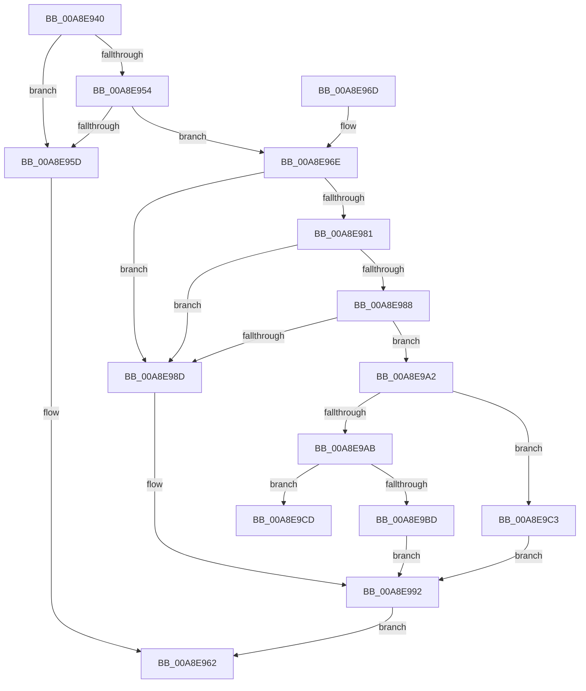

# PoUnregisterPowerSettingCallback

- RVA: `0x00A8E940`–`0x00A8E9D6` (길이 `150` bytes)
- VA: `0x0000000140A8E940`
- 실행 섹션: `PAGE`
- PDB 이름 있음: `예`; PDB Function 태그: `예`
- unwind 정보 RVA: `0x000601F4`
- 디코드: `44`개 명령, `150/150` bytes 표시
- 미해석 바이트: `0` (있으면 어셈블리에 `.byte`로 보존)

> 이 문서는 커널 이미지의 기계어와 PDB 기호를 분석해 생성했습니다. 4번과 5번은 함수 원형과 자료형을 바이너리 사용 방식에서 추정한 C 해석이며 원본 소스 복구 결과는 아닙니다.

## 1. Dependencies

- 직접 호출 지점: **3**; 고유 호출 대상: **3**
- 직접 호출자로 확인된 함수: **3**
- RIP 상대 이미지 참조: **1**

### Outgoing calls
- `0x00A8E975` → [ExAcquireFastMutex](../../text/20/ExAcquireFastMutex_function_0020E5A0.md) (function, `0x0020E5A0`)
- `0x00A8E999` → [ExReleaseFastMutex](../../text/25/ExReleaseFastMutex_function_002519C0.md) (function, `0x002519C0`)
- `0x00A8E9C6` → [PopUnregisterPowerSettingCallback](../../text/4B/PopUnregisterPowerSettingCallback_function_004B7594.md) (function, `0x004B7594`)

### Direct callers
- [SSHSupportUnregisterPowerSettingCallback](../77/SSHSupportUnregisterPowerSettingCallback_function_00774A2C.md) at `0x00774A37`
- [TtmCleanupCurrentSession](../AC/TtmCleanupCurrentSession_function_00AC54DC.md) at `0x00AC5584`
- [TtmCleanupCurrentSession](../AC/TtmCleanupCurrentSession_function_00AC54DC.md) at `0x00AC55A5`
- [PopModernStandbyNotificationInit](../../init/C4/PopModernStandbyNotificationInit_function_00C43948.md) at `0x00C43A14`
- [PopModernStandbyNotificationInit](../../init/C4/PopModernStandbyNotificationInit_function_00C43948.md) at `0x00C43A2D`
- [PopModernStandbyNotificationInit](../../init/C4/PopModernStandbyNotificationInit_function_00C43948.md) at `0x00C43A46`
- [PopModernStandbyNotificationInit](../../init/C4/PopModernStandbyNotificationInit_function_00C43948.md) at `0x00C43A5F`

### Static image references
- `0x00A8E96E` → RVA `0x00F0DF40` (`.data`; read)

## 2. Other-region calls and transfers

- 다른 실행 섹션으로 향하는 call: **3**
  - `0x00A8E975` → [ExAcquireFastMutex](../../text/20/ExAcquireFastMutex_function_0020E5A0.md) (`PAGE` → `.text`)
  - `0x00A8E999` → [ExReleaseFastMutex](../../text/25/ExReleaseFastMutex_function_002519C0.md) (`PAGE` → `.text`)
  - `0x00A8E9C6` → [PopUnregisterPowerSettingCallback](../../text/4B/PopUnregisterPowerSettingCallback_function_004B7594.md) (`PAGE` → `.text`)
- call이 아닌 외부 분기/꼬리 이동: **1**
  - `0x00A8E9D1` → [sub_00B465F2 + 0x3D](../B4/Unknown_function_00B465F2.md) (`tail-transfer`)

## 3. Assembly (complete function range)

```asm
00A8E940  48 89 5C 24 08                  mov qword ptr [rsp + 8], rbx
00A8E945  57                              push rdi
00A8E946  48 83 EC 30                     sub rsp, 0x30
00A8E94A  33 FF                           xor edi, edi
00A8E94C  48 8B D9                        mov rbx, rcx
00A8E94F  48 85 C9                        test rcx, rcx
00A8E952  74 09                           je 0x140a8e95d
00A8E954  81 79 10 50 53 65 74            cmp dword ptr [rcx + 0x10], 0x74655350
00A8E95B  74 11                           je 0x140a8e96e
00A8E95D  B8 0D 00 00 C0                  mov eax, 0xc000000d
00A8E962  48 8B 5C 24 40                  mov rbx, qword ptr [rsp + 0x40]
00A8E967  48 83 C4 30                     add rsp, 0x30
00A8E96B  5F                              pop rdi
00A8E96C  C3                              ret
00A8E96D  CC                              int3
00A8E96E  48 8D 0D CB F5 47 00            lea rcx, [rip + 0x47f5cb]
00A8E975  E8 26 FC 77 FF                  call 0x14020e5a0
00A8E97A  8A 43 21                        mov al, byte ptr [rbx + 0x21]
00A8E97D  84 C0                           test al, al
00A8E97F  75 0C                           jne 0x140a8e98d
00A8E981  8A 43 20                        mov al, byte ptr [rbx + 0x20]
00A8E984  84 C0                           test al, al
00A8E986  75 05                           jne 0x140a8e98d
00A8E988  48 39 1B                        cmp qword ptr [rbx], rbx
00A8E98B  75 15                           jne 0x140a8e9a2
00A8E98D  BF 0D 00 00 C0                  mov edi, 0xc000000d
00A8E992  48 8D 0D A7 F5 47 00            lea rcx, [rip + 0x47f5a7]
00A8E999  E8 22 30 7C FF                  call 0x1402519c0
00A8E99E  8B C7                           mov eax, edi
00A8E9A0  EB C0                           jmp 0x140a8e962
00A8E9A2  48 8B 43 18                     mov rax, qword ptr [rbx + 0x18]
00A8E9A6  48 85 C0                        test rax, rax
00A8E9A9  74 18                           je 0x140a8e9c3
00A8E9AB  48 8B 4B 18                     mov rcx, qword ptr [rbx + 0x18]
00A8E9AF  65 48 8B 04 25 88 01 00 00      mov rax, qword ptr gs:[0x188]
00A8E9B8  48 3B C8                        cmp rcx, rax
00A8E9BB  75 10                           jne 0x140a8e9cd
00A8E9BD  C6 43 20 01                     mov byte ptr [rbx + 0x20], 1
00A8E9C1  EB CF                           jmp 0x140a8e992
00A8E9C3  48 8B CB                        mov rcx, rbx
00A8E9C6  E8 C9 8B A2 FF                  call 0x1404b7594
00A8E9CB  EB C5                           jmp 0x140a8e992
00A8E9CD  C6 43 21 01                     mov byte ptr [rbx + 0x21], 1
00A8E9D1  E9 59 7C 0B 00                  jmp 0x140b4662f
```

## 4. C-style interpretation (structured pseudocode)

```c
__int64 __fastcall PoUnregisterPowerSettingCallback(__int64 a1)
{
    __int64 result;
    __int64 v_rdi;
    __int64 v_rsp;
    unsigned __int64 v_stack_p8;

    v_stack_p8 = v_rbx;
    v_rsp = (v_rsp) - (48);
    v_rdi = 0;
    if (a1 == 0) goto loc_00A8E95D;
    if ((*(unsigned int *)(a1 + 16)) == 0x74655350ULL) goto loc_00A8E96E;
loc_00A8E95D:
loc_00A8E962:
    v_rsp = (v_rsp) + (48);
    return (unsigned int)(0xC000000DULL);
loc_00A8E96E:
    result = ExAcquireFastMutex(v_rip + 4715979, a2, a3, a4);
    if ((unsigned __int8)(*(unsigned __int8 *)(v_stack_p8 + 33)) != 0) goto loc_00A8E98D;
    if ((unsigned __int8)(*(unsigned __int8 *)(v_stack_p8 + 32)) != 0) goto loc_00A8E98D;
    if ((*(unsigned __int64 *)(v_stack_p8)) != v_stack_p8) goto loc_00A8E9A2;
loc_00A8E98D:
loc_00A8E992:
    result = ExReleaseFastMutex(v_rip + 4715943, a2, a3, a4);
    goto loc_00A8E962;
loc_00A8E9A2:
    if (*(unsigned __int64 *)(v_stack_p8 + 24) == 0) goto loc_00A8E9C3;
    if ((*(unsigned __int64 *)(v_stack_p8 + 24)) != (*(unsigned __int64 *)(gs_base + (0 + 392)))) goto loc_00A8E9CD;
    *(unsigned __int8 *)(v_stack_p8 + 32) = 1;
    goto loc_00A8E992;
loc_00A8E9C3:
    result = PopUnregisterPowerSettingCallback(v_stack_p8, a2, a3, a4);
    goto loc_00A8E992;
loc_00A8E9CD:
    *(unsigned __int8 *)(v_stack_p8 + 33) = 1;
}
```

## 5. (Beta) C Style

```c
int64_t PoUnregisterPowerSettingCallback(void *Arg1)
{
    uint8_t *arg1 = (uint8_t *)Arg1;

    int64_t result;
    int64_t local_rdi;
    int64_t local_rsp;
    uint64_t v_stack_p8;

    v_stack_p8 = local_rbx;
    local_rsp = (local_rsp) - (48);
    local_rdi = 0;
    if (Arg1 == NULL) goto loc_00A8E95D;
    if ((*(uint32_t *)(arg1 + 0x10)) == 0x74655350ULL) goto loc_00A8E96E;
loc_00A8E95D:
loc_00A8E962:
    local_rsp = (local_rsp) + (48);
    return (uint32_t)(0xC000000DULL);
loc_00A8E96E:
    result = ExAcquireFastMutex(v_rip + 4715979, a2, a3, a4);
    if ((uint8_t)(*(uint8_t *)(v_stack_p8 + 0x21)) != 0) goto loc_00A8E98D;
    if ((uint8_t)(*(uint8_t *)(v_stack_p8 + 0x20)) != 0) goto loc_00A8E98D;
    if ((*(uint64_t *)(v_stack_p8)) != v_stack_p8) goto loc_00A8E9A2;
loc_00A8E98D:
loc_00A8E992:
    result = ExReleaseFastMutex(v_rip + 4715943, a2, a3, a4);
    goto loc_00A8E962;
loc_00A8E9A2:
    if (*(uint64_t *)(v_stack_p8 + 0x18) == 0) goto loc_00A8E9C3;
    if ((*(uint64_t *)(v_stack_p8 + 0x18)) != (*(uint64_t *)(gs_base + (0 + 0x188)))) goto loc_00A8E9CD;
    *(uint8_t *)(v_stack_p8 + 0x20) = 1;
    goto loc_00A8E992;
loc_00A8E9C3:
    result = PopUnregisterPowerSettingCallback(v_stack_p8, a2, a3, a4);
    goto loc_00A8E992;
loc_00A8E9CD:
    *(uint8_t *)(v_stack_p8 + 0x21) = 1;
}
```

### 관측된 메모리 오프셋

구조체 형식이 확인되지 않은 접근은 인자 기준의 오프셋으로만 기록했습니다.

| 기준 인자 | 오프셋 표현 | 폭 (bit) | 접근 |
|---|---:|---:|---|
| `Arg1` | `+ 0x0` | `64` | `R` |
| `Arg1` | `+ 0x18` | `64` | `R` |
| `Arg1` | `+ 0x20` | `8` | `R` |
| `Arg1` | `+ 0x20` | `8` | `W` |
| `Arg1` | `+ 0x21` | `8` | `R` |
| `Arg1` | `+ 0x21` | `8` | `W` |

## 6. Execution-region graph

[열기: 2D/3D 그래프와 함수 탐색 컨트롤 패널](../../../control-panel.html?section=page&rva=0x00A8E940&view=graph)

- 2D 그래프는 위에서 아래로 흐르고, 3D 그래프는 빈 공간을 드래그해 회전합니다. Shift+드래그는 이동, 휠은 확대·축소, 함수 노드 선택은 대상 보고서 이동입니다.

### Static fallback


