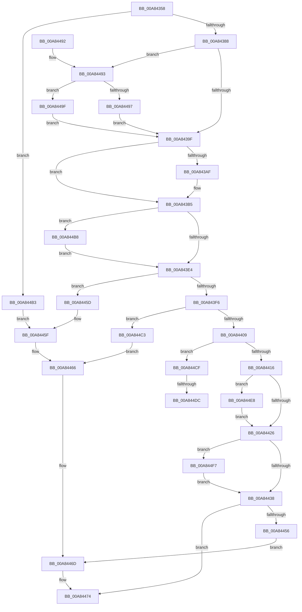

# PopBatteryCheckCompositeCapacity

- RVA: `0x00A84358`–`0x00A84503` (길이 `427` bytes)
- VA: `0x0000000140A84358`
- 실행 섹션: `PAGE`
- PDB 이름 있음: `예`; PDB Function 태그: `예`
- unwind 정보 RVA: `0x000B7620`
- 디코드: `102`개 명령, `427/427` bytes 표시
- 미해석 바이트: `0` (있으면 어셈블리에 `.byte`로 보존)

> 이 문서는 커널 이미지의 기계어와 PDB 기호를 분석해 생성했습니다. 4번과 5번은 함수 원형과 자료형을 바이너리 사용 방식에서 추정한 C 해석이며 원본 소스 복구 결과는 아닙니다.

## 1. Dependencies

- 직접 호출 지점: **1**; 고유 호출 대상: **1**
- 직접 호출자로 확인된 함수: **1**
- RIP 상대 이미지 참조: **15**

### Outgoing calls
- `0x00A84477` → [PopSetBatteryDischargingState](PopSetBatteryDischargingState_function_00A8450C.md) (function, `0x00A8450C`)

### Direct callers
- [PopBatteryApplyCompositeState](../AE/PopBatteryApplyCompositeState_function_00AE0CD0.md) at `0x00AE0DF2`

### Static image references
- `0x00A84373` → RVA `0x00F0C034` (`.data`; read)
- `0x00A84391` → RVA `0x00F0C0A0` (`.data`; read)
- `0x00A8439F` → RVA `0x00F0C20C` (`.data`; read)
- `0x00A843E4` → RVA `0x00F0C208` (`.data`; read)
- `0x00A843EA` → RVA `0x00F0C20C` (`.data`; write)
- `0x00A843F6` → RVA `0x00F0C060` (`.data`; read)
- `0x00A84409` → RVA `0x00F0C038` (`.data`; read)
- `0x00A84416` → RVA `0x00F0C218` (`.data`; read)
- `0x00A84426` → RVA `0x00E0B838` (`.data`; read)
- `0x00A84438` → RVA `0x00F0C220` (`.data`; read)
- `0x00A84443` → RVA `0x00F0C220` (`.data`; write)
- `0x00A8444E` → RVA `0x00E0B834` (`.data`; read)
- `0x00A8445F` → RVA `0x00F0C218` (`.data`; write)
- `0x00A84466` → RVA `0x00F09000` (`.data`; write)
- `0x00A844CF` → RVA `0x00F09000` (`.data`; read)

## 2. Other-region calls and transfers

- 다른 실행 섹션으로 향하는 call: **0**
- call이 아닌 외부 분기/꼬리 이동: **2**
  - `0x00A844D6` → [sub_00B4412E](../B4/Unknown_function_00B4412E.md) (`tail-transfer`)
  - `0x00A844E3` → [sub_00B4412E](../B4/Unknown_function_00B4412E.md) (`tail-transfer`)

## 3. Assembly (complete function range)

```asm
00A84358  48 89 5C 24 08                  mov qword ptr [rsp + 8], rbx
00A8435D  48 89 74 24 10                  mov qword ptr [rsp + 0x10], rsi
00A84362  48 89 7C 24 18                  mov qword ptr [rsp + 0x18], rdi
00A84367  41 56                           push r14
00A84369  48 83 EC 20                     sub rsp, 0x20
00A8436D  45 33 F6                        xor r14d, r14d
00A84370  49 8B D8                        mov rbx, r8
00A84373  44 39 35 BA 7C 48 00            cmp dword ptr [rip + 0x487cba], r14d
00A8437A  8B FA                           mov edi, edx
00A8437C  48 8B F1                        mov rsi, rcx
00A8437F  45 89 30                        mov dword ptr [r8], r14d
00A84382  0F 84 2B 01 00 00               je 0x140a844b3
00A84388  8B 41 04                        mov eax, dword ptr [rcx + 4]
00A8438B  41 B8 A0 86 01 00               mov r8d, 0x186a0
00A84391  8B 0D 09 7D 48 00               mov ecx, dword ptr [rip + 0x487d09]
00A84397  3B C8                           cmp ecx, eax
00A84399  0F 87 F4 00 00 00               ja 0x140a84493
00A8439F  44 8B 1D 66 7E 48 00            mov r11d, dword ptr [rip + 0x487e66]
00A843A6  45 8B D6                        mov r10d, r14d
00A843A9  41 83 FB FF                     cmp r11d, -1
00A843AD  74 06                           je 0x140a843b5
00A843AF  45 8B D0                        mov r10d, r8d
00A843B2  45 2B D3                        sub r10d, r11d
00A843B5  41 8D 88 F4 01 00 00            lea ecx, [r8 + 0x1f4]
00A843BC  B8 D3 4D 62 10                  mov eax, 0x10624dd3
00A843C1  F7 E1                           mul ecx
00A843C3  41 8D 8B F4 01 00 00            lea ecx, [r11 + 0x1f4]
00A843CA  B8 D3 4D 62 10                  mov eax, 0x10624dd3
00A843CF  44 8B CA                        mov r9d, edx
00A843D2  F7 E1                           mul ecx
00A843D4  41 C1 E9 06                     shr r9d, 6
00A843D8  C1 EA 06                        shr edx, 6
00A843DB  44 3B CA                        cmp r9d, edx
00A843DE  0F 85 D4 00 00 00               jne 0x140a844b8
00A843E4  8A 15 1E 7E 48 00               mov dl, byte ptr [rip + 0x487e1e]
00A843EA  44 89 05 1B 7E 48 00            mov dword ptr [rip + 0x487e1b], r8d
00A843F1  83 FF 01                        cmp edi, 1
00A843F4  74 67                           je 0x140a8445d
00A843F6  8B 05 64 7C 48 00               mov eax, dword ptr [rip + 0x487c64]
00A843FC  F7 D0                           not eax
00A843FE  83 E0 01                        and eax, 1
00A84401  3B F8                           cmp edi, eax
00A84403  0F 85 BA 00 00 00               jne 0x140a844c3
00A84409  44 38 35 28 7C 48 00            cmp byte ptr [rip + 0x487c28], r14b
00A84410  0F 85 B9 00 00 00               jne 0x140a844cf
00A84416  44 8B 0D FB 7D 48 00            mov r9d, dword ptr [rip + 0x487dfb]
00A8441D  45 3B C8                        cmp r9d, r8d
00A84420  0F 82 C2 00 00 00               jb 0x140a844e8
00A84426  8B 0D 0C 74 38 00               mov ecx, dword ptr [rip + 0x38740c]
00A8442C  41 03 C8                        add ecx, r8d
00A8442F  44 3B C9                        cmp r9d, ecx
00A84432  0F 87 BF 00 00 00               ja 0x140a844f7
00A84438  8B 0D E2 7D 48 00               mov ecx, dword ptr [rip + 0x487de2]
00A8443E  41 03 CA                        add ecx, r10d
00A84441  8B C1                           mov eax, ecx
00A84443  89 0D D7 7D 48 00               mov dword ptr [rip + 0x487dd7], ecx
00A84449  F7 D8                           neg eax
00A8444B  0F 48 C1                        cmovs eax, ecx
00A8444E  3B 05 E0 73 38 00               cmp eax, dword ptr [rip + 0x3873e0]
00A84454  7C 1E                           jl 0x140a84474
00A84456  8B D1                           mov edx, ecx
00A84458  C1 EA 1F                        shr edx, 0x1f
00A8445B  EB 10                           jmp 0x140a8446d
00A8445D  B2 01                           mov dl, 1
00A8445F  44 89 35 B2 7D 48 00            mov dword ptr [rip + 0x487db2], r14d
00A84466  44 88 35 93 4B 48 00            mov byte ptr [rip + 0x484b93], r14b
00A8446D  44 89 35 AC 7D 48 00            mov dword ptr [rip + 0x487dac], r14d
00A84474  48 8B CE                        mov rcx, rsi
00A84477  E8 90 00 00 00                  call 0x140a8450c
00A8447C  48 8B 5C 24 30                  mov rbx, qword ptr [rsp + 0x30]
00A84481  48 8B 74 24 38                  mov rsi, qword ptr [rsp + 0x38]
00A84486  48 8B 7C 24 40                  mov rdi, qword ptr [rsp + 0x40]
00A8448B  48 83 C4 20                     add rsp, 0x20
00A8448F  41 5E                           pop r14
00A84491  C3                              ret
00A84492  CC                              int3
00A84493  85 C9                           test ecx, ecx
00A84495  75 08                           jne 0x140a8449f
00A84497  45 8B C6                        mov r8d, r14d
00A8449A  E9 00 FF FF FF                  jmp 0x140a8439f
00A8449F  48 69 C0 A0 86 01 00            imul rax, rax, 0x186a0
00A844A6  33 D2                           xor edx, edx
00A844A8  48 F7 F1                        div rcx
00A844AB  4C 8B C0                        mov r8, rax
00A844AE  E9 EC FE FF FF                  jmp 0x140a8439f
00A844B3  41 8A D6                        mov dl, r14b
00A844B6  EB A7                           jmp 0x140a8445f
00A844B8  44 2B CA                        sub r9d, edx
00A844BB  44 89 0B                        mov dword ptr [rbx], r9d
00A844BE  E9 21 FF FF FF                  jmp 0x140a843e4
00A844C3  41 8A D6                        mov dl, r14b
00A844C6  44 89 05 4B 7D 48 00            mov dword ptr [rip + 0x487d4b], r8d
00A844CD  EB 97                           jmp 0x140a84466
00A844CF  44 38 35 2A 4B 48 00            cmp byte ptr [rip + 0x484b2a], r14b
00A844D6  0F 85 52 FC 0B 00               jne 0x140b4412e
00A844DC  44 89 05 35 7D 48 00            mov dword ptr [rip + 0x487d35], r8d
00A844E3  E9 46 FC 0B 00                  jmp 0x140b4412e
00A844E8  45 8B C8                        mov r9d, r8d
00A844EB  44 89 05 26 7D 48 00            mov dword ptr [rip + 0x487d26], r8d
00A844F2  E9 2F FF FF FF                  jmp 0x140a84426
00A844F7  C6 05 02 4B 48 00 01            mov byte ptr [rip + 0x484b02], 1
00A844FE  E9 35 FF FF FF                  jmp 0x140a84438
```

## 4. C-style interpretation (structured pseudocode)

```c
__int64 __fastcall PopBatteryCheckCompositeCapacity(__int64 a1, int a2, __int64 a3)
{
    __int64 result;
    __int64 v_r10;
    __int64 v_r14;
    __int64 v_rsp;
    unsigned __int64 v_stack_p10;
    unsigned __int64 v_stack_p18;
    unsigned __int64 v_stack_p8;

    v_stack_p8 = v_rbx;
    v_stack_p10 = v_rsi;
    v_stack_p18 = v_rdi;
    v_rsp = (v_rsp) - (32);
    v_r14 = 0;
    *(unsigned int *)(a3) = 0;
    if ((*(unsigned int *)(v_rip + 4750522)) == 0) goto loc_00A844B3;
    if (((unsigned int)((unsigned int)(*(unsigned int *)(v_rip + 4750601)))) > ((unsigned int)((unsigned int)(*(unsigned int *)(a1 + 4))))) goto loc_00A84493;
loc_00A8439F:
    v_r10 = 0;
    if (((unsigned int)((unsigned int)(*(unsigned int *)(v_rip + 4750950)))) != -1) {
        v_r10 = (unsigned int)((unsigned int)(0x186A0ULL));
        v_r10 = (unsigned int)((v_r10) - ((unsigned int)((unsigned int)(*(unsigned int *)(v_rip + 4750950)))));
    }
    a4 = (unsigned int)(((unsigned int)(a2)) >> (6));
    a2 = (unsigned int)((a2) >> (6));
    if (((unsigned int)(a4)) != a2) goto loc_00A844B8;
loc_00A843E4:
    *(unsigned int *)(v_rip + 4750875) = (unsigned int)((unsigned int)(0x186A0ULL));
    if (((unsigned int)((unsigned int)(a2))) == 1) goto loc_00A8445D;
    result = (unsigned int)(~((unsigned int)(*(unsigned int *)(v_rip + 4750436))));
    result = (unsigned int)((result) & (1));
    if (((unsigned int)((unsigned int)(a2))) != ((unsigned int)(result))) goto loc_00A844C3;
    if ((*(unsigned __int8 *)(v_rip + 4750376)) != 0) goto loc_00A844CF;
    if (((unsigned int)((unsigned int)(*(unsigned int *)(v_rip + 4750843)))) < ((unsigned int)((unsigned int)(0x186A0ULL)))) goto loc_00A844E8;
loc_00A84426:
    a1 = (unsigned int)(((unsigned int)(*(unsigned int *)(v_rip + 3699724))) + ((unsigned int)((unsigned int)(0x186A0ULL))));
    if (((unsigned int)((unsigned int)(*(unsigned int *)(v_rip + 4750843)))) > ((unsigned int)(a1))) goto loc_00A844F7;
loc_00A84438:
    a1 = (unsigned int)(((unsigned int)(*(unsigned int *)(v_rip + 4750818))) + ((unsigned int)(v_r10)));
    *(unsigned int *)(v_rip + 4750807) = (unsigned int)(a1);
    result = (unsigned int)(-((unsigned int)((unsigned int)(a1))));
    if (sign_flag) { result = (unsigned int)(a1); }
    if (((unsigned int)(result)) < (*(unsigned int *)(v_rip + 3699680))) goto loc_00A84474;
    a2 = (unsigned int)(((unsigned int)((unsigned int)(a1))) >> (31));
    goto loc_00A8446D;
loc_00A8445D:
loc_00A8445F:
    *(unsigned int *)(v_rip + 4750770) = 0;
loc_00A84466:
    *(unsigned __int8 *)(v_rip + 4737939) = 0;
loc_00A8446D:
    *(unsigned int *)(v_rip + 4750764) = 0;
loc_00A84474:
    result = PopSetBatteryDischargingState(a1, 1, (unsigned int)(0x186A0ULL), (unsigned int)(*(unsigned int *)(v_rip + 4750843)));
    v_rsp = (v_rsp) + (32);
    return result;
loc_00A84493:
    if ((unsigned int)(a1) != 0) goto loc_00A8449F;
    goto loc_00A8439F;
loc_00A8449F:
    result = (result) * (result);
    a2 = 0;
    goto loc_00A8439F;
loc_00A844B3:
    goto loc_00A8445F;
loc_00A844B8:
    a4 = (unsigned int)(((unsigned int)(*(unsigned int *)(v_rip + 4750843))) - (0));
    *(unsigned int *)(v_stack_p8) = (unsigned int)(a4);
    goto loc_00A843E4;
loc_00A844C3:
    *(unsigned int *)(v_rip + 4750667) = (unsigned int)(result);
    goto loc_00A84466;
loc_00A844CF:
    *(unsigned int *)(v_rip + 4750645) = (unsigned int)(result);
loc_00A844E8:
    *(unsigned int *)(v_rip + 4750630) = (unsigned int)(result);
    goto loc_00A84426;
loc_00A844F7:
    *(unsigned __int8 *)(v_rip + 4737794) = 1;
    goto loc_00A84438;
}
```

## 5. (Beta) C Style

```c
int64_t PopBatteryCheckCompositeCapacity(void *Arg1, int32_t Arg2, void *Arg3)
{
    uint8_t *arg1 = (uint8_t *)Arg1;
    uint8_t *arg3 = (uint8_t *)Arg3;

    int64_t result;
    int64_t local_r10;
    int64_t local_r14;
    int64_t local_rsp;
    uint64_t v_stack_p10;
    uint64_t v_stack_p18;
    uint64_t v_stack_p8;

    v_stack_p8 = local_rbx;
    v_stack_p10 = local_rsi;
    v_stack_p18 = local_rdi;
    local_rsp = (local_rsp) - (32);
    local_r14 = 0;
    *(uint32_t *)(arg3) = 0;
    if ((*(uint32_t *)(v_rip + 0x487CBA)) == 0) goto loc_00A844B3;
    if (((uint32_t)((uint32_t)(*(uint32_t *)(v_rip + 0x487D09)))) > ((uint32_t)((uint32_t)(*(uint32_t *)(arg1 + 0x4))))) goto loc_00A84493;
loc_00A8439F:
    local_r10 = 0;
    if (((uint32_t)((uint32_t)(*(uint32_t *)(v_rip + 0x487E66)))) != -1) {
        local_r10 = (uint32_t)((uint32_t)(0x186A0ULL));
        local_r10 = (uint32_t)((local_r10) - ((uint32_t)((uint32_t)(*(uint32_t *)(v_rip + 0x487E66)))));
    }
    a4 = (uint32_t)(((uint32_t)(Arg2)) >> (6));
    Arg2 = (uint32_t)((Arg2) >> (6));
    if (((uint32_t)(a4)) != Arg2) goto loc_00A844B8;
loc_00A843E4:
    *(uint32_t *)(v_rip + 0x487E1B) = (uint32_t)((uint32_t)(0x186A0ULL));
    if (((uint32_t)((uint32_t)(Arg2))) == 1) goto loc_00A8445D;
    result = (uint32_t)(~((uint32_t)(*(uint32_t *)(v_rip + 0x487C64))));
    result = (uint32_t)((result) & (1));
    if (((uint32_t)((uint32_t)(Arg2))) != ((uint32_t)(result))) goto loc_00A844C3;
    if ((*(uint8_t *)(v_rip + 0x487C28)) != 0) goto loc_00A844CF;
    if (((uint32_t)((uint32_t)(*(uint32_t *)(v_rip + 0x487DFB)))) < ((uint32_t)((uint32_t)(0x186A0ULL)))) goto loc_00A844E8;
loc_00A84426:
    Arg1 = (uint32_t)(((uint32_t)(*(uint32_t *)(v_rip + 0x38740C))) + ((uint32_t)((uint32_t)(0x186A0ULL))));
    if (((uint32_t)((uint32_t)(*(uint32_t *)(v_rip + 0x487DFB)))) > ((uint32_t)(Arg1))) goto loc_00A844F7;
loc_00A84438:
    Arg1 = (uint32_t)(((uint32_t)(*(uint32_t *)(v_rip + 0x487DE2))) + ((uint32_t)(local_r10)));
    *(uint32_t *)(v_rip + 0x487DD7) = (uint32_t)(Arg1);
    result = (uint32_t)(-((uint32_t)((uint32_t)(Arg1))));
    if (sign_flag) { result = (uint32_t)(Arg1); }
    if (((uint32_t)(result)) < (*(uint32_t *)(v_rip + 0x3873E0))) goto loc_00A84474;
    Arg2 = (uint32_t)(((uint32_t)((uint32_t)(Arg1))) >> (31));
    goto loc_00A8446D;
loc_00A8445D:
loc_00A8445F:
    *(uint32_t *)(v_rip + 0x487DB2) = 0;
loc_00A84466:
    *(uint8_t *)(v_rip + 0x484B93) = 0;
loc_00A8446D:
    *(uint32_t *)(v_rip + 0x487DAC) = 0;
loc_00A84474:
    result = PopSetBatteryDischargingState(Arg1, 1, (uint32_t)(0x186A0ULL), (uint32_t)(*(uint32_t *)(v_rip + 0x487DFB)));
    local_rsp = (local_rsp) + (32);
    return result;
loc_00A84493:
    if ((uint32_t)(Arg1) != 0) goto loc_00A8449F;
    goto loc_00A8439F;
loc_00A8449F:
    result = (result) * (result);
    Arg2 = 0;
    goto loc_00A8439F;
loc_00A844B3:
    goto loc_00A8445F;
loc_00A844B8:
    a4 = (uint32_t)(((uint32_t)(*(uint32_t *)(v_rip + 0x487DFB))) - (0));
    *(uint32_t *)(v_stack_p8) = (uint32_t)(a4);
    goto loc_00A843E4;
loc_00A844C3:
    *(uint32_t *)(v_rip + 0x487D4B) = (uint32_t)(result);
    goto loc_00A84466;
loc_00A844CF:
    *(uint32_t *)(v_rip + 0x487D35) = (uint32_t)(result);
loc_00A844E8:
    *(uint32_t *)(v_rip + 0x487D26) = (uint32_t)(result);
    goto loc_00A84426;
loc_00A844F7:
    *(uint8_t *)(v_rip + 0x484B02) = 1;
    goto loc_00A84438;
}
```

### 관측된 메모리 오프셋

구조체 형식이 확인되지 않은 접근은 인자 기준의 오프셋으로만 기록했습니다.

| 기준 인자 | 오프셋 표현 | 폭 (bit) | 접근 |
|---|---:|---:|---|
| `Arg1` | `+ 0x4` | `32` | `R` |
| `Arg3` | `+ 0x0` | `32` | `W` |

## 6. Execution-region graph

[열기: 2D/3D 그래프와 함수 탐색 컨트롤 패널](../../../control-panel.html?section=page&rva=0x00A84358&view=graph)

- 2D 그래프는 위에서 아래로 흐르고, 3D 그래프는 빈 공간을 드래그해 회전합니다. Shift+드래그는 이동, 휠은 확대·축소, 함수 노드 선택은 대상 보고서 이동입니다.

### Static fallback


