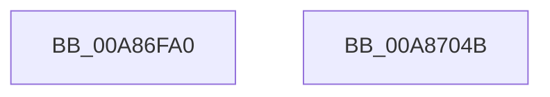

# PopBootBatteryStatusWorker

- RVA: `0x00A86FA0`–`0x00A8704C` (길이 `172` bytes)
- VA: `0x0000000140A86FA0`
- 실행 섹션: `PAGE`
- PDB 이름 있음: `예`; PDB Function 태그: `아니요`
- unwind 정보 RVA: `0x000886E8`
- 디코드: `39`개 명령, `172/172` bytes 표시
- 미해석 바이트: `0` (있으면 어셈블리에 `.byte`로 보존)

> 이 문서는 커널 이미지의 기계어와 PDB 기호를 분석해 생성했습니다. 4번과 5번은 함수 원형과 자료형을 바이너리 사용 방식에서 추정한 C 해석이며 원본 소스 복구 결과는 아닙니다.

## 1. Dependencies

- 직접 호출 지점: **5**; 고유 호출 대상: **5**
- 직접 호출자로 확인된 함수: **0**
- RIP 상대 이미지 참조: **4**

### Outgoing calls
- `0x00A86FC1` → [PopAcquireRwLockShared](../../text/2D/PopAcquireRwLockShared_function_002D9A40.md) (function, `0x002D9A40`)
- `0x00A86FD8` → [PopReleaseRwLock](../../text/2D/PopReleaseRwLock_function_002DFBBC.md) (function, `0x002DFBBC`)
- `0x00A8701C` → [Feature_SleepStudySlimControlEtl__private_ReportDeviceUsage](../../text/4F/Feature_SleepStudySlimControlEtl__private_ReportDeviceUsage_function_004FC658.md) (function, `0x004FC658`)
- `0x00A87031` → [SshpSessionManagerSendControlEventSlimEtl](SshpSessionManagerSendControlEventSlimEtl_function_00A87200.md) (function, `0x00A87200`)
- `0x00A8703D` → [_security_check_cookie](../../text/6A/_security_check_cookie_function_006AC640.md) (function, `0x006AC640`)

### Direct callers
- 이 함수 시작 RVA로 연결되는 직접 call은 확인되지 않았습니다. 간접 호출은 완전히 역산할 수 없습니다.

### Static image references
- `0x00A86FAC` → RVA `0x00E0A740` (`.data`; read)
- `0x00A86FBA` → RVA `0x00F0C238` (`.data`; read)
- `0x00A86FC6` → RVA `0x00F0C248` (`.data`; read)
- `0x00A8702A` → RVA `0x0001BDE8` (`.rdata`; read)

## 2. Other-region calls and transfers

- 다른 실행 섹션으로 향하는 call: **4**
  - `0x00A86FC1` → [PopAcquireRwLockShared](../../text/2D/PopAcquireRwLockShared_function_002D9A40.md) (`PAGE` → `.text`)
  - `0x00A86FD8` → [PopReleaseRwLock](../../text/2D/PopReleaseRwLock_function_002DFBBC.md) (`PAGE` → `.text`)
  - `0x00A8701C` → [Feature_SleepStudySlimControlEtl__private_ReportDeviceUsage](../../text/4F/Feature_SleepStudySlimControlEtl__private_ReportDeviceUsage_function_004FC658.md) (`PAGE` → `.text`)
  - `0x00A8703D` → [_security_check_cookie](../../text/6A/_security_check_cookie_function_006AC640.md) (`PAGE` → `.text`)
- 별도 외부 분기/꼬리 이동을 확인하지 못했습니다.

## 3. Assembly (complete function range)

```asm
00A86FA0  40 55                           push rbp
00A86FA2  48 8B EC                        mov rbp, rsp
00A86FA5  48 81 EC 80 00 00 00            sub rsp, 0x80
00A86FAC  48 8B 05 8D 37 38 00            mov rax, qword ptr [rip + 0x38378d]
00A86FB3  48 33 C4                        xor rax, rsp
00A86FB6  48 89 45 F0                     mov qword ptr [rbp - 0x10], rax
00A86FBA  48 8D 0D 77 52 48 00            lea rcx, [rip + 0x485277]
00A86FC1  E8 7A 2A 85 FF                  call 0x1402d9a40
00A86FC6  0F 10 05 7B 52 48 00            movups xmm0, xmmword ptr [rip + 0x48527b]
00A86FCD  48 8D 0D 64 52 48 00            lea rcx, [rip + 0x485264]
00A86FD4  0F 11 45 D0                     movups xmmword ptr [rbp - 0x30], xmm0
00A86FD8  E8 DF 8B 85 FF                  call 0x1402dfbbc
00A86FDD  0F 10 4D D0                     movups xmm1, xmmword ptr [rbp - 0x30]
00A86FE1  83 65 DC 00                     and dword ptr [rbp - 0x24], 0
00A86FE5  48 8D 45 A0                     lea rax, [rbp - 0x60]
00A86FE9  83 65 EC 00                     and dword ptr [rbp - 0x14], 0
00A86FED  B9 04 00 00 00                  mov ecx, 4
00A86FF2  66 0F 6F C1                     movdqa xmm0, xmm1
00A86FF6  48 89 45 D0                     mov qword ptr [rbp - 0x30], rax
00A86FFA  66 0F 73 D8 08                  psrldq xmm0, 8
00A86FFF  48 8D 45 A8                     lea rax, [rbp - 0x58]
00A87003  66 0F 73 D9 0C                  psrldq xmm1, 0xc
00A87008  66 0F 7E 45 A8                  movd dword ptr [rbp - 0x58], xmm0
00A8700D  66 0F 7E 4D A0                  movd dword ptr [rbp - 0x60], xmm1
00A87012  89 4D D8                        mov dword ptr [rbp - 0x28], ecx
00A87015  48 89 45 E0                     mov qword ptr [rbp - 0x20], rax
00A87019  89 4D E8                        mov dword ptr [rbp - 0x18], ecx
00A8701C  E8 37 56 A7 FF                  call 0x1404fc658
00A87021  4C 8D 45 D0                     lea r8, [rbp - 0x30]
00A87025  BA 02 00 00 00                  mov edx, 2
00A8702A  48 8D 0D B7 4D 59 FF            lea rcx, [rip - 0xa6b249]
00A87031  E8 CA 01 00 00                  call 0x140a87200
00A87036  48 8B 4D F0                     mov rcx, qword ptr [rbp - 0x10]
00A8703A  48 33 CC                        xor rcx, rsp
00A8703D  E8 FE 55 C2 FF                  call 0x1406ac640
00A87042  48 81 C4 80 00 00 00            add rsp, 0x80
00A87049  5D                              pop rbp
00A8704A  C3                              ret
00A8704B  CC                              int3
```

## 4. C-style interpretation (structured pseudocode)

```c
__int64 __fastcall PopBootBatteryStatusWorker(void)
{
    __int64 result;
    __int64 v_rsp;
    unsigned __int64 v_stack_m18;
    unsigned int v_stack_m1C;
    unsigned int v_stack_m20;
    unsigned __int64 v_stack_m28;
    unsigned int v_stack_m2C;
    unsigned int v_stack_m30;
    unsigned __int64 v_stack_m38;
    unsigned __int64 v_stack_m60;
    unsigned __int64 v_stack_m68;

    v_rsp = (v_rsp) - (128);
    result = (*(unsigned __int64 *)(v_rip + 3684237)) ^ (v_rsp);
    v_stack_m18 = result;
    result = PopAcquireRwLockShared(v_rip + 4739703, a2, a3, a4);
    v_stack_m38 = v_xmm0;
    result = PopReleaseRwLock(v_rip + 4739684, a2, a3, a4);
    v_stack_m38 = v_stack_m68;
    v_stack_m60 = v_xmm0;
    v_stack_m68 = v_xmm1;
    v_stack_m30 = 4;
    v_stack_m28 = v_stack_m60;
    v_stack_m20 = 4;
    result = Feature_SleepStudySlimControlEtl__private_ReportDeviceUsage(4, a2, a3, a4);
    result = SshpSessionManagerSendControlEventSlimEtl(v_rip - 10924617, 2, v_stack_m38, a4);
    a1 = (v_stack_m18) ^ (v_rsp);
    result = _security_check_cookie(a1, 2, v_stack_m38, a4);
    v_rsp = (v_rsp) + (128);
    return result;
}
```

## 5. (Beta) C Style

```c
void PopBootBatteryStatusWorker(void)
{
    int64_t result;
    int64_t local_rsp;
    uint64_t v_stack_m18;
    uint32_t v_stack_m1C;
    uint32_t v_stack_m20;
    uint64_t v_stack_m28;
    uint32_t v_stack_m2C;
    uint32_t v_stack_m30;
    uint64_t v_stack_m38;
    uint64_t v_stack_m60;
    uint64_t v_stack_m68;

    local_rsp = (local_rsp) - (128);
    result = (*(uint64_t *)(v_rip + 0x38378D)) ^ (local_rsp);
    v_stack_m18 = result;
    result = PopAcquireRwLockShared(v_rip + 4739703, a2, a3, a4);
    v_stack_m38 = v_xmm0;
    result = PopReleaseRwLock(v_rip + 4739684, a2, a3, a4);
    v_stack_m38 = v_stack_m68;
    v_stack_m60 = v_xmm0;
    v_stack_m68 = v_xmm1;
    v_stack_m30 = 4;
    v_stack_m28 = v_stack_m60;
    v_stack_m20 = 4;
    result = Feature_SleepStudySlimControlEtl__private_ReportDeviceUsage(4, a2, a3, a4);
    result = SshpSessionManagerSendControlEventSlimEtl(v_rip - 10924617, 2, v_stack_m38, a4);
    a1 = (v_stack_m18) ^ (local_rsp);
    result = _security_check_cookie(a1, 2, v_stack_m38, a4);
    local_rsp = (local_rsp) + (128);
    return result;
}
```

## 6. Execution-region graph

[열기: 2D/3D 그래프와 함수 탐색 컨트롤 패널](../../../control-panel.html?section=page&rva=0x00A86FA0&view=graph)

- 2D 그래프는 위에서 아래로 흐르고, 3D 그래프는 빈 공간을 드래그해 회전합니다. Shift+드래그는 이동, 휠은 확대·축소, 함수 노드 선택은 대상 보고서 이동입니다.

### Static fallback


