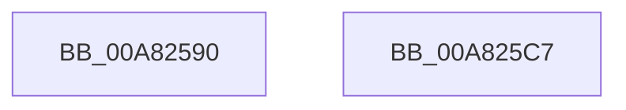

# PopBsdFlushWorker

- RVA: `0x00A82590`–`0x00A825C8` (길이 `56` bytes)
- VA: `0x0000000140A82590`
- 실행 섹션: `PAGE`
- PDB 이름 있음: `예`; PDB Function 태그: `아니요`
- unwind 정보 RVA: `0x0005C788`
- 디코드: `12`개 명령, `56/56` bytes 표시
- 미해석 바이트: `0` (있으면 어셈블리에 `.byte`로 보존)

> 이 문서는 커널 이미지의 기계어와 PDB 기호를 분석해 생성했습니다. 4번과 5번은 함수 원형과 자료형을 바이너리 사용 방식에서 추정한 C 해석이며 원본 소스 복구 결과는 아닙니다.

## 1. Dependencies

- 직접 호출 지점: **4**; 고유 호출 대상: **4**
- 직접 호출자로 확인된 함수: **0**
- RIP 상대 이미지 참조: **2**

### Outgoing calls
- `0x00A8259B` → [PopAcquireRwLockExclusive](../../text/43/PopAcquireRwLockExclusive_function_00430B44.md) (function, `0x00430B44`)
- `0x00A825A5` → [PopBsdFlush](PopBsdFlush_function_00A82624.md) (function, `0x00A82624`)
- `0x00A825B1` → [PopReleaseRwLock](../../text/2D/PopReleaseRwLock_function_002DFBBC.md) (function, `0x002DFBBC`)
- `0x00A825BD` → [PopOkayToQueueNextWorkItem](../../text/4A/PopOkayToQueueNextWorkItem_function_004AED54.md) (function, `0x004AED54`)

### Direct callers
- 이 함수 시작 RVA로 연결되는 직접 call은 확인되지 않았습니다. 간접 호출은 완전히 역산할 수 없습니다.

### Static image references
- `0x00A82594` → RVA `0x00F0F1E0` (`.data`; read)
- `0x00A825B6` → RVA `0x00F0F100` (`.data`; read)

## 2. Other-region calls and transfers

- 다른 실행 섹션으로 향하는 call: **3**
  - `0x00A8259B` → [PopAcquireRwLockExclusive](../../text/43/PopAcquireRwLockExclusive_function_00430B44.md) (`PAGE` → `.text`)
  - `0x00A825B1` → [PopReleaseRwLock](../../text/2D/PopReleaseRwLock_function_002DFBBC.md) (`PAGE` → `.text`)
  - `0x00A825BD` → [PopOkayToQueueNextWorkItem](../../text/4A/PopOkayToQueueNextWorkItem_function_004AED54.md) (`PAGE` → `.text`)
- 별도 외부 분기/꼬리 이동을 확인하지 못했습니다.

## 3. Assembly (complete function range)

```asm
00A82590  48 83 EC 28                     sub rsp, 0x28
00A82594  48 8D 0D 45 CC 48 00            lea rcx, [rip + 0x48cc45]
00A8259B  E8 A4 E5 9A FF                  call 0x140430b44
00A825A0  B9 07 00 00 00                  mov ecx, 7
00A825A5  E8 7A 00 00 00                  call 0x140a82624
00A825AA  48 8D 0D 2F CC 48 00            lea rcx, [rip + 0x48cc2f]
00A825B1  E8 06 D6 85 FF                  call 0x1402dfbbc
00A825B6  48 8D 0D 43 CB 48 00            lea rcx, [rip + 0x48cb43]
00A825BD  E8 92 C7 A2 FF                  call 0x1404aed54
00A825C2  48 83 C4 28                     add rsp, 0x28
00A825C6  C3                              ret
00A825C7  CC                              int3
```

## 4. C-style interpretation (structured pseudocode)

```c
__int64 __fastcall PopBsdFlushWorker(void)
{
    __int64 result;
    __int64 v_rsp;

    v_rsp = (v_rsp) - (40);
    result = PopAcquireRwLockExclusive(v_rip + 4770885, a2, a3, a4);
    result = PopBsdFlush(7, a2, a3, a4);
    result = PopReleaseRwLock(v_rip + 4770863, a2, a3, a4);
    result = PopOkayToQueueNextWorkItem(v_rip + 4770627, a2, a3, a4);
    v_rsp = (v_rsp) + (40);
    return result;
}
```

## 5. (Beta) C Style

```c
void PopBsdFlushWorker(void)
{
    int64_t result;
    int64_t local_rsp;

    local_rsp = (local_rsp) - (40);
    result = PopAcquireRwLockExclusive(v_rip + 4770885, a2, a3, a4);
    result = PopBsdFlush(7, a2, a3, a4);
    result = PopReleaseRwLock(v_rip + 4770863, a2, a3, a4);
    result = PopOkayToQueueNextWorkItem(v_rip + 4770627, a2, a3, a4);
    local_rsp = (local_rsp) + (40);
    return result;
}
```

## 6. Execution-region graph

[열기: 2D/3D 그래프와 함수 탐색 컨트롤 패널](../../../control-panel.html?section=page&rva=0x00A82590&view=graph)

- 2D 그래프는 위에서 아래로 흐르고, 3D 그래프는 빈 공간을 드래그해 회전합니다. Shift+드래그는 이동, 휠은 확대·축소, 함수 노드 선택은 대상 보고서 이동입니다.

### Static fallback


