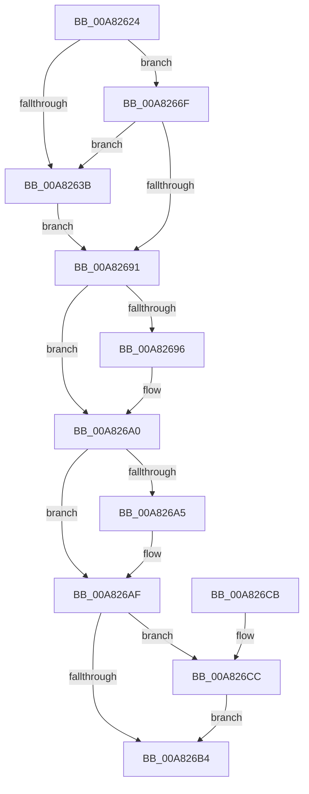

# PopBsdFlush

- RVA: `0x00A82624`–`0x00A826D8` (길이 `180` bytes)
- VA: `0x0000000140A82624`
- 실행 섹션: `PAGE`
- PDB 이름 있음: `예`; PDB Function 태그: `아니요`
- unwind 정보 RVA: `0x000B72DC`
- 디코드: `47`개 명령, `180/180` bytes 표시
- 미해석 바이트: `0` (있으면 어셈블리에 `.byte`로 보존)

> 이 문서는 커널 이미지의 기계어와 PDB 기호를 분석해 생성했습니다. 4번과 5번은 함수 원형과 자료형을 바이너리 사용 방식에서 추정한 C 해석이며 원본 소스 복구 결과는 아닙니다.

## 1. Dependencies

- 직접 호출 지점: **8**; 고유 호출 대상: **5**
- 직접 호출자로 확인된 함수: **3**
- RIP 상대 이미지 참조: **3**

### Outgoing calls
- `0x00A82642` → [PopReleaseRwLock](../../text/2D/PopReleaseRwLock_function_002DFBBC.md) (function, `0x002DFBBC`)
- `0x00A8265C` → [KeWaitForSingleObject](../../text/20/KeWaitForSingleObject_function_0020E6B0.md) (function, `0x0020E6B0`)
- `0x00A82668` → [PopAcquireRwLockExclusive](../../text/43/PopAcquireRwLockExclusive_function_00430B44.md) (function, `0x00430B44`)
- `0x00A82688` → [KeWaitForSingleObject](../../text/20/KeWaitForSingleObject_function_0020E6B0.md) (function, `0x0020E6B0`)
- `0x00A8269B` → [PopWriteBsdPoInfo](../../text/43/PopWriteBsdPoInfo_function_00430768.md) (function, `0x00430768`)
- `0x00A826AA` → [PopWriteBsdPoInfo](../../text/43/PopWriteBsdPoInfo_function_00430768.md) (function, `0x00430768`)
- `0x00A826C0` → [KeSetEvent](../../text/33/KeSetEvent_function_0033F310.md) (function, `0x0033F310`)
- `0x00A826D1` → [PopWriteBsdPoInfo](../../text/43/PopWriteBsdPoInfo_function_00430768.md) (function, `0x00430768`)

### Direct callers
- [PopBsdHandleRequest](../../text/4B/PopBsdHandleRequest_function_004B27A0.md) at `0x004B27EB`
- [PopBsdFlushWorker](PopBsdFlushWorker_function_00A82590.md) at `0x00A825A5`
- [PopBsdUpdateWorker](PopBsdUpdateWorker_function_00A825D0.md) at `0x00A82614`

### Static image references
- `0x00A82632` → RVA `0x00F0F1C4` (`.data`; read)
- `0x00A8263B` → RVA `0x00F0F1E0` (`.data`; read)
- `0x00A8264D` → RVA `0x00F0F1C0` (`.data`; read)

## 2. Other-region calls and transfers

- 다른 실행 섹션으로 향하는 call: **8**
  - `0x00A82642` → [PopReleaseRwLock](../../text/2D/PopReleaseRwLock_function_002DFBBC.md) (`PAGE` → `.text`)
  - `0x00A8265C` → [KeWaitForSingleObject](../../text/20/KeWaitForSingleObject_function_0020E6B0.md) (`PAGE` → `.text`)
  - `0x00A82668` → [PopAcquireRwLockExclusive](../../text/43/PopAcquireRwLockExclusive_function_00430B44.md) (`PAGE` → `.text`)
  - `0x00A82688` → [KeWaitForSingleObject](../../text/20/KeWaitForSingleObject_function_0020E6B0.md) (`PAGE` → `.text`)
  - `0x00A8269B` → [PopWriteBsdPoInfo](../../text/43/PopWriteBsdPoInfo_function_00430768.md) (`PAGE` → `.text`)
  - `0x00A826AA` → [PopWriteBsdPoInfo](../../text/43/PopWriteBsdPoInfo_function_00430768.md) (`PAGE` → `.text`)
  - `0x00A826C0` → [KeSetEvent](../../text/33/KeSetEvent_function_0033F310.md) (`PAGE` → `.text`)
  - `0x00A826D1` → [PopWriteBsdPoInfo](../../text/43/PopWriteBsdPoInfo_function_00430768.md) (`PAGE` → `.text`)
- 별도 외부 분기/꼬리 이동을 확인하지 못했습니다.

## 3. Assembly (complete function range)

```asm
00A82624  40 53                           push rbx
00A82626  48 83 EC 30                     sub rsp, 0x30
00A8262A  48 83 64 24 48 00               and qword ptr [rsp + 0x48], 0
00A82630  8B D9                           mov ebx, ecx
00A82632  83 3D 8B CB 48 00 00            cmp dword ptr [rip + 0x48cb8b], 0
00A82639  75 34                           jne 0x140a8266f
00A8263B  48 8D 0D 9E CB 48 00            lea rcx, [rip + 0x48cb9e]
00A82642  E8 75 D5 85 FF                  call 0x1402dfbbc
00A82647  48 83 64 24 20 00               and qword ptr [rsp + 0x20], 0
00A8264D  48 8D 0D 6C CB 48 00            lea rcx, [rip + 0x48cb6c]
00A82654  45 33 C9                        xor r9d, r9d
00A82657  45 33 C0                        xor r8d, r8d
00A8265A  33 D2                           xor edx, edx
00A8265C  E8 4F C0 78 FF                  call 0x14020e6b0
00A82661  48 8D 0D 78 CB 48 00            lea rcx, [rip + 0x48cb78]
00A82668  E8 D7 E4 9A FF                  call 0x140430b44
00A8266D  EB 22                           jmp 0x140a82691
00A8266F  48 8D 44 24 48                  lea rax, [rsp + 0x48]
00A82674  45 33 C9                        xor r9d, r9d
00A82677  45 33 C0                        xor r8d, r8d
00A8267A  48 89 44 24 20                  mov qword ptr [rsp + 0x20], rax
00A8267F  33 D2                           xor edx, edx
00A82681  48 8D 0D 38 CB 48 00            lea rcx, [rip + 0x48cb38]
00A82688  E8 23 C0 78 FF                  call 0x14020e6b0
00A8268D  85 C0                           test eax, eax
00A8268F  78 AA                           js 0x140a8263b
00A82691  F6 C3 01                        test bl, 1
00A82694  74 0A                           je 0x140a826a0
00A82696  B9 07 00 00 00                  mov ecx, 7
00A8269B  E8 C8 E0 9A FF                  call 0x140430768
00A826A0  F6 C3 02                        test bl, 2
00A826A3  74 0A                           je 0x140a826af
00A826A5  B9 10 00 00 00                  mov ecx, 0x10
00A826AA  E8 B9 E0 9A FF                  call 0x140430768
00A826AF  F6 C3 04                        test bl, 4
00A826B2  75 18                           jne 0x140a826cc
00A826B4  45 33 C0                        xor r8d, r8d
00A826B7  48 8D 0D 02 CB 48 00            lea rcx, [rip + 0x48cb02]
00A826BE  33 D2                           xor edx, edx
00A826C0  E8 4B CC 8B FF                  call 0x14033f310
00A826C5  48 83 C4 30                     add rsp, 0x30
00A826C9  5B                              pop rbx
00A826CA  C3                              ret
00A826CB  CC                              int3
00A826CC  B9 0E 00 00 00                  mov ecx, 0xe
00A826D1  E8 92 E0 9A FF                  call 0x140430768
00A826D6  EB DC                           jmp 0x140a826b4
```

## 4. C-style interpretation (structured pseudocode)

```c
__int64 __fastcall PopBsdFlush(int a1, int a2, int a3, int a4)
{
    __int64 result;
    __int64 v_rsp;
    unsigned __int64 v_stack_m18;
    unsigned __int64 v_stack_p10;

    v_rsp = (v_rsp) - (48);
    if ((*(unsigned int *)(v_rip + 4770699)) != 0) goto loc_00A8266F;
loc_00A8263B:
    result = PopReleaseRwLock(v_rip + 4770718, a2, a3, a4);
    a4 = 0;
    a3 = 0;
    a2 = 0;
    result = KeWaitForSingleObject(v_rip + 4770668, a2, a3, a4);
    result = PopAcquireRwLockExclusive(v_rip + 4770680, a2, a3, a4);
    goto loc_00A82691;
loc_00A8266F:
    a4 = 0;
    a3 = 0;
    v_stack_m18 = v_stack_p10;
    a2 = 0;
    result = KeWaitForSingleObject(v_rip + 4770616, a2, a3, a4);
    if (sign_flag) goto loc_00A8263B;
loc_00A82691:
    if ((((unsigned __int8)((unsigned int)(a1))) & (1)) != 0) {
        a1 = 7;
        result = PopWriteBsdPoInfo(a1, a2, a3, a4);
    }
    if ((((unsigned __int8)((unsigned int)(a1))) & (2)) != 0) {
        a1 = 16;
        result = PopWriteBsdPoInfo(a1, a2, a3, a4);
    }
    if ((((unsigned __int8)((unsigned int)(a1))) & (4)) != 0) goto loc_00A826CC;
loc_00A826B4:
    a3 = 0;
    a2 = 0;
    result = KeSetEvent(v_rip + 4770562, a2, a3, a4);
    v_rsp = (v_rsp) + (48);
    return result;
loc_00A826CC:
    result = PopWriteBsdPoInfo(14, a2, a3, a4);
    goto loc_00A826B4;
}
```

## 5. (Beta) C Style

```c
int64_t PopBsdFlush(int32_t Arg1, int32_t Arg2, int32_t Arg3, int32_t Arg4)
{
    int64_t result;
    int64_t local_rsp;
    uint64_t v_stack_m18;
    uint64_t v_stack_p10;

    local_rsp = (local_rsp) - (48);
    if ((*(uint32_t *)(v_rip + 0x48CB8B)) != 0) goto loc_00A8266F;
loc_00A8263B:
    result = PopReleaseRwLock(v_rip + 4770718, Arg2, Arg3, Arg4);
    Arg4 = 0;
    Arg3 = 0;
    Arg2 = 0;
    result = KeWaitForSingleObject(v_rip + 4770668, Arg2, Arg3, Arg4);
    result = PopAcquireRwLockExclusive(v_rip + 4770680, Arg2, Arg3, Arg4);
    goto loc_00A82691;
loc_00A8266F:
    Arg4 = 0;
    Arg3 = 0;
    v_stack_m18 = v_stack_p10;
    Arg2 = 0;
    result = KeWaitForSingleObject(v_rip + 4770616, Arg2, Arg3, Arg4);
    if (sign_flag) goto loc_00A8263B;
loc_00A82691:
    if ((((uint8_t)((uint32_t)(Arg1))) & (1)) != 0) {
        Arg1 = 7;
        result = PopWriteBsdPoInfo(Arg1, Arg2, Arg3, Arg4);
    }
    if ((((uint8_t)((uint32_t)(Arg1))) & (2)) != 0) {
        Arg1 = 16;
        result = PopWriteBsdPoInfo(Arg1, Arg2, Arg3, Arg4);
    }
    if ((((uint8_t)((uint32_t)(Arg1))) & (4)) != 0) goto loc_00A826CC;
loc_00A826B4:
    Arg3 = 0;
    Arg2 = 0;
    result = KeSetEvent(v_rip + 4770562, Arg2, Arg3, Arg4);
    local_rsp = (local_rsp) + (48);
    return result;
loc_00A826CC:
    result = PopWriteBsdPoInfo(14, Arg2, Arg3, Arg4);
    goto loc_00A826B4;
}
```

## 6. Execution-region graph

[열기: 2D/3D 그래프와 함수 탐색 컨트롤 패널](../../../control-panel.html?section=page&rva=0x00A82624&view=graph)

- 2D 그래프는 위에서 아래로 흐르고, 3D 그래프는 빈 공간을 드래그해 회전합니다. Shift+드래그는 이동, 휠은 확대·축소, 함수 노드 선택은 대상 보고서 이동입니다.

### Static fallback


