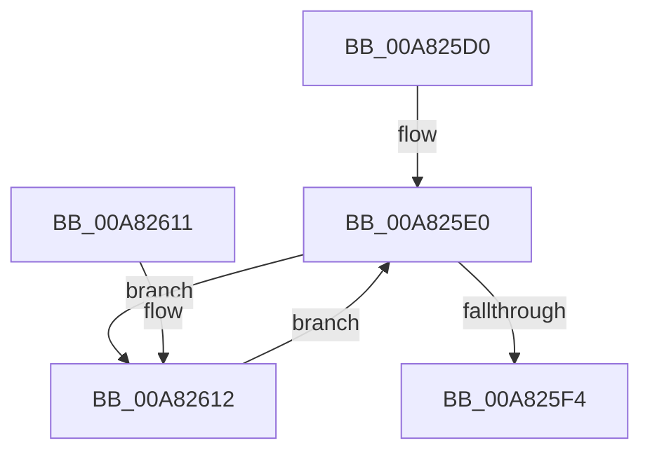

# PopBsdUpdateWorker

- RVA: `0x00A825D0`–`0x00A8261B` (길이 `75` bytes)
- VA: `0x0000000140A825D0`
- 실행 섹션: `PAGE`
- PDB 이름 있음: `예`; PDB Function 태그: `아니요`
- unwind 정보 RVA: `0x0006EDE0`
- 디코드: `17`개 명령, `75/75` bytes 표시
- 미해석 바이트: `0` (있으면 어셈블리에 `.byte`로 보존)

> 이 문서는 커널 이미지의 기계어와 PDB 기호를 분석해 생성했습니다. 4번과 5번은 함수 원형과 자료형을 바이너리 사용 방식에서 추정한 C 해석이며 원본 소스 복구 결과는 아닙니다.

## 1. Dependencies

- 직접 호출 지점: **4**; 고유 호출 대상: **4**
- 직접 호출자로 확인된 함수: **0**
- RIP 상대 이미지 참조: **4**

### Outgoing calls
- `0x00A825DB` → [PopAcquireRwLockExclusive](../../text/43/PopAcquireRwLockExclusive_function_00430B44.md) (function, `0x00430B44`)
- `0x00A825FB` → [PopOkayToQueueNextWorkItem](../../text/4A/PopOkayToQueueNextWorkItem_function_004AED54.md) (function, `0x004AED54`)
- `0x00A82607` → [PopReleaseRwLock](../../text/2D/PopReleaseRwLock_function_002DFBBC.md) (function, `0x002DFBBC`)
- `0x00A82614` → [PopBsdFlush](PopBsdFlush_function_00A82624.md) (function, `0x00A82624`)

### Direct callers
- 이 함수 시작 RVA로 연결되는 직접 call은 확인되지 않았습니다. 간접 호출은 완전히 역산할 수 없습니다.

### Static image references
- `0x00A825D4` → RVA `0x00F0F1E0` (`.data`; read)
- `0x00A825E0` → RVA `0x00F0EFFC` (`.data`; read)
- `0x00A825E6` → RVA `0x00F0EFFC` (`.data`; write)
- `0x00A825F4` → RVA `0x00F0F0C0` (`.data`; read)

## 2. Other-region calls and transfers

- 다른 실행 섹션으로 향하는 call: **3**
  - `0x00A825DB` → [PopAcquireRwLockExclusive](../../text/43/PopAcquireRwLockExclusive_function_00430B44.md) (`PAGE` → `.text`)
  - `0x00A825FB` → [PopOkayToQueueNextWorkItem](../../text/4A/PopOkayToQueueNextWorkItem_function_004AED54.md) (`PAGE` → `.text`)
  - `0x00A82607` → [PopReleaseRwLock](../../text/2D/PopReleaseRwLock_function_002DFBBC.md) (`PAGE` → `.text`)
- 별도 외부 분기/꼬리 이동을 확인하지 못했습니다.

## 3. Assembly (complete function range)

```asm
00A825D0  48 83 EC 28                     sub rsp, 0x28
00A825D4  48 8D 0D 05 CC 48 00            lea rcx, [rip + 0x48cc05]
00A825DB  E8 64 E5 9A FF                  call 0x140430b44
00A825E0  8B 05 16 CA 48 00               mov eax, dword ptr [rip + 0x48ca16]
00A825E6  C7 05 0C CA 48 00 00 00 00 00   mov dword ptr [rip + 0x48ca0c], 0
00A825F0  85 C0                           test eax, eax
00A825F2  75 1E                           jne 0x140a82612
00A825F4  48 8D 0D C5 CA 48 00            lea rcx, [rip + 0x48cac5]
00A825FB  E8 54 C7 A2 FF                  call 0x1404aed54
00A82600  48 8D 0D D9 CB 48 00            lea rcx, [rip + 0x48cbd9]
00A82607  E8 B0 D5 85 FF                  call 0x1402dfbbc
00A8260C  48 83 C4 28                     add rsp, 0x28
00A82610  C3                              ret
00A82611  CC                              int3
00A82612  8B C8                           mov ecx, eax
00A82614  E8 0B 00 00 00                  call 0x140a82624
00A82619  EB C5                           jmp 0x140a825e0
```

## 4. C-style interpretation (structured pseudocode)

```c
__int64 __fastcall PopBsdUpdateWorker(void)
{
    __int64 result;
    __int64 v_rsp;

    v_rsp = (v_rsp) - (40);
    result = PopAcquireRwLockExclusive(v_rip + 4770821, a2, a3, a4);
loc_00A825E0:
    *(unsigned int *)(v_rip + 4770316) = 0;
    if ((unsigned int)((unsigned int)(*(unsigned int *)(v_rip + 4770326))) != 0) goto loc_00A82612;
    result = PopOkayToQueueNextWorkItem(v_rip + 4770501, a2, a3, a4);
    result = PopReleaseRwLock(v_rip + 4770777, a2, a3, a4);
    v_rsp = (v_rsp) + (40);
    return result;
loc_00A82612:
    result = PopBsdFlush((unsigned int)((unsigned int)(result)), a2, a3, a4);
    goto loc_00A825E0;
}
```

## 5. (Beta) C Style

```c
void PopBsdUpdateWorker(void)
{
    int64_t result;
    int64_t local_rsp;

    local_rsp = (local_rsp) - (40);
    result = PopAcquireRwLockExclusive(v_rip + 4770821, a2, a3, a4);
loc_00A825E0:
    *(uint32_t *)(v_rip + 0x48CA0C) = 0;
    if ((uint32_t)((uint32_t)(*(uint32_t *)(v_rip + 0x48CA16))) != 0) goto loc_00A82612;
    result = PopOkayToQueueNextWorkItem(v_rip + 4770501, a2, a3, a4);
    result = PopReleaseRwLock(v_rip + 4770777, a2, a3, a4);
    local_rsp = (local_rsp) + (40);
    return result;
loc_00A82612:
    result = PopBsdFlush((uint32_t)((uint32_t)(result)), a2, a3, a4);
    goto loc_00A825E0;
}
```

## 6. Execution-region graph

[열기: 2D/3D 그래프와 함수 탐색 컨트롤 패널](../../../control-panel.html?section=page&rva=0x00A825D0&view=graph)

- 2D 그래프는 위에서 아래로 흐르고, 3D 그래프는 빈 공간을 드래그해 회전합니다. Shift+드래그는 이동, 휠은 확대·축소, 함수 노드 선택은 대상 보고서 이동입니다.

### Static fallback


