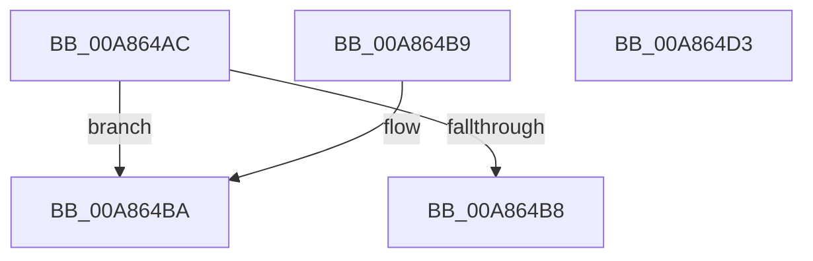

# PopCapturePlatformRole

- RVA: `0x00A864AC`–`0x00A864D4` (길이 `40` bytes)
- VA: `0x0000000140A864AC`
- 실행 섹션: `PAGE`
- PDB 이름 있음: `예`; PDB Function 태그: `아니요`
- unwind 정보 RVA: `0x000DB714`
- 디코드: `14`개 명령, `40/40` bytes 표시
- 미해석 바이트: `0` (있으면 어셈블리에 `.byte`로 보존)

> 이 문서는 커널 이미지의 기계어와 PDB 기호를 분석해 생성했습니다. 4번과 5번은 함수 원형과 자료형을 바이너리 사용 방식에서 추정한 C 해석이며 원본 소스 복구 결과는 아닙니다.

## 1. Dependencies

- 직접 호출 지점: **0**; 고유 호출 대상: **0**
- 직접 호출자로 확인된 함수: **3**
- RIP 상대 이미지 참조: **2**

### Outgoing calls
- 직접 디코드된 call 명령이 없습니다.

### Direct callers
- [NtPowerInformation](../95/NtPowerInformation_function_00955D80.md) at `0x00957806`
- [PopConfigureHeteroPolicies](../A3/PopConfigureHeteroPolicies_function_00A35B30.md) at `0x00A361C9`
- [PopDripsWatchdogInitialize](../../init/C4/PopDripsWatchdogInitialize_function_00C43BCC.md) at `0x00C43C32`

### Static image references
- `0x00A864AC` → RVA `0x00E67398` (`.data`; read)
- `0x00A864BA` → RVA `0x00F0C030` (`.data`; read)

## 2. Other-region calls and transfers

- 다른 실행 섹션으로 향하는 call: **0**
- 별도 외부 분기/꼬리 이동을 확인하지 못했습니다.

## 3. Assembly (complete function range)

```asm
00A864AC  8B 05 E6 0E 3E 00               mov eax, dword ptr [rip + 0x3e0ee6]
00A864B2  33 C9                           xor ecx, ecx
00A864B4  85 C0                           test eax, eax
00A864B6  74 02                           je 0x140a864ba
00A864B8  C3                              ret
00A864B9  CC                              int3
00A864BA  39 0D 70 5B 48 00               cmp dword ptr [rip + 0x485b70], ecx
00A864C0  0F 97 C1                        seta cl
00A864C3  FF C1                           inc ecx
00A864C5  33 C0                           xor eax, eax
00A864C7  F0 0F B1 0D C9 0E 3E 00         lock cmpxchg dword ptr [rip + 0x3e0ec9], ecx
00A864CF  0F 44 C1                        cmove eax, ecx
00A864D2  C3                              ret
00A864D3  CC                              int3
```

## 4. C-style interpretation (structured pseudocode)

```c
__int64 __fastcall PopCapturePlatformRole(int a1)
{
    __int64 result;

    a1 = 0;
    if ((unsigned int)((unsigned int)(*(unsigned int *)(v_rip + 4067046))) == 0) goto loc_00A864BA;
    return (unsigned int)(*(unsigned int *)(v_rip + 4067046));
loc_00A864BA:
    a1 = ((*(unsigned int *)(v_rip + 4742000)) > 0) ? 1 : 0;
    a1 = (unsigned int)((a1) + 1);
    result = 0;
    if (condition_is_equal) { result = a1; }
    return result;
}
```

## 5. (Beta) C Style

```c
int64_t PopCapturePlatformRole(int32_t Arg1)
{
    int64_t result;

    Arg1 = 0;
    if ((uint32_t)((uint32_t)(*(uint32_t *)(v_rip + 0x3E0EE6))) == 0) goto loc_00A864BA;
    return (uint32_t)(*(uint32_t *)(v_rip + 0x3E0EE6));
loc_00A864BA:
    Arg1 = ((*(uint32_t *)(v_rip + 0x485B70)) > 0) ? 1 : 0;
    Arg1 = (uint32_t)((Arg1) + 1);
    result = 0;
    if (condition_is_equal) { result = Arg1; }
    return result;
}
```

## 6. Execution-region graph

[열기: 2D/3D 그래프와 함수 탐색 컨트롤 패널](../../../control-panel.html?section=page&rva=0x00A864AC&view=graph)

- 2D 그래프는 위에서 아래로 흐르고, 3D 그래프는 빈 공간을 드래그해 회전합니다. Shift+드래그는 이동, 휠은 확대·축소, 함수 노드 선택은 대상 보고서 이동입니다.

### Static fallback


