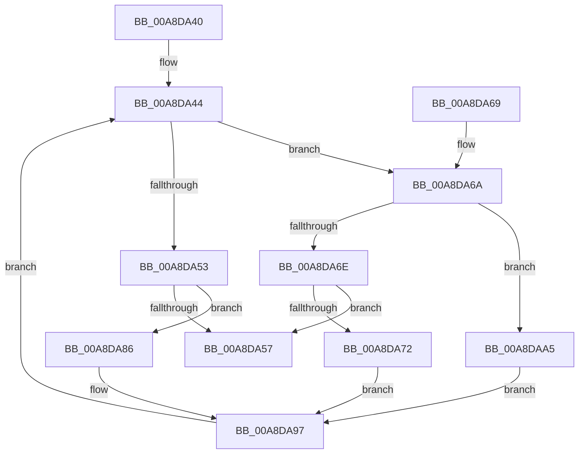

# PopCoalescingCallbackWorker

- RVA: `0x00A8DA40`–`0x00A8DAC0` (길이 `128` bytes)
- VA: `0x0000000140A8DA40`
- 실행 섹션: `PAGE`
- PDB 이름 있음: `예`; PDB Function 태그: `아니요`
- unwind 정보 RVA: `0x0006FF68`
- 디코드: `36`개 명령, `128/128` bytes 표시
- 미해석 바이트: `0` (있으면 어셈블리에 `.byte`로 보존)

> 이 문서는 커널 이미지의 기계어와 PDB 기호를 분석해 생성했습니다. 4번과 5번은 함수 원형과 자료형을 바이너리 사용 방식에서 추정한 C 해석이며 원본 소스 복구 결과는 아닙니다.

## 1. Dependencies

- 직접 호출 지점: **8**; 고유 호출 대상: **4**
- 직접 호출자로 확인된 함수: **0**
- RIP 상대 이미지 참조: **3**

### Outgoing calls
- `0x00A8DA44` → [PopAcquirePolicyLock](../../pagelk/B7/PopAcquirePolicyLock_function_00B783C0.md) (function, `0x00B783C0`)
- `0x00A8DA5F` → [PopReleasePolicyLock](../../pagelk/B7/PopReleasePolicyLock_function_00B78410.md) (function, `0x00B78410`)
- `0x00A8DA7A` → [PopReleasePolicyLock](../../pagelk/B7/PopReleasePolicyLock_function_00B78410.md) (function, `0x00B78410`)
- `0x00A8DA88` → [PopCoalescingSetActiveState](../../text/4B/PopCoalescingSetActiveState_function_004B7E18.md) (function, `0x004B7E18`)
- `0x00A8DA8D` → [PopReleasePolicyLock](../../pagelk/B7/PopReleasePolicyLock_function_00B78410.md) (function, `0x00B78410`)
- `0x00A8DA9E` → [PoIssueCoalescingNotification](../../text/44/PoIssueCoalescingNotification_function_0044D670.md) (function, `0x0044D670`)
- `0x00A8DAAF` → [PopCoalescingSetActiveState](../../text/4B/PopCoalescingSetActiveState_function_004B7E18.md) (function, `0x004B7E18`)
- `0x00A8DAB4` → [PopReleasePolicyLock](../../pagelk/B7/PopReleasePolicyLock_function_00B78410.md) (function, `0x00B78410`)

### Direct callers
- 이 함수 시작 RVA로 연결되는 직접 call은 확인되지 않았습니다. 간접 호출은 완전히 역산할 수 없습니다.

### Static image references
- `0x00A8DA49` → RVA `0x00F0E068` (`.data`; read)
- `0x00A8DA59` → RVA `0x00F0E068` (`.data`; write)
- `0x00A8DA97` → RVA `0x00F0DFB8` (`.data`; read)

## 2. Other-region calls and transfers

- 다른 실행 섹션으로 향하는 call: **8**
  - `0x00A8DA44` → [PopAcquirePolicyLock](../../pagelk/B7/PopAcquirePolicyLock_function_00B783C0.md) (`PAGE` → `PAGELK`)
  - `0x00A8DA5F` → [PopReleasePolicyLock](../../pagelk/B7/PopReleasePolicyLock_function_00B78410.md) (`PAGE` → `PAGELK`)
  - `0x00A8DA7A` → [PopReleasePolicyLock](../../pagelk/B7/PopReleasePolicyLock_function_00B78410.md) (`PAGE` → `PAGELK`)
  - `0x00A8DA88` → [PopCoalescingSetActiveState](../../text/4B/PopCoalescingSetActiveState_function_004B7E18.md) (`PAGE` → `.text`)
  - `0x00A8DA8D` → [PopReleasePolicyLock](../../pagelk/B7/PopReleasePolicyLock_function_00B78410.md) (`PAGE` → `PAGELK`)
  - `0x00A8DA9E` → [PoIssueCoalescingNotification](../../text/44/PoIssueCoalescingNotification_function_0044D670.md) (`PAGE` → `.text`)
  - `0x00A8DAAF` → [PopCoalescingSetActiveState](../../text/4B/PopCoalescingSetActiveState_function_004B7E18.md) (`PAGE` → `.text`)
  - `0x00A8DAB4` → [PopReleasePolicyLock](../../pagelk/B7/PopReleasePolicyLock_function_00B78410.md) (`PAGE` → `PAGELK`)
- 별도 외부 분기/꼬리 이동을 확인하지 못했습니다.

## 3. Assembly (complete function range)

```asm
00A8DA40  48 83 EC 28                     sub rsp, 0x28
00A8DA44  E8 77 A9 0E 00                  call 0x140b783c0
00A8DA49  8A 05 19 06 48 00               mov al, byte ptr [rip + 0x480619]
00A8DA4F  A8 02                           test al, 2
00A8DA51  75 17                           jne 0x140a8da6a
00A8DA53  A8 01                           test al, 1
00A8DA55  75 2F                           jne 0x140a8da86
00A8DA57  24 F7                           and al, 0xf7
00A8DA59  88 05 09 06 48 00               mov byte ptr [rip + 0x480609], al
00A8DA5F  E8 AC A9 0E 00                  call 0x140b78410
00A8DA64  48 83 C4 28                     add rsp, 0x28
00A8DA68  C3                              ret
00A8DA69  CC                              int3
00A8DA6A  A8 01                           test al, 1
00A8DA6C  74 37                           je 0x140a8daa5
00A8DA6E  A8 04                           test al, 4
00A8DA70  74 E5                           je 0x140a8da57
00A8DA72  24 FB                           and al, 0xfb
00A8DA74  88 05 EE 05 48 00               mov byte ptr [rip + 0x4805ee], al
00A8DA7A  E8 91 A9 0E 00                  call 0x140b78410
00A8DA7F  BA 03 00 00 00                  mov edx, 3
00A8DA84  EB 11                           jmp 0x140a8da97
00A8DA86  33 C9                           xor ecx, ecx
00A8DA88  E8 8B A3 A2 FF                  call 0x1404b7e18
00A8DA8D  E8 7E A9 0E 00                  call 0x140b78410
00A8DA92  BA 02 00 00 00                  mov edx, 2
00A8DA97  48 8B 0D 1A 05 48 00            mov rcx, qword ptr [rip + 0x48051a]
00A8DA9E  E8 CD FB 9B FF                  call 0x14044d670
00A8DAA3  EB 9F                           jmp 0x140a8da44
00A8DAA5  24 FB                           and al, 0xfb
00A8DAA7  B1 01                           mov cl, 1
00A8DAA9  88 05 B9 05 48 00               mov byte ptr [rip + 0x4805b9], al
00A8DAAF  E8 64 A3 A2 FF                  call 0x1404b7e18
00A8DAB4  E8 57 A9 0E 00                  call 0x140b78410
00A8DAB9  BA 01 00 00 00                  mov edx, 1
00A8DABE  EB D7                           jmp 0x140a8da97
```

## 4. C-style interpretation (structured pseudocode)

```c
__int64 __fastcall PopCoalescingCallbackWorker(int a1)
{
    __int64 result;
    __int64 v_rsp;

    v_rsp = (v_rsp) - (40);
loc_00A8DA44:
    result = PopAcquirePolicyLock(a1, a2, a3, a4);
    if ((((unsigned __int8)(*(unsigned __int8 *)(v_rip + 4720153))) & (2)) != 0) goto loc_00A8DA6A;
    if ((((unsigned __int8)(*(unsigned __int8 *)(v_rip + 4720153))) & (1)) != 0) goto loc_00A8DA86;
loc_00A8DA57:
    result = (unsigned __int8)((*(unsigned __int8 *)(v_rip + 4720153)) & (247));
    *(unsigned __int8 *)(v_rip + 4720137) = (unsigned __int8)(result);
    result = PopReleasePolicyLock(a1, a2, a3, a4);
    v_rsp = (v_rsp) + (40);
    return result;
loc_00A8DA6A:
    if ((((unsigned __int8)(result)) & (1)) == 0) goto loc_00A8DAA5;
    if ((((unsigned __int8)(result)) & (4)) == 0) goto loc_00A8DA57;
    result = (unsigned __int8)((result) & (251));
    *(unsigned __int8 *)(v_rip + 4720110) = (unsigned __int8)(result);
    result = PopReleasePolicyLock(a1, a2, a3, a4);
    goto loc_00A8DA97;
loc_00A8DA86:
    a1 = 0;
    result = PopCoalescingSetActiveState(a1, 3, a3, a4);
    result = PopReleasePolicyLock(a1, 3, a3, a4);
loc_00A8DA97:
    result = PoIssueCoalescingNotification(*(unsigned __int64 *)(v_rip + 4719898), 2, a3, a4);
    goto loc_00A8DA44;
loc_00A8DAA5:
    result = (unsigned __int8)((result) & (251));
    *(unsigned __int8 *)(v_rip + 4720057) = (unsigned __int8)(result);
    result = PopCoalescingSetActiveState(1, 2, a3, a4);
    result = PopReleasePolicyLock(1, 2, a3, a4);
    goto loc_00A8DA97;
}
```

## 5. (Beta) C Style

```c
int64_t PopCoalescingCallbackWorker(int32_t Arg1)
{
    int64_t result;
    int64_t local_rsp;

    local_rsp = (local_rsp) - (40);
loc_00A8DA44:
    result = PopAcquirePolicyLock(Arg1, a2, a3, a4);
    if ((((uint8_t)(*(uint8_t *)(v_rip + 0x480619))) & (2)) != 0) goto loc_00A8DA6A;
    if ((((uint8_t)(*(uint8_t *)(v_rip + 0x480619))) & (1)) != 0) goto loc_00A8DA86;
loc_00A8DA57:
    result = (uint8_t)((*(uint8_t *)(v_rip + 0x480619)) & (247));
    *(uint8_t *)(v_rip + 0x480609) = (uint8_t)(result);
    result = PopReleasePolicyLock(Arg1, a2, a3, a4);
    local_rsp = (local_rsp) + (40);
    return result;
loc_00A8DA6A:
    if ((((uint8_t)(result)) & (1)) == 0) goto loc_00A8DAA5;
    if ((((uint8_t)(result)) & (4)) == 0) goto loc_00A8DA57;
    result = (uint8_t)((result) & (251));
    *(uint8_t *)(v_rip + 0x4805EE) = (uint8_t)(result);
    result = PopReleasePolicyLock(Arg1, a2, a3, a4);
    goto loc_00A8DA97;
loc_00A8DA86:
    Arg1 = 0;
    result = PopCoalescingSetActiveState(Arg1, 3, a3, a4);
    result = PopReleasePolicyLock(Arg1, 3, a3, a4);
loc_00A8DA97:
    result = PoIssueCoalescingNotification(*(uint64_t *)(v_rip + 0x48051A), 2, a3, a4);
    goto loc_00A8DA44;
loc_00A8DAA5:
    result = (uint8_t)((result) & (251));
    *(uint8_t *)(v_rip + 0x4805B9) = (uint8_t)(result);
    result = PopCoalescingSetActiveState(1, 2, a3, a4);
    result = PopReleasePolicyLock(1, 2, a3, a4);
    goto loc_00A8DA97;
}
```

## 6. Execution-region graph

[열기: 2D/3D 그래프와 함수 탐색 컨트롤 패널](../../../control-panel.html?section=page&rva=0x00A8DA40&view=graph)

- 2D 그래프는 위에서 아래로 흐르고, 3D 그래프는 빈 공간을 드래그해 회전합니다. Shift+드래그는 이동, 휠은 확대·축소, 함수 노드 선택은 대상 보고서 이동입니다.

### Static fallback


