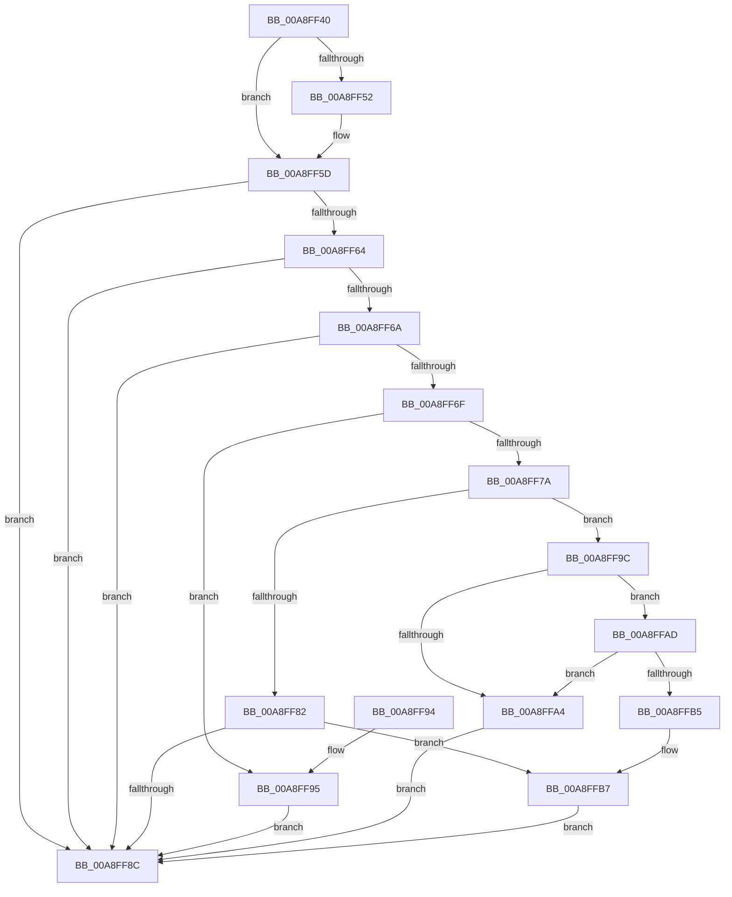

# PopConnectedStandbySettingCallback

- RVA: `0x00A8FF40`–`0x00A8FFC1` (길이 `129` bytes)
- VA: `0x0000000140A8FF40`
- 실행 섹션: `PAGE`
- PDB 이름 있음: `예`; PDB Function 태그: `아니요`
- unwind 정보 RVA: `0x0006575C`
- 디코드: `40`개 명령, `129/129` bytes 표시
- 미해석 바이트: `0` (있으면 어셈블리에 `.byte`로 보존)

> 이 문서는 커널 이미지의 기계어와 PDB 기호를 분석해 생성했습니다. 4번과 5번은 함수 원형과 자료형을 바이너리 사용 방식에서 추정한 C 해석이며 원본 소스 복구 결과는 아닙니다.

## 1. Dependencies

- 직접 호출 지점: **2**; 고유 호출 대상: **2**
- 직접 호출자로 확인된 함수: **0**
- RIP 상대 이미지 참조: **6**

### Outgoing calls
- `0x00A8FF71` → [PopIsPlatformAoAcCapable](../../text/49/PopIsPlatformAoAcCapable_function_0049BF40.md) (function, `0x0049BF40`)
- `0x00A8FFBA` → [PopFanUpdateCsState](../AD/PopFanUpdateCsState_function_00AD5958.md) (function, `0x00AD5958`)

### Direct callers
- 이 함수 시작 RVA로 연결되는 직접 call은 확인되지 않았습니다. 간접 호출은 완전히 역산할 수 없습니다.

### Static image references
- `0x00A8FF46` → RVA `0x0001C130` (`.rdata`; read)
- `0x00A8FF52` → RVA `0x0001C138` (`.rdata`; read)
- `0x00A8FF7A` → RVA `0x00F0EA20` (`.data`; read)
- `0x00A8FF82` → RVA `0x00F0EA20` (`.data`; write)
- `0x00A8FF9C` → RVA `0x00F0BD44` (`.data`; read)
- `0x00A8FFAD` → RVA `0x00E67A55` (`.data`; read)

## 2. Other-region calls and transfers

- 다른 실행 섹션으로 향하는 call: **1**
  - `0x00A8FF71` → [PopIsPlatformAoAcCapable](../../text/49/PopIsPlatformAoAcCapable_function_0049BF40.md) (`PAGE` → `.text`)
- 별도 외부 분기/꼬리 이동을 확인하지 못했습니다.

## 3. Assembly (complete function range)

```asm
00A8FF40  40 53                           push rbx
00A8FF42  48 83 EC 20                     sub rsp, 0x20
00A8FF46  4C 8B 0D E3 C1 58 FF            mov r9, qword ptr [rip - 0xa73e1d]
00A8FF4D  4C 2B 09                        sub r9, qword ptr [rcx]
00A8FF50  75 0B                           jne 0x140a8ff5d
00A8FF52  4C 8B 0D DF C1 58 FF            mov r9, qword ptr [rip - 0xa73e21]
00A8FF59  4C 2B 49 08                     sub r9, qword ptr [rcx + 8]
00A8FF5D  33 DB                           xor ebx, ebx
00A8FF5F  4D 85 C9                        test r9, r9
00A8FF62  75 28                           jne 0x140a8ff8c
00A8FF64  41 83 F8 04                     cmp r8d, 4
00A8FF68  75 22                           jne 0x140a8ff8c
00A8FF6A  48 85 D2                        test rdx, rdx
00A8FF6D  74 1D                           je 0x140a8ff8c
00A8FF6F  8B 0A                           mov ecx, dword ptr [rdx]
00A8FF71  E8 CA BF A0 FF                  call 0x14049bf40
00A8FF76  84 C0                           test al, al
00A8FF78  74 1B                           je 0x140a8ff95
00A8FF7A  38 1D A0 EA 47 00               cmp byte ptr [rip + 0x47eaa0], bl
00A8FF80  74 1A                           je 0x140a8ff9c
00A8FF82  88 1D 98 EA 47 00               mov byte ptr [rip + 0x47ea98], bl
00A8FF88  85 C9                           test ecx, ecx
00A8FF8A  74 2B                           je 0x140a8ffb7
00A8FF8C  8B C3                           mov eax, ebx
00A8FF8E  48 83 C4 20                     add rsp, 0x20
00A8FF92  5B                              pop rbx
00A8FF93  C3                              ret
00A8FF94  CC                              int3
00A8FF95  BB BB 00 00 C0                  mov ebx, 0xc00000bb
00A8FF9A  EB F0                           jmp 0x140a8ff8c
00A8FF9C  39 1D A2 BD 47 00               cmp dword ptr [rip + 0x47bda2], ebx
00A8FFA2  74 09                           je 0x140a8ffad
00A8FFA4  C6 05 75 EA 47 00 01            mov byte ptr [rip + 0x47ea75], 1
00A8FFAB  EB DF                           jmp 0x140a8ff8c
00A8FFAD  38 1D A2 7A 3D 00               cmp byte ptr [rip + 0x3d7aa2], bl
00A8FFB3  75 EF                           jne 0x140a8ffa4
00A8FFB5  85 C9                           test ecx, ecx
00A8FFB7  0F 95 C1                        setne cl
00A8FFBA  E8 99 59 04 00                  call 0x140ad5958
00A8FFBF  EB CB                           jmp 0x140a8ff8c
```

## 4. C-style interpretation (structured pseudocode)

```c
__int64 __fastcall PopConnectedStandbySettingCallback(__int64 a1, __int64 a2, int a3)
{
    __int64 result;
    __int64 v_rbx;
    __int64 v_rsp;

    v_rsp = (v_rsp) - (32);
    a4 = (*(unsigned __int64 *)(v_rip - 10960413)) - (*(unsigned __int64 *)(a1));
    if (!(condition_is_not_equal)) {
        a4 = *(unsigned __int64 *)(v_rip - 10960417);
        a4 = (a4) - (*(unsigned __int64 *)(a1 + 8));
    }
    v_rbx = 0;
    if (a4 != 0) goto loc_00A8FF8C;
    if (a3 != 4) goto loc_00A8FF8C;
    if (a2 == 0) goto loc_00A8FF8C;
    result = PopIsPlatformAoAcCapable((unsigned int)(*(unsigned int *)(a2)), a2, a3, a4);
    if ((unsigned __int8)(result) == 0) goto loc_00A8FF95;
    if ((*(unsigned __int8 *)(v_rip + 4713120)) == 0) goto loc_00A8FF9C;
    *(unsigned __int8 *)(v_rip + 4713112) = 0;
    if ((unsigned int)((unsigned int)(*(unsigned int *)(a2))) == 0) goto loc_00A8FFB7;
loc_00A8FF8C:
    v_rsp = (v_rsp) + (32);
    return 0;
loc_00A8FF95:
    goto loc_00A8FF8C;
loc_00A8FF9C:
    if ((*(unsigned int *)(v_rip + 4701602)) == ((unsigned int)((unsigned int)(0xC00000BBULL)))) goto loc_00A8FFAD;
loc_00A8FFA4:
    *(unsigned __int8 *)(v_rip + 4713077) = 1;
    goto loc_00A8FF8C;
loc_00A8FFAD:
    if ((*(unsigned __int8 *)(v_rip + 4029090)) != ((unsigned __int8)((unsigned int)(0xC00000BBULL)))) goto loc_00A8FFA4;
loc_00A8FFB7:
    a1 = ((unsigned int)((unsigned int)(*(unsigned int *)(a2))) != 0) ? 1 : 0;
    result = PopFanUpdateCsState(a1, a2, a3, a4);
    goto loc_00A8FF8C;
}
```

## 5. (Beta) C Style

```c
int64_t PopConnectedStandbySettingCallback(void *Arg1, int64_t Arg2, int32_t Arg3)
{
    uint8_t *arg1 = (uint8_t *)Arg1;

    int64_t result;
    int64_t local_rbx;
    int64_t local_rsp;

    local_rsp = (local_rsp) - (32);
    a4 = (*(uint64_t *)(v_rip - 0xA73E1D)) - (*(uint64_t *)(arg1));
    if (!(condition_is_not_equal)) {
        a4 = *(uint64_t *)(v_rip - 0xA73E21);
        a4 = (a4) - (*(uint64_t *)(arg1 + 0x8));
    }
    local_rbx = 0;
    if (a4 != 0) goto loc_00A8FF8C;
    if (Arg3 != 4) goto loc_00A8FF8C;
    if (Arg2 == 0) goto loc_00A8FF8C;
    result = PopIsPlatformAoAcCapable((uint32_t)(*(uint32_t *)(Arg2)), Arg2, Arg3, a4);
    if ((uint8_t)(result) == 0) goto loc_00A8FF95;
    if ((*(uint8_t *)(v_rip + 0x47EAA0)) == 0) goto loc_00A8FF9C;
    *(uint8_t *)(v_rip + 0x47EA98) = 0;
    if ((uint32_t)((uint32_t)(*(uint32_t *)(Arg2))) == 0) goto loc_00A8FFB7;
loc_00A8FF8C:
    local_rsp = (local_rsp) + (32);
    return 0;
loc_00A8FF95:
    goto loc_00A8FF8C;
loc_00A8FF9C:
    if ((*(uint32_t *)(v_rip + 0x47BDA2)) == ((uint32_t)((uint32_t)(0xC00000BBULL)))) goto loc_00A8FFAD;
loc_00A8FFA4:
    *(uint8_t *)(v_rip + 0x47EA75) = 1;
    goto loc_00A8FF8C;
loc_00A8FFAD:
    if ((*(uint8_t *)(v_rip + 0x3D7AA2)) != ((uint8_t)((uint32_t)(0xC00000BBULL)))) goto loc_00A8FFA4;
loc_00A8FFB7:
    Arg1 = ((uint32_t)((uint32_t)(*(uint32_t *)(Arg2))) != 0) ? 1 : 0;
    result = PopFanUpdateCsState(Arg1, Arg2, Arg3, a4);
    goto loc_00A8FF8C;
}
```

### 관측된 메모리 오프셋

구조체 형식이 확인되지 않은 접근은 인자 기준의 오프셋으로만 기록했습니다.

| 기준 인자 | 오프셋 표현 | 폭 (bit) | 접근 |
|---|---:|---:|---|
| `Arg1` | `+ 0x0` | `64` | `R` |
| `Arg1` | `+ 0x8` | `64` | `R` |

## 6. Execution-region graph

[열기: 2D/3D 그래프와 함수 탐색 컨트롤 패널](../../../control-panel.html?section=page&rva=0x00A8FF40&view=graph)

- 2D 그래프는 위에서 아래로 흐르고, 3D 그래프는 빈 공간을 드래그해 회전합니다. Shift+드래그는 이동, 휠은 확대·축소, 함수 노드 선택은 대상 보고서 이동입니다.

### Static fallback


