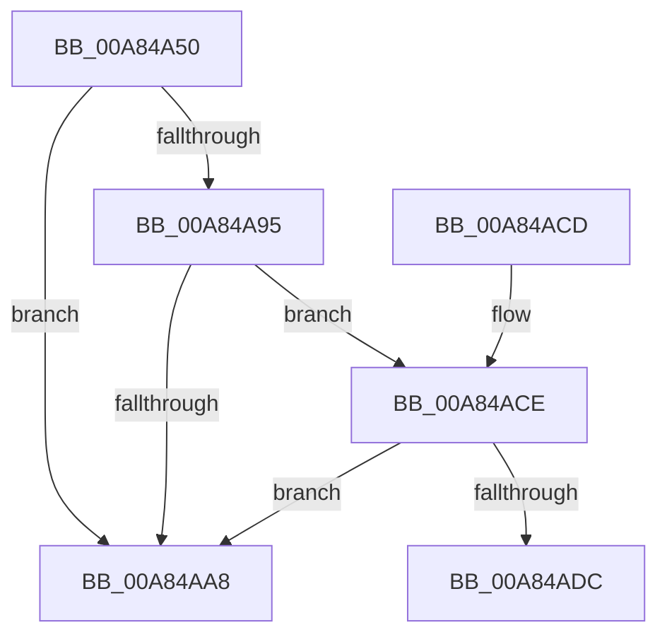

# PopDiagTraceBatteryTriggerFlags

- RVA: `0x00A84A50`–`0x00A84AE1` (길이 `145` bytes)
- VA: `0x0000000140A84A50`
- 실행 섹션: `PAGE`
- PDB 이름 있음: `예`; PDB Function 태그: `예`
- unwind 정보 RVA: `0x000B766C`
- 디코드: `36`개 명령, `145/145` bytes 표시
- 미해석 바이트: `0` (있으면 어셈블리에 `.byte`로 보존)

> 이 문서는 커널 이미지의 기계어와 PDB 기호를 분석해 생성했습니다. 4번과 5번은 함수 원형과 자료형을 바이너리 사용 방식에서 추정한 C 해석이며 원본 소스 복구 결과는 아닙니다.

## 1. Dependencies

- 직접 호출 지점: **1**; 고유 호출 대상: **1**
- 직접 호출자로 확인된 함수: **3**
- RIP 상대 이미지 참조: **4**

### Outgoing calls
- `0x00A84AAF` → [_security_check_cookie](../../text/6A/_security_check_cookie_function_006AC640.md) (function, `0x006AC640`)

### Direct callers
- [PopResetCBTriggers](../76/PopResetCBTriggers_function_007683F8.md) at `0x00768443`
- [PopBatteryApplyCompositeState](../AE/PopBatteryApplyCompositeState_function_00AE0CD0.md) at `0x00AE125D`
- [PopRecalculateCBTriggerLevels](../AE/PopRecalculateCBTriggerLevels_function_00AE3018.md) at `0x00AE30AB`
- [PopRecalculateCBTriggerLevels](../AE/PopRecalculateCBTriggerLevels_function_00AE3018.md) at `0x00AE30EE`

### Static image references
- `0x00A84A6B` → RVA `0x00E0A740` (`.data`; read)
- `0x00A84A79` → RVA `0x00F0C060` (`.data`; read)
- `0x00A84A8A` → RVA `0x00F0C20C` (`.data`; read)
- `0x00A84A95` → RVA `0x00000000` (`image boundary/outside`; read)

## 2. Other-region calls and transfers

- 다른 실행 섹션으로 향하는 call: **1**
  - `0x00A84AAF` → [_security_check_cookie](../../text/6A/_security_check_cookie_function_006AC640.md) (`PAGE` → `.text`)
- call이 아닌 외부 분기/꼬리 이동: **1**
  - `0x00A84ADC` → [sub_00B44136](../B4/Unknown_function_00B44136.md) (`tail-transfer`)

## 3. Assembly (complete function range)

```asm
00A84A50  48 8B C4                        mov rax, rsp
00A84A53  48 89 58 10                     mov qword ptr [rax + 0x10], rbx
00A84A57  48 89 70 18                     mov qword ptr [rax + 0x18], rsi
00A84A5B  48 89 78 20                     mov qword ptr [rax + 0x20], rdi
00A84A5F  55                              push rbp
00A84A60  48 8D 68 A1                     lea rbp, [rax - 0x5f]
00A84A64  48 81 EC D0 00 00 00            sub rsp, 0xd0
00A84A6B  48 8B 05 CE 5C 38 00            mov rax, qword ptr [rip + 0x385cce]
00A84A72  48 33 C4                        xor rax, rsp
00A84A75  48 89 45 47                     mov qword ptr [rbp + 0x47], rax
00A84A79  44 8A 1D E0 75 48 00            mov r11b, byte ptr [rip + 0x4875e0]
00A84A80  BE 01 00 00 00                  mov esi, 1
00A84A85  8B 01                           mov eax, dword ptr [rcx]
00A84A87  44 22 DE                        and r11b, sil
00A84A8A  8B 3D 7C 77 48 00               mov edi, dword ptr [rip + 0x48777c]
00A84A90  83 F8 04                        cmp eax, 4
00A84A93  73 13                           jae 0x140a84aa8
00A84A95  4C 8D 0D 64 B5 57 FF            lea r9, [rip - 0xa84a9c]
00A84A9C  49 8B 9C C1 30 B4 00 00         mov rbx, qword ptr [r9 + rax*8 + 0xb430]
00A84AA4  3B C6                           cmp eax, esi
00A84AA6  76 26                           jbe 0x140a84ace
00A84AA8  48 8B 4D 47                     mov rcx, qword ptr [rbp + 0x47]
00A84AAC  48 33 CC                        xor rcx, rsp
00A84AAF  E8 8C 7B C2 FF                  call 0x1406ac640
00A84AB4  4C 8D 9C 24 D0 00 00 00         lea r11, [rsp + 0xd0]
00A84ABC  49 8B 5B 18                     mov rbx, qword ptr [r11 + 0x18]
00A84AC0  49 8B 73 20                     mov rsi, qword ptr [r11 + 0x20]
00A84AC4  49 8B 7B 28                     mov rdi, qword ptr [r11 + 0x28]
00A84AC8  49 8B E3                        mov rsp, r11
00A84ACB  5D                              pop rbp
00A84ACC  C3                              ret
00A84ACD  CC                              int3
00A84ACE  44 8B 42 04                     mov r8d, dword ptr [rdx + 4]
00A84AD2  45 3B 84 81 80 B5 E0 00         cmp r8d, dword ptr [r9 + rax*4 + 0xe0b580]
00A84ADA  74 CC                           je 0x140a84aa8
00A84ADC  E9 55 F6 0B 00                  jmp 0x140b44136
```

## 4. C-style interpretation (structured pseudocode)

```c
__int64 __fastcall PopDiagTraceBatteryTriggerFlags(__int64 a1, __int64 a2)
{
    __int64 result;
    __int64 v_r11;
    __int64 v_rsp;
    unsigned __int64 v_stack_m8;

    *(unsigned __int64 *)(v_rsp + 16) = v_rbx;
    *(unsigned __int64 *)(v_rsp + 24) = v_rsi;
    *(unsigned __int64 *)(v_rsp + 32) = v_rdi;
    v_rsp = (v_rsp) - (208);
    result = (*(unsigned __int64 *)(v_rip + 3693774)) ^ (v_rsp);
    *(unsigned __int64 *)(v_rsp - 95 + 71) = result;
    v_r11 = (unsigned __int8)((*(unsigned __int8 *)(v_rip + 4748768)) & (1));
    if (((unsigned int)((unsigned int)(*(unsigned int *)(a1)))) >= 4) goto loc_00A84AA8;
    if (((unsigned int)((unsigned int)(*(unsigned int *)(a1)))) <= 1) goto loc_00A84ACE;
loc_00A84AA8:
    a1 = (*(unsigned __int64 *)(v_rsp - 95 + 71)) ^ (v_rsp);
    result = _security_check_cookie(a1, a2, a3, v_rip - 11029148);
    return result;
loc_00A84ACE:
    if (((unsigned int)((unsigned int)(*(unsigned int *)(a2 + 4)))) == (*(unsigned int *)(v_rip - 11029148 + result * 4 + 14726528))) goto loc_00A84AA8;
}
```

## 5. (Beta) C Style

```c
int64_t PopDiagTraceBatteryTriggerFlags(void *Arg1, void *Arg2)
{
    uint8_t *arg1 = (uint8_t *)Arg1;
    uint8_t *arg2 = (uint8_t *)Arg2;

    int64_t result;
    int64_t local_r11;
    int64_t local_rsp;
    uint64_t v_stack_m8;

    *(uint64_t *)(local_rsp + 0x10) = local_rbx;
    *(uint64_t *)(local_rsp + 0x18) = local_rsi;
    *(uint64_t *)(local_rsp + 0x20) = local_rdi;
    local_rsp = (local_rsp) - (208);
    result = (*(uint64_t *)(v_rip + 0x385CCE)) ^ (local_rsp);
    *(uint64_t *)(local_rsp - 0x5F + 0x47) = result;
    local_r11 = (uint8_t)((*(uint8_t *)(v_rip + 0x4875E0)) & (1));
    if (((uint32_t)((uint32_t)(*(uint32_t *)(arg1)))) >= 4) goto loc_00A84AA8;
    if (((uint32_t)((uint32_t)(*(uint32_t *)(arg1)))) <= 1) goto loc_00A84ACE;
loc_00A84AA8:
    Arg1 = (*(uint64_t *)(local_rsp - 0x5F + 0x47)) ^ (local_rsp);
    result = _security_check_cookie(Arg1, Arg2, a3, v_rip - 11029148);
    return result;
loc_00A84ACE:
    if (((uint32_t)((uint32_t)(*(uint32_t *)(arg2 + 0x4)))) == (*(uint32_t *)(v_rip - 0xA84A9C + result * 4 + 0xE0B580))) goto loc_00A84AA8;
}
```

### 관측된 메모리 오프셋

구조체 형식이 확인되지 않은 접근은 인자 기준의 오프셋으로만 기록했습니다.

| 기준 인자 | 오프셋 표현 | 폭 (bit) | 접근 |
|---|---:|---:|---|
| `Arg1` | `+ 0x0` | `32` | `R` |
| `Arg2` | `+ 0x4` | `32` | `R` |

## 6. Execution-region graph

[열기: 2D/3D 그래프와 함수 탐색 컨트롤 패널](../../../control-panel.html?section=page&rva=0x00A84A50&view=graph)

- 2D 그래프는 위에서 아래로 흐르고, 3D 그래프는 빈 공간을 드래그해 회전합니다. Shift+드래그는 이동, 휠은 확대·축소, 함수 노드 선택은 대상 보고서 이동입니다.

### Static fallback


