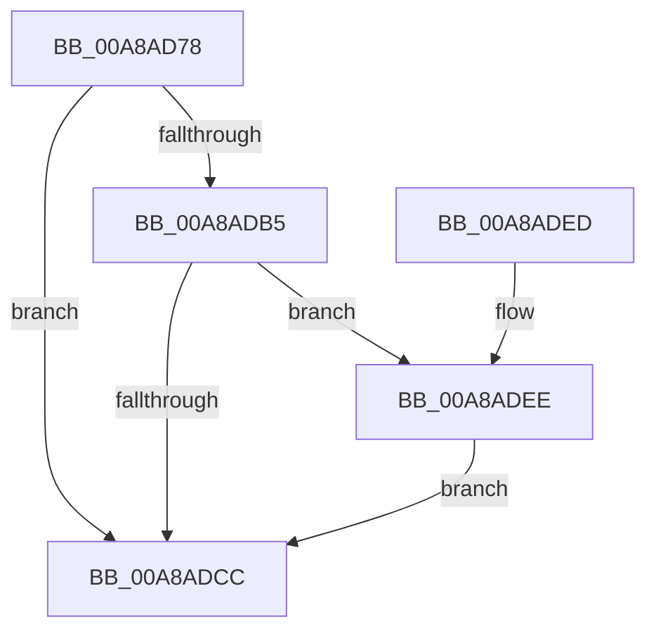

# PopDiagTraceFxDevicePreparation

- RVA: `0x00A8AD78`–`0x00A8AE7E` (길이 `262` bytes)
- VA: `0x0000000140A8AD78`
- 실행 섹션: `PAGE`
- PDB 이름 있음: `예`; PDB Function 태그: `아니요`
- unwind 정보 RVA: `0x000B85F0`
- 디코드: `64`개 명령, `262/262` bytes 표시
- 미해석 바이트: `0` (있으면 어셈블리에 `.byte`로 보존)

> 이 문서는 커널 이미지의 기계어와 PDB 기호를 분석해 생성했습니다. 4번과 5번은 함수 원형과 자료형을 바이너리 사용 방식에서 추정한 C 해석이며 원본 소스 복구 결과는 아닙니다.

## 1. Dependencies

- 직접 호출 지점: **3**; 고유 호출 대상: **3**
- 직접 호출자로 확인된 함수: **2**
- RIP 상대 이미지 참조: **4**

### Outgoing calls
- `0x00A8ADC3` → [EtwEventEnabled](../../text/39/EtwEventEnabled_function_00392450.md) (function, `0x00392450`)
- `0x00A8ADD3` → [_security_check_cookie](../../text/6A/_security_check_cookie_function_006AC640.md) (function, `0x006AC640`)
- `0x00A8AE74` → [EtwWrite](../../text/41/EtwWrite_function_0041C720.md) (function, `0x0041C720`)

### Direct callers
- [PoFxPrepareDevice](../../text/49/PoFxPrepareDevice_function_00499F0C.md) at `0x0049A06C`
- [PoFxAbandonDevice](PoFxAbandonDevice_function_00A8AB64.md) at `0x00A8ABBE`

### Static image references
- `0x00A8AD97` → RVA `0x00E0A740` (`.data`; read)
- `0x00A8ADA5` → RVA `0x00E67858` (`.data`; read)
- `0x00A8ADB5` → RVA `0x00F0B408` (`.data`; read)
- `0x00A8ADBC` → RVA `0x0001BF48` (`.rdata`; read)

## 2. Other-region calls and transfers

- 다른 실행 섹션으로 향하는 call: **3**
  - `0x00A8ADC3` → [EtwEventEnabled](../../text/39/EtwEventEnabled_function_00392450.md) (`PAGE` → `.text`)
  - `0x00A8ADD3` → [_security_check_cookie](../../text/6A/_security_check_cookie_function_006AC640.md) (`PAGE` → `.text`)
  - `0x00A8AE74` → [EtwWrite](../../text/41/EtwWrite_function_0041C720.md) (`PAGE` → `.text`)
- 별도 외부 분기/꼬리 이동을 확인하지 못했습니다.

## 3. Assembly (complete function range)

```asm
00A8AD78  48 8B C4                        mov rax, rsp
00A8AD7B  48 89 58 18                     mov qword ptr [rax + 0x18], rbx
00A8AD7F  48 89 78 20                     mov qword ptr [rax + 0x20], rdi
00A8AD83  48 89 50 10                     mov qword ptr [rax + 0x10], rdx
00A8AD87  48 89 48 08                     mov qword ptr [rax + 8], rcx
00A8AD8B  55                              push rbp
00A8AD8C  48 8D 68 A1                     lea rbp, [rax - 0x5f]
00A8AD90  48 81 EC A0 00 00 00            sub rsp, 0xa0
00A8AD97  48 8B 05 A2 F9 37 00            mov rax, qword ptr [rip + 0x37f9a2]
00A8AD9E  48 33 C4                        xor rax, rsp
00A8ADA1  48 89 45 47                     mov qword ptr [rbp + 0x47], rax
00A8ADA5  80 3D AC CA 3D 00 00            cmp byte ptr [rip + 0x3dcaac], 0
00A8ADAC  49 8B D8                        mov rbx, r8
00A8ADAF  41 0F B6 F9                     movzx edi, r9b
00A8ADB3  74 17                           je 0x140a8adcc
00A8ADB5  48 8B 0D 4C 06 48 00            mov rcx, qword ptr [rip + 0x48064c]
00A8ADBC  48 8D 15 85 11 59 FF            lea rdx, [rip - 0xa6ee7b]
00A8ADC3  E8 88 76 90 FF                  call 0x140392450
00A8ADC8  84 C0                           test al, al
00A8ADCA  75 22                           jne 0x140a8adee
00A8ADCC  48 8B 4D 47                     mov rcx, qword ptr [rbp + 0x47]
00A8ADD0  48 33 CC                        xor rcx, rsp
00A8ADD3  E8 68 18 C2 FF                  call 0x1406ac640
00A8ADD8  4C 8D 9C 24 A0 00 00 00         lea r11, [rsp + 0xa0]
00A8ADE0  49 8B 5B 20                     mov rbx, qword ptr [r11 + 0x20]
00A8ADE4  49 8B 7B 28                     mov rdi, qword ptr [r11 + 0x28]
00A8ADE8  49 8B E3                        mov rsp, r11
00A8ADEB  5D                              pop rbp
00A8ADEC  C3                              ret
00A8ADED  CC                              int3
00A8ADEE  0F B7 0B                        movzx ecx, word ptr [rbx]
00A8ADF1  BA 08 00 00 00                  mov edx, 8
00A8ADF6  83 65 03 00                     and dword ptr [rbp + 3], 0
00A8ADFA  0F B7 C1                        movzx eax, cx
00A8ADFD  83 65 13 00                     and dword ptr [rbp + 0x13], 0
00A8AE01  45 33 C0                        xor r8d, r8d
00A8AE04  83 65 23 00                     and dword ptr [rbp + 0x23], 0
00A8AE08  83 65 33 00                     and dword ptr [rbp + 0x33], 0
00A8AE0C  44 8D 4A FD                     lea r9d, [rdx - 3]
00A8AE10  83 65 43 00                     and dword ptr [rbp + 0x43], 0
00A8AE14  66 D1 E8                        shr ax, 1
00A8AE17  66 89 45 E7                     mov word ptr [rbp - 0x19], ax
00A8AE1B  48 8D 45 67                     lea rax, [rbp + 0x67]
00A8AE1F  48 89 45 F7                     mov qword ptr [rbp - 9], rax
00A8AE23  48 8D 45 6F                     lea rax, [rbp + 0x6f]
00A8AE27  48 89 45 07                     mov qword ptr [rbp + 7], rax
00A8AE2B  48 8D 45 E7                     lea rax, [rbp - 0x19]
00A8AE2F  48 89 45 17                     mov qword ptr [rbp + 0x17], rax
00A8AE33  48 8B 43 08                     mov rax, qword ptr [rbx + 8]
00A8AE37  48 89 45 27                     mov qword ptr [rbp + 0x27], rax
00A8AE3B  48 8D 45 EB                     lea rax, [rbp - 0x15]
00A8AE3F  48 89 45 37                     mov qword ptr [rbp + 0x37], rax
00A8AE43  48 8D 45 F7                     lea rax, [rbp - 9]
00A8AE47  89 55 FF                        mov dword ptr [rbp - 1], edx
00A8AE4A  89 55 0F                        mov dword ptr [rbp + 0xf], edx
00A8AE4D  48 8D 15 F4 10 59 FF            lea rdx, [rip - 0xa6ef0c]
00A8AE54  89 4D 2F                        mov dword ptr [rbp + 0x2f], ecx
00A8AE57  48 8B 0D AA 05 48 00            mov rcx, qword ptr [rip + 0x4805aa]
00A8AE5E  48 89 44 24 20                  mov qword ptr [rsp + 0x20], rax
00A8AE63  89 7D EB                        mov dword ptr [rbp - 0x15], edi
00A8AE66  C7 45 1F 02 00 00 00            mov dword ptr [rbp + 0x1f], 2
00A8AE6D  C7 45 3F 04 00 00 00            mov dword ptr [rbp + 0x3f], 4
00A8AE74  E8 A7 18 99 FF                  call 0x14041c720
00A8AE79  E9 4E FF FF FF                  jmp 0x140a8adcc
```

## 4. C-style interpretation (structured pseudocode)

```c
__int64 __fastcall PopDiagTraceFxDevicePreparation(__int64 a1, __int64 a2, __int64 a3, unsigned __int8 a4)
{
    __int64 result;
    __int64 v_rsp;
    unsigned __int64 v_stack_m8;
    unsigned __int64 v_stack_m80;

    *(unsigned __int64 *)(v_rsp + 24) = v_rbx;
    *(unsigned __int64 *)(v_rsp + 32) = v_rdi;
    *(unsigned __int64 *)(v_rsp + 16) = a2;
    *(unsigned __int64 *)(v_rsp + 8) = a1;
    v_rsp = (v_rsp) - (160);
    result = (*(unsigned __int64 *)(v_rip + 3668386)) ^ (v_rsp);
    *(unsigned __int64 *)(v_rsp - 95 + 71) = result;
    if ((*(unsigned __int8 *)(v_rip + 4049580)) == 0) goto loc_00A8ADCC;
    result = EtwEventEnabled(*(unsigned __int64 *)(v_rip + 4720204), v_rip - 10940027, a3, a4);
    if ((unsigned __int8)(result) != 0) goto loc_00A8ADEE;
loc_00A8ADCC:
    a1 = (*(unsigned __int64 *)(v_rsp - 95 + 71)) ^ (v_rsp);
    result = _security_check_cookie(a1, v_rip - 10940027, a3, a4);
    return result;
loc_00A8ADEE:
    a3 = 0;
    result = (unsigned __int16)(((unsigned __int16)(*(unsigned __int16 *)(*(unsigned __int64 *)(v_stack_m8 + 32)))) >> (1));
    *(unsigned __int16 *)(v_rsp - 95 - 25) = (unsigned __int16)(result);
    *(unsigned __int64 *)(v_rsp - 95 - 9) = v_rsp - 95 + 103;
    *(unsigned __int64 *)(v_rsp - 95 + 7) = v_rsp - 95 + 111;
    *(unsigned __int64 *)(v_rsp - 95 + 23) = v_rsp - 95 - 25;
    *(unsigned __int64 *)(v_rsp - 95 + 39) = *(unsigned __int64 *)(*(unsigned __int64 *)(v_stack_m8 + 32) + 8);
    *(unsigned __int64 *)(v_rsp - 95 + 55) = v_rsp - 95 - 21;
    *(unsigned int *)(v_rsp - 95 - 1) = 8;
    *(unsigned int *)(v_rsp - 95 + 15) = 8;
    *(unsigned int *)(v_rsp - 95 + 47) = (unsigned int)(*(unsigned __int16 *)(*(unsigned __int64 *)(v_stack_m8 + 32)));
    v_stack_m80 = v_rsp - 95 - 9;
    *(unsigned int *)(v_rsp - 95 - 21) = (unsigned int)(*(unsigned __int64 *)(v_stack_m8 + 40));
    *(unsigned int *)(v_rsp - 95 + 31) = 2;
    *(unsigned int *)(v_rsp - 95 + 63) = 4;
    result = EtwWrite(*(unsigned __int64 *)(v_rip + 4720042), v_rip - 10940172, a3, 8 - 3);
    goto loc_00A8ADCC;
}
```

## 5. (Beta) C Style

```c
int64_t PopDiagTraceFxDevicePreparation(int64_t Arg1, int64_t Arg2, void *Arg3, uint8_t Arg4)
{
    uint8_t *arg3 = (uint8_t *)Arg3;

    int64_t result;
    int64_t local_rsp;
    uint64_t v_stack_m8;
    uint64_t v_stack_m80;

    *(uint64_t *)(local_rsp + 0x18) = local_rbx;
    *(uint64_t *)(local_rsp + 0x20) = local_rdi;
    *(uint64_t *)(local_rsp + 0x10) = Arg2;
    *(uint64_t *)(local_rsp + 0x8) = Arg1;
    local_rsp = (local_rsp) - (160);
    result = (*(uint64_t *)(v_rip + 0x37F9A2)) ^ (local_rsp);
    *(uint64_t *)(local_rsp - 0x5F + 0x47) = result;
    if ((*(uint8_t *)(v_rip + 0x3DCAAC)) == 0) goto loc_00A8ADCC;
    result = EtwEventEnabled(*(uint64_t *)(v_rip + 0x48064C), v_rip - 10940027, Arg3, Arg4);
    if ((uint8_t)(result) != 0) goto loc_00A8ADEE;
loc_00A8ADCC:
    Arg1 = (*(uint64_t *)(local_rsp - 0x5F + 0x47)) ^ (local_rsp);
    result = _security_check_cookie(Arg1, v_rip - 10940027, Arg3, Arg4);
    return result;
loc_00A8ADEE:
    Arg3 = 0;
    result = (uint16_t)(((uint16_t)(*(uint16_t *)(*(uint64_t *)(v_stack_m8 + 0x20)))) >> (1));
    *(uint16_t *)(local_rsp - 0x5F - 0x19) = (uint16_t)(result);
    *(uint64_t *)(local_rsp - 0x5F - 0x9) = local_rsp - 95 + 103;
    *(uint64_t *)(local_rsp - 0x5F + 0x7) = local_rsp - 95 + 111;
    *(uint64_t *)(local_rsp - 0x5F + 0x17) = local_rsp - 95 - 25;
    *(uint64_t *)(local_rsp - 0x5F + 0x27) = *(uint64_t *)(*(uint64_t *)(v_stack_m8 + 0x20) + 0x8);
    *(uint64_t *)(local_rsp - 0x5F + 0x37) = local_rsp - 95 - 21;
    *(uint32_t *)(local_rsp - 0x5F - 0x1) = 8;
    *(uint32_t *)(local_rsp - 0x5F + 0xF) = 8;
    *(uint32_t *)(local_rsp - 0x5F + 0x2F) = (uint32_t)(*(uint16_t *)(*(uint64_t *)(v_stack_m8 + 0x20)));
    v_stack_m80 = local_rsp - 95 - 9;
    *(uint32_t *)(local_rsp - 0x5F - 0x15) = (uint32_t)(*(uint64_t *)(v_stack_m8 + 0x28));
    *(uint32_t *)(local_rsp - 0x5F + 0x1F) = 2;
    *(uint32_t *)(local_rsp - 0x5F + 0x3F) = 4;
    result = EtwWrite(*(uint64_t *)(v_rip + 0x4805AA), v_rip - 10940172, Arg3, 8 - 3);
    goto loc_00A8ADCC;
}
```

### 관측된 메모리 오프셋

구조체 형식이 확인되지 않은 접근은 인자 기준의 오프셋으로만 기록했습니다.

| 기준 인자 | 오프셋 표현 | 폭 (bit) | 접근 |
|---|---:|---:|---|
| `Arg3` | `+ 0x0` | `16` | `R` |
| `Arg3` | `+ 0x8` | `64` | `R` |

## 6. Execution-region graph

[열기: 2D/3D 그래프와 함수 탐색 컨트롤 패널](../../../control-panel.html?section=page&rva=0x00A8AD78&view=graph)

- 2D 그래프는 위에서 아래로 흐르고, 3D 그래프는 빈 공간을 드래그해 회전합니다. Shift+드래그는 이동, 휠은 확대·축소, 함수 노드 선택은 대상 보고서 이동입니다.

### Static fallback


