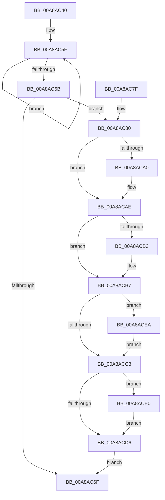

# PopDirectedDripsDiagDestroyDeviceDiagnostic

- RVA: `0x00A8AC40`–`0x00A8ACF9` (길이 `185` bytes)
- VA: `0x0000000140A8AC40`
- 실행 섹션: `PAGE`
- PDB 이름 있음: `예`; PDB Function 태그: `아니요`
- unwind 정보 RVA: `0x000B85DC`
- 디코드: `50`개 명령, `185/185` bytes 표시
- 미해석 바이트: `0` (있으면 어셈블리에 `.byte`로 보존)

> 이 문서는 커널 이미지의 기계어와 PDB 기호를 분석해 생성했습니다. 4번과 5번은 함수 원형과 자료형을 바이너리 사용 방식에서 추정한 C 해석이며 원본 소스 복구 결과는 아닙니다.

## 1. Dependencies

- 직접 호출 지점: **4**; 고유 호출 대상: **4**
- 직접 호출자로 확인된 함수: **1**
- RIP 상대 이미지 참조: **3**

### Outgoing calls
- `0x00A8AC8F` → [KeAbPreAcquire](../../text/21/KeAbPreAcquire_function_00210230.md) (function, `0x00210230`)
- `0x00A8ACA9` → [ExfAcquirePushLockExclusiveEx](../../text/20/ExfAcquirePushLockExclusiveEx_function_0020FC90.md) (function, `0x0020FC90`)
- `0x00A8ACD9` → [KeAbPostRelease](../../text/2E/KeAbPostRelease_function_002E1600.md) (function, `0x002E1600`)
- `0x00A8ACE3` → [ExfTryToWakePushLock](../../text/26/ExfTryToWakePushLock_function_00265DD0.md) (function, `0x00265DD0`)

### Direct callers
- [PoFxAbandonDevice](PoFxAbandonDevice_function_00A8AB64.md) at `0x00A8AB71`

### Static image references
- `0x00A8AC52` → RVA `0x00F0EAC0` (`.data`; read)
- `0x00A8AC80` → RVA `0x00F07650` (`.data`; read)
- `0x00A8ACC7` → RVA `0x00F07650` (`.data`; read/write)

## 2. Other-region calls and transfers

- 다른 실행 섹션으로 향하는 call: **4**
  - `0x00A8AC8F` → [KeAbPreAcquire](../../text/21/KeAbPreAcquire_function_00210230.md) (`PAGE` → `.text`)
  - `0x00A8ACA9` → [ExfAcquirePushLockExclusiveEx](../../text/20/ExfAcquirePushLockExclusiveEx_function_0020FC90.md) (`PAGE` → `.text`)
  - `0x00A8ACD9` → [KeAbPostRelease](../../text/2E/KeAbPostRelease_function_002E1600.md) (`PAGE` → `.text`)
  - `0x00A8ACE3` → [ExfTryToWakePushLock](../../text/26/ExfTryToWakePushLock_function_00265DD0.md) (`PAGE` → `.text`)
- 별도 외부 분기/꼬리 이동을 확인하지 못했습니다.

## 3. Assembly (complete function range)

```asm
00A8AC40  48 89 5C 24 08                  mov qword ptr [rsp + 8], rbx
00A8AC45  48 89 6C 24 10                  mov qword ptr [rsp + 0x10], rbp
00A8AC4A  57                              push rdi
00A8AC4B  48 83 EC 20                     sub rsp, 0x20
00A8AC4F  48 8B F9                        mov rdi, rcx
00A8AC52  0F 0D 0D 67 3E 48 00            prefetchw byte ptr [rip + 0x483e67]
00A8AC59  8B 05 61 3E 48 00               mov eax, dword ptr [rip + 0x483e61]
00A8AC5F  8B D0                           mov edx, eax
00A8AC61  F0 0F B1 15 57 3E 48 00         lock cmpxchg dword ptr [rip + 0x483e57], edx
00A8AC69  75 F4                           jne 0x140a8ac5f
00A8AC6B  A8 01                           test al, 1
00A8AC6D  75 11                           jne 0x140a8ac80
00A8AC6F  48 8B 5C 24 30                  mov rbx, qword ptr [rsp + 0x30]
00A8AC74  48 8B 6C 24 38                  mov rbp, qword ptr [rsp + 0x38]
00A8AC79  48 83 C4 20                     add rsp, 0x20
00A8AC7D  5F                              pop rdi
00A8AC7E  C3                              ret
00A8AC7F  CC                              int3
00A8AC80  48 8D 2D C9 C9 47 00            lea rbp, [rip + 0x47c9c9]
00A8AC87  45 33 C0                        xor r8d, r8d
00A8AC8A  48 8B CD                        mov rcx, rbp
00A8AC8D  33 D2                           xor edx, edx
00A8AC8F  E8 9C 55 78 FF                  call 0x140210230
00A8AC94  F0 48 0F BA 6D 00 00            lock bts qword ptr [rbp], 0
00A8AC9B  48 8B D8                        mov rbx, rax
00A8AC9E  73 0E                           jae 0x140a8acae
00A8ACA0  4C 8B C5                        mov r8, rbp
00A8ACA3  48 8B D0                        mov rdx, rax
00A8ACA6  48 8B CD                        mov rcx, rbp
00A8ACA9  E8 E2 4F 78 FF                  call 0x14020fc90
00A8ACAE  48 85 DB                        test rbx, rbx
00A8ACB1  74 04                           je 0x140a8acb7
00A8ACB3  C6 43 0A 01                     mov byte ptr [rbx + 0xa], 1
00A8ACB7  48 8B 87 08 03 00 00            mov rax, qword ptr [rdi + 0x308]
00A8ACBE  48 85 C0                        test rax, rax
00A8ACC1  75 27                           jne 0x140a8acea
00A8ACC3  48 83 C8 FF                     or rax, 0xffffffffffffffff
00A8ACC7  F0 48 0F C1 05 80 C9 47 00      lock xadd qword ptr [rip + 0x47c980], rax
00A8ACD0  24 06                           and al, 6
00A8ACD2  3C 02                           cmp al, 2
00A8ACD4  74 0A                           je 0x140a8ace0
00A8ACD6  48 8B CD                        mov rcx, rbp
00A8ACD9  E8 22 69 85 FF                  call 0x1402e1600
00A8ACDE  EB 8F                           jmp 0x140a8ac6f
00A8ACE0  48 8B CD                        mov rcx, rbp
00A8ACE3  E8 E8 B0 7D FF                  call 0x140265dd0
00A8ACE8  EB EC                           jmp 0x140a8acd6
00A8ACEA  48 83 A7 08 03 00 00 00         and qword ptr [rdi + 0x308], 0
00A8ACF2  48 83 60 10 00                  and qword ptr [rax + 0x10], 0
00A8ACF7  EB CA                           jmp 0x140a8acc3
```

## 4. C-style interpretation (structured pseudocode)

```c
__int64 __fastcall PopDirectedDripsDiagDestroyDeviceDiagnostic(__int64 a1, __int64 a2, int a3)
{
    __int64 result;
    __int64 v_rsp;
    unsigned __int64 v_stack_p10;
    unsigned __int64 v_stack_p8;

    v_stack_p8 = v_rbx;
    v_stack_p10 = v_rbp;
    v_rsp = (v_rsp) - (32);
loc_00A8AC5F:
    if (condition_is_not_equal) goto loc_00A8AC5F;
    if ((((unsigned __int8)((unsigned int)(*(unsigned int *)(v_rip + 4734561)))) & (1)) != 0) goto loc_00A8AC80;
loc_00A8AC6F:
    v_rsp = (v_rsp) + (32);
    return (unsigned int)(*(unsigned int *)(v_rip + 4734561));
loc_00A8AC80:
    a3 = 0;
    a2 = 0;
    result = KeAbPreAcquire(v_rip + 4704713, a2, a3, a4);
    if (!(condition_is_above_or_equal)) {
        a3 = v_rip + 4704713;
        a2 = result;
        a1 = v_rip + 4704713;
        result = ExfAcquirePushLockExclusiveEx(a1, a2, a3, a4);
    }
    if (result != 0) {
        *(unsigned __int8 *)(result + 10) = 1;
    }
    if (*(unsigned __int64 *)(a1 + 776) != 0) goto loc_00A8ACEA;
loc_00A8ACC3:
    result = (*(unsigned __int64 *)(a1 + 776)) | (-1);
    result = (unsigned __int8)((result) & (6));
    if (((unsigned __int8)(result)) == 2) goto loc_00A8ACE0;
loc_00A8ACD6:
    result = KeAbPostRelease(v_rip + 4704713, a2, a3, a4);
    goto loc_00A8AC6F;
loc_00A8ACE0:
    result = ExfTryToWakePushLock(v_rip + 4704713, a2, a3, a4);
    goto loc_00A8ACD6;
loc_00A8ACEA:
    goto loc_00A8ACC3;
}
```

## 5. (Beta) C Style

```c
int64_t PopDirectedDripsDiagDestroyDeviceDiagnostic(void *Arg1, int64_t Arg2, int32_t Arg3)
{
    uint8_t *arg1 = (uint8_t *)Arg1;

    int64_t result;
    int64_t local_rsp;
    uint64_t v_stack_p10;
    uint64_t v_stack_p8;

    v_stack_p8 = local_rbx;
    v_stack_p10 = local_rbp;
    local_rsp = (local_rsp) - (32);
loc_00A8AC5F:
    if (condition_is_not_equal) goto loc_00A8AC5F;
    if ((((uint8_t)((uint32_t)(*(uint32_t *)(v_rip + 0x483E61)))) & (1)) != 0) goto loc_00A8AC80;
loc_00A8AC6F:
    local_rsp = (local_rsp) + (32);
    return (uint32_t)(*(uint32_t *)(v_rip + 0x483E61));
loc_00A8AC80:
    Arg3 = 0;
    Arg2 = 0;
    result = KeAbPreAcquire(v_rip + 4704713, Arg2, Arg3, a4);
    if (!(condition_is_above_or_equal)) {
        Arg3 = v_rip + 4704713;
        Arg2 = result;
        Arg1 = v_rip + 4704713;
        result = ExfAcquirePushLockExclusiveEx(Arg1, Arg2, Arg3, a4);
    }
    if (result != 0) {
        *(uint8_t *)(result + 0xA) = 1;
    }
    if (*(uint64_t *)(arg1 + 0x308) != 0) goto loc_00A8ACEA;
loc_00A8ACC3:
    result = (*(uint64_t *)(arg1 + 0x308)) | (-1);
    result = (uint8_t)((result) & (6));
    if (((uint8_t)(result)) == 2) goto loc_00A8ACE0;
loc_00A8ACD6:
    result = KeAbPostRelease(v_rip + 4704713, Arg2, Arg3, a4);
    goto loc_00A8AC6F;
loc_00A8ACE0:
    result = ExfTryToWakePushLock(v_rip + 4704713, Arg2, Arg3, a4);
    goto loc_00A8ACD6;
loc_00A8ACEA:
    goto loc_00A8ACC3;
}
```

### 관측된 메모리 오프셋

구조체 형식이 확인되지 않은 접근은 인자 기준의 오프셋으로만 기록했습니다.

| 기준 인자 | 오프셋 표현 | 폭 (bit) | 접근 |
|---|---:|---:|---|
| `Arg1` | `+ 0x308` | `64` | `R` |
| `Arg1` | `+ 0x308` | `64` | `R/W` |

## 6. Execution-region graph

[열기: 2D/3D 그래프와 함수 탐색 컨트롤 패널](../../../control-panel.html?section=page&rva=0x00A8AC40&view=graph)

- 2D 그래프는 위에서 아래로 흐르고, 3D 그래프는 빈 공간을 드래그해 회전합니다. Shift+드래그는 이동, 휠은 확대·축소, 함수 노드 선택은 대상 보고서 이동입니다.

### Static fallback


