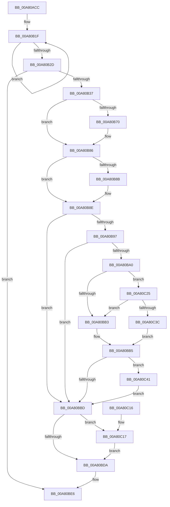

# PopDirectedDripsDiagNotifySessionStop

- RVA: `0x00A80ACC`–`0x00A80D25` (길이 `601` bytes)
- VA: `0x0000000140A80ACC`
- 실행 섹션: `PAGE`
- PDB 이름 있음: `예`; PDB Function 태그: `아니요`
- unwind 정보 RVA: `0x000B70D4`
- 디코드: `135`개 명령, `601/601` bytes 표시
- 미해석 바이트: `0` (있으면 어셈블리에 `.byte`로 보존)

> 이 문서는 커널 이미지의 기계어와 PDB 기호를 분석해 생성했습니다. 4번과 5번은 함수 원형과 자료형을 바이너리 사용 방식에서 추정한 C 해석이며 원본 소스 복구 결과는 아닙니다.

## 1. Dependencies

- 직접 호출 지점: **9**; 고유 호출 대상: **9**
- 직접 호출자로 확인된 함수: **1**
- RIP 상대 이미지 참조: **10**

### Outgoing calls
- `0x00A80B44` → [PopDirectedDripsDiagQueryAndResetPnpAccounting](../../text/4A/PopDirectedDripsDiagQueryAndResetPnpAccounting_function_004AEF34.md) (function, `0x004AEF34`)
- `0x00A80B5C` → [KeAbPreAcquire](../../text/21/KeAbPreAcquire_function_00210230.md) (function, `0x00210230`)
- `0x00A80B81` → [ExfAcquirePushLockExclusiveEx](../../text/20/ExfAcquirePushLockExclusiveEx_function_0020FC90.md) (function, `0x0020FC90`)
- `0x00A80BBD` → [PopDirectedDripsDiagRundownBroadcastTrees](PopDirectedDripsDiagRundownBroadcastTrees_function_00A80D2C.md) (function, `0x00A80D2C`)
- `0x00A80BC2` → [PopDirectedDripsDiagRundownDevices](PopDirectedDripsDiagRundownDevices_function_00A80E08.md) (function, `0x00A80E08`)
- `0x00A80BE1` → [KeAbPostRelease](../../text/2E/KeAbPostRelease_function_002E1600.md) (function, `0x002E1600`)
- `0x00A80BF0` → [_security_check_cookie](../../text/6A/_security_check_cookie_function_006AC640.md) (function, `0x006AC640`)
- `0x00A80C1E` → [ExfTryToWakePushLock](../../text/26/ExfTryToWakePushLock_function_00265DD0.md) (function, `0x00265DD0`)
- `0x00A80D1B` → [tlgWriteTransfer_EtwWriteTransfer](../../text/42/tlgWriteTransfer_EtwWriteTransfer_function_004260E0.md) (function, `0x004260E0`)

### Direct callers
- [PopDirectedDripsSendSessionData](PopDirectedDripsSendSessionData_function_00A80A58.md) at `0x00A80AB5`

### Static image references
- `0x00A80AF2` → RVA `0x00E0A740` (`.data`; read)
- `0x00A80B12` → RVA `0x00F0EAC0` (`.data`; read)
- `0x00A80B49` → RVA `0x00F0B6B0` (`.data`; read)
- `0x00A80B50` → RVA `0x00F07650` (`.data`; read)
- `0x00A80B61` → RVA `0x00F07650` (`.data`; read/write)
- `0x00A80B8E` → RVA `0x00FD8900` (`PAGEDATA`; read)
- `0x00A80B97` → RVA `0x00F07410` (`.data`; read)
- `0x00A80BAA` → RVA `0x00FD8910` (`PAGEDATA`; read)
- `0x00A80C25` → RVA `0x00FD8918` (`PAGEDATA`; read)
- `0x00A80CDD` → RVA `0x00050060` (`.rdata`; read)

## 2. Other-region calls and transfers

- 다른 실행 섹션으로 향하는 call: **7**
  - `0x00A80B44` → [PopDirectedDripsDiagQueryAndResetPnpAccounting](../../text/4A/PopDirectedDripsDiagQueryAndResetPnpAccounting_function_004AEF34.md) (`PAGE` → `.text`)
  - `0x00A80B5C` → [KeAbPreAcquire](../../text/21/KeAbPreAcquire_function_00210230.md) (`PAGE` → `.text`)
  - `0x00A80B81` → [ExfAcquirePushLockExclusiveEx](../../text/20/ExfAcquirePushLockExclusiveEx_function_0020FC90.md) (`PAGE` → `.text`)
  - `0x00A80BE1` → [KeAbPostRelease](../../text/2E/KeAbPostRelease_function_002E1600.md) (`PAGE` → `.text`)
  - `0x00A80BF0` → [_security_check_cookie](../../text/6A/_security_check_cookie_function_006AC640.md) (`PAGE` → `.text`)
  - `0x00A80C1E` → [ExfTryToWakePushLock](../../text/26/ExfTryToWakePushLock_function_00265DD0.md) (`PAGE` → `.text`)
  - `0x00A80D1B` → [tlgWriteTransfer_EtwWriteTransfer](../../text/42/tlgWriteTransfer_EtwWriteTransfer_function_004260E0.md) (`PAGE` → `.text`)
- 별도 외부 분기/꼬리 이동을 확인하지 못했습니다.

## 3. Assembly (complete function range)

```asm
00A80ACC  48 8B C4                        mov rax, rsp
00A80ACF  48 89 58 08                     mov qword ptr [rax + 8], rbx
00A80AD3  48 89 70 10                     mov qword ptr [rax + 0x10], rsi
00A80AD7  48 89 78 18                     mov qword ptr [rax + 0x18], rdi
00A80ADB  4C 89 60 20                     mov qword ptr [rax + 0x20], r12
00A80ADF  55                              push rbp
00A80AE0  41 56                           push r14
00A80AE2  41 57                           push r15
00A80AE4  48 8D A8 88 FE FF FF            lea rbp, [rax - 0x178]
00A80AEB  48 81 EC 60 02 00 00            sub rsp, 0x260
00A80AF2  48 8B 05 47 9C 38 00            mov rax, qword ptr [rip + 0x389c47]
00A80AF9  48 33 C4                        xor rax, rsp
00A80AFC  48 89 85 50 01 00 00            mov qword ptr [rbp + 0x150], rax
00A80B03  48 83 64 24 40 00               and qword ptr [rsp + 0x40], 0
00A80B09  41 8B F0                        mov esi, r8d
00A80B0C  44 8B F2                        mov r14d, edx
00A80B0F  44 8B F9                        mov r15d, ecx
00A80B12  0F 0D 0D A7 DF 48 00            prefetchw byte ptr [rip + 0x48dfa7]
00A80B19  8B 05 A1 DF 48 00               mov eax, dword ptr [rip + 0x48dfa1]
00A80B1F  44 8B C8                        mov r9d, eax
00A80B22  F0 44 0F B1 0D 95 DF 48 00      lock cmpxchg dword ptr [rip + 0x48df95], r9d
00A80B2B  75 F2                           jne 0x140a80b1f
00A80B2D  B3 01                           mov bl, 1
00A80B2F  84 C3                           test bl, al
00A80B31  0F 84 AF 00 00 00               je 0x140a80be6
00A80B37  4C 8D 4D 70                     lea r9, [rbp + 0x70]
00A80B3B  4C 8D 45 00                     lea r8, [rbp]
00A80B3F  48 8D 54 24 40                  lea rdx, [rsp + 0x40]
00A80B44  E8 EB E3 A2 FF                  call 0x1404aef34
00A80B49  4C 8B 25 60 AB 48 00            mov r12, qword ptr [rip + 0x48ab60]
00A80B50  48 8D 0D F9 6A 48 00            lea rcx, [rip + 0x486af9]
00A80B57  45 33 C0                        xor r8d, r8d
00A80B5A  33 D2                           xor edx, edx
00A80B5C  E8 CF F6 78 FF                  call 0x140210230
00A80B61  F0 48 0F BA 2D E5 6A 48 00 00   lock bts qword ptr [rip + 0x486ae5], 0
00A80B6B  48 8B F8                        mov rdi, rax
00A80B6E  73 16                           jae 0x140a80b86
00A80B70  4C 8D 05 D9 6A 48 00            lea r8, [rip + 0x486ad9]
00A80B77  48 8B D0                        mov rdx, rax
00A80B7A  48 8D 0D CF 6A 48 00            lea rcx, [rip + 0x486acf]
00A80B81  E8 0A F1 78 FF                  call 0x14020fc90
00A80B86  48 85 FF                        test rdi, rdi
00A80B89  74 03                           je 0x140a80b8e
00A80B8B  88 5F 0A                        mov byte ptr [rdi + 0xa], bl
00A80B8E  83 3D 6B 7D 55 00 05            cmp dword ptr [rip + 0x557d6b], 5
00A80B95  76 26                           jbe 0x140a80bbd
00A80B97  80 3D 72 68 48 00 00            cmp byte ptr [rip + 0x486872], 0
00A80B9E  74 1D                           je 0x140a80bbd
00A80BA0  48 BA 00 00 00 00 00 40 00 00   movabs rdx, 0x400000000000
00A80BAA  48 85 15 5F 7D 55 00            test qword ptr [rip + 0x557d5f], rdx
00A80BB1  75 72                           jne 0x140a80c25
00A80BB3  32 DB                           xor bl, bl
00A80BB5  84 DB                           test bl, bl
00A80BB7  0F 85 84 00 00 00               jne 0x140a80c41
00A80BBD  E8 6A 01 00 00                  call 0x140a80d2c
00A80BC2  E8 41 02 00 00                  call 0x140a80e08
00A80BC7  48 83 C8 FF                     or rax, 0xffffffffffffffff
00A80BCB  F0 48 0F C1 05 7C 6A 48 00      lock xadd qword ptr [rip + 0x486a7c], rax
00A80BD4  24 06                           and al, 6
00A80BD6  3C 02                           cmp al, 2
00A80BD8  74 3D                           je 0x140a80c17
00A80BDA  48 8D 0D 6F 6A 48 00            lea rcx, [rip + 0x486a6f]
00A80BE1  E8 1A 0A 86 FF                  call 0x1402e1600
00A80BE6  48 8B 8D 50 01 00 00            mov rcx, qword ptr [rbp + 0x150]
00A80BED  48 33 CC                        xor rcx, rsp
00A80BF0  E8 4B BA C2 FF                  call 0x1406ac640
00A80BF5  4C 8D 9C 24 60 02 00 00         lea r11, [rsp + 0x260]
00A80BFD  49 8B 5B 20                     mov rbx, qword ptr [r11 + 0x20]
00A80C01  49 8B 73 28                     mov rsi, qword ptr [r11 + 0x28]
00A80C05  49 8B 7B 30                     mov rdi, qword ptr [r11 + 0x30]
00A80C09  4D 8B 63 38                     mov r12, qword ptr [r11 + 0x38]
00A80C0D  49 8B E3                        mov rsp, r11
00A80C10  41 5F                           pop r15
00A80C12  41 5E                           pop r14
00A80C14  5D                              pop rbp
00A80C15  C3                              ret
00A80C16  CC                              int3
00A80C17  48 8D 0D 32 6A 48 00            lea rcx, [rip + 0x486a32]
00A80C1E  E8 AD 51 7E FF                  call 0x140265dd0
00A80C23  EB B5                           jmp 0x140a80bda
00A80C25  48 8B 05 EC 7C 55 00            mov rax, qword ptr [rip + 0x557cec]
00A80C2C  48 23 C2                        and rax, rdx
00A80C2F  48 3B 05 E2 7C 55 00            cmp rax, qword ptr [rip + 0x557ce2]
00A80C36  0F 85 77 FF FF FF               jne 0x140a80bb3
00A80C3C  E9 74 FF FF FF                  jmp 0x140a80bb5
00A80C41  83 65 8C 00                     and dword ptr [rbp - 0x74], 0
00A80C45  48 8D 44 24 48                  lea rax, [rsp + 0x48]
00A80C4A  83 65 9C 00                     and dword ptr [rbp - 0x64], 0
00A80C4E  BA 08 00 00 00                  mov edx, 8
00A80C53  83 65 AC 00                     and dword ptr [rbp - 0x54], 0
00A80C57  45 33 C9                        xor r9d, r9d
00A80C5A  83 65 BC 00                     and dword ptr [rbp - 0x44], 0
00A80C5E  45 33 C0                        xor r8d, r8d
00A80C61  83 65 CC 00                     and dword ptr [rbp - 0x34], 0
00A80C65  83 65 DC 00                     and dword ptr [rbp - 0x24], 0
00A80C69  8D 4A FC                        lea ecx, [rdx - 4]
00A80C6C  83 65 EC 00                     and dword ptr [rbp - 0x14], 0
00A80C70  83 65 FC 00                     and dword ptr [rbp - 4], 0
00A80C74  48 89 45 80                     mov qword ptr [rbp - 0x80], rax
00A80C78  48 8D 44 24 30                  lea rax, [rsp + 0x30]
00A80C7D  48 89 45 90                     mov qword ptr [rbp - 0x70], rax
00A80C81  48 8D 44 24 34                  lea rax, [rsp + 0x34]
00A80C86  48 89 45 A0                     mov qword ptr [rbp - 0x60], rax
00A80C8A  48 8D 44 24 38                  lea rax, [rsp + 0x38]
00A80C8F  48 89 45 B0                     mov qword ptr [rbp - 0x50], rax
00A80C93  48 8B 44 24 40                  mov rax, qword ptr [rsp + 0x40]
00A80C98  48 89 44 24 50                  mov qword ptr [rsp + 0x50], rax
00A80C9D  48 8D 44 24 50                  lea rax, [rsp + 0x50]
00A80CA2  48 89 45 C0                     mov qword ptr [rbp - 0x40], rax
00A80CA6  48 8D 45 00                     lea rax, [rbp]
00A80CAA  48 89 45 D0                     mov qword ptr [rbp - 0x30], rax
00A80CAE  48 8D 45 70                     lea rax, [rbp + 0x70]
00A80CB2  48 89 45 E0                     mov qword ptr [rbp - 0x20], rax
00A80CB6  48 8D 44 24 58                  lea rax, [rsp + 0x58]
00A80CBB  48 89 45 F0                     mov qword ptr [rbp - 0x10], rax
00A80CBF  48 8D 44 24 60                  lea rax, [rsp + 0x60]
00A80CC4  89 55 88                        mov dword ptr [rbp - 0x78], edx
00A80CC7  89 4D 98                        mov dword ptr [rbp - 0x68], ecx
00A80CCA  89 4D A8                        mov dword ptr [rbp - 0x58], ecx
00A80CCD  89 4D B8                        mov dword ptr [rbp - 0x48], ecx
00A80CD0  48 8D 0D 29 7C 55 00            lea rcx, [rip + 0x557c29]
00A80CD7  89 55 C8                        mov dword ptr [rbp - 0x38], edx
00A80CDA  89 55 F8                        mov dword ptr [rbp - 8], edx
00A80CDD  48 8D 15 7C F3 5C FF            lea rdx, [rip - 0xa30c84]
00A80CE4  48 89 44 24 28                  mov qword ptr [rsp + 0x28], rax
00A80CE9  C7 44 24 20 0A 00 00 00         mov dword ptr [rsp + 0x20], 0xa
00A80CF1  4C 89 64 24 48                  mov qword ptr [rsp + 0x48], r12
00A80CF6  44 89 7C 24 30                  mov dword ptr [rsp + 0x30], r15d
00A80CFB  44 89 74 24 34                  mov dword ptr [rsp + 0x34], r14d
00A80D00  89 74 24 38                     mov dword ptr [rsp + 0x38], esi
00A80D04  C7 45 D8 70 00 00 00            mov dword ptr [rbp - 0x28], 0x70
00A80D0B  C7 45 E8 E0 00 00 00            mov dword ptr [rbp - 0x18], 0xe0
00A80D12  48 C7 44 24 58 00 00 00 01      mov qword ptr [rsp + 0x58], 0x1000000
00A80D1B  E8 C0 53 9A FF                  call 0x1404260e0
00A80D20  E9 98 FE FF FF                  jmp 0x140a80bbd
```

## 4. C-style interpretation (structured pseudocode)

```c
__int64 __fastcall PopDirectedDripsDiagNotifySessionStop(int a1, int a2, int a3)
{
    __int64 result;
    __int64 v_rbx;
    __int64 v_rsp;
    unsigned __int64 v_stack_m18;
    unsigned __int64 v_stack_m200;
    unsigned __int64 v_stack_m208;
    unsigned __int64 v_stack_m210;
    unsigned __int64 v_stack_m218;
    unsigned __int64 v_stack_m220;
    unsigned __int64 v_stack_m228;
    unsigned __int64 v_stack_m22C;
    unsigned __int64 v_stack_m230;
    unsigned __int64 v_stack_m238;
    unsigned int v_stack_m240;

    *(unsigned __int64 *)(v_rsp + 8) = v_rbx;
    *(unsigned __int64 *)(v_rsp + 16) = v_rsi;
    *(unsigned __int64 *)(v_rsp + 24) = v_rdi;
    *(unsigned __int64 *)(v_rsp + 32) = v_r12;
    v_rsp = (v_rsp) - (608);
    result = (*(unsigned __int64 *)(v_rip + 3710023)) ^ (v_rsp);
    *(unsigned __int64 *)(v_rsp - 376 + 336) = result;
loc_00A80B1F:
    if (condition_is_not_equal) goto loc_00A80B1F;
    if (((1) & ((unsigned __int8)((unsigned int)(*(unsigned int *)(v_rip + 4775841))))) == 0) goto loc_00A80BE6;
    result = PopDirectedDripsDiagQueryAndResetPnpAccounting(a1, v_stack_m238, v_rsp - 376, v_rsp - 376 + 112);
    a3 = 0;
    a2 = 0;
    result = KeAbPreAcquire(v_rip + 4745977, a2, a3, v_rsp - 376 + 112);
    if (!(condition_is_above_or_equal)) {
        a3 = v_rip + 4745945;
        a2 = result;
        a1 = v_rip + 4745935;
        result = ExfAcquirePushLockExclusiveEx(a1, a2, a3, v_rsp - 376 + 112);
    }
    if (result != 0) {
        *(unsigned __int8 *)(result + 10) = 1;
    }
    if ((*(unsigned int *)(v_rip + 5602667)) <= 5) goto loc_00A80BBD;
    if ((*(unsigned __int8 *)(v_rip + 4745330)) == 0) goto loc_00A80BBD;
    if (((*(unsigned __int64 *)(v_rip + 5602655)) & (a2)) != 0) goto loc_00A80C25;
loc_00A80BB3:
    v_rbx = 0;
loc_00A80BB5:
    if (0 != 0) goto loc_00A80C41;
loc_00A80BBD:
    result = PopDirectedDripsDiagRundownBroadcastTrees(a1, a2, a3, v_rsp - 376 + 112);
    result = PopDirectedDripsDiagRundownDevices(a1, a2, a3, v_rsp - 376 + 112);
    result = (result) | (-1);
    result = (unsigned __int8)((result) & (6));
    if (((unsigned __int8)(result)) == 2) goto loc_00A80C17;
loc_00A80BDA:
    result = KeAbPostRelease(v_rip + 4745839, a2, a3, v_rsp - 376 + 112);
loc_00A80BE6:
    a1 = (*(unsigned __int64 *)(v_rsp - 376 + 336)) ^ (v_rsp);
    result = _security_check_cookie(a1, a2, a3, v_rsp - 376 + 112);
    return result;
loc_00A80C17:
    result = ExfTryToWakePushLock(v_rip + 4745778, a2, a3, v_rsp - 376 + 112);
    goto loc_00A80BDA;
loc_00A80C25:
    result = (*(unsigned __int64 *)(v_rip + 5602540)) & (a2);
    if (result != (*(unsigned __int64 *)(v_rip + 5602530))) goto loc_00A80BB3;
    goto loc_00A80BB5;
loc_00A80C41:
    a4 = 0;
    a3 = 0;
    *(unsigned __int64 *)(v_rsp - 376 - 128) = v_stack_m218;
    *(unsigned __int64 *)(v_rsp - 376 - 112) = v_stack_m230;
    *(unsigned __int64 *)(v_rsp - 376 - 96) = v_stack_m22C;
    *(unsigned __int64 *)(v_rsp - 376 - 80) = v_stack_m228;
    v_stack_m210 = v_stack_m220;
    *(unsigned __int64 *)(v_rsp - 376 - 64) = v_stack_m210;
    *(unsigned __int64 *)(v_rsp - 376 - 48) = v_rsp - 376;
    *(unsigned __int64 *)(v_rsp - 376 - 32) = v_rsp - 376 + 112;
    *(unsigned __int64 *)(v_rsp - 376 - 16) = v_stack_m208;
    *(unsigned int *)(v_rsp - 376 - 120) = 8;
    *(unsigned int *)(v_rsp - 376 - 104) = (unsigned int)(8 - 4);
    *(unsigned int *)(v_rsp - 376 - 88) = (unsigned int)(8 - 4);
    *(unsigned int *)(v_rsp - 376 - 72) = (unsigned int)(8 - 4);
    *(unsigned int *)(v_rsp - 376 - 56) = 8;
    *(unsigned int *)(v_rsp - 376 - 8) = 8;
    v_stack_m238 = v_stack_m200;
    v_stack_m240 = 10;
    v_stack_m218 = *(unsigned __int64 *)(v_stack_m18 + 56);
    v_stack_m230 = (unsigned int)((unsigned int)(a1));
    v_stack_m22C = (unsigned int)((unsigned int)(a2));
    v_stack_m228 = (unsigned int)(*(unsigned __int64 *)(v_stack_m18 + 40));
    *(unsigned int *)(v_rsp - 376 - 40) = 112;
    *(unsigned int *)(v_rsp - 376 - 24) = 224;
    v_stack_m208 = 0x1000000ULL;
    result = tlgWriteTransfer_EtwWriteTransfer(v_rip + 5602345, v_rip - 10685572, a3, a4);
    goto loc_00A80BBD;
}
```

## 5. (Beta) C Style

```c
int64_t PopDirectedDripsDiagNotifySessionStop(int32_t Arg1, int32_t Arg2, int32_t Arg3)
{
    int64_t result;
    int64_t local_rbx;
    int64_t local_rsp;
    uint64_t v_stack_m18;
    uint64_t v_stack_m200;
    uint64_t v_stack_m208;
    uint64_t v_stack_m210;
    uint64_t v_stack_m218;
    uint64_t v_stack_m220;
    uint64_t v_stack_m228;
    uint64_t v_stack_m22C;
    uint64_t v_stack_m230;
    uint64_t v_stack_m238;
    uint32_t v_stack_m240;

    *(uint64_t *)(local_rsp + 0x8) = local_rbx;
    *(uint64_t *)(local_rsp + 0x10) = local_rsi;
    *(uint64_t *)(local_rsp + 0x18) = local_rdi;
    *(uint64_t *)(local_rsp + 0x20) = local_r12;
    local_rsp = (local_rsp) - (608);
    result = (*(uint64_t *)(v_rip + 0x389C47)) ^ (local_rsp);
    *(uint64_t *)(local_rsp - 0x178 + 0x150) = result;
loc_00A80B1F:
    if (condition_is_not_equal) goto loc_00A80B1F;
    if (((1) & ((uint8_t)((uint32_t)(*(uint32_t *)(v_rip + 0x48DFA1))))) == 0) goto loc_00A80BE6;
    result = PopDirectedDripsDiagQueryAndResetPnpAccounting(Arg1, v_stack_m238, local_rsp - 376, local_rsp - 376 + 112);
    Arg3 = 0;
    Arg2 = 0;
    result = KeAbPreAcquire(v_rip + 4745977, Arg2, Arg3, local_rsp - 376 + 112);
    if (!(condition_is_above_or_equal)) {
        Arg3 = v_rip + 4745945;
        Arg2 = result;
        Arg1 = v_rip + 4745935;
        result = ExfAcquirePushLockExclusiveEx(Arg1, Arg2, Arg3, local_rsp - 376 + 112);
    }
    if (result != 0) {
        *(uint8_t *)(result + 0xA) = 1;
    }
    if ((*(uint32_t *)(v_rip + 0x557D6B)) <= 5) goto loc_00A80BBD;
    if ((*(uint8_t *)(v_rip + 0x486872)) == 0) goto loc_00A80BBD;
    if (((*(uint64_t *)(v_rip + 0x557D5F)) & (Arg2)) != 0) goto loc_00A80C25;
loc_00A80BB3:
    local_rbx = 0;
loc_00A80BB5:
    if (0 != 0) goto loc_00A80C41;
loc_00A80BBD:
    result = PopDirectedDripsDiagRundownBroadcastTrees(Arg1, Arg2, Arg3, local_rsp - 376 + 112);
    result = PopDirectedDripsDiagRundownDevices(Arg1, Arg2, Arg3, local_rsp - 376 + 112);
    result = (result) | (-1);
    result = (uint8_t)((result) & (6));
    if (((uint8_t)(result)) == 2) goto loc_00A80C17;
loc_00A80BDA:
    result = KeAbPostRelease(v_rip + 4745839, Arg2, Arg3, local_rsp - 376 + 112);
loc_00A80BE6:
    Arg1 = (*(uint64_t *)(local_rsp - 0x178 + 0x150)) ^ (local_rsp);
    result = _security_check_cookie(Arg1, Arg2, Arg3, local_rsp - 376 + 112);
    return result;
loc_00A80C17:
    result = ExfTryToWakePushLock(v_rip + 4745778, Arg2, Arg3, local_rsp - 376 + 112);
    goto loc_00A80BDA;
loc_00A80C25:
    result = (*(uint64_t *)(v_rip + 0x557CEC)) & (Arg2);
    if (result != (*(uint64_t *)(v_rip + 0x557CE2))) goto loc_00A80BB3;
    goto loc_00A80BB5;
loc_00A80C41:
    a4 = 0;
    Arg3 = 0;
    *(uint64_t *)(local_rsp - 0x178 - 0x80) = v_stack_m218;
    *(uint64_t *)(local_rsp - 0x178 - 0x70) = v_stack_m230;
    *(uint64_t *)(local_rsp - 0x178 - 0x60) = v_stack_m22C;
    *(uint64_t *)(local_rsp - 0x178 - 0x50) = v_stack_m228;
    v_stack_m210 = v_stack_m220;
    *(uint64_t *)(local_rsp - 0x178 - 0x40) = v_stack_m210;
    *(uint64_t *)(local_rsp - 0x178 - 0x30) = local_rsp - 376;
    *(uint64_t *)(local_rsp - 0x178 - 0x20) = local_rsp - 376 + 112;
    *(uint64_t *)(local_rsp - 0x178 - 0x10) = v_stack_m208;
    *(uint32_t *)(local_rsp - 0x178 - 0x78) = 8;
    *(uint32_t *)(local_rsp - 0x178 - 0x68) = (uint32_t)(8 - 4);
    *(uint32_t *)(local_rsp - 0x178 - 0x58) = (uint32_t)(8 - 4);
    *(uint32_t *)(local_rsp - 0x178 - 0x48) = (uint32_t)(8 - 4);
    *(uint32_t *)(local_rsp - 0x178 - 0x38) = 8;
    *(uint32_t *)(local_rsp - 0x178 - 0x8) = 8;
    v_stack_m238 = v_stack_m200;
    v_stack_m240 = 10;
    v_stack_m218 = *(uint64_t *)(v_stack_m18 + 0x38);
    v_stack_m230 = (uint32_t)((uint32_t)(Arg1));
    v_stack_m22C = (uint32_t)((uint32_t)(Arg2));
    v_stack_m228 = (uint32_t)(*(uint64_t *)(v_stack_m18 + 0x28));
    *(uint32_t *)(local_rsp - 0x178 - 0x28) = 112;
    *(uint32_t *)(local_rsp - 0x178 - 0x18) = 224;
    v_stack_m208 = 0x1000000ULL;
    result = tlgWriteTransfer_EtwWriteTransfer(v_rip + 5602345, v_rip - 10685572, Arg3, a4);
    goto loc_00A80BBD;
}
```

## 6. Execution-region graph

[열기: 2D/3D 그래프와 함수 탐색 컨트롤 패널](../../../control-panel.html?section=page&rva=0x00A80ACC&view=graph)

- 2D 그래프는 위에서 아래로 흐르고, 3D 그래프는 빈 공간을 드래그해 회전합니다. Shift+드래그는 이동, 휠은 확대·축소, 함수 노드 선택은 대상 보고서 이동입니다.

### Static fallback


