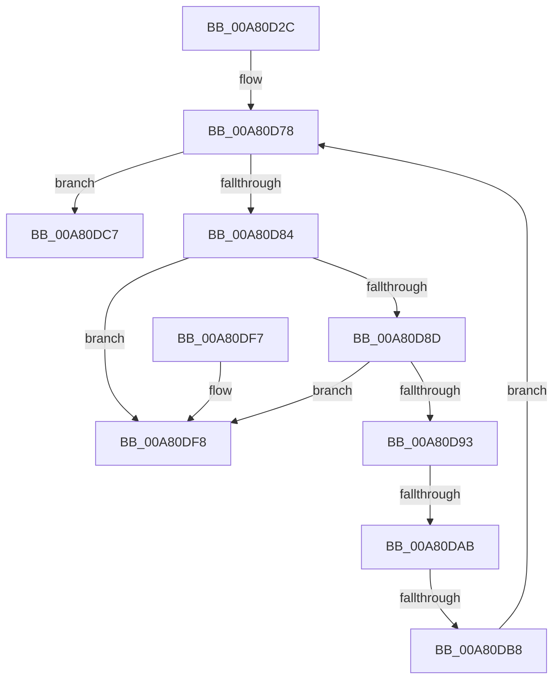

# PopDirectedDripsDiagRundownBroadcastTrees

- RVA: `0x00A80D2C`–`0x00A80DFF` (길이 `211` bytes)
- VA: `0x0000000140A80D2C`
- 실행 섹션: `PAGE`
- PDB 이름 있음: `예`; PDB Function 태그: `예`
- unwind 정보 RVA: `0x000B7100`
- 디코드: `52`개 명령, `211/211` bytes 표시
- 미해석 바이트: `0` (있으면 어셈블리에 `.byte`로 보존)

> 이 문서는 커널 이미지의 기계어와 PDB 기호를 분석해 생성했습니다. 4번과 5번은 함수 원형과 자료형을 바이너리 사용 방식에서 추정한 C 해석이며 원본 소스 복구 결과는 아닙니다.

## 1. Dependencies

- 직접 호출 지점: **2**; 고유 호출 대상: **2**
- 직접 호출자로 확인된 함수: **1**
- RIP 상대 이미지 참조: **5**

### Outgoing calls
- `0x00A80DC0` → [ExFreePoolWithTag](../../poolcode/B8/ExFreePoolWithTag_function_00B82870.md) (function, `0x00B82870`)
- `0x00A80DD1` → [_security_check_cookie](../../text/6A/_security_check_cookie_function_006AC640.md) (function, `0x006AC640`)

### Direct callers
- [PopDirectedDripsDiagNotifySessionStop](PopDirectedDripsDiagNotifySessionStop_function_00A80ACC.md) at `0x00A80BBD`

### Static image references
- `0x00A80D52` → RVA `0x00E0A740` (`.data`; read)
- `0x00A80D63` → RVA `0x00F0B6B0` (`.data`; read)
- `0x00A80D6A` → RVA `0x00F07420` (`.data`; read)
- `0x00A80D93` → RVA `0x00F07420` (`.data`; write)
- `0x00A80D9E` → RVA `0x00FD8900` (`PAGEDATA`; read)

## 2. Other-region calls and transfers

- 다른 실행 섹션으로 향하는 call: **2**
  - `0x00A80DC0` → [ExFreePoolWithTag](../../poolcode/B8/ExFreePoolWithTag_function_00B82870.md) (`PAGE` → `POOLCODE`)
  - `0x00A80DD1` → [_security_check_cookie](../../text/6A/_security_check_cookie_function_006AC640.md) (`PAGE` → `.text`)
- call이 아닌 외부 분기/꼬리 이동: **2**
  - `0x00A80DA5` → [sub_00B4322A](../B4/Unknown_function_00B4322A.md) (`tail-transfer`)
  - `0x00A80DB2` → [sub_00B4322A + 0x143](../B4/Unknown_function_00B4322A.md) (`tail-transfer`)

## 3. Assembly (complete function range)

```asm
00A80D2C  48 8B C4                        mov rax, rsp
00A80D2F  48 89 58 08                     mov qword ptr [rax + 8], rbx
00A80D33  48 89 70 10                     mov qword ptr [rax + 0x10], rsi
00A80D37  48 89 78 18                     mov qword ptr [rax + 0x18], rdi
00A80D3B  4C 89 60 20                     mov qword ptr [rax + 0x20], r12
00A80D3F  55                              push rbp
00A80D40  41 56                           push r14
00A80D42  41 57                           push r15
00A80D44  48 8D A8 38 FF FF FF            lea rbp, [rax - 0xc8]
00A80D4B  48 81 EC B0 01 00 00            sub rsp, 0x1b0
00A80D52  48 8B 05 E7 99 38 00            mov rax, qword ptr [rip + 0x3899e7]
00A80D59  48 33 C4                        xor rax, rsp
00A80D5C  48 89 85 A0 00 00 00            mov qword ptr [rbp + 0xa0], rax
00A80D63  48 8B 05 46 A9 48 00            mov rax, qword ptr [rip + 0x48a946]
00A80D6A  4C 8D 3D AF 66 48 00            lea r15, [rip + 0x4866af]
00A80D71  48 89 44 24 58                  mov qword ptr [rsp + 0x58], rax
00A80D76  33 F6                           xor esi, esi
00A80D78  48 8B 1D A1 66 48 00            mov rbx, qword ptr [rip + 0x4866a1]
00A80D7F  49 3B DF                        cmp rbx, r15
00A80D82  74 43                           je 0x140a80dc7
00A80D84  48 8B 03                        mov rax, qword ptr [rbx]
00A80D87  4C 39 7B 08                     cmp qword ptr [rbx + 8], r15
00A80D8B  75 6B                           jne 0x140a80df8
00A80D8D  48 39 58 08                     cmp qword ptr [rax + 8], rbx
00A80D91  75 65                           jne 0x140a80df8
00A80D93  48 89 05 86 66 48 00            mov qword ptr [rip + 0x486686], rax
00A80D9A  4C 89 78 08                     mov qword ptr [rax + 8], r15
00A80D9E  83 3D 5B 7B 55 00 05            cmp dword ptr [rip + 0x557b5b], 5
00A80DA5  0F 87 7F 24 0C 00               ja 0x140b4322a
00A80DAB  48 8B 7B 18                     mov rdi, qword ptr [rbx + 0x18]
00A80DAF  48 85 FF                        test rdi, rdi
00A80DB2  0F 85 B5 25 0C 00               jne 0x140b4336d
00A80DB8  BA 50 64 69 67                  mov edx, 0x67696450
00A80DBD  48 8B CB                        mov rcx, rbx
00A80DC0  E8 AB 1A 10 00                  call 0x140b82870
00A80DC5  EB B1                           jmp 0x140a80d78
00A80DC7  48 8B 8D A0 00 00 00            mov rcx, qword ptr [rbp + 0xa0]
00A80DCE  48 33 CC                        xor rcx, rsp
00A80DD1  E8 6A B8 C2 FF                  call 0x1406ac640
00A80DD6  4C 8D 9C 24 B0 01 00 00         lea r11, [rsp + 0x1b0]
00A80DDE  49 8B 5B 20                     mov rbx, qword ptr [r11 + 0x20]
00A80DE2  49 8B 73 28                     mov rsi, qword ptr [r11 + 0x28]
00A80DE6  49 8B 7B 30                     mov rdi, qword ptr [r11 + 0x30]
00A80DEA  4D 8B 63 38                     mov r12, qword ptr [r11 + 0x38]
00A80DEE  49 8B E3                        mov rsp, r11
00A80DF1  41 5F                           pop r15
00A80DF3  41 5E                           pop r14
00A80DF5  5D                              pop rbp
00A80DF6  C3                              ret
00A80DF7  CC                              int3
00A80DF8  B9 03 00 00 00                  mov ecx, 3
00A80DFD  CD 29                           int 0x29
```

## 4. C-style interpretation (structured pseudocode)

```c
__int64 __fastcall PopDirectedDripsDiagRundownBroadcastTrees(void)
{
    __int64 result;
    __int64 v_rsi;
    __int64 v_rsp;
    unsigned __int64 v_stack_m170;
    unsigned __int64 v_stack_m18;

    *(unsigned __int64 *)(v_rsp + 8) = v_rbx;
    *(unsigned __int64 *)(v_rsp + 16) = v_rsi;
    *(unsigned __int64 *)(v_rsp + 24) = v_rdi;
    *(unsigned __int64 *)(v_rsp + 32) = v_r12;
    v_rsp = (v_rsp) - (432);
    result = (*(unsigned __int64 *)(v_rip + 3709415)) ^ (v_rsp);
    *(unsigned __int64 *)(v_rsp - 200 + 160) = result;
    v_stack_m170 = *(unsigned __int64 *)(v_rip + 4761926);
    v_rsi = 0;
loc_00A80D78:
    if ((*(unsigned __int64 *)(v_rip + 4744865)) == (v_rip + 4744879)) goto loc_00A80DC7;
    if ((*(unsigned __int64 *)(*(unsigned __int64 *)(v_rip + 4744865) + 8)) != (v_rip + 4744879)) goto loc_00A80DF8;
    if ((*(unsigned __int64 *)(*(unsigned __int64 *)(*(unsigned __int64 *)(v_rip + 4744865)) + 8)) != (*(unsigned __int64 *)(v_rip + 4744865))) goto loc_00A80DF8;
    *(unsigned __int64 *)(v_rip + 4744838) = *(unsigned __int64 *)(*(unsigned __int64 *)(v_rip + 4744865));
    *(unsigned __int64 *)(*(unsigned __int64 *)(*(unsigned __int64 *)(v_rip + 4744865)) + 8) = v_rip + 4744879;
    result = ExFreePoolWithTag(*(unsigned __int64 *)(v_rip + 4744865), (unsigned int)(0x67696450ULL), a3, a4);
    goto loc_00A80D78;
loc_00A80DC7:
    a1 = (*(unsigned __int64 *)(v_rsp - 200 + 160)) ^ (v_rsp);
    result = _security_check_cookie(a1, (unsigned int)(0x67696450ULL), a3, a4);
    return result;
loc_00A80DF8:
    return result;
}
```

## 5. (Beta) C Style

```c
void PopDirectedDripsDiagRundownBroadcastTrees(void)
{
    int64_t result;
    int64_t local_rsi;
    int64_t local_rsp;
    uint64_t v_stack_m170;
    uint64_t v_stack_m18;

    *(uint64_t *)(local_rsp + 0x8) = local_rbx;
    *(uint64_t *)(local_rsp + 0x10) = local_rsi;
    *(uint64_t *)(local_rsp + 0x18) = local_rdi;
    *(uint64_t *)(local_rsp + 0x20) = local_r12;
    local_rsp = (local_rsp) - (432);
    result = (*(uint64_t *)(v_rip + 0x3899E7)) ^ (local_rsp);
    *(uint64_t *)(local_rsp - 0xC8 + 0xA0) = result;
    v_stack_m170 = *(uint64_t *)(v_rip + 0x48A946);
    local_rsi = 0;
loc_00A80D78:
    if ((*(uint64_t *)(v_rip + 0x4866A1)) == (v_rip + 4744879)) goto loc_00A80DC7;
    if ((*(uint64_t *)(*(uint64_t *)(v_rip + 0x4866A1) + 0x8)) != (v_rip + 4744879)) goto loc_00A80DF8;
    if ((*(uint64_t *)(*(uint64_t *)(*(uint64_t *)(v_rip + 0x4866A1)) + 0x8)) != (*(uint64_t *)(v_rip + 0x4866A1))) goto loc_00A80DF8;
    *(uint64_t *)(v_rip + 0x486686) = *(uint64_t *)(*(uint64_t *)(v_rip + 0x4866A1));
    *(uint64_t *)(*(uint64_t *)(*(uint64_t *)(v_rip + 0x4866A1)) + 0x8) = v_rip + 4744879;
    result = ExFreePoolWithTag(*(uint64_t *)(v_rip + 0x4866A1), (uint32_t)(0x67696450ULL), a3, a4);
    goto loc_00A80D78;
loc_00A80DC7:
    a1 = (*(uint64_t *)(local_rsp - 0xC8 + 0xA0)) ^ (local_rsp);
    result = _security_check_cookie(a1, (uint32_t)(0x67696450ULL), a3, a4);
    return result;
loc_00A80DF8:
    return result;
}
```

## 6. Execution-region graph

[열기: 2D/3D 그래프와 함수 탐색 컨트롤 패널](../../../control-panel.html?section=page&rva=0x00A80D2C&view=graph)

- 2D 그래프는 위에서 아래로 흐르고, 3D 그래프는 빈 공간을 드래그해 회전합니다. Shift+드래그는 이동, 휠은 확대·축소, 함수 노드 선택은 대상 보고서 이동입니다.

### Static fallback


