# PopDirectedDripsDiagRundownDevices

- RVA: `0x00A80E08`–`0x00A81586` (길이 `1,918` bytes)
- VA: `0x0000000140A80E08`
- 실행 섹션: `PAGE`
- PDB 이름 있음: `예`; PDB Function 태그: `아니요`
- unwind 정보 RVA: `0x000B713C`
- 디코드: `382`개 명령, `1,918/1,918` bytes 표시
- 미해석 바이트: `0` (있으면 어셈블리에 `.byte`로 보존)

> 이 문서는 커널 이미지의 기계어와 PDB 기호를 분석해 생성했습니다. 4번과 5번은 함수 원형과 자료형을 바이너리 사용 방식에서 추정한 C 해석이며 원본 소스 복구 결과는 아닙니다.

## 1. Dependencies

- 직접 호출 지점: **13**; 고유 호출 대상: **10**
- 직접 호출자로 확인된 함수: **1**
- RIP 상대 이미지 참조: **49**

### Outgoing calls
- `0x00A80EED` → [PopDirectedDripsDiagCreateBlockerEntryULong](../77/PopDirectedDripsDiagCreateBlockerEntryULong_function_00770F4C.md) (function, `0x00770F4C`)
- `0x00A80F29` → [PopDirectedDripsDiagCreateBlockerEntryULong](../77/PopDirectedDripsDiagCreateBlockerEntryULong_function_00770F4C.md) (function, `0x00770F4C`)
- `0x00A80F62` → [PopDirectedDripsDiagCreateBlockerEntryBoolean](../77/PopDirectedDripsDiagCreateBlockerEntryBoolean_function_00770EE0.md) (function, `0x00770EE0`)
- `0x00A80F96` → [PopDirectedDripsDiagCreateBlockerEntryBoolean](../77/PopDirectedDripsDiagCreateBlockerEntryBoolean_function_00770EE0.md) (function, `0x00770EE0`)
- `0x00A80FE0` → [PopDirectedDripsDiagExtractDeviceDescription](../77/PopDirectedDripsDiagExtractDeviceDescription_function_00771178.md) (function, `0x00771178`)
- `0x00A80FE9` → [PopDirectedDripsDiagSanitizeHardwareId](../AC/PopDirectedDripsDiagSanitizeHardwareId_function_00AC3058.md) (function, `0x00AC3058`)
- `0x00A8101D` → [tlgKeywordOn](../../text/42/tlgKeywordOn_function_0042EAA0.md) (function, `0x0042EAA0`)
- `0x00A81233` → [tlgWriteTransfer_EtwWriteTransfer](../../text/42/tlgWriteTransfer_EtwWriteTransfer_function_004260E0.md) (function, `0x004260E0`)
- `0x00A81256` → [EtwEventEnabled](../../text/39/EtwEventEnabled_function_00392450.md) (function, `0x00392450`)
- `0x00A813F7` → [EtwWrite](../../text/41/EtwWrite_function_0041C720.md) (function, `0x0041C720`)
- `0x00A81528` → [EtwWrite](../../text/41/EtwWrite_function_0041C720.md) (function, `0x0041C720`)
- `0x00A81544` → [PopDirectedDripsDiagFreeDeviceDiagnostic](../77/PopDirectedDripsDiagFreeDeviceDiagnostic_function_007711FC.md) (function, `0x007711FC`)
- `0x00A8155F` → [_security_check_cookie](../../text/6A/_security_check_cookie_function_006AC640.md) (function, `0x006AC640`)

### Direct callers
- [PopDirectedDripsDiagNotifySessionStop](PopDirectedDripsDiagNotifySessionStop_function_00A80ACC.md) at `0x00A80BC2`

### Static image references
- `0x00A80E2E` → RVA `0x00E0A740` (`.data`; read)
- `0x00A80E3F` → RVA `0x00F0B6B0` (`.data`; read)
- `0x00A80E46` → RVA `0x00F072A0` (`.data`; read)
- `0x00A80E8B` → RVA `0x00F07430` (`.data`; read)
- `0x00A80EB9` → RVA `0x00F07430` (`.data`; write)
- `0x00A80EDF` → RVA `0x00B03EA0` (` ?? ::NNGAKEGL::`string'`; read)
- `0x00A80F14` → RVA `0x00B03E70` (` ?? ::NNGAKEGL::`string'`; read)
- `0x00A80F4D` → RVA `0x00B03F10` (` ?? ::NNGAKEGL::`string'`; read)
- `0x00A80F81` → RVA `0x00B03ED0` (` ?? ::NNGAKEGL::`string'`; read)
- `0x00A80FEE` → RVA `0x00FD8900` (`PAGEDATA`; read)
- `0x00A811FC` → RVA `0x000502AF` (`.rdata`; read)
- `0x00A8123B` → RVA `0x00E67858` (`.data`; read)
- `0x00A81248` → RVA `0x00F0B408` (`.data`; read)
- `0x00A8124F` → RVA `0x00021F60` (`.rdata`; read)
- `0x00A8126C` → RVA `0x00F072A0` (`.data`; write)
- `0x00A81276` → RVA `0x00F072A8` (`.data`; write)
- `0x00A81285` → RVA `0x00F072B0` (`.data`; write)
- `0x00A8128C` → RVA `0x00F072B8` (`.data`; write)
- `0x00A812A6` → RVA `0x00F072C0` (`.data`; write)
- `0x00A812AD` → RVA `0x00F072C8` (`.data`; write)
- `0x00A812C3` → RVA `0x00F072D0` (`.data`; write)
- `0x00A812CA` → RVA `0x00F072D8` (`.data`; write)
- `0x00A812D0` → RVA `0x00F072DC` (`.data`; write)
- `0x00A812E9` → RVA `0x00F072E0` (`.data`; write)
- `0x00A812F0` → RVA `0x00F072E8` (`.data`; write)
- `0x00A81309` → RVA `0x00F072F0` (`.data`; write)
- `0x00A81310` → RVA `0x00F072F8` (`.data`; write)
- `0x00A81316` → RVA `0x00F072FC` (`.data`; write)
- `0x00A8132B` → RVA `0x00F07300` (`.data`; write)
- `0x00A81332` → RVA `0x00F07308` (`.data`; write)
- `0x00A81344` → RVA `0x00F07310` (`.data`; write)
- `0x00A8134B` → RVA `0x00F07318` (`.data`; write)
- `0x00A81351` → RVA `0x00F0731C` (`.data`; write)
- `0x00A81367` → RVA `0x00F07320` (`.data`; write)
- `0x00A8136E` → RVA `0x00F07328` (`.data`; write)
- `0x00A81388` → RVA `0x00F07330` (`.data`; write)
- `0x00A81396` → RVA `0x00F07338` (`.data`; write)
- `0x00A813A3` → RVA `0x00F07340` (`.data`; write)
- `0x00A813AA` → RVA `0x00F0733C` (`.data`; write)
- `0x00A813B1` → RVA `0x00F07348` (`.data`; write)
- `0x00A813BC` → RVA `0x00F07350` (`.data`; write)
- `0x00A813C3` → RVA `0x00F07358` (`.data`; write)
- `0x00A813CE` → RVA `0x00F07360` (`.data`; write)
- `0x00A813D5` → RVA `0x00F07368` (`.data`; write)
- `0x00A813E0` → RVA `0x00F07370` (`.data`; write)
- `0x00A813E7` → RVA `0x00F07378` (`.data`; write)
- `0x00A8140D` → RVA `0x00E67859` (`.data`; read)
- `0x00A8150D` → RVA `0x0001A7F0` (`.rdata`; read)
- `0x00A81521` → RVA `0x00F0B6B8` (`.data`; read)

## 2. Other-region calls and transfers

- 다른 실행 섹션으로 향하는 call: **6**
  - `0x00A8101D` → [tlgKeywordOn](../../text/42/tlgKeywordOn_function_0042EAA0.md) (`PAGE` → `.text`)
  - `0x00A81233` → [tlgWriteTransfer_EtwWriteTransfer](../../text/42/tlgWriteTransfer_EtwWriteTransfer_function_004260E0.md) (`PAGE` → `.text`)
  - `0x00A81256` → [EtwEventEnabled](../../text/39/EtwEventEnabled_function_00392450.md) (`PAGE` → `.text`)
  - `0x00A813F7` → [EtwWrite](../../text/41/EtwWrite_function_0041C720.md) (`PAGE` → `.text`)
  - `0x00A81528` → [EtwWrite](../../text/41/EtwWrite_function_0041C720.md) (`PAGE` → `.text`)
  - `0x00A8155F` → [_security_check_cookie](../../text/6A/_security_check_cookie_function_006AC640.md) (`PAGE` → `.text`)
- 별도 외부 분기/꼬리 이동을 확인하지 못했습니다.

## 3. Assembly (complete function range)

```asm
00A80E08  48 8B C4                        mov rax, rsp
00A80E0B  48 89 58 08                     mov qword ptr [rax + 8], rbx
00A80E0F  48 89 70 10                     mov qword ptr [rax + 0x10], rsi
00A80E13  48 89 78 18                     mov qword ptr [rax + 0x18], rdi
00A80E17  55                              push rbp
00A80E18  41 54                           push r12
00A80E1A  41 55                           push r13
00A80E1C  41 56                           push r14
00A80E1E  41 57                           push r15
00A80E20  48 8D A8 C8 FD FF FF            lea rbp, [rax - 0x238]
00A80E27  48 81 EC 10 03 00 00            sub rsp, 0x310
00A80E2E  48 8B 05 0B 99 38 00            mov rax, qword ptr [rip + 0x38990b]
00A80E35  48 33 C4                        xor rax, rsp
00A80E38  48 89 85 00 02 00 00            mov qword ptr [rbp + 0x200], rax
00A80E3F  48 8B 05 6A A8 48 00            mov rax, qword ptr [rip + 0x48a86a]
00A80E46  4C 8D 35 53 64 48 00            lea r14, [rip + 0x486453]
00A80E4D  45 33 FF                        xor r15d, r15d
00A80E50  88 44 24 40                     mov byte ptr [rsp + 0x40], al
00A80E54  44 89 7C 24 44                  mov dword ptr [rsp + 0x44], r15d
00A80E59  4C 89 7C 24 70                  mov qword ptr [rsp + 0x70], r15
00A80E5E  44 89 7C 24 54                  mov dword ptr [rsp + 0x54], r15d
00A80E63  4C 89 7C 24 78                  mov qword ptr [rsp + 0x78], r15
00A80E68  44 89 7C 24 58                  mov dword ptr [rsp + 0x58], r15d
00A80E6D  4C 89 7D 80                     mov qword ptr [rbp - 0x80], r15
00A80E71  44 89 7C 24 4C                  mov dword ptr [rsp + 0x4c], r15d
00A80E76  4C 89 7D 98                     mov qword ptr [rbp - 0x68], r15
00A80E7A  44 89 7C 24 50                  mov dword ptr [rsp + 0x50], r15d
00A80E7F  4C 89 7D 88                     mov qword ptr [rbp - 0x78], r15
00A80E83  4C 89 7D 90                     mov qword ptr [rbp - 0x70], r15
00A80E87  48 89 45 A0                     mov qword ptr [rbp - 0x60], rax
00A80E8B  48 8B 1D 9E 65 48 00            mov rbx, qword ptr [rip + 0x48659e]
00A80E92  48 8D 0D 97 65 48 00            lea rcx, [rip + 0x486597]
00A80E99  48 3B D9                        cmp rbx, rcx
00A80E9C  0F 84 B3 06 00 00               je 0x140a81555
00A80EA2  48 39 4B 08                     cmp qword ptr [rbx + 8], rcx
00A80EA6  0F 85 A2 06 00 00               jne 0x140a8154e
00A80EAC  48 8B 03                        mov rax, qword ptr [rbx]
00A80EAF  48 39 58 08                     cmp qword ptr [rax + 8], rbx
00A80EB3  0F 85 95 06 00 00               jne 0x140a8154e
00A80EB9  48 89 05 70 65 48 00            mov qword ptr [rip + 0x486570], rax
00A80EC0  4C 8D AB 9C 00 00 00            lea r13, [rbx + 0x9c]
00A80EC7  48 89 48 08                     mov qword ptr [rax + 8], rcx
00A80ECB  45 8B CF                        mov r9d, r15d
00A80ECE  44 89 7C 24 44                  mov dword ptr [rsp + 0x44], r15d
00A80ED3  41 8B D7                        mov edx, r15d
00A80ED6  45 8B 45 00                     mov r8d, dword ptr [r13]
00A80EDA  45 85 C0                        test r8d, r8d
00A80EDD  74 23                           je 0x140a80f02
00A80EDF  48 8D 15 BA 2F 08 00            lea rdx, [rip + 0x82fba]
00A80EE6  48 8D 8D 20 01 00 00            lea rcx, [rbp + 0x120]
00A80EED  E8 5A 00 CF FF                  call 0x140770f4c
00A80EF2  44 8B 4C 24 44                  mov r9d, dword ptr [rsp + 0x44]
00A80EF7  41 FF C1                        inc r9d
00A80EFA  44 89 4C 24 44                  mov dword ptr [rsp + 0x44], r9d
00A80EFF  41 8B D1                        mov edx, r9d
00A80F02  4C 8D A3 A0 00 00 00            lea r12, [rbx + 0xa0]
00A80F09  45 8B 04 24                     mov r8d, dword ptr [r12]
00A80F0D  45 85 C0                        test r8d, r8d
00A80F10  74 2C                           je 0x140a80f3e
00A80F12  8B C2                           mov eax, edx
00A80F14  48 8D 15 55 2F 08 00            lea rdx, [rip + 0x82f55]
00A80F1B  48 6B C8 38                     imul rcx, rax, 0x38
00A80F1F  48 8D 85 20 01 00 00            lea rax, [rbp + 0x120]
00A80F26  48 03 C8                        add rcx, rax
00A80F29  E8 1E 00 CF FF                  call 0x140770f4c
00A80F2E  44 8B 4C 24 44                  mov r9d, dword ptr [rsp + 0x44]
00A80F33  41 FF C1                        inc r9d
00A80F36  44 89 4C 24 44                  mov dword ptr [rsp + 0x44], r9d
00A80F3B  41 8B D1                        mov edx, r9d
00A80F3E  48 8D BB 98 00 00 00            lea rdi, [rbx + 0x98]
00A80F45  66 83 3F 00                     cmp word ptr [rdi], 0
00A80F49  74 2C                           je 0x140a80f77
00A80F4B  8B C2                           mov eax, edx
00A80F4D  48 8D 15 BC 2F 08 00            lea rdx, [rip + 0x82fbc]
00A80F54  48 6B C8 38                     imul rcx, rax, 0x38
00A80F58  48 8D 85 20 01 00 00            lea rax, [rbp + 0x120]
00A80F5F  48 03 C8                        add rcx, rax
00A80F62  E8 79 FF CE FF                  call 0x140770ee0
00A80F67  44 8B 4C 24 44                  mov r9d, dword ptr [rsp + 0x44]
00A80F6C  41 FF C1                        inc r9d
00A80F6F  44 89 4C 24 44                  mov dword ptr [rsp + 0x44], r9d
00A80F74  41 8B D1                        mov edx, r9d
00A80F77  F7 07 00 00 01 00               test dword ptr [rdi], 0x10000
00A80F7D  74 29                           je 0x140a80fa8
00A80F7F  8B C2                           mov eax, edx
00A80F81  48 8D 15 48 2F 08 00            lea rdx, [rip + 0x82f48]
00A80F88  48 6B C8 38                     imul rcx, rax, 0x38
00A80F8C  48 8D 85 20 01 00 00            lea rax, [rbp + 0x120]
00A80F93  48 03 C8                        add rcx, rax
00A80F96  E8 45 FF CE FF                  call 0x140770ee0
00A80F9B  44 8B 4C 24 44                  mov r9d, dword ptr [rsp + 0x44]
00A80FA0  41 FF C1                        inc r9d
00A80FA3  44 89 4C 24 44                  mov dword ptr [rsp + 0x44], r9d
00A80FA8  F7 07 00 00 04 00               test dword ptr [rdi], 0x40000
00A80FAE  0F 84 59 04 00 00               je 0x140a8140d
00A80FB4  48 8D 45 90                     lea rax, [rbp - 0x70]
00A80FB8  48 8B CB                        mov rcx, rbx
00A80FBB  48 89 44 24 30                  mov qword ptr [rsp + 0x30], rax
00A80FC0  4C 8D 4C 24 70                  lea r9, [rsp + 0x70]
00A80FC5  48 8D 45 88                     lea rax, [rbp - 0x78]
00A80FC9  48 89 44 24 28                  mov qword ptr [rsp + 0x28], rax
00A80FCE  4C 8D 45 98                     lea r8, [rbp - 0x68]
00A80FD2  48 8D 44 24 78                  lea rax, [rsp + 0x78]
00A80FD7  48 8D 55 80                     lea rdx, [rbp - 0x80]
00A80FDB  48 89 44 24 20                  mov qword ptr [rsp + 0x20], rax
00A80FE0  E8 93 01 CF FF                  call 0x140771178
00A80FE5  48 8D 4B 40                     lea rcx, [rbx + 0x40]
00A80FE9  E8 6A 20 04 00                  call 0x140ac3058
00A80FEE  83 3D 0B 79 55 00 05            cmp dword ptr [rip + 0x55790b], 5
00A80FF5  4C 8B C0                        mov r8, rax
00A80FF8  48 8B 74 24 70                  mov rsi, qword ptr [rsp + 0x70]
00A80FFD  4C 8B 74 24 78                  mov r14, qword ptr [rsp + 0x78]
00A81002  4C 8B 7D 80                     mov r15, qword ptr [rbp - 0x80]
00A81006  0F 86 2C 02 00 00               jbe 0x140a81238
00A8100C  48 BA 00 00 00 00 00 40 00 00   movabs rdx, 0x400000000000
00A81016  48 8D 0D E3 78 55 00            lea rcx, [rip + 0x5578e3]
00A8101D  E8 7E DA 9A FF                  call 0x14042eaa0
00A81022  45 33 C9                        xor r9d, r9d
00A81025  84 C0                           test al, al
00A81027  0F 84 0E 02 00 00               je 0x140a8123b
00A8102D  8A 44 24 40                     mov al, byte ptr [rsp + 0x40]
00A81031  48 8D 55 08                     lea rdx, [rbp + 8]
00A81035  88 44 24 48                     mov byte ptr [rsp + 0x48], al
00A81039  48 8D 44 24 48                  lea rax, [rsp + 0x48]
00A8103E  48 89 45 E0                     mov qword ptr [rbp - 0x20], rax
00A81042  48 C7 45 E8 01 00 00 00         mov qword ptr [rbp - 0x18], 1
00A8104A  41 0F B7 0F                     movzx ecx, word ptr [r15]
00A8104E  49 8B 47 08                     mov rax, qword ptr [r15 + 8]
00A81052  48 89 45 00                     mov qword ptr [rbp], rax
00A81056  48 8D 45 28                     lea rax, [rbp + 0x28]
00A8105A  48 89 45 10                     mov qword ptr [rbp + 0x10], rax
00A8105E  49 8B 40 08                     mov rax, qword ptr [r8 + 8]
00A81062  48 89 45 20                     mov qword ptr [rbp + 0x20], rax
00A81066  41 0F B7 00                     movzx eax, word ptr [r8]
00A8106A  89 45 28                        mov dword ptr [rbp + 0x28], eax
00A8106D  48 89 55 F0                     mov qword ptr [rbp - 0x10], rdx
00A81071  48 8D 55 48                     lea rdx, [rbp + 0x48]
00A81075  48 C7 45 F8 02 00 00 00         mov qword ptr [rbp - 8], 2
00A8107D  89 4D 08                        mov dword ptr [rbp + 8], ecx
00A81080  44 89 4D 0C                     mov dword ptr [rbp + 0xc], r9d
00A81084  48 C7 45 18 02 00 00 00         mov qword ptr [rbp + 0x18], 2
00A8108C  44 89 4D 2C                     mov dword ptr [rbp + 0x2c], r9d
00A81090  0F B7 0E                        movzx ecx, word ptr [rsi]
00A81093  48 8B 46 08                     mov rax, qword ptr [rsi + 8]
00A81097  48 89 45 40                     mov qword ptr [rbp + 0x40], rax
00A8109B  48 89 55 30                     mov qword ptr [rbp + 0x30], rdx
00A8109F  48 8D 55 68                     lea rdx, [rbp + 0x68]
00A810A3  89 4D 48                        mov dword ptr [rbp + 0x48], ecx
00A810A6  48 C7 45 38 02 00 00 00         mov qword ptr [rbp + 0x38], 2
00A810AE  44 89 4D 4C                     mov dword ptr [rbp + 0x4c], r9d
00A810B2  49 8B 46 08                     mov rax, qword ptr [r14 + 8]
00A810B6  41 0F B7 0E                     movzx ecx, word ptr [r14]
00A810BA  48 89 45 60                     mov qword ptr [rbp + 0x60], rax
00A810BE  8B 83 94 00 00 00               mov eax, dword ptr [rbx + 0x94]
00A810C4  89 44 24 5C                     mov dword ptr [rsp + 0x5c], eax
00A810C8  48 8D 44 24 5C                  lea rax, [rsp + 0x5c]
00A810CD  48 89 45 70                     mov qword ptr [rbp + 0x70], rax
00A810D1  41 8B 45 00                     mov eax, dword ptr [r13]
00A810D5  89 44 24 60                     mov dword ptr [rsp + 0x60], eax
00A810D9  48 8D 44 24 60                  lea rax, [rsp + 0x60]
00A810DE  48 89 85 80 00 00 00            mov qword ptr [rbp + 0x80], rax
00A810E5  41 8B 04 24                     mov eax, dword ptr [r12]
00A810E9  89 44 24 64                     mov dword ptr [rsp + 0x64], eax
00A810ED  48 8D 44 24 64                  lea rax, [rsp + 0x64]
00A810F2  48 89 85 90 00 00 00            mov qword ptr [rbp + 0x90], rax
00A810F9  8B 07                           mov eax, dword ptr [rdi]
00A810FB  89 44 24 68                     mov dword ptr [rsp + 0x68], eax
00A810FF  48 8D 44 24 68                  lea rax, [rsp + 0x68]
00A81104  48 89 85 A0 00 00 00            mov qword ptr [rbp + 0xa0], rax
00A8110B  48 8B 45 88                     mov rax, qword ptr [rbp - 0x78]
00A8110F  48 89 55 50                     mov qword ptr [rbp + 0x50], rdx
00A81113  48 C7 45 58 02 00 00 00         mov qword ptr [rbp + 0x58], 2
00A8111B  89 4D 68                        mov dword ptr [rbp + 0x68], ecx
00A8111E  44 89 4D 6C                     mov dword ptr [rbp + 0x6c], r9d
00A81122  48 C7 45 78 04 00 00 00         mov qword ptr [rbp + 0x78], 4
00A8112A  48 C7 85 88 00 00 00 04 00 00 00  mov qword ptr [rbp + 0x88], 4
00A81135  48 C7 85 98 00 00 00 04 00 00 00  mov qword ptr [rbp + 0x98], 4
00A81140  48 C7 85 A8 00 00 00 04 00 00 00  mov qword ptr [rbp + 0xa8], 4
00A8114B  0F B7 10                        movzx edx, word ptr [rax]
00A8114E  48 8B 48 08                     mov rcx, qword ptr [rax + 8]
00A81152  48 8D 85 C8 00 00 00            lea rax, [rbp + 0xc8]
00A81159  48 89 85 B0 00 00 00            mov qword ptr [rbp + 0xb0], rax
00A81160  48 8B 45 A0                     mov rax, qword ptr [rbp - 0x60]
00A81164  48 89 45 A8                     mov qword ptr [rbp - 0x58], rax
00A81168  48 8D 45 A8                     lea rax, [rbp - 0x58]
00A8116C  48 89 85 D0 00 00 00            mov qword ptr [rbp + 0xd0], rax
00A81173  8B 43 18                        mov eax, dword ptr [rbx + 0x18]
00A81176  89 44 24 6C                     mov dword ptr [rsp + 0x6c], eax
00A8117A  48 8D 44 24 6C                  lea rax, [rsp + 0x6c]
00A8117F  48 89 85 E0 00 00 00            mov qword ptr [rbp + 0xe0], rax
00A81186  48 8B 45 90                     mov rax, qword ptr [rbp - 0x70]
00A8118A  48 C7 85 B8 00 00 00 02 00 00 00  mov qword ptr [rbp + 0xb8], 2
00A81195  48 89 8D C0 00 00 00            mov qword ptr [rbp + 0xc0], rcx
00A8119C  89 95 C8 00 00 00               mov dword ptr [rbp + 0xc8], edx
00A811A2  44 89 8D CC 00 00 00            mov dword ptr [rbp + 0xcc], r9d
00A811A9  48 C7 85 D8 00 00 00 08 00 00 00  mov qword ptr [rbp + 0xd8], 8
00A811B4  48 C7 85 E8 00 00 00 04 00 00 00  mov qword ptr [rbp + 0xe8], 4
00A811BF  0F B7 10                        movzx edx, word ptr [rax]
00A811C2  48 8B 48 08                     mov rcx, qword ptr [rax + 8]
00A811C6  48 8D 85 08 01 00 00            lea rax, [rbp + 0x108]
00A811CD  48 89 85 F0 00 00 00            mov qword ptr [rbp + 0xf0], rax
00A811D4  48 8D 45 B0                     lea rax, [rbp - 0x50]
00A811D8  48 89 8D 00 01 00 00            mov qword ptr [rbp + 0x100], rcx
00A811DF  48 89 85 10 01 00 00            mov qword ptr [rbp + 0x110], rax
00A811E6  48 8D 0D 13 77 55 00            lea rcx, [rip + 0x557713]
00A811ED  48 8D 45 C0                     lea rax, [rbp - 0x40]
00A811F1  89 95 08 01 00 00               mov dword ptr [rbp + 0x108], edx
00A811F7  48 89 44 24 28                  mov qword ptr [rsp + 0x28], rax
00A811FC  48 8D 15 AC F0 5C FF            lea rdx, [rip - 0xa30f54]
00A81203  45 33 C0                        xor r8d, r8d
00A81206  C7 44 24 20 16 00 00 00         mov dword ptr [rsp + 0x20], 0x16
00A8120E  48 C7 85 F8 00 00 00 02 00 00 00  mov qword ptr [rbp + 0xf8], 2
00A81219  44 89 8D 0C 01 00 00            mov dword ptr [rbp + 0x10c], r9d
00A81220  48 C7 45 B0 00 00 00 01         mov qword ptr [rbp - 0x50], 0x1000000
00A81228  48 C7 85 18 01 00 00 08 00 00 00  mov qword ptr [rbp + 0x118], 8
00A81233  E8 A8 4E 9A FF                  call 0x1404260e0
00A81238  45 33 C9                        xor r9d, r9d
00A8123B  44 38 0D 16 66 3E 00            cmp byte ptr [rip + 0x3e6616], r9b
00A81242  0F 84 B6 01 00 00               je 0x140a813fe
00A81248  48 8B 0D B9 A1 48 00            mov rcx, qword ptr [rip + 0x48a1b9]
00A8124F  48 8D 15 0A 0D 5A FF            lea rdx, [rip - 0xa5f2f6]
00A81256  E8 F5 11 91 FF                  call 0x140392450
00A8125B  84 C0                           test al, al
00A8125D  0F 84 9B 01 00 00               je 0x140a813fe
00A81263  48 8B 55 98                     mov rdx, qword ptr [rbp - 0x68]
00A81267  48 8D 44 24 40                  lea rax, [rsp + 0x40]
00A8126C  48 89 05 2D 60 48 00            mov qword ptr [rip + 0x48602d], rax
00A81273  45 33 C0                        xor r8d, r8d
00A81276  48 C7 05 27 60 48 00 01 00 00 00  mov qword ptr [rip + 0x486027], 1
00A81281  48 8D 43 10                     lea rax, [rbx + 0x10]
00A81285  48 89 05 24 60 48 00            mov qword ptr [rip + 0x486024], rax
00A8128C  48 C7 05 21 60 48 00 08 00 00 00  mov qword ptr [rip + 0x486021], 8
00A81297  41 0F B7 07                     movzx eax, word ptr [r15]
00A8129B  D1 E8                           shr eax, 1
00A8129D  89 44 24 4C                     mov dword ptr [rsp + 0x4c], eax
00A812A1  48 8D 44 24 4C                  lea rax, [rsp + 0x4c]
00A812A6  48 89 05 13 60 48 00            mov qword ptr [rip + 0x486013], rax
00A812AD  48 C7 05 10 60 48 00 04 00 00 00  mov qword ptr [rip + 0x486010], 4
00A812B8  41 0F B7 0F                     movzx ecx, word ptr [r15]
00A812BC  49 8B 47 08                     mov rax, qword ptr [r15 + 8]
00A812C0  45 33 FF                        xor r15d, r15d
00A812C3  48 89 05 06 60 48 00            mov qword ptr [rip + 0x486006], rax
00A812CA  89 0D 08 60 48 00               mov dword ptr [rip + 0x486008], ecx
00A812D0  44 89 3D 05 60 48 00            mov dword ptr [rip + 0x486005], r15d
00A812D7  0F B7 02                        movzx eax, word ptr [rdx]
00A812DA  45 8D 4F 0E                     lea r9d, [r15 + 0xe]
00A812DE  D1 E8                           shr eax, 1
00A812E0  89 44 24 50                     mov dword ptr [rsp + 0x50], eax
00A812E4  48 8D 44 24 50                  lea rax, [rsp + 0x50]
00A812E9  48 89 05 F0 5F 48 00            mov qword ptr [rip + 0x485ff0], rax
00A812F0  48 C7 05 ED 5F 48 00 04 00 00 00  mov qword ptr [rip + 0x485fed], 4
00A812FB  0F B7 0A                        movzx ecx, word ptr [rdx]
00A812FE  48 8B 42 08                     mov rax, qword ptr [rdx + 8]
00A81302  48 8D 15 57 0C 5A FF            lea rdx, [rip - 0xa5f3a9]
00A81309  48 89 05 E0 5F 48 00            mov qword ptr [rip + 0x485fe0], rax
00A81310  89 0D E2 5F 48 00               mov dword ptr [rip + 0x485fe2], ecx
00A81316  44 89 3D DF 5F 48 00            mov dword ptr [rip + 0x485fdf], r15d
00A8131D  0F B7 06                        movzx eax, word ptr [rsi]
00A81320  D1 E8                           shr eax, 1
00A81322  89 44 24 54                     mov dword ptr [rsp + 0x54], eax
00A81326  48 8D 44 24 54                  lea rax, [rsp + 0x54]
00A8132B  48 89 05 CE 5F 48 00            mov qword ptr [rip + 0x485fce], rax
00A81332  48 C7 05 CB 5F 48 00 04 00 00 00  mov qword ptr [rip + 0x485fcb], 4
00A8133D  0F B7 0E                        movzx ecx, word ptr [rsi]
00A81340  48 8B 46 08                     mov rax, qword ptr [rsi + 8]
00A81344  48 89 05 C5 5F 48 00            mov qword ptr [rip + 0x485fc5], rax
00A8134B  89 0D C7 5F 48 00               mov dword ptr [rip + 0x485fc7], ecx
00A81351  44 89 3D C4 5F 48 00            mov dword ptr [rip + 0x485fc4], r15d
00A81358  41 0F B7 06                     movzx eax, word ptr [r14]
00A8135C  D1 E8                           shr eax, 1
00A8135E  89 44 24 58                     mov dword ptr [rsp + 0x58], eax
00A81362  48 8D 44 24 58                  lea rax, [rsp + 0x58]
00A81367  48 89 05 B2 5F 48 00            mov qword ptr [rip + 0x485fb2], rax
00A8136E  48 C7 05 AF 5F 48 00 04 00 00 00  mov qword ptr [rip + 0x485faf], 4
00A81379  49 8B 46 08                     mov rax, qword ptr [r14 + 8]
00A8137D  41 0F B7 0E                     movzx ecx, word ptr [r14]
00A81381  4C 8D 35 18 5F 48 00            lea r14, [rip + 0x485f18]
00A81388  48 89 05 A1 5F 48 00            mov qword ptr [rip + 0x485fa1], rax
00A8138F  48 8D 83 94 00 00 00            lea rax, [rbx + 0x94]
00A81396  89 0D 9C 5F 48 00               mov dword ptr [rip + 0x485f9c], ecx
00A8139C  48 8B 0D 65 A0 48 00            mov rcx, qword ptr [rip + 0x48a065]
00A813A3  48 89 05 96 5F 48 00            mov qword ptr [rip + 0x485f96], rax
00A813AA  44 89 3D 8B 5F 48 00            mov dword ptr [rip + 0x485f8b], r15d
00A813B1  48 C7 05 8C 5F 48 00 04 00 00 00  mov qword ptr [rip + 0x485f8c], 4
00A813BC  4C 89 2D 8D 5F 48 00            mov qword ptr [rip + 0x485f8d], r13
00A813C3  48 C7 05 8A 5F 48 00 04 00 00 00  mov qword ptr [rip + 0x485f8a], 4
00A813CE  4C 89 25 8B 5F 48 00            mov qword ptr [rip + 0x485f8b], r12
00A813D5  48 C7 05 88 5F 48 00 04 00 00 00  mov qword ptr [rip + 0x485f88], 4
00A813E0  48 89 3D 89 5F 48 00            mov qword ptr [rip + 0x485f89], rdi
00A813E7  48 C7 05 86 5F 48 00 04 00 00 00  mov qword ptr [rip + 0x485f86], 4
00A813F2  4C 89 74 24 20                  mov qword ptr [rsp + 0x20], r14
00A813F7  E8 24 B3 99 FF                  call 0x14041c720
00A813FC  EB 0A                           jmp 0x140a81408
00A813FE  45 33 FF                        xor r15d, r15d
00A81401  4C 8D 35 98 5E 48 00            lea r14, [rip + 0x485e98]
00A81408  44 8B 4C 24 44                  mov r9d, dword ptr [rsp + 0x44]
00A8140D  44 38 3D 45 64 3E 00            cmp byte ptr [rip + 0x3e6445], r15b
00A81414  0F 84 13 01 00 00               je 0x140a8152d
00A8141A  45 85 C9                        test r9d, r9d
00A8141D  0F 84 0A 01 00 00               je 0x140a8152d
00A81423  41 8B FF                        mov edi, r15d
00A81426  48 8D 73 20                     lea rsi, [rbx + 0x20]
00A8142A  45 8B DF                        mov r11d, r15d
00A8142D  4C 8D 95 20 01 00 00            lea r10, [rbp + 0x120]
00A81434  47 8D 04 9B                     lea r8d, [r11 + r11*4]
00A81438  41 FF C3                        inc r11d
00A8143B  49 8D 52 10                     lea rdx, [r10 + 0x10]
00A8143F  41 8D 78 02                     lea edi, [r8 + 2]
00A81443  8B C7                           mov eax, edi
00A81445  41 8D 48 03                     lea ecx, [r8 + 3]
00A81449  48 03 C0                        add rax, rax
00A8144C  48 03 C9                        add rcx, rcx
00A8144F  49 89 34 C6                     mov qword ptr [r14 + rax*8], rsi
00A81453  49 C7 44 C6 08 10 00 00 00      mov qword ptr [r14 + rax*8 + 8], 0x10
00A8145C  49 8B 42 08                     mov rax, qword ptr [r10 + 8]
00A81460  4D 89 14 CE                     mov qword ptr [r14 + rcx*8], r10
00A81464  49 C7 44 CE 08 04 00 00 00      mov qword ptr [r14 + rcx*8 + 8], 4
00A8146D  41 8D 48 04                     lea ecx, [r8 + 4]
00A81471  48 03 C9                        add rcx, rcx
00A81474  49 89 04 CE                     mov qword ptr [r14 + rcx*8], rax
00A81478  41 8B 02                        mov eax, dword ptr [r10]
00A8147B  45 89 7C CE 0C                  mov dword ptr [r14 + rcx*8 + 0xc], r15d
00A81480  03 C0                           add eax, eax
00A81482  41 89 44 CE 08                  mov dword ptr [r14 + rcx*8 + 8], eax
00A81487  49 8D 42 14                     lea rax, [r10 + 0x14]
00A8148B  41 8D 48 05                     lea ecx, [r8 + 5]
00A8148F  49 83 C2 38                     add r10, 0x38
00A81493  48 03 C9                        add rcx, rcx
00A81496  49 89 14 CE                     mov qword ptr [r14 + rcx*8], rdx
00A8149A  49 C7 44 CE 08 04 00 00 00      mov qword ptr [r14 + rcx*8 + 8], 4
00A814A3  41 8D 48 06                     lea ecx, [r8 + 6]
00A814A7  48 03 C9                        add rcx, rcx
00A814AA  49 89 04 CE                     mov qword ptr [r14 + rcx*8], rax
00A814AE  8B 02                           mov eax, dword ptr [rdx]
00A814B0  03 C0                           add eax, eax
00A814B2  45 89 7C CE 0C                  mov dword ptr [r14 + rcx*8 + 0xc], r15d
00A814B7  41 89 44 CE 08                  mov dword ptr [r14 + rcx*8 + 8], eax
00A814BC  45 3B D9                        cmp r11d, r9d
00A814BF  0F 82 6F FF FF FF               jb 0x140a81434
00A814C5  48 C7 05 D8 5D 48 00 01 00 00 00  mov qword ptr [rip + 0x485dd8], 1
00A814D0  48 8D 44 24 40                  lea rax, [rsp + 0x40]
00A814D5  48 89 05 C4 5D 48 00            mov qword ptr [rip + 0x485dc4], rax
00A814DC  47 8D 0C 89                     lea r9d, [r9 + r9*4]
00A814E0  48 C7 05 CD 5D 48 00 04 00 00 00  mov qword ptr [rip + 0x485dcd], 4
00A814EB  48 8D 44 24 44                  lea rax, [rsp + 0x44]
00A814F0  48 89 05 B9 5D 48 00            mov qword ptr [rip + 0x485db9], rax
00A814F7  8D 4F 05                        lea ecx, [rdi + 5]
00A814FA  48 03 C9                        add rcx, rcx
00A814FD  4C 89 74 24 20                  mov qword ptr [rsp + 0x20], r14
00A81502  48 8D 45 A0                     lea rax, [rbp - 0x60]
00A81506  41 83 C1 03                     add r9d, 3
00A8150A  45 33 C0                        xor r8d, r8d
00A8150D  48 8D 15 DC 92 59 FF            lea rdx, [rip - 0xa66d24]
00A81514  49 89 04 CE                     mov qword ptr [r14 + rcx*8], rax
00A81518  49 C7 44 CE 08 08 00 00 00      mov qword ptr [r14 + rcx*8 + 8], 8
00A81521  48 8B 0D 90 A1 48 00            mov rcx, qword ptr [rip + 0x48a190]
00A81528  E8 F3 B1 99 FF                  call 0x14041c720
00A8152D  48 8B 43 10                     mov rax, qword ptr [rbx + 0x10]
00A81531  48 85 C0                        test rax, rax
00A81534  74 0B                           je 0x140a81541
00A81536  4C 89 B8 08 03 00 00            mov qword ptr [rax + 0x308], r15
00A8153D  4C 89 7B 10                     mov qword ptr [rbx + 0x10], r15
00A81541  48 8B CB                        mov rcx, rbx
00A81544  E8 B3 FC CE FF                  call 0x1407711fc
00A81549  E9 3D F9 FF FF                  jmp 0x140a80e8b
00A8154E  B9 03 00 00 00                  mov ecx, 3
00A81553  CD 29                           int 0x29
00A81555  48 8B 8D 00 02 00 00            mov rcx, qword ptr [rbp + 0x200]
00A8155C  48 33 CC                        xor rcx, rsp
00A8155F  E8 DC B0 C2 FF                  call 0x1406ac640
00A81564  4C 8D 9C 24 10 03 00 00         lea r11, [rsp + 0x310]
00A8156C  49 8B 5B 30                     mov rbx, qword ptr [r11 + 0x30]
00A81570  49 8B 73 38                     mov rsi, qword ptr [r11 + 0x38]
00A81574  49 8B 7B 40                     mov rdi, qword ptr [r11 + 0x40]
00A81578  49 8B E3                        mov rsp, r11
00A8157B  41 5F                           pop r15
00A8157D  41 5E                           pop r14
00A8157F  41 5D                           pop r13
00A81581  41 5C                           pop r12
00A81583  5D                              pop rbp
00A81584  C3                              ret
00A81585  CC                              int3
```

## 4. C-style interpretation (structured pseudocode)

```c
__int64 __fastcall PopDirectedDripsDiagRundownDevices(void)
{
    __int64 result;
    __int64 v_r10;
    __int64 v_r11;
    __int64 v_r15;
    __int64 v_rsp;
    unsigned __int64 v_stack_m28;
    unsigned __int64 v_stack_m2C0;
    unsigned __int64 v_stack_m2C8;
    unsigned int v_stack_m2CC;
    unsigned int v_stack_m2D0;
    unsigned int v_stack_m2D4;
    unsigned int v_stack_m2D8;
    unsigned int v_stack_m2DC;
    unsigned int v_stack_m2E0;
    unsigned int v_stack_m2E4;
    unsigned int v_stack_m2E8;
    unsigned int v_stack_m2EC;
    unsigned __int8 v_stack_m2F0;
    unsigned int v_stack_m2F4;
    unsigned __int8 v_stack_m2F8;
    unsigned __int64 v_stack_m308;
    unsigned __int64 v_stack_m310;
    unsigned __int64 v_stack_m318;

    *(unsigned __int64 *)(v_rsp + 8) = v_rbx;
    *(unsigned __int64 *)(v_rsp + 16) = v_rsi;
    *(unsigned __int64 *)(v_rsp + 24) = v_rdi;
    v_rsp = (v_rsp) - (784);
    result = (*(unsigned __int64 *)(v_rip + 3709195)) ^ (v_rsp);
    *(unsigned __int64 *)(v_rsp - 568 + 512) = result;
    v_r15 = 0;
    v_stack_m2F8 = (unsigned __int8)(*(unsigned __int64 *)(v_rip + 4761706));
    v_stack_m2F4 = 0;
    v_stack_m2C8 = 0;
    v_stack_m2E4 = 0;
    v_stack_m2C0 = 0;
    v_stack_m2E0 = 0;
    *(unsigned __int64 *)(v_rsp - 568 - 128) = 0;
    v_stack_m2EC = 0;
    *(unsigned __int64 *)(v_rsp - 568 - 104) = 0;
    v_stack_m2E8 = 0;
    *(unsigned __int64 *)(v_rsp - 568 - 120) = 0;
    *(unsigned __int64 *)(v_rsp - 568 - 112) = 0;
    *(unsigned __int64 *)(v_rsp - 568 - 96) = *(unsigned __int64 *)(v_rip + 4761706);
loc_00A80E8B:
    if ((*(unsigned __int64 *)(v_rip + 4744606)) == (v_rip + 4744599)) goto loc_00A81555;
    if ((*(unsigned __int64 *)(*(unsigned __int64 *)(v_rip + 4744606) + 8)) != (v_rip + 4744599)) goto loc_00A8154E;
    if ((*(unsigned __int64 *)(*(unsigned __int64 *)(*(unsigned __int64 *)(v_rip + 4744606)) + 8)) != (*(unsigned __int64 *)(v_rip + 4744606))) goto loc_00A8154E;
    *(unsigned __int64 *)(v_rip + 4744560) = *(unsigned __int64 *)(*(unsigned __int64 *)(v_rip + 4744606));
    *(unsigned __int64 *)(*(unsigned __int64 *)(*(unsigned __int64 *)(v_rip + 4744606)) + 8) = v_rip + 4744599;
    v_stack_m2F4 = 0;
    result = *(unsigned __int64 *)(*(unsigned __int64 *)(v_rip + 4744606));
    if ((unsigned int)((unsigned int)(*(unsigned int *)(*(unsigned __int64 *)(v_rip + 4744606) + 156))) != 0) {
        a2 = v_rip + 536506;
        a1 = v_rsp - 568 + 288;
        result = PopDirectedDripsDiagCreateBlockerEntryULong(a1, a2, (unsigned int)(*(unsigned int *)(*(unsigned __int64 *)(v_rip + 4744606) + 156)), 0);
        a4 = v_stack_m2F4;
        a4 = (unsigned int)((a4) + 1);
        v_stack_m2F4 = (unsigned int)(a4);
        a2 = (unsigned int)(a4);
    }
    if ((unsigned int)((unsigned int)(*(unsigned int *)(*(unsigned __int64 *)(v_rip + 4744606) + 160))) != 0) {
        result = (unsigned int)(a2);
        a2 = v_rip + 536405;
        a1 = (a1) * (result);
        result = v_rsp - 568 + 288;
        a1 = (a1) + (result);
        result = PopDirectedDripsDiagCreateBlockerEntryULong(a1, a2, (unsigned int)(*(unsigned int *)(*(unsigned __int64 *)(v_rip + 4744606) + 160)), a4);
        a4 = v_stack_m2F4;
        a4 = (unsigned int)((a4) + 1);
        v_stack_m2F4 = (unsigned int)(a4);
        a2 = (unsigned int)(a4);
    }
    if ((*(unsigned __int16 *)(*(unsigned __int64 *)(v_rip + 4744606) + 152)) != 0) {
        result = (unsigned int)(a2);
        a2 = v_rip + 536508;
        a1 = (a1) * (result);
        result = v_rsp - 568 + 288;
        a1 = (a1) + (result);
        result = PopDirectedDripsDiagCreateBlockerEntryBoolean(a1, a2, (unsigned int)(*(unsigned int *)(*(unsigned __int64 *)(v_rip + 4744606) + 160)), a4);
        a4 = v_stack_m2F4;
        a4 = (unsigned int)((a4) + 1);
        v_stack_m2F4 = (unsigned int)(a4);
        a2 = (unsigned int)(a4);
    }
    if (((*(unsigned int *)(*(unsigned __int64 *)(v_rip + 4744606) + 152)) & (0x10000ULL)) != 0) {
        result = (unsigned int)(a2);
        a2 = v_rip + 536392;
        a1 = (a1) * (result);
        result = v_rsp - 568 + 288;
        a1 = (a1) + (result);
        result = PopDirectedDripsDiagCreateBlockerEntryBoolean(a1, a2, (unsigned int)(*(unsigned int *)(*(unsigned __int64 *)(v_rip + 4744606) + 160)), a4);
        a4 = v_stack_m2F4;
        a4 = (unsigned int)((a4) + 1);
        v_stack_m2F4 = (unsigned int)(a4);
    }
    if (((*(unsigned int *)(*(unsigned __int64 *)(v_rip + 4744606) + 152)) & (0x40000ULL)) == 0) goto loc_00A8140D;
    v_stack_m308 = v_rsp - 568 - 112;
    v_stack_m310 = v_rsp - 568 - 120;
    v_stack_m318 = v_stack_m2C0;
    result = PopDirectedDripsDiagExtractDeviceDescription(*(unsigned __int64 *)(v_rip + 4744606), v_rsp - 568 - 128, v_rsp - 568 - 104, v_stack_m2C8);
    result = PopDirectedDripsDiagSanitizeHardwareId(*(unsigned __int64 *)(v_rip + 4744606) + 64, v_rsp - 568 - 128, v_rsp - 568 - 104, v_stack_m2C8);
    if ((*(unsigned int *)(v_rip + 5601547)) <= 5) goto loc_00A81238;
    result = tlgKeywordOn(v_rip + 5601507, v_rsp - 568 - 128, result, v_stack_m2C8);
    a4 = 0;
    if ((unsigned __int8)(result) == 0) goto loc_00A8123B;
    v_stack_m2F0 = (unsigned __int8)(v_stack_m2F8);
    *(unsigned __int64 *)(v_rsp - 568 - 32) = v_stack_m2F0;
    *(unsigned __int64 *)(v_rsp - 568 - 24) = 1;
    *(unsigned __int64 *)(v_rsp - 568) = *(unsigned __int64 *)(*(unsigned __int64 *)(v_rsp - 568 - 128) + 8);
    *(unsigned __int64 *)(v_rsp - 568 + 16) = v_rsp - 568 + 40;
    *(unsigned __int64 *)(v_rsp - 568 + 32) = *(unsigned __int64 *)(result + 8);
    *(unsigned int *)(v_rsp - 568 + 40) = (unsigned int)(*(unsigned __int16 *)(result));
    *(unsigned __int64 *)(v_rsp - 568 - 16) = v_rsp - 568 + 8;
    *(unsigned __int64 *)(v_rsp - 568 - 8) = 2;
    *(unsigned int *)(v_rsp - 568 + 8) = (unsigned int)(*(unsigned __int16 *)(*(unsigned __int64 *)(v_rsp - 568 - 128)));
    *(unsigned int *)(v_rsp - 568 + 12) = 0;
    *(unsigned __int64 *)(v_rsp - 568 + 24) = 2;
    *(unsigned int *)(v_rsp - 568 + 44) = 0;
    *(unsigned __int64 *)(v_rsp - 568 + 64) = *(unsigned __int64 *)(v_stack_m2C8 + 8);
    *(unsigned __int64 *)(v_rsp - 568 + 48) = v_rsp - 568 + 72;
    *(unsigned int *)(v_rsp - 568 + 72) = (unsigned int)(*(unsigned __int16 *)(v_stack_m2C8));
    *(unsigned __int64 *)(v_rsp - 568 + 56) = 2;
    *(unsigned int *)(v_rsp - 568 + 76) = 0;
    *(unsigned __int64 *)(v_rsp - 568 + 96) = *(unsigned __int64 *)(v_stack_m2C0 + 8);
    v_stack_m2DC = (unsigned int)((unsigned int)(*(unsigned int *)(*(unsigned __int64 *)(v_rip + 4744606) + 148)));
    *(unsigned __int64 *)(v_rsp - 568 + 112) = v_stack_m2DC;
    v_stack_m2D8 = (unsigned int)((unsigned int)(*(unsigned int *)(*(unsigned __int64 *)(v_rip + 4744606) + 156)));
    *(unsigned __int64 *)(v_rsp - 568 + 128) = v_stack_m2D8;
    v_stack_m2D4 = (unsigned int)((unsigned int)(*(unsigned int *)(*(unsigned __int64 *)(v_rip + 4744606) + 160)));
    *(unsigned __int64 *)(v_rsp - 568 + 144) = v_stack_m2D4;
    v_stack_m2D0 = (unsigned int)((unsigned int)(*(unsigned int *)(*(unsigned __int64 *)(v_rip + 4744606) + 152)));
    *(unsigned __int64 *)(v_rsp - 568 + 160) = v_stack_m2D0;
    *(unsigned __int64 *)(v_rsp - 568 + 80) = v_rsp - 568 + 104;
    *(unsigned __int64 *)(v_rsp - 568 + 88) = 2;
    *(unsigned int *)(v_rsp - 568 + 104) = (unsigned int)(*(unsigned __int16 *)(v_stack_m2C0));
    *(unsigned int *)(v_rsp - 568 + 108) = 0;
    *(unsigned __int64 *)(v_rsp - 568 + 120) = 4;
    *(unsigned __int64 *)(v_rsp - 568 + 136) = 4;
    *(unsigned __int64 *)(v_rsp - 568 + 152) = 4;
    *(unsigned __int64 *)(v_rsp - 568 + 168) = 4;
    *(unsigned __int64 *)(v_rsp - 568 + 176) = v_rsp - 568 + 200;
    *(unsigned __int64 *)(v_rsp - 568 - 88) = *(unsigned __int64 *)(v_rsp - 568 - 96);
    *(unsigned __int64 *)(v_rsp - 568 + 208) = v_rsp - 568 - 88;
    v_stack_m2CC = (unsigned int)((unsigned int)(*(unsigned int *)(*(unsigned __int64 *)(v_rip + 4744606) + 24)));
    *(unsigned __int64 *)(v_rsp - 568 + 224) = v_stack_m2CC;
    *(unsigned __int64 *)(v_rsp - 568 + 184) = 2;
    *(unsigned __int64 *)(v_rsp - 568 + 192) = *(unsigned __int64 *)(*(unsigned __int64 *)(v_rsp - 568 - 120) + 8);
    *(unsigned int *)(v_rsp - 568 + 200) = (unsigned int)(*(unsigned __int16 *)(*(unsigned __int64 *)(v_rsp - 568 - 120)));
    *(unsigned int *)(v_rsp - 568 + 204) = 0;
    *(unsigned __int64 *)(v_rsp - 568 + 216) = 8;
    *(unsigned __int64 *)(v_rsp - 568 + 232) = 4;
    *(unsigned __int64 *)(v_rsp - 568 + 240) = v_rsp - 568 + 264;
    *(unsigned __int64 *)(v_rsp - 568 + 256) = *(unsigned __int64 *)(*(unsigned __int64 *)(v_rsp - 568 - 112) + 8);
    *(unsigned __int64 *)(v_rsp - 568 + 272) = v_rsp - 568 - 80;
    *(unsigned int *)(v_rsp - 568 + 264) = (unsigned int)(*(unsigned __int16 *)(*(unsigned __int64 *)(v_rsp - 568 - 112)));
    v_stack_m310 = v_rsp - 568 - 64;
    a3 = 0;
    v_stack_m318 = 22;
    *(unsigned __int64 *)(v_rsp - 568 + 248) = 2;
    *(unsigned int *)(v_rsp - 568 + 268) = 0;
    *(unsigned __int64 *)(v_rsp - 568 - 80) = 0x1000000ULL;
    *(unsigned __int64 *)(v_rsp - 568 + 280) = 8;
    result = tlgWriteTransfer_EtwWriteTransfer(v_rip + 5601043, v_rip - 10686292, a3, a4);
loc_00A81238:
    a4 = 0;
loc_00A8123B:
    if ((*(unsigned __int8 *)(v_rip + 4089366)) == 0) goto loc_00A813FE;
    result = EtwEventEnabled(*(unsigned __int64 *)(v_rip + 4759993), v_rip - 10875638, a3, a4);
    if ((unsigned __int8)(result) == 0) goto loc_00A813FE;
    *(unsigned __int64 *)(v_rip + 4743213) = v_stack_m2F8;
    a3 = 0;
    *(unsigned __int64 *)(v_rip + 4743207) = 1;
    *(unsigned __int64 *)(v_rip + 4743204) = *(unsigned __int64 *)(v_rip + 4744606) + 16;
    *(unsigned __int64 *)(v_rip + 4743201) = 8;
    result = (unsigned int)((*(unsigned __int16 *)(*(unsigned __int64 *)(v_rsp - 568 - 128))) >> (1));
    v_stack_m2EC = (unsigned int)(result);
    *(unsigned __int64 *)(v_rip + 4743187) = v_stack_m2EC;
    *(unsigned __int64 *)(v_rip + 4743184) = 4;
    v_r15 = 0;
    *(unsigned __int64 *)(v_rip + 4743174) = *(unsigned __int64 *)(*(unsigned __int64 *)(v_rsp - 568 - 128) + 8);
    *(unsigned int *)(v_rip + 4743176) = (unsigned int)(*(unsigned __int16 *)(*(unsigned __int64 *)(v_rsp - 568 - 128)));
    *(unsigned int *)(v_rip + 4743173) = 0;
    result = (unsigned int)((*(unsigned __int16 *)(*(unsigned __int64 *)(v_rsp - 568 - 104))) >> (1));
    v_stack_m2E8 = (unsigned int)(result);
    *(unsigned __int64 *)(v_rip + 4743152) = v_stack_m2E8;
    *(unsigned __int64 *)(v_rip + 4743149) = 4;
    *(unsigned __int64 *)(v_rip + 4743136) = *(unsigned __int64 *)(*(unsigned __int64 *)(v_rsp - 568 - 104) + 8);
    *(unsigned int *)(v_rip + 4743138) = (unsigned int)(*(unsigned __int16 *)(*(unsigned __int64 *)(v_rsp - 568 - 104)));
    *(unsigned int *)(v_rip + 4743135) = 0;
    result = (unsigned int)((*(unsigned __int16 *)(v_stack_m2C8)) >> (1));
    v_stack_m2E4 = (unsigned int)(result);
    *(unsigned __int64 *)(v_rip + 4743118) = v_stack_m2E4;
    *(unsigned __int64 *)(v_rip + 4743115) = 4;
    *(unsigned __int64 *)(v_rip + 4743109) = *(unsigned __int64 *)(v_stack_m2C8 + 8);
    *(unsigned int *)(v_rip + 4743111) = (unsigned int)(*(unsigned __int16 *)(v_stack_m2C8));
    *(unsigned int *)(v_rip + 4743108) = 0;
    result = (unsigned int)((*(unsigned __int16 *)(v_stack_m2C0)) >> (1));
    v_stack_m2E0 = (unsigned int)(result);
    *(unsigned __int64 *)(v_rip + 4743090) = v_stack_m2E0;
    *(unsigned __int64 *)(v_rip + 4743087) = 4;
    *(unsigned __int64 *)(v_rip + 4743073) = *(unsigned __int64 *)(v_stack_m2C0 + 8);
    *(unsigned int *)(v_rip + 4743068) = (unsigned int)(*(unsigned __int16 *)(v_stack_m2C0));
    *(unsigned __int64 *)(v_rip + 4743062) = *(unsigned __int64 *)(v_rip + 4744606) + 148;
    *(unsigned int *)(v_rip + 4743051) = 0;
    *(unsigned __int64 *)(v_rip + 4743052) = 4;
    *(unsigned __int64 *)(v_rip + 4743053) = *(unsigned __int64 *)(v_rip + 4744606) + 156;
    *(unsigned __int64 *)(v_rip + 4743050) = 4;
    *(unsigned __int64 *)(v_rip + 4743051) = *(unsigned __int64 *)(v_rip + 4744606) + 160;
    *(unsigned __int64 *)(v_rip + 4743048) = 4;
    *(unsigned __int64 *)(v_rip + 4743049) = *(unsigned __int64 *)(v_rip + 4744606) + 152;
    *(unsigned __int64 *)(v_rip + 4743046) = 4;
    v_stack_m318 = v_rip + 4742936;
    result = EtwWrite(*(unsigned __int64 *)(v_rip + 4759653), v_rip - 10875817, a3, v_r15 + 14);
    goto loc_00A81408;
loc_00A813FE:
    v_r15 = 0;
loc_00A81408:
loc_00A8140D:
    if ((*(unsigned __int8 *)(v_rip + 4088901)) == 0) goto loc_00A8152D;
    if ((unsigned int)((unsigned int)(v_stack_m2F4)) == 0) goto loc_00A8152D;
loc_00A81434:
    v_r11 = (unsigned int)((0) + 1);
    result = ((unsigned int)((unsigned int)(0 + 0 * 4 + 2))) + ((unsigned int)((unsigned int)(0 + 0 * 4 + 2)));
    a1 = (0 + 0 * 4 + 3) + (0 + 0 * 4 + 3);
    *(unsigned __int64 *)(v_rip + 4742808 + result * 8) = *(unsigned __int64 *)(v_rip + 4744606) + 32;
    *(unsigned __int64 *)(v_rip + 4742808 + result * 8 + 8) = 16;
    *(unsigned __int64 *)(v_rip + 4742808 + a1 * 8) = v_rsp - 568 + 288;
    *(unsigned __int64 *)(v_rip + 4742808 + a1 * 8 + 8) = 4;
    a1 = (0 + 0 * 4 + 4) + (0 + 0 * 4 + 4);
    *(unsigned __int64 *)(v_rip + 4742808 + a1 * 8) = *(unsigned __int64 *)(v_rsp - 568 + 288 + 8);
    *(unsigned int *)(v_rip + 4742808 + a1 * 8 + 12) = 0;
    result = (unsigned int)(((unsigned int)(*(unsigned int *)(v_rsp - 568 + 288))) + ((unsigned int)((unsigned int)(*(unsigned int *)(v_rsp - 568 + 288)))));
    *(unsigned int *)(v_rip + 4742808 + a1 * 8 + 8) = (unsigned int)(result);
    v_r10 = (v_rsp - 568 + 288) + (56);
    a1 = (0 + 0 * 4 + 5) + (0 + 0 * 4 + 5);
    *(unsigned __int64 *)(v_rip + 4742808 + a1 * 8) = v_rsp - 568 + 288 + 16;
    *(unsigned __int64 *)(v_rip + 4742808 + a1 * 8 + 8) = 4;
    a1 = (0 + 0 * 4 + 6) + (0 + 0 * 4 + 6);
    *(unsigned __int64 *)(v_rip + 4742808 + a1 * 8) = v_rsp - 568 + 288 + 20;
    result = (unsigned int)(((unsigned int)(*(unsigned int *)(v_rsp - 568 + 288 + 16))) + ((unsigned int)((unsigned int)(*(unsigned int *)(v_rsp - 568 + 288 + 16)))));
    *(unsigned int *)(v_rip + 4742808 + a1 * 8 + 12) = 0;
    *(unsigned int *)(v_rip + 4742808 + a1 * 8 + 8) = (unsigned int)(result);
    if (((unsigned int)(v_r11)) < ((unsigned int)((unsigned int)(v_stack_m2F4)))) goto loc_00A81434;
    *(unsigned __int64 *)(v_rip + 4742616) = 1;
    *(unsigned __int64 *)(v_rip + 4742596) = v_stack_m2F8;
    *(unsigned __int64 *)(v_rip + 4742605) = 4;
    *(unsigned __int64 *)(v_rip + 4742585) = v_stack_m2F4;
    a1 = (0 + 0 * 4 + 2 + 5) + (0 + 0 * 4 + 2 + 5);
    v_stack_m318 = v_rip + 4742808;
    a4 = (unsigned int)(((unsigned int)(v_stack_m2F4) + (unsigned int)(v_stack_m2F4) * 4) + (3));
    a3 = 0;
    *(unsigned __int64 *)(v_rip + 4742808 + a1 * 8) = v_rsp - 568 - 96;
    *(unsigned __int64 *)(v_rip + 4742808 + a1 * 8 + 8) = 8;
    result = EtwWrite(*(unsigned __int64 *)(v_rip + 4759952), v_rip - 10906916, a3, a4);
loc_00A8152D:
    if (*(unsigned __int64 *)(*(unsigned __int64 *)(v_rip + 4744606) + 16) != 0) {
        *(unsigned __int64 *)(*(unsigned __int64 *)(*(unsigned __int64 *)(v_rip + 4744606) + 16) + 776) = 0;
        *(unsigned __int64 *)(*(unsigned __int64 *)(v_rip + 4744606) + 16) = 0;
    }
    result = PopDirectedDripsDiagFreeDeviceDiagnostic(*(unsigned __int64 *)(v_rip + 4744606), v_rip - 10906916, a3, a4);
    goto loc_00A80E8B;
loc_00A8154E:
loc_00A81555:
    a1 = (*(unsigned __int64 *)(v_rsp - 568 + 512)) ^ (v_rsp);
    result = _security_check_cookie(a1, v_rip - 10906916, a3, a4);
    return result;
}
```

## 5. (Beta) C Style

```c
void PopDirectedDripsDiagRundownDevices(void)
{
    int64_t result;
    int64_t local_r10;
    int64_t local_r11;
    int64_t local_r15;
    int64_t local_rsp;
    uint64_t v_stack_m28;
    uint64_t v_stack_m2C0;
    uint64_t v_stack_m2C8;
    uint32_t v_stack_m2CC;
    uint32_t v_stack_m2D0;
    uint32_t v_stack_m2D4;
    uint32_t v_stack_m2D8;
    uint32_t v_stack_m2DC;
    uint32_t v_stack_m2E0;
    uint32_t v_stack_m2E4;
    uint32_t v_stack_m2E8;
    uint32_t v_stack_m2EC;
    uint8_t v_stack_m2F0;
    uint32_t v_stack_m2F4;
    uint8_t v_stack_m2F8;
    uint64_t v_stack_m308;
    uint64_t v_stack_m310;
    uint64_t v_stack_m318;

    *(uint64_t *)(local_rsp + 0x8) = local_rbx;
    *(uint64_t *)(local_rsp + 0x10) = local_rsi;
    *(uint64_t *)(local_rsp + 0x18) = local_rdi;
    local_rsp = (local_rsp) - (784);
    result = (*(uint64_t *)(v_rip + 0x38990B)) ^ (local_rsp);
    *(uint64_t *)(local_rsp - 0x238 + 0x200) = result;
    local_r15 = 0;
    v_stack_m2F8 = (uint8_t)(*(uint64_t *)(v_rip + 0x48A86A));
    v_stack_m2F4 = 0;
    v_stack_m2C8 = 0;
    v_stack_m2E4 = 0;
    v_stack_m2C0 = 0;
    v_stack_m2E0 = 0;
    *(uint64_t *)(local_rsp - 0x238 - 0x80) = 0;
    v_stack_m2EC = 0;
    *(uint64_t *)(local_rsp - 0x238 - 0x68) = 0;
    v_stack_m2E8 = 0;
    *(uint64_t *)(local_rsp - 0x238 - 0x78) = 0;
    *(uint64_t *)(local_rsp - 0x238 - 0x70) = 0;
    *(uint64_t *)(local_rsp - 0x238 - 0x60) = *(uint64_t *)(v_rip + 0x48A86A);
loc_00A80E8B:
    if ((*(uint64_t *)(v_rip + 0x48659E)) == (v_rip + 4744599)) goto loc_00A81555;
    if ((*(uint64_t *)(*(uint64_t *)(v_rip + 0x48659E) + 0x8)) != (v_rip + 4744599)) goto loc_00A8154E;
    if ((*(uint64_t *)(*(uint64_t *)(*(uint64_t *)(v_rip + 0x48659E)) + 0x8)) != (*(uint64_t *)(v_rip + 0x48659E))) goto loc_00A8154E;
    *(uint64_t *)(v_rip + 0x486570) = *(uint64_t *)(*(uint64_t *)(v_rip + 0x48659E));
    *(uint64_t *)(*(uint64_t *)(*(uint64_t *)(v_rip + 0x48659E)) + 0x8) = v_rip + 4744599;
    v_stack_m2F4 = 0;
    result = *(uint64_t *)(*(uint64_t *)(v_rip + 0x48659E));
    if ((uint32_t)((uint32_t)(*(uint32_t *)(*(uint64_t *)(v_rip + 0x48659E) + 0x9C))) != 0) {
        a2 = v_rip + 536506;
        a1 = local_rsp - 568 + 288;
        result = PopDirectedDripsDiagCreateBlockerEntryULong(a1, a2, (uint32_t)(*(uint32_t *)(*(uint64_t *)(v_rip + 0x48659E) + 0x9C)), 0);
        a4 = v_stack_m2F4;
        a4 = (uint32_t)((a4) + 1);
        v_stack_m2F4 = (uint32_t)(a4);
        a2 = (uint32_t)(a4);
    }
    if ((uint32_t)((uint32_t)(*(uint32_t *)(*(uint64_t *)(v_rip + 0x48659E) + 0xA0))) != 0) {
        result = (uint32_t)(a2);
        a2 = v_rip + 536405;
        a1 = (a1) * (result);
        result = local_rsp - 568 + 288;
        a1 = (a1) + (result);
        result = PopDirectedDripsDiagCreateBlockerEntryULong(a1, a2, (uint32_t)(*(uint32_t *)(*(uint64_t *)(v_rip + 0x48659E) + 0xA0)), a4);
        a4 = v_stack_m2F4;
        a4 = (uint32_t)((a4) + 1);
        v_stack_m2F4 = (uint32_t)(a4);
        a2 = (uint32_t)(a4);
    }
    if ((*(uint16_t *)(*(uint64_t *)(v_rip + 0x48659E) + 0x98)) != 0) {
        result = (uint32_t)(a2);
        a2 = v_rip + 536508;
        a1 = (a1) * (result);
        result = local_rsp - 568 + 288;
        a1 = (a1) + (result);
        result = PopDirectedDripsDiagCreateBlockerEntryBoolean(a1, a2, (uint32_t)(*(uint32_t *)(*(uint64_t *)(v_rip + 0x48659E) + 0xA0)), a4);
        a4 = v_stack_m2F4;
        a4 = (uint32_t)((a4) + 1);
        v_stack_m2F4 = (uint32_t)(a4);
        a2 = (uint32_t)(a4);
    }
    if (((*(uint32_t *)(*(uint64_t *)(v_rip + 0x48659E) + 0x98)) & (0x10000ULL)) != 0) {
        result = (uint32_t)(a2);
        a2 = v_rip + 536392;
        a1 = (a1) * (result);
        result = local_rsp - 568 + 288;
        a1 = (a1) + (result);
        result = PopDirectedDripsDiagCreateBlockerEntryBoolean(a1, a2, (uint32_t)(*(uint32_t *)(*(uint64_t *)(v_rip + 0x48659E) + 0xA0)), a4);
        a4 = v_stack_m2F4;
        a4 = (uint32_t)((a4) + 1);
        v_stack_m2F4 = (uint32_t)(a4);
    }
    if (((*(uint32_t *)(*(uint64_t *)(v_rip + 0x48659E) + 0x98)) & (0x40000ULL)) == 0) goto loc_00A8140D;
    v_stack_m308 = local_rsp - 568 - 112;
    v_stack_m310 = local_rsp - 568 - 120;
    v_stack_m318 = v_stack_m2C0;
    result = PopDirectedDripsDiagExtractDeviceDescription(*(uint64_t *)(v_rip + 0x48659E), local_rsp - 568 - 128, local_rsp - 568 - 104, v_stack_m2C8);
    result = PopDirectedDripsDiagSanitizeHardwareId(*(uint64_t *)(v_rip + 0x48659E) + 64, local_rsp - 568 - 128, local_rsp - 568 - 104, v_stack_m2C8);
    if ((*(uint32_t *)(v_rip + 0x55790B)) <= 5) goto loc_00A81238;
    result = tlgKeywordOn(v_rip + 5601507, local_rsp - 568 - 128, result, v_stack_m2C8);
    a4 = 0;
    if ((uint8_t)(result) == 0) goto loc_00A8123B;
    v_stack_m2F0 = (uint8_t)(v_stack_m2F8);
    *(uint64_t *)(local_rsp - 0x238 - 0x20) = v_stack_m2F0;
    *(uint64_t *)(local_rsp - 0x238 - 0x18) = 1;
    *(uint64_t *)(local_rsp - 0x238) = *(uint64_t *)(*(uint64_t *)(local_rsp - 0x238 - 0x80) + 0x8);
    *(uint64_t *)(local_rsp - 0x238 + 0x10) = local_rsp - 568 + 40;
    *(uint64_t *)(local_rsp - 0x238 + 0x20) = *(uint64_t *)(result + 0x8);
    *(uint32_t *)(local_rsp - 0x238 + 0x28) = (uint32_t)(*(uint16_t *)(result));
    *(uint64_t *)(local_rsp - 0x238 - 0x10) = local_rsp - 568 + 8;
    *(uint64_t *)(local_rsp - 0x238 - 0x8) = 2;
    *(uint32_t *)(local_rsp - 0x238 + 0x8) = (uint32_t)(*(uint16_t *)(*(uint64_t *)(local_rsp - 0x238 - 0x80)));
    *(uint32_t *)(local_rsp - 0x238 + 0xC) = 0;
    *(uint64_t *)(local_rsp - 0x238 + 0x18) = 2;
    *(uint32_t *)(local_rsp - 0x238 + 0x2C) = 0;
    *(uint64_t *)(local_rsp - 0x238 + 0x40) = *(uint64_t *)(v_stack_m2C8 + 0x8);
    *(uint64_t *)(local_rsp - 0x238 + 0x30) = local_rsp - 568 + 72;
    *(uint32_t *)(local_rsp - 0x238 + 0x48) = (uint32_t)(*(uint16_t *)(v_stack_m2C8));
    *(uint64_t *)(local_rsp - 0x238 + 0x38) = 2;
    *(uint32_t *)(local_rsp - 0x238 + 0x4C) = 0;
    *(uint64_t *)(local_rsp - 0x238 + 0x60) = *(uint64_t *)(v_stack_m2C0 + 0x8);
    v_stack_m2DC = (uint32_t)((uint32_t)(*(uint32_t *)(*(uint64_t *)(v_rip + 0x48659E) + 0x94)));
    *(uint64_t *)(local_rsp - 0x238 + 0x70) = v_stack_m2DC;
    v_stack_m2D8 = (uint32_t)((uint32_t)(*(uint32_t *)(*(uint64_t *)(v_rip + 0x48659E) + 0x9C)));
    *(uint64_t *)(local_rsp - 0x238 + 0x80) = v_stack_m2D8;
    v_stack_m2D4 = (uint32_t)((uint32_t)(*(uint32_t *)(*(uint64_t *)(v_rip + 0x48659E) + 0xA0)));
    *(uint64_t *)(local_rsp - 0x238 + 0x90) = v_stack_m2D4;
    v_stack_m2D0 = (uint32_t)((uint32_t)(*(uint32_t *)(*(uint64_t *)(v_rip + 0x48659E) + 0x98)));
    *(uint64_t *)(local_rsp - 0x238 + 0xA0) = v_stack_m2D0;
    *(uint64_t *)(local_rsp - 0x238 + 0x50) = local_rsp - 568 + 104;
    *(uint64_t *)(local_rsp - 0x238 + 0x58) = 2;
    *(uint32_t *)(local_rsp - 0x238 + 0x68) = (uint32_t)(*(uint16_t *)(v_stack_m2C0));
    *(uint32_t *)(local_rsp - 0x238 + 0x6C) = 0;
    *(uint64_t *)(local_rsp - 0x238 + 0x78) = 4;
    *(uint64_t *)(local_rsp - 0x238 + 0x88) = 4;
    *(uint64_t *)(local_rsp - 0x238 + 0x98) = 4;
    *(uint64_t *)(local_rsp - 0x238 + 0xA8) = 4;
    *(uint64_t *)(local_rsp - 0x238 + 0xB0) = local_rsp - 568 + 200;
    *(uint64_t *)(local_rsp - 0x238 - 0x58) = *(uint64_t *)(local_rsp - 0x238 - 0x60);
    *(uint64_t *)(local_rsp - 0x238 + 0xD0) = local_rsp - 568 - 88;
    v_stack_m2CC = (uint32_t)((uint32_t)(*(uint32_t *)(*(uint64_t *)(v_rip + 0x48659E) + 0x18)));
    *(uint64_t *)(local_rsp - 0x238 + 0xE0) = v_stack_m2CC;
    *(uint64_t *)(local_rsp - 0x238 + 0xB8) = 2;
    *(uint64_t *)(local_rsp - 0x238 + 0xC0) = *(uint64_t *)(*(uint64_t *)(local_rsp - 0x238 - 0x78) + 0x8);
    *(uint32_t *)(local_rsp - 0x238 + 0xC8) = (uint32_t)(*(uint16_t *)(*(uint64_t *)(local_rsp - 0x238 - 0x78)));
    *(uint32_t *)(local_rsp - 0x238 + 0xCC) = 0;
    *(uint64_t *)(local_rsp - 0x238 + 0xD8) = 8;
    *(uint64_t *)(local_rsp - 0x238 + 0xE8) = 4;
    *(uint64_t *)(local_rsp - 0x238 + 0xF0) = local_rsp - 568 + 264;
    *(uint64_t *)(local_rsp - 0x238 + 0x100) = *(uint64_t *)(*(uint64_t *)(local_rsp - 0x238 - 0x70) + 0x8);
    *(uint64_t *)(local_rsp - 0x238 + 0x110) = local_rsp - 568 - 80;
    *(uint32_t *)(local_rsp - 0x238 + 0x108) = (uint32_t)(*(uint16_t *)(*(uint64_t *)(local_rsp - 0x238 - 0x70)));
    v_stack_m310 = local_rsp - 568 - 64;
    a3 = 0;
    v_stack_m318 = 22;
    *(uint64_t *)(local_rsp - 0x238 + 0xF8) = 2;
    *(uint32_t *)(local_rsp - 0x238 + 0x10C) = 0;
    *(uint64_t *)(local_rsp - 0x238 - 0x50) = 0x1000000ULL;
    *(uint64_t *)(local_rsp - 0x238 + 0x118) = 8;
    result = tlgWriteTransfer_EtwWriteTransfer(v_rip + 5601043, v_rip - 10686292, a3, a4);
loc_00A81238:
    a4 = 0;
loc_00A8123B:
    if ((*(uint8_t *)(v_rip + 0x3E6616)) == 0) goto loc_00A813FE;
    result = EtwEventEnabled(*(uint64_t *)(v_rip + 0x48A1B9), v_rip - 10875638, a3, a4);
    if ((uint8_t)(result) == 0) goto loc_00A813FE;
    *(uint64_t *)(v_rip + 0x48602D) = v_stack_m2F8;
    a3 = 0;
    *(uint64_t *)(v_rip + 0x486027) = 1;
    *(uint64_t *)(v_rip + 0x486024) = *(uint64_t *)(v_rip + 0x48659E) + 16;
    *(uint64_t *)(v_rip + 0x486021) = 8;
    result = (uint32_t)((*(uint16_t *)(*(uint64_t *)(local_rsp - 0x238 - 0x80))) >> (1));
    v_stack_m2EC = (uint32_t)(result);
    *(uint64_t *)(v_rip + 0x486013) = v_stack_m2EC;
    *(uint64_t *)(v_rip + 0x486010) = 4;
    local_r15 = 0;
    *(uint64_t *)(v_rip + 0x486006) = *(uint64_t *)(*(uint64_t *)(local_rsp - 0x238 - 0x80) + 0x8);
    *(uint32_t *)(v_rip + 0x486008) = (uint32_t)(*(uint16_t *)(*(uint64_t *)(local_rsp - 0x238 - 0x80)));
    *(uint32_t *)(v_rip + 0x486005) = 0;
    result = (uint32_t)((*(uint16_t *)(*(uint64_t *)(local_rsp - 0x238 - 0x68))) >> (1));
    v_stack_m2E8 = (uint32_t)(result);
    *(uint64_t *)(v_rip + 0x485FF0) = v_stack_m2E8;
    *(uint64_t *)(v_rip + 0x485FED) = 4;
    *(uint64_t *)(v_rip + 0x485FE0) = *(uint64_t *)(*(uint64_t *)(local_rsp - 0x238 - 0x68) + 0x8);
    *(uint32_t *)(v_rip + 0x485FE2) = (uint32_t)(*(uint16_t *)(*(uint64_t *)(local_rsp - 0x238 - 0x68)));
    *(uint32_t *)(v_rip + 0x485FDF) = 0;
    result = (uint32_t)((*(uint16_t *)(v_stack_m2C8)) >> (1));
    v_stack_m2E4 = (uint32_t)(result);
    *(uint64_t *)(v_rip + 0x485FCE) = v_stack_m2E4;
    *(uint64_t *)(v_rip + 0x485FCB) = 4;
    *(uint64_t *)(v_rip + 0x485FC5) = *(uint64_t *)(v_stack_m2C8 + 0x8);
    *(uint32_t *)(v_rip + 0x485FC7) = (uint32_t)(*(uint16_t *)(v_stack_m2C8));
    *(uint32_t *)(v_rip + 0x485FC4) = 0;
    result = (uint32_t)((*(uint16_t *)(v_stack_m2C0)) >> (1));
    v_stack_m2E0 = (uint32_t)(result);
    *(uint64_t *)(v_rip + 0x485FB2) = v_stack_m2E0;
    *(uint64_t *)(v_rip + 0x485FAF) = 4;
    *(uint64_t *)(v_rip + 0x485FA1) = *(uint64_t *)(v_stack_m2C0 + 0x8);
    *(uint32_t *)(v_rip + 0x485F9C) = (uint32_t)(*(uint16_t *)(v_stack_m2C0));
    *(uint64_t *)(v_rip + 0x485F96) = *(uint64_t *)(v_rip + 0x48659E) + 148;
    *(uint32_t *)(v_rip + 0x485F8B) = 0;
    *(uint64_t *)(v_rip + 0x485F8C) = 4;
    *(uint64_t *)(v_rip + 0x485F8D) = *(uint64_t *)(v_rip + 0x48659E) + 156;
    *(uint64_t *)(v_rip + 0x485F8A) = 4;
    *(uint64_t *)(v_rip + 0x485F8B) = *(uint64_t *)(v_rip + 0x48659E) + 160;
    *(uint64_t *)(v_rip + 0x485F88) = 4;
    *(uint64_t *)(v_rip + 0x485F89) = *(uint64_t *)(v_rip + 0x48659E) + 152;
    *(uint64_t *)(v_rip + 0x485F86) = 4;
    v_stack_m318 = v_rip + 4742936;
    result = EtwWrite(*(uint64_t *)(v_rip + 0x48A065), v_rip - 10875817, a3, local_r15 + 14);
    goto loc_00A81408;
loc_00A813FE:
    local_r15 = 0;
loc_00A81408:
loc_00A8140D:
    if ((*(uint8_t *)(v_rip + 0x3E6445)) == 0) goto loc_00A8152D;
    if ((uint32_t)((uint32_t)(v_stack_m2F4)) == 0) goto loc_00A8152D;
loc_00A81434:
    local_r11 = (uint32_t)((0) + 1);
    result = ((uint32_t)((uint32_t)(0 + 0 * 4 + 2))) + ((uint32_t)((uint32_t)(0 + 0 * 4 + 2)));
    a1 = (0 + 0 * 4 + 3) + (0 + 0 * 4 + 3);
    *(uint64_t *)(v_rip + 0x485E98 + result * 8) = *(uint64_t *)(v_rip + 0x48659E) + 32;
    *(uint64_t *)(v_rip + 0x485E98 + result * 8 + 0x8) = 16;
    *(uint64_t *)(v_rip + 0x485E98 + a1 * 8) = local_rsp - 568 + 288;
    *(uint64_t *)(v_rip + 0x485E98 + a1 * 8 + 0x8) = 4;
    a1 = (0 + 0 * 4 + 4) + (0 + 0 * 4 + 4);
    *(uint64_t *)(v_rip + 0x485E98 + a1 * 8) = *(uint64_t *)(local_rsp - 0x238 + 0x120 + 0x8);
    *(uint32_t *)(v_rip + 0x485E98 + a1 * 8 + 0xC) = 0;
    result = (uint32_t)(((uint32_t)(*(uint32_t *)(local_rsp - 0x238 + 0x120))) + ((uint32_t)((uint32_t)(*(uint32_t *)(local_rsp - 0x238 + 0x120)))));
    *(uint32_t *)(v_rip + 0x485E98 + a1 * 8 + 0x8) = (uint32_t)(result);
    local_r10 = (local_rsp - 568 + 288) + (56);
    a1 = (0 + 0 * 4 + 5) + (0 + 0 * 4 + 5);
    *(uint64_t *)(v_rip + 0x485E98 + a1 * 8) = local_rsp - 568 + 288 + 16;
    *(uint64_t *)(v_rip + 0x485E98 + a1 * 8 + 0x8) = 4;
    a1 = (0 + 0 * 4 + 6) + (0 + 0 * 4 + 6);
    *(uint64_t *)(v_rip + 0x485E98 + a1 * 8) = local_rsp - 568 + 288 + 20;
    result = (uint32_t)(((uint32_t)(*(uint32_t *)(local_rsp - 0x238 + 0x120 + 0x10))) + ((uint32_t)((uint32_t)(*(uint32_t *)(local_rsp - 0x238 + 0x120 + 0x10)))));
    *(uint32_t *)(v_rip + 0x485E98 + a1 * 8 + 0xC) = 0;
    *(uint32_t *)(v_rip + 0x485E98 + a1 * 8 + 0x8) = (uint32_t)(result);
    if (((uint32_t)(local_r11)) < ((uint32_t)((uint32_t)(v_stack_m2F4)))) goto loc_00A81434;
    *(uint64_t *)(v_rip + 0x485DD8) = 1;
    *(uint64_t *)(v_rip + 0x485DC4) = v_stack_m2F8;
    *(uint64_t *)(v_rip + 0x485DCD) = 4;
    *(uint64_t *)(v_rip + 0x485DB9) = v_stack_m2F4;
    a1 = (0 + 0 * 4 + 2 + 5) + (0 + 0 * 4 + 2 + 5);
    v_stack_m318 = v_rip + 4742808;
    a4 = (uint32_t)(((uint32_t)(v_stack_m2F4) + (uint32_t)(v_stack_m2F4) * 4) + (3));
    a3 = 0;
    *(uint64_t *)(v_rip + 0x485E98 + a1 * 8) = local_rsp - 568 - 96;
    *(uint64_t *)(v_rip + 0x485E98 + a1 * 8 + 0x8) = 8;
    result = EtwWrite(*(uint64_t *)(v_rip + 0x48A190), v_rip - 10906916, a3, a4);
loc_00A8152D:
    if (*(uint64_t *)(*(uint64_t *)(v_rip + 0x48659E) + 0x10) != 0) {
        *(uint64_t *)(*(uint64_t *)(*(uint64_t *)(v_rip + 0x48659E) + 0x10) + 0x308) = 0;
        *(uint64_t *)(*(uint64_t *)(v_rip + 0x48659E) + 0x10) = 0;
    }
    result = PopDirectedDripsDiagFreeDeviceDiagnostic(*(uint64_t *)(v_rip + 0x48659E), v_rip - 10906916, a3, a4);
    goto loc_00A80E8B;
loc_00A8154E:
loc_00A81555:
    a1 = (*(uint64_t *)(local_rsp - 0x238 + 0x200)) ^ (local_rsp);
    result = _security_check_cookie(a1, v_rip - 10906916, a3, a4);
    return result;
}
```

## 6. Execution-region graph

[열기: 2D/3D 그래프와 함수 탐색 컨트롤 패널](../../../control-panel.html?section=page&rva=0x00A80E08&view=graph)

- 2D 그래프는 위에서 아래로 흐르고, 3D 그래프는 빈 공간을 드래그해 회전합니다. Shift+드래그는 이동, 휠은 확대·축소, 함수 노드 선택은 대상 보고서 이동입니다.

### Static fallback

```mermaid
flowchart TD
  bb_00A80E08[BB_00A80E08]
  bb_00A80E8B[BB_00A80E8B]
  bb_00A80EA2[BB_00A80EA2]
  bb_00A80EAC[BB_00A80EAC]
  bb_00A80EB9[BB_00A80EB9]
  bb_00A80EDF[BB_00A80EDF]
  bb_00A80F02[BB_00A80F02]
  bb_00A80F12[BB_00A80F12]
  bb_00A80F3E[BB_00A80F3E]
  bb_00A80F4B[BB_00A80F4B]
  bb_00A80F77[BB_00A80F77]
  bb_00A80F7F[BB_00A80F7F]
  bb_00A80FA8[BB_00A80FA8]
  bb_00A80FB4[BB_00A80FB4]
  bb_00A8100C[BB_00A8100C]
  bb_00A8102D[BB_00A8102D]
  bb_00A81238[BB_00A81238]
  bb_00A8123B[BB_00A8123B]
  bb_00A81248[BB_00A81248]
  bb_00A81263[BB_00A81263]
  bb_00A813FE[BB_00A813FE]
  bb_00A81408[BB_00A81408]
  bb_00A8140D[BB_00A8140D]
  bb_00A8141A[BB_00A8141A]
  bb_00A81423[BB_00A81423]
  bb_00A81434[BB_00A81434]
  bb_00A814C5[BB_00A814C5]
  bb_00A8152D[BB_00A8152D]
  bb_00A81536[BB_00A81536]
  bb_00A81541[BB_00A81541]
  bb_00A8154E[BB_00A8154E]
  bb_00A81555[BB_00A81555]
  bb_00A81585[BB_00A81585]
  bb_00A80E08 -->|flow| bb_00A80E8B
  bb_00A80E8B -->|branch| bb_00A81555
  bb_00A80E8B -->|fallthrough| bb_00A80EA2
  bb_00A80EA2 -->|branch| bb_00A8154E
  bb_00A80EA2 -->|fallthrough| bb_00A80EAC
  bb_00A80EAC -->|branch| bb_00A8154E
  bb_00A80EAC -->|fallthrough| bb_00A80EB9
  bb_00A80EB9 -->|branch| bb_00A80F02
  bb_00A80EB9 -->|fallthrough| bb_00A80EDF
  bb_00A80EDF -->|flow| bb_00A80F02
  bb_00A80F02 -->|branch| bb_00A80F3E
  bb_00A80F02 -->|fallthrough| bb_00A80F12
  bb_00A80F12 -->|flow| bb_00A80F3E
  bb_00A80F3E -->|branch| bb_00A80F77
  bb_00A80F3E -->|fallthrough| bb_00A80F4B
  bb_00A80F4B -->|flow| bb_00A80F77
  bb_00A80F77 -->|branch| bb_00A80FA8
  bb_00A80F77 -->|fallthrough| bb_00A80F7F
  bb_00A80F7F -->|flow| bb_00A80FA8
  bb_00A80FA8 -->|branch| bb_00A8140D
  bb_00A80FA8 -->|fallthrough| bb_00A80FB4
  bb_00A80FB4 -->|branch| bb_00A81238
  bb_00A80FB4 -->|fallthrough| bb_00A8100C
  bb_00A8100C -->|branch| bb_00A8123B
  bb_00A8100C -->|fallthrough| bb_00A8102D
  bb_00A8102D -->|flow| bb_00A81238
  bb_00A81238 -->|flow| bb_00A8123B
  bb_00A8123B -->|branch| bb_00A813FE
  bb_00A8123B -->|fallthrough| bb_00A81248
  bb_00A81248 -->|branch| bb_00A813FE
  bb_00A81248 -->|fallthrough| bb_00A81263
  bb_00A81263 -->|branch| bb_00A81408
  bb_00A813FE -->|flow| bb_00A81408
  bb_00A81408 -->|flow| bb_00A8140D
  bb_00A8140D -->|branch| bb_00A8152D
  bb_00A8140D -->|fallthrough| bb_00A8141A
  bb_00A8141A -->|branch| bb_00A8152D
  bb_00A8141A -->|fallthrough| bb_00A81423
  bb_00A81423 -->|flow| bb_00A81434
  bb_00A81434 -->|branch| bb_00A81434
  bb_00A81434 -->|fallthrough| bb_00A814C5
  bb_00A814C5 -->|flow| bb_00A8152D
  bb_00A8152D -->|branch| bb_00A81541
  bb_00A8152D -->|fallthrough| bb_00A81536
  bb_00A81536 -->|flow| bb_00A81541
  bb_00A81541 -->|branch| bb_00A80E8B
  bb_00A8154E -->|flow| bb_00A81555
```


