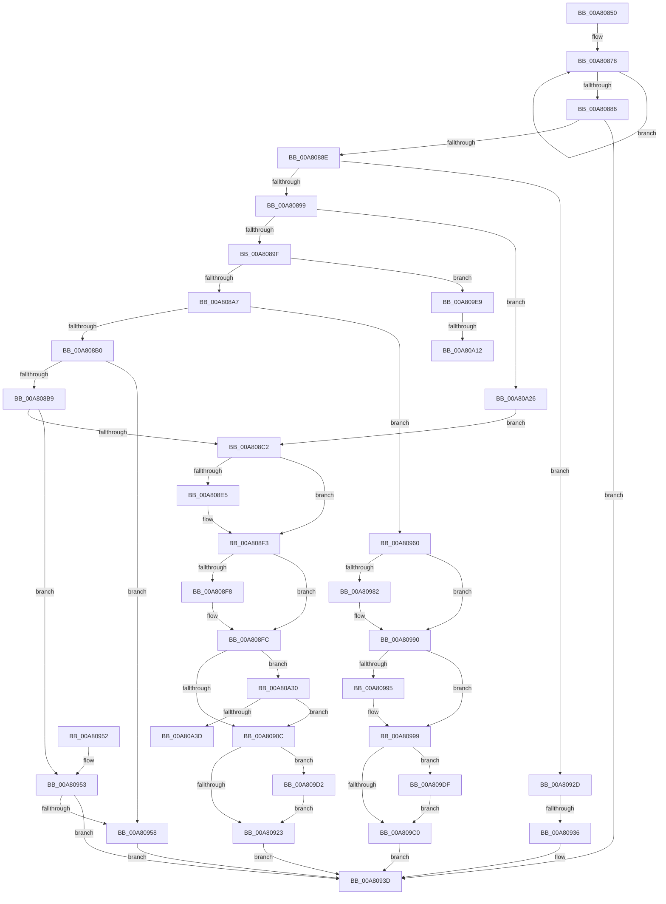

# PopDirectedDripsNotify

- RVA: `0x00A80850`–`0x00A80A4F` (길이 `511` bytes)
- VA: `0x0000000140A80850`
- 실행 섹션: `PAGE`
- PDB 이름 있음: `예`; PDB Function 태그: `예`
- unwind 정보 RVA: `0x000B70AC`
- 디코드: `125`개 명령, `511/511` bytes 표시
- 미해석 바이트: `0` (있으면 어셈블리에 `.byte`로 보존)

> 이 문서는 커널 이미지의 기계어와 PDB 기호를 분석해 생성했습니다. 4번과 5번은 함수 원형과 자료형을 바이너리 사용 방식에서 추정한 C 해석이며 원본 소스 복구 결과는 아닙니다.

## 1. Dependencies

- 직접 호출 지점: **12**; 고유 호출 대상: **6**
- 직접 호출자로 확인된 함수: **6**
- RIP 상대 이미지 참조: **9**

### Outgoing calls
- `0x00A808D5` → [KeAbPreAcquire](../../text/21/KeAbPreAcquire_function_00210230.md) (function, `0x00210230`)
- `0x00A808EE` → [ExfAcquirePushLockExclusiveEx](../../text/20/ExfAcquirePushLockExclusiveEx_function_0020FC90.md) (function, `0x0020FC90`)
- `0x00A80926` → [KeAbPostRelease](../../text/2E/KeAbPostRelease_function_002E1600.md) (function, `0x002E1600`)
- `0x00A80938` → [PopDirectedDripsEngage](../../text/49/PopDirectedDripsEngage_function_00498888.md) (function, `0x00498888`)
- `0x00A80972` → [KeAbPreAcquire](../../text/21/KeAbPreAcquire_function_00210230.md) (function, `0x00210230`)
- `0x00A8098B` → [ExfAcquirePushLockExclusiveEx](../../text/20/ExfAcquirePushLockExclusiveEx_function_0020FC90.md) (function, `0x0020FC90`)
- `0x00A809C3` → [KeAbPostRelease](../../text/2E/KeAbPostRelease_function_002E1600.md) (function, `0x002E1600`)
- `0x00A809C8` → [PopDirectedDripsSendSessionData](PopDirectedDripsSendSessionData_function_00A80A58.md) (function, `0x00A80A58`)
- `0x00A809D5` → [ExfTryToWakePushLock](../../text/26/ExfTryToWakePushLock_function_00265DD0.md) (function, `0x00265DD0`)
- `0x00A809E2` → [ExfTryToWakePushLock](../../text/26/ExfTryToWakePushLock_function_00265DD0.md) (function, `0x00265DD0`)
- `0x00A809FE` → [KeAbPreAcquire](../../text/21/KeAbPreAcquire_function_00210230.md) (function, `0x00210230`)
- `0x00A80A1B` → [ExfAcquirePushLockExclusiveEx](../../text/20/ExfAcquirePushLockExclusiveEx_function_0020FC90.md) (function, `0x0020FC90`)

### Direct callers
- [PopCaptureSleepStudyStatistics](../../text/43/PopCaptureSleepStudyStatistics_function_004399F4.md) at `0x00439EC9`
- [PopCaptureSleepStudyStatistics](../../text/43/PopCaptureSleepStudyStatistics_function_004399F4.md) at `0x00439F2C`
- [PopPowerAggregatorEngageModernStandby](../76/PopPowerAggregatorEngageModernStandby_function_00764784.md) at `0x0076488F`
- [PopDripsWatchdogCallbackHandler](../76/PopDripsWatchdogCallbackHandler_function_0076C1C0.md) at `0x0076C291`
- [PopDripsWatchdogCallbackHandler](../76/PopDripsWatchdogCallbackHandler_function_0076C1C0.md) at `0x0076C32A`
- [PopAcquireTransitionLock](../AA/PopAcquireTransitionLock_function_00AA9E7C.md) at `0x00AA9ECC`
- [PopReleaseTransitionLock](../AB/PopReleaseTransitionLock_function_00ABDABC.md) at `0x00ABDAF5`
- [PopDirectedDripsUmMarkTestDevices](../AC/PopDirectedDripsUmMarkTestDevices_function_00ACF828.md) at `0x00ACF87C`
- [PopDirectedDripsUmMarkTestDevices](../AC/PopDirectedDripsUmMarkTestDevices_function_00ACF828.md) at `0x00ACF923`

### Static image references
- `0x00A8086B` → RVA `0x00F0EAC0` (`.data`; read)
- `0x00A808C2` → RVA `0x00F0EB60` (`.data`; read)
- `0x00A808FF` → RVA `0x00F0ECE8` (`.data`; read)
- `0x00A80910` → RVA `0x00F0EB60` (`.data`; read/write)
- `0x00A80958` → RVA `0x00F0EAF4` (`.data`; read/write)
- `0x00A80999` → RVA `0x00F0EB50` (`.data`; read)
- `0x00A809A5` → RVA `0x00F0ECE8` (`.data`; read/write)
- `0x00A809F0` → RVA `0x00F0EB50` (`.data`; write)
- `0x00A80A30` → RVA `0x00F0ECF0` (`.data`; read)

## 2. Other-region calls and transfers

- 다른 실행 섹션으로 향하는 call: **11**
  - `0x00A808D5` → [KeAbPreAcquire](../../text/21/KeAbPreAcquire_function_00210230.md) (`PAGE` → `.text`)
  - `0x00A808EE` → [ExfAcquirePushLockExclusiveEx](../../text/20/ExfAcquirePushLockExclusiveEx_function_0020FC90.md) (`PAGE` → `.text`)
  - `0x00A80926` → [KeAbPostRelease](../../text/2E/KeAbPostRelease_function_002E1600.md) (`PAGE` → `.text`)
  - `0x00A80938` → [PopDirectedDripsEngage](../../text/49/PopDirectedDripsEngage_function_00498888.md) (`PAGE` → `.text`)
  - `0x00A80972` → [KeAbPreAcquire](../../text/21/KeAbPreAcquire_function_00210230.md) (`PAGE` → `.text`)
  - `0x00A8098B` → [ExfAcquirePushLockExclusiveEx](../../text/20/ExfAcquirePushLockExclusiveEx_function_0020FC90.md) (`PAGE` → `.text`)
  - `0x00A809C3` → [KeAbPostRelease](../../text/2E/KeAbPostRelease_function_002E1600.md) (`PAGE` → `.text`)
  - `0x00A809D5` → [ExfTryToWakePushLock](../../text/26/ExfTryToWakePushLock_function_00265DD0.md) (`PAGE` → `.text`)
  - `0x00A809E2` → [ExfTryToWakePushLock](../../text/26/ExfTryToWakePushLock_function_00265DD0.md) (`PAGE` → `.text`)
  - `0x00A809FE` → [KeAbPreAcquire](../../text/21/KeAbPreAcquire_function_00210230.md) (`PAGE` → `.text`)
  - `0x00A80A1B` → [ExfAcquirePushLockExclusiveEx](../../text/20/ExfAcquirePushLockExclusiveEx_function_0020FC90.md) (`PAGE` → `.text`)
- call이 아닌 외부 분기/꼬리 이동: **4**
  - `0x00A80930` → [sub_00B4309E + 0x88](../B4/Unknown_function_00B4309E.md) (`tail-transfer`)
  - `0x00A80A0C` → [sub_00B4309E](../B4/Unknown_function_00B4309E.md) (`tail-transfer`)
  - `0x00A80A21` → [sub_00B4309E](../B4/Unknown_function_00B4309E.md) (`tail-transfer`)
  - `0x00A80A4A` → [sub_00B4309E + 0x57](../B4/Unknown_function_00B4309E.md) (`tail-transfer`)

## 3. Assembly (complete function range)

```asm
00A80850  48 8B C4                        mov rax, rsp
00A80853  48 89 58 08                     mov qword ptr [rax + 8], rbx
00A80857  48 89 68 10                     mov qword ptr [rax + 0x10], rbp
00A8085B  48 89 70 20                     mov qword ptr [rax + 0x20], rsi
00A8085F  57                              push rdi
00A80860  48 83 EC 20                     sub rsp, 0x20
00A80864  83 60 18 00                     and dword ptr [rax + 0x18], 0
00A80868  48 8B F2                        mov rsi, rdx
00A8086B  0F 0D 0D 4E E2 48 00            prefetchw byte ptr [rip + 0x48e24e]
00A80872  8B 05 48 E2 48 00               mov eax, dword ptr [rip + 0x48e248]
00A80878  44 8B C0                        mov r8d, eax
00A8087B  F0 44 0F B1 05 3C E2 48 00      lock cmpxchg dword ptr [rip + 0x48e23c], r8d
00A80884  75 F2                           jne 0x140a80878
00A80886  A8 01                           test al, 1
00A80888  0F 84 AF 00 00 00               je 0x140a8093d
00A8088E  33 FF                           xor edi, edi
00A80890  83 F9 05                        cmp ecx, 5
00A80893  0F 8F 94 00 00 00               jg 0x140a8092d
00A80899  0F 84 87 01 00 00               je 0x140a80a26
00A8089F  85 C9                           test ecx, ecx
00A808A1  0F 84 42 01 00 00               je 0x140a809e9
00A808A7  83 E9 01                        sub ecx, 1
00A808AA  0F 84 B0 00 00 00               je 0x140a80960
00A808B0  83 E9 01                        sub ecx, 1
00A808B3  0F 84 9F 00 00 00               je 0x140a80958
00A808B9  83 E9 01                        sub ecx, 1
00A808BC  0F 85 91 00 00 00               jne 0x140a80953
00A808C2  48 8D 1D 97 E2 48 00            lea rbx, [rip + 0x48e297]
00A808C9  45 33 C0                        xor r8d, r8d
00A808CC  48 8B CB                        mov rcx, rbx
00A808CF  33 D2                           xor edx, edx
00A808D1  0F BA EF 0C                     bts edi, 0xc
00A808D5  E8 56 F9 78 FF                  call 0x140210230
00A808DA  F0 48 0F BA 2B 00               lock bts qword ptr [rbx], 0
00A808E0  48 8B E8                        mov rbp, rax
00A808E3  73 0E                           jae 0x140a808f3
00A808E5  4C 8B C3                        mov r8, rbx
00A808E8  48 8B D0                        mov rdx, rax
00A808EB  48 8B CB                        mov rcx, rbx
00A808EE  E8 9D F3 78 FF                  call 0x14020fc90
00A808F3  48 85 ED                        test rbp, rbp
00A808F6  74 04                           je 0x140a808fc
00A808F8  C6 45 0A 01                     mov byte ptr [rbp + 0xa], 1
00A808FC  48 8B 06                        mov rax, qword ptr [rsi]
00A808FF  48 39 05 E2 E3 48 00            cmp qword ptr [rip + 0x48e3e2], rax
00A80906  0F 84 24 01 00 00               je 0x140a80a30
00A8090C  48 83 C8 FF                     or rax, 0xffffffffffffffff
00A80910  F0 48 0F C1 05 47 E2 48 00      lock xadd qword ptr [rip + 0x48e247], rax
00A80919  24 06                           and al, 6
00A8091B  3C 02                           cmp al, 2
00A8091D  0F 84 AF 00 00 00               je 0x140a809d2
00A80923  48 8B CB                        mov rcx, rbx
00A80926  E8 D5 0C 86 FF                  call 0x1402e1600
00A8092B  EB 10                           jmp 0x140a8093d
00A8092D  83 E9 06                        sub ecx, 6
00A80930  0F 85 F0 27 0C 00               jne 0x140b43126
00A80936  8A 12                           mov dl, byte ptr [rdx]
00A80938  E8 4B 7F A1 FF                  call 0x140498888
00A8093D  48 8B 5C 24 30                  mov rbx, qword ptr [rsp + 0x30]
00A80942  48 8B 6C 24 38                  mov rbp, qword ptr [rsp + 0x38]
00A80947  48 8B 74 24 48                  mov rsi, qword ptr [rsp + 0x48]
00A8094C  48 83 C4 20                     add rsp, 0x20
00A80950  5F                              pop rdi
00A80951  C3                              ret
00A80952  CC                              int3
00A80953  83 F9 01                        cmp ecx, 1
00A80956  75 E5                           jne 0x140a8093d
00A80958  21 3D 96 E1 48 00               and dword ptr [rip + 0x48e196], edi
00A8095E  EB DD                           jmp 0x140a8093d
00A80960  48 8B 32                        mov rsi, qword ptr [rdx]
00A80963  48 8D 1D F6 E1 48 00            lea rbx, [rip + 0x48e1f6]
00A8096A  48 8B CB                        mov rcx, rbx
00A8096D  45 33 C0                        xor r8d, r8d
00A80970  33 D2                           xor edx, edx
00A80972  E8 B9 F8 78 FF                  call 0x140210230
00A80977  F0 48 0F BA 2B 00               lock bts qword ptr [rbx], 0
00A8097D  48 8B F8                        mov rdi, rax
00A80980  73 0E                           jae 0x140a80990
00A80982  4C 8B C3                        mov r8, rbx
00A80985  48 8B D0                        mov rdx, rax
00A80988  48 8B CB                        mov rcx, rbx
00A8098B  E8 00 F3 78 FF                  call 0x14020fc90
00A80990  48 85 FF                        test rdi, rdi
00A80993  74 04                           je 0x140a80999
00A80995  C6 47 0A 01                     mov byte ptr [rdi + 0xa], 1
00A80999  8B 05 B1 E1 48 00               mov eax, dword ptr [rip + 0x48e1b1]
00A8099F  89 86 DC 00 00 00               mov dword ptr [rsi + 0xdc], eax
00A809A5  48 83 25 3B E3 48 00 00         and qword ptr [rip + 0x48e33b], 0
00A809AD  48 83 C8 FF                     or rax, 0xffffffffffffffff
00A809B1  F0 48 0F C1 05 A6 E1 48 00      lock xadd qword ptr [rip + 0x48e1a6], rax
00A809BA  24 06                           and al, 6
00A809BC  3C 02                           cmp al, 2
00A809BE  74 1F                           je 0x140a809df
00A809C0  48 8B CB                        mov rcx, rbx
00A809C3  E8 38 0C 86 FF                  call 0x1402e1600
00A809C8  E8 8B 00 00 00                  call 0x140a80a58
00A809CD  E9 6B FF FF FF                  jmp 0x140a8093d
00A809D2  48 8B CB                        mov rcx, rbx
00A809D5  E8 F6 53 7E FF                  call 0x140265dd0
00A809DA  E9 44 FF FF FF                  jmp 0x140a80923
00A809DF  48 8B CB                        mov rcx, rbx
00A809E2  E8 E9 53 7E FF                  call 0x140265dd0
00A809E7  EB D7                           jmp 0x140a809c0
00A809E9  48 8D 1D 70 E1 48 00            lea rbx, [rip + 0x48e170]
00A809F0  89 3D 5A E1 48 00               mov dword ptr [rip + 0x48e15a], edi
00A809F6  48 8B CB                        mov rcx, rbx
00A809F9  45 33 C0                        xor r8d, r8d
00A809FC  33 D2                           xor edx, edx
00A809FE  E8 2D F8 78 FF                  call 0x140210230
00A80A03  F0 48 0F BA 2B 00               lock bts qword ptr [rbx], 0
00A80A09  48 8B F8                        mov rdi, rax
00A80A0C  0F 83 8C 26 0C 00               jae 0x140b4309e
00A80A12  4C 8B C3                        mov r8, rbx
00A80A15  48 8B D0                        mov rdx, rax
00A80A18  48 8B CB                        mov rcx, rbx
00A80A1B  E8 70 F2 78 FF                  call 0x14020fc90
00A80A20  90                              nop
00A80A21  E9 78 26 0C 00                  jmp 0x140b4309e
00A80A26  BF 00 20 00 00                  mov edi, 0x2000
00A80A2B  E9 92 FE FF FF                  jmp 0x140a808c2
00A80A30  83 3D B9 E2 48 00 00            cmp dword ptr [rip + 0x48e2b9], 0
00A80A37  0F 84 CF FE FF FF               je 0x140a8090c
00A80A3D  0F 0D 0D 7C E0 48 00            prefetchw byte ptr [rip + 0x48e07c]
00A80A44  8B 05 76 E0 48 00               mov eax, dword ptr [rip + 0x48e076]
00A80A4A  E9 A6 26 0C 00                  jmp 0x140b430f5
```

## 4. C-style interpretation (structured pseudocode)

```c
__int64 __fastcall PopDirectedDripsNotify(int a1, __int64 a2)
{
    __int64 result;
    __int64 v_rdi;
    __int64 v_rsp;
    unsigned __int64 v_stack_p10;
    unsigned __int64 v_stack_p20;
    unsigned __int64 v_stack_p8;

    *(unsigned __int64 *)(v_rsp + 8) = v_rbx;
    *(unsigned __int64 *)(v_rsp + 16) = v_rbp;
    *(unsigned __int64 *)(v_rsp + 32) = v_rsi;
    v_rsp = (v_rsp) - (32);
loc_00A80878:
    if (condition_is_not_equal) goto loc_00A80878;
    if ((((unsigned __int8)((unsigned int)(*(unsigned int *)(v_rip + 4776520)))) & (1)) == 0) goto loc_00A8093D;
    v_rdi = 0;
    if (a1 > 5) goto loc_00A8092D;
    if (a1 == 5) goto loc_00A80A26;
    if (a1 == 0) goto loc_00A809E9;
    a1 = (unsigned int)((a1) - (1));
    if (condition_is_equal) goto loc_00A80960;
    a1 = (unsigned int)((a1) - (1));
    if (condition_is_equal) goto loc_00A80958;
    a1 = (unsigned int)((a1) - (1));
    if (condition_is_not_equal) goto loc_00A80953;
loc_00A808C2:
    a3 = 0;
    a2 = 0;
    result = KeAbPreAcquire(v_rip + 4776599, a2, a3, a4);
    if (!(condition_is_above_or_equal)) {
        a3 = v_rip + 4776599;
        a2 = result;
        a1 = v_rip + 4776599;
        result = ExfAcquirePushLockExclusiveEx(a1, a2, a3, a4);
    }
    if (result != 0) {
        *(unsigned __int8 *)(result + 10) = 1;
    }
    if ((*(unsigned __int64 *)(v_rip + 4776930)) == (*(unsigned __int64 *)(a2))) goto loc_00A80A30;
loc_00A8090C:
    result = (*(unsigned __int64 *)(a2)) | (-1);
    result = (unsigned __int8)((result) & (6));
    if (((unsigned __int8)(result)) == 2) goto loc_00A809D2;
loc_00A80923:
    result = KeAbPostRelease(v_rip + 4776599, a2, a3, a4);
    goto loc_00A8093D;
loc_00A8092D:
    a1 = (unsigned int)((v_rip + 4776599) - (6));
    result = PopDirectedDripsEngage(a1, *(unsigned __int8 *)(a2), a3, a4);
loc_00A8093D:
    v_rsp = (v_rsp) + (32);
    return result;
loc_00A80953:
    if (a1 != 1) goto loc_00A8093D;
loc_00A80958:
    goto loc_00A8093D;
loc_00A80960:
    a3 = 0;
    a2 = 0;
    result = KeAbPreAcquire(v_rip + 4776438, a2, a3, a4);
    if (!(condition_is_above_or_equal)) {
        a3 = v_rip + 4776438;
        a2 = result;
        a1 = v_rip + 4776438;
        result = ExfAcquirePushLockExclusiveEx(a1, a2, a3, a4);
    }
    if (result != 0) {
        *(unsigned __int8 *)(result + 10) = 1;
    }
    *(unsigned int *)(*(unsigned __int64 *)(*(unsigned __int8 *)(a2)) + 220) = (unsigned int)((unsigned int)(*(unsigned int *)(v_rip + 4776369)));
    result = ((unsigned int)(*(unsigned int *)(v_rip + 4776369))) | (-1);
    result = (unsigned __int8)((result) & (6));
    if (((unsigned __int8)(result)) == 2) goto loc_00A809DF;
loc_00A809C0:
    result = KeAbPostRelease(v_rip + 4776438, a2, a3, a4);
    result = PopDirectedDripsSendSessionData(v_rip + 4776438, a2, a3, a4);
    goto loc_00A8093D;
loc_00A809D2:
    result = ExfTryToWakePushLock(v_rip + 4776438, a2, a3, a4);
    goto loc_00A80923;
loc_00A809DF:
    result = ExfTryToWakePushLock(v_rip + 4776438, a2, a3, a4);
    goto loc_00A809C0;
loc_00A809E9:
    *(unsigned int *)(v_rip + 4776282) = (unsigned int)(result);
    a3 = 0;
    a2 = 0;
    result = KeAbPreAcquire(v_rip + 4776304, a2, a3, a4);
    result = ExfAcquirePushLockExclusiveEx(v_rip + 4776304, result, v_rip + 4776304, a4);
loc_00A80A26:
    goto loc_00A808C2;
loc_00A80A30:
    if ((*(unsigned int *)(v_rip + 4776633)) == 0) goto loc_00A8090C;
}
```

## 5. (Beta) C Style

```c
int64_t PopDirectedDripsNotify(int32_t Arg1, void *Arg2)
{
    uint8_t *arg2 = (uint8_t *)Arg2;

    int64_t result;
    int64_t local_rdi;
    int64_t local_rsp;
    uint64_t v_stack_p10;
    uint64_t v_stack_p20;
    uint64_t v_stack_p8;

    *(uint64_t *)(local_rsp + 0x8) = local_rbx;
    *(uint64_t *)(local_rsp + 0x10) = local_rbp;
    *(uint64_t *)(local_rsp + 0x20) = local_rsi;
    local_rsp = (local_rsp) - (32);
loc_00A80878:
    if (condition_is_not_equal) goto loc_00A80878;
    if ((((uint8_t)((uint32_t)(*(uint32_t *)(v_rip + 0x48E248)))) & (1)) == 0) goto loc_00A8093D;
    local_rdi = 0;
    if (Arg1 > 5) goto loc_00A8092D;
    if (Arg1 == 5) goto loc_00A80A26;
    if (Arg1 == 0) goto loc_00A809E9;
    Arg1 = (uint32_t)((Arg1) - (1));
    if (condition_is_equal) goto loc_00A80960;
    Arg1 = (uint32_t)((Arg1) - (1));
    if (condition_is_equal) goto loc_00A80958;
    Arg1 = (uint32_t)((Arg1) - (1));
    if (condition_is_not_equal) goto loc_00A80953;
loc_00A808C2:
    a3 = 0;
    Arg2 = 0;
    result = KeAbPreAcquire(v_rip + 4776599, Arg2, a3, a4);
    if (!(condition_is_above_or_equal)) {
        a3 = v_rip + 4776599;
        Arg2 = result;
        Arg1 = v_rip + 4776599;
        result = ExfAcquirePushLockExclusiveEx(Arg1, Arg2, a3, a4);
    }
    if (result != 0) {
        *(uint8_t *)(result + 0xA) = 1;
    }
    if ((*(uint64_t *)(v_rip + 0x48E3E2)) == (*(uint64_t *)(arg2))) goto loc_00A80A30;
loc_00A8090C:
    result = (*(uint64_t *)(arg2)) | (-1);
    result = (uint8_t)((result) & (6));
    if (((uint8_t)(result)) == 2) goto loc_00A809D2;
loc_00A80923:
    result = KeAbPostRelease(v_rip + 4776599, Arg2, a3, a4);
    goto loc_00A8093D;
loc_00A8092D:
    Arg1 = (uint32_t)((v_rip + 4776599) - (6));
    result = PopDirectedDripsEngage(Arg1, *(uint8_t *)(arg2), a3, a4);
loc_00A8093D:
    local_rsp = (local_rsp) + (32);
    return result;
loc_00A80953:
    if (Arg1 != 1) goto loc_00A8093D;
loc_00A80958:
    goto loc_00A8093D;
loc_00A80960:
    a3 = 0;
    Arg2 = 0;
    result = KeAbPreAcquire(v_rip + 4776438, Arg2, a3, a4);
    if (!(condition_is_above_or_equal)) {
        a3 = v_rip + 4776438;
        Arg2 = result;
        Arg1 = v_rip + 4776438;
        result = ExfAcquirePushLockExclusiveEx(Arg1, Arg2, a3, a4);
    }
    if (result != 0) {
        *(uint8_t *)(result + 0xA) = 1;
    }
    *(uint32_t *)(*(uint64_t *)(*(uint8_t *)(arg2)) + 0xDC) = (uint32_t)((uint32_t)(*(uint32_t *)(v_rip + 0x48E1B1)));
    result = ((uint32_t)(*(uint32_t *)(v_rip + 0x48E1B1))) | (-1);
    result = (uint8_t)((result) & (6));
    if (((uint8_t)(result)) == 2) goto loc_00A809DF;
loc_00A809C0:
    result = KeAbPostRelease(v_rip + 4776438, Arg2, a3, a4);
    result = PopDirectedDripsSendSessionData(v_rip + 4776438, Arg2, a3, a4);
    goto loc_00A8093D;
loc_00A809D2:
    result = ExfTryToWakePushLock(v_rip + 4776438, Arg2, a3, a4);
    goto loc_00A80923;
loc_00A809DF:
    result = ExfTryToWakePushLock(v_rip + 4776438, Arg2, a3, a4);
    goto loc_00A809C0;
loc_00A809E9:
    *(uint32_t *)(v_rip + 0x48E15A) = (uint32_t)(result);
    a3 = 0;
    Arg2 = 0;
    result = KeAbPreAcquire(v_rip + 4776304, Arg2, a3, a4);
    result = ExfAcquirePushLockExclusiveEx(v_rip + 4776304, result, v_rip + 4776304, a4);
loc_00A80A26:
    goto loc_00A808C2;
loc_00A80A30:
    if ((*(uint32_t *)(v_rip + 0x48E2B9)) == 0) goto loc_00A8090C;
}
```

### 관측된 메모리 오프셋

구조체 형식이 확인되지 않은 접근은 인자 기준의 오프셋으로만 기록했습니다.

| 기준 인자 | 오프셋 표현 | 폭 (bit) | 접근 |
|---|---:|---:|---|
| `Arg2` | `+ 0x0` | `8` | `R` |
| `Arg2` | `+ 0x0` | `64` | `R` |

## 6. Execution-region graph

[열기: 2D/3D 그래프와 함수 탐색 컨트롤 패널](../../../control-panel.html?section=page&rva=0x00A80850&view=graph)

- 2D 그래프는 위에서 아래로 흐르고, 3D 그래프는 빈 공간을 드래그해 회전합니다. Shift+드래그는 이동, 휠은 확대·축소, 함수 노드 선택은 대상 보고서 이동입니다.

### Static fallback


